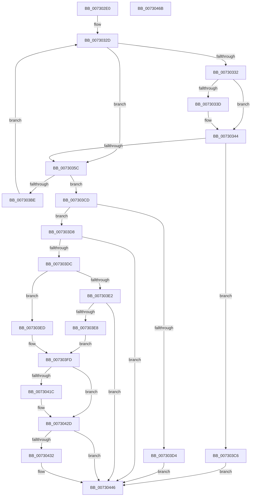

# PiDmListInitEnumCallback

- RVA: `0x007302E0`–`0x0073046C` (길이 `396` bytes)
- VA: `0x00000001407302E0`
- 실행 섹션: `PAGE`
- PDB 이름 있음: `예`; PDB Function 태그: `아니요`
- unwind 정보 RVA: `0x000C8914`
- 디코드: `112`개 명령, `396/396` bytes 표시
- 미해석 바이트: `0` (있으면 어셈블리에 `.byte`로 보존)

> 이 문서는 커널 이미지의 기계어와 PDB 기호를 분석해 생성했습니다. 4번과 5번은 함수 원형과 자료형을 바이너리 사용 방식에서 추정한 C 해석이며 원본 소스 복구 결과는 아닙니다.

## 1. Dependencies

- 직접 호출 지점: **9**; 고유 호출 대상: **9**
- 직접 호출자로 확인된 함수: **0**
- RIP 상대 이미지 참조: **3**

### Outgoing calls
- `0x0073033F` → [ExFreePoolWithTag](../../poolcode/B8/ExFreePoolWithTag_function_00B82870.md) (function, `0x00B82870`)
- `0x0073034F` → [ExAllocatePool2](../../poolcode/B8/ExAllocatePool2_function_00B820F0.md) (function, `0x00B820F0`)
- `0x007303B0` → [PnpGetObjectProperty](../8E/PnpGetObjectProperty_function_008E2180.md) (function, `0x008E2180`)
- `0x007303F4` → [PnpStringFromGuid](../8F/PnpStringFromGuid_function_008F5A2C.md) (function, `0x008F5A2C`)
- `0x0073040D` → [PiDmAddCacheReferenceForObject](../95/PiDmAddCacheReferenceForObject_function_00950FB4.md) (function, `0x00950FB4`)
- `0x00730428` → [PiDmListAddObject](../95/PiDmListAddObject_function_00950128.md) (function, `0x00950128`)
- `0x00730439` → [PiDmRemoveCacheReferenceForObject](../95/PiDmRemoveCacheReferenceForObject_function_00950F24.md) (function, `0x00950F24`)
- `0x00730441` → [PiDmObjectRelease](../8E/PiDmObjectRelease_function_008E4F70.md) (function, `0x008E4F70`)
- `0x0073044F` → [_security_check_cookie](../../text/6A/_security_check_cookie_function_006AC640.md) (function, `0x006AC640`)

### Direct callers
- 이 함수 시작 RVA로 연결되는 직접 call은 확인되지 않았습니다. 간접 호출은 완전히 역산할 수 없습니다.

### Static image references
- `0x007302F8` → RVA `0x00E0A740` (`.data`; read)
- `0x0073030A` → RVA `0x000018A0` (`.rdata`; read)
- `0x0073039E` → RVA `0x00E66398` (`.data`; read)

## 2. Other-region calls and transfers

- 다른 실행 섹션으로 향하는 call: **3**
  - `0x0073033F` → [ExFreePoolWithTag](../../poolcode/B8/ExFreePoolWithTag_function_00B82870.md) (`PAGE` → `POOLCODE`)
  - `0x0073034F` → [ExAllocatePool2](../../poolcode/B8/ExAllocatePool2_function_00B820F0.md) (`PAGE` → `POOLCODE`)
  - `0x0073044F` → [_security_check_cookie](../../text/6A/_security_check_cookie_function_006AC640.md) (`PAGE` → `.text`)
- 별도 외부 분기/꼬리 이동을 확인하지 못했습니다.

## 3. Assembly (complete function range)

```asm
007302E0  48 89 5C 24 20                  mov qword ptr [rsp + 0x20], rbx
007302E5  55                              push rbp
007302E6  56                              push rsi
007302E7  57                              push rdi
007302E8  41 54                           push r12
007302EA  41 56                           push r14
007302EC  48 8D 6C 24 C9                  lea rbp, [rsp - 0x37]
007302F1  48 81 EC D0 00 00 00            sub rsp, 0xd0
007302F8  48 8B 05 41 A4 6D 00            mov rax, qword ptr [rip + 0x6da441]
007302FF  48 33 C4                        xor rax, rsp
00730302  48 89 45 27                     mov qword ptr [rbp + 0x27], rax
00730306  83 65 CB 00                     and dword ptr [rbp - 0x35], 0
0073030A  4C 8D 25 8F 15 8D FF            lea r12, [rip - 0x72ea71]
00730311  48 83 65 CF 00                  and qword ptr [rbp - 0x31], 0
00730316  B8 00 04 00 00                  mov eax, 0x400
0073031B  89 45 C7                        mov dword ptr [rbp - 0x39], eax
0073031E  48 8B FA                        mov rdi, rdx
00730321  4C 8B F1                        mov r14, rcx
00730324  41 C6 00 00                     mov byte ptr [r8], 0
00730328  BE 50 6E 70 5A                  mov esi, 0x5a706e50
0073032D  3B 47 08                        cmp eax, dword ptr [rdi + 8]
00730330  76 2A                           jbe 0x14073035c
00730332  48 8B 0F                        mov rcx, qword ptr [rdi]
00730335  89 47 08                        mov dword ptr [rdi + 8], eax
00730338  48 85 C9                        test rcx, rcx
0073033B  74 07                           je 0x140730344
0073033D  8B D6                           mov edx, esi
0073033F  E8 2C 25 45 00                  call 0x140b82870
00730344  8B 57 08                        mov edx, dword ptr [rdi + 8]
00730347  44 8B C6                        mov r8d, esi
0073034A  B9 00 01 00 00                  mov ecx, 0x100
0073034F  E8 9C 1D 45 00                  call 0x140b820f0
00730354  48 89 07                        mov qword ptr [rdi], rax
00730357  48 85 C0                        test rax, rax
0073035A  74 6A                           je 0x1407303c6
0073035C  83 64 24 50 00                  and dword ptr [rsp + 0x50], 0
00730361  45 33 C9                        xor r9d, r9d
00730364  48 63 47 0C                     movsxd rax, dword ptr [rdi + 0xc]
00730368  45 8B 46 1C                     mov r8d, dword ptr [r14 + 0x1c]
0073036C  49 8B 56 10                     mov rdx, qword ptr [r14 + 0x10]
00730370  83 65 C7 00                     and dword ptr [rbp - 0x39], 0
00730374  48 8D 0C 80                     lea rcx, [rax + rax*4]
00730378  48 8D 45 C7                     lea rax, [rbp - 0x39]
0073037C  48 89 44 24 48                  mov qword ptr [rsp + 0x48], rax
00730381  8B 47 08                        mov eax, dword ptr [rdi + 8]
00730384  89 44 24 40                     mov dword ptr [rsp + 0x40], eax
00730388  48 8B 07                        mov rax, qword ptr [rdi]
0073038B  48 89 44 24 38                  mov qword ptr [rsp + 0x38], rax
00730390  48 8D 45 CB                     lea rax, [rbp - 0x35]
00730394  48 89 44 24 30                  mov qword ptr [rsp + 0x30], rax
00730399  49 8B 44 CC 20                  mov rax, qword ptr [r12 + rcx*8 + 0x20]
0073039E  48 8B 0D F3 5F 73 00            mov rcx, qword ptr [rip + 0x735ff3]
007303A5  48 89 44 24 28                  mov qword ptr [rsp + 0x28], rax
007303AA  48 83 64 24 20 00               and qword ptr [rsp + 0x20], 0
007303B0  E8 CB 1D 1B 00                  call 0x1408e2180
007303B5  8B D8                           mov ebx, eax
007303B7  3D 23 00 00 C0                  cmp eax, 0xc0000023
007303BC  75 0F                           jne 0x1407303cd
007303BE  8B 45 C7                        mov eax, dword ptr [rbp - 0x39]
007303C1  E9 67 FF FF FF                  jmp 0x14073032d
007303C6  BB 9A 00 00 C0                  mov ebx, 0xc000009a
007303CB  EB 79                           jmp 0x140730446
007303CD  3D 25 02 00 C0                  cmp eax, 0xc0000225
007303D2  75 04                           jne 0x1407303d8
007303D4  33 DB                           xor ebx, ebx
007303D6  EB 6E                           jmp 0x140730446
007303D8  85 C0                           test eax, eax
007303DA  78 6A                           js 0x140730446
007303DC  83 7D CB 0D                     cmp dword ptr [rbp - 0x35], 0xd
007303E0  74 0B                           je 0x1407303ed
007303E2  83 7D CB 12                     cmp dword ptr [rbp - 0x35], 0x12
007303E6  75 5E                           jne 0x140730446
007303E8  48 8B 17                        mov rdx, qword ptr [rdi]
007303EB  EB 10                           jmp 0x1407303fd
007303ED  48 8B 0F                        mov rcx, qword ptr [rdi]
007303F0  48 8D 55 D7                     lea rdx, [rbp - 0x29]
007303F4  E8 33 56 1C 00                  call 0x1408f5a2c
007303F9  48 8D 55 D7                     lea rdx, [rbp - 0x29]
007303FD  48 63 47 0C                     movsxd rax, dword ptr [rdi + 0xc]
00730401  4C 8D 45 CF                     lea r8, [rbp - 0x31]
00730405  48 8D 0C 80                     lea rcx, [rax + rax*4]
00730409  41 8B 0C CC                     mov ecx, dword ptr [r12 + rcx*8]
0073040D  E8 A2 0B 22 00                  call 0x140950fb4
00730412  48 8B 75 CF                     mov rsi, qword ptr [rbp - 0x31]
00730416  8B D8                           mov ebx, eax
00730418  85 C0                           test eax, eax
0073041A  78 11                           js 0x14073042d
0073041C  8B 4F 0C                        mov ecx, dword ptr [rdi + 0xc]
0073041F  45 33 C9                        xor r9d, r9d
00730422  4D 8B C6                        mov r8, r14
00730425  48 8B D6                        mov rdx, rsi
00730428  E8 FB FC 21 00                  call 0x140950128
0073042D  48 85 F6                        test rsi, rsi
00730430  74 14                           je 0x140730446
00730432  48 8B 56 10                     mov rdx, qword ptr [rsi + 0x10]
00730436  8B 4E 1C                        mov ecx, dword ptr [rsi + 0x1c]
00730439  E8 E6 0A 22 00                  call 0x140950f24
0073043E  48 8B CE                        mov rcx, rsi
00730441  E8 2A 4B 1B 00                  call 0x1408e4f70
00730446  8B C3                           mov eax, ebx
00730448  48 8B 4D 27                     mov rcx, qword ptr [rbp + 0x27]
0073044C  48 33 CC                        xor rcx, rsp
0073044F  E8 EC C1 F7 FF                  call 0x1406ac640
00730454  48 8B 9C 24 18 01 00 00         mov rbx, qword ptr [rsp + 0x118]
0073045C  48 81 C4 D0 00 00 00            add rsp, 0xd0
00730463  41 5E                           pop r14
00730465  41 5C                           pop r12
00730467  5F                              pop rdi
00730468  5E                              pop rsi
00730469  5D                              pop rbp
0073046A  C3                              ret
0073046B  CC                              int3
```

## 4. C-style interpretation (structured pseudocode)

```c
__int64 __fastcall PiDmListInitEnumCallback(__int64 a1, __int64 a2, __int64 a3, int a4)
{
    __int64 result;
    __int64 v_rbx;
    __int64 v_rsp;
    unsigned __int64 v_stack_m38;
    unsigned __int64 v_stack_m5F;
    unsigned __int64 v_stack_m88;
    unsigned __int64 v_stack_m90;
    unsigned int v_stack_m94;
    unsigned int v_stack_m98;
    unsigned int v_stack_mA8;
    unsigned __int64 v_stack_mB0;
    unsigned int v_stack_mB8;
    unsigned __int64 v_stack_mC0;
    unsigned __int64 v_stack_mC8;
    unsigned __int64 v_stack_mD0;
    unsigned __int64 v_stack_mD8;
    unsigned __int64 v_stack_p20;

    v_stack_p20 = v_rbx;
    v_rsp = (v_rsp) - (208);
    result = (*(unsigned __int64 *)(v_rip + 7185473)) ^ (v_rsp);
    v_stack_m38 = result;
    v_stack_m98 = (unsigned int)((unsigned int)(0x400ULL));
    *(unsigned __int8 *)(a3) = 0;
loc_0073032D:
    if (((unsigned int)((unsigned int)(0x400ULL))) <= (*(unsigned int *)(a2 + 8))) goto loc_0073035C;
    *(unsigned int *)(a2 + 8) = (unsigned int)((unsigned int)(0x400ULL));
    result = (unsigned int)(0x400ULL);
    if (*(unsigned __int64 *)(a2) != 0) {
        a2 = (unsigned int)((unsigned int)(0x5A706E50ULL));
        result = ExFreePoolWithTag(*(unsigned __int64 *)(a2), a2, a3, a4);
    }
    result = ExAllocatePool2(256, (unsigned int)(*(unsigned int *)(a2 + 8)), (unsigned int)((unsigned int)((unsigned int)(0x5A706E50ULL))), a4);
    *(unsigned __int64 *)(a2) = result;
    if (result == 0) goto loc_007303C6;
loc_0073035C:
    a4 = 0;
    v_stack_mB0 = v_stack_m98;
    v_stack_mB8 = (unsigned int)((unsigned int)(*(unsigned int *)(a2 + 8)));
    v_stack_mC0 = *(unsigned __int64 *)(a2);
    v_stack_mC8 = v_stack_m94;
    v_stack_mD0 = *(unsigned __int64 *)(v_rip - 7531121 + (int)(*(unsigned int *)(a2 + 12)) + (int)(*(unsigned int *)(a2 + 12)) * 4 * 8 + 32);
    result = PnpGetObjectProperty(*(unsigned __int64 *)(v_rip + 7561203), *(unsigned __int64 *)(a1 + 16), (unsigned int)(*(unsigned int *)(a1 + 28)), a4);
    if (((unsigned int)(result)) != 0xC0000023ULL) goto loc_007303CD;
    goto loc_0073032D;
loc_007303C6:
    goto loc_00730446;
loc_007303CD:
    if (((unsigned int)((unsigned int)(v_stack_m98))) != 0xC0000225ULL) goto loc_007303D8;
    v_rbx = 0;
    goto loc_00730446;
loc_007303D8:
    if (sign_flag) goto loc_00730446;
    if (v_stack_m94 == 13) goto loc_007303ED;
    if (v_stack_m94 != 18) goto loc_00730446;
    goto loc_007303FD;
loc_007303ED:
    result = PnpStringFromGuid(*(unsigned __int64 *)(a2), v_stack_m88, (unsigned int)(*(unsigned int *)(a1 + 28)), a4);
loc_007303FD:
    result = PiDmAddCacheReferenceForObject((unsigned int)(*(unsigned int *)(v_rip - 7531121 + (int)(*(unsigned int *)(a2 + 12)) + (int)(*(unsigned int *)(a2 + 12)) * 4 * 8)), v_stack_m88, v_stack_m90, a4);
    if (!(sign_flag)) {
        a1 = *(unsigned int *)(a2 + 12);
        a4 = 0;
        a3 = a1;
        a2 = v_stack_m90;
        result = PiDmListAddObject(a1, a2, a3, a4);
    }
    if (v_stack_m90 != 0) {
        a2 = *(unsigned __int64 *)(v_stack_m90 + 16);
        a1 = *(unsigned int *)(v_stack_m90 + 28);
        result = PiDmRemoveCacheReferenceForObject(a1, a2, a3, a4);
        a1 = v_stack_m90;
        result = PiDmObjectRelease(a1, a2, a3, a4);
    }
    a1 = (v_stack_m38) ^ (v_rsp);
    result = _security_check_cookie(a1, a2, a3, a4);
    v_rsp = (v_rsp) + (208);
    return result;
}
```

## 5. (Beta) C Style

```c
int64_t PiDmListInitEnumCallback(void *Arg1, void *Arg2, void *Arg3, int32_t Arg4)
{
    uint8_t *arg1 = (uint8_t *)Arg1;
    uint8_t *arg2 = (uint8_t *)Arg2;
    uint8_t *arg3 = (uint8_t *)Arg3;

    int64_t result;
    int64_t local_rbx;
    int64_t local_rsp;
    uint64_t v_stack_m38;
    uint64_t v_stack_m5F;
    uint64_t v_stack_m88;
    uint64_t v_stack_m90;
    uint32_t v_stack_m94;
    uint32_t v_stack_m98;
    uint32_t v_stack_mA8;
    uint64_t v_stack_mB0;
    uint32_t v_stack_mB8;
    uint64_t v_stack_mC0;
    uint64_t v_stack_mC8;
    uint64_t v_stack_mD0;
    uint64_t v_stack_mD8;
    uint64_t v_stack_p20;

    v_stack_p20 = local_rbx;
    local_rsp = (local_rsp) - (208);
    result = (*(uint64_t *)(v_rip + 0x6DA441)) ^ (local_rsp);
    v_stack_m38 = result;
    v_stack_m98 = (uint32_t)((uint32_t)(0x400ULL));
    *(uint8_t *)(arg3) = 0;
loc_0073032D:
    if (((uint32_t)((uint32_t)(0x400ULL))) <= (*(uint32_t *)(arg2 + 0x8))) goto loc_0073035C;
    *(uint32_t *)(arg2 + 0x8) = (uint32_t)((uint32_t)(0x400ULL));
    result = (uint32_t)(0x400ULL);
    if (*(uint64_t *)(arg2) != 0) {
        Arg2 = (uint32_t)((uint32_t)(0x5A706E50ULL));
        result = ExFreePoolWithTag(*(uint64_t *)(arg2), Arg2, Arg3, Arg4);
    }
    result = ExAllocatePool2(256, (uint32_t)(*(uint32_t *)(arg2 + 0x8)), (uint32_t)((uint32_t)((uint32_t)(0x5A706E50ULL))), Arg4);
    *(uint64_t *)(arg2) = result;
    if (result == 0) goto loc_007303C6;
loc_0073035C:
    Arg4 = 0;
    v_stack_mB0 = v_stack_m98;
    v_stack_mB8 = (uint32_t)((uint32_t)(*(uint32_t *)(arg2 + 0x8)));
    v_stack_mC0 = *(uint64_t *)(arg2);
    v_stack_mC8 = v_stack_m94;
    v_stack_mD0 = *(uint64_t *)(v_rip - 0x72EA71 + (int32_t)(*(uint32_t *)(arg2 + 0xC)) + (int32_t)(*(uint32_t *)(arg2 + 0xC)) * 4 * 8 + 0x20);
    result = PnpGetObjectProperty(*(uint64_t *)(v_rip + 0x735FF3), *(uint64_t *)(arg1 + 0x10), (uint32_t)(*(uint32_t *)(arg1 + 0x1C)), Arg4);
    if (((uint32_t)(result)) != 0xC0000023ULL) goto loc_007303CD;
    goto loc_0073032D;
loc_007303C6:
    goto loc_00730446;
loc_007303CD:
    if (((uint32_t)((uint32_t)(v_stack_m98))) != 0xC0000225ULL) goto loc_007303D8;
    local_rbx = 0;
    goto loc_00730446;
loc_007303D8:
    if (sign_flag) goto loc_00730446;
    if (v_stack_m94 == 13) goto loc_007303ED;
    if (v_stack_m94 != 18) goto loc_00730446;
    goto loc_007303FD;
loc_007303ED:
    result = PnpStringFromGuid(*(uint64_t *)(arg2), v_stack_m88, (uint32_t)(*(uint32_t *)(arg1 + 0x1C)), Arg4);
loc_007303FD:
    result = PiDmAddCacheReferenceForObject((uint32_t)(*(uint32_t *)(v_rip - 0x72EA71 + (int32_t)(*(uint32_t *)(arg2 + 0xC)) + (int32_t)(*(uint32_t *)(arg2 + 0xC)) * 4 * 8)), v_stack_m88, v_stack_m90, Arg4);
    if (!(sign_flag)) {
        Arg1 = *(uint32_t *)(arg2 + 0xC);
        Arg4 = 0;
        Arg3 = Arg1;
        Arg2 = v_stack_m90;
        result = PiDmListAddObject(Arg1, Arg2, Arg3, Arg4);
    }
    if (v_stack_m90 != 0) {
        Arg2 = *(uint64_t *)(v_stack_m90 + 0x10);
        Arg1 = *(uint32_t *)(v_stack_m90 + 0x1C);
        result = PiDmRemoveCacheReferenceForObject(Arg1, Arg2, Arg3, Arg4);
        Arg1 = v_stack_m90;
        result = PiDmObjectRelease(Arg1, Arg2, Arg3, Arg4);
    }
    Arg1 = (v_stack_m38) ^ (local_rsp);
    result = _security_check_cookie(Arg1, Arg2, Arg3, Arg4);
    local_rsp = (local_rsp) + (208);
    return result;
}
```

### 관측된 메모리 오프셋

구조체 형식이 확인되지 않은 접근은 인자 기준의 오프셋으로만 기록했습니다.

| 기준 인자 | 오프셋 표현 | 폭 (bit) | 접근 |
|---|---:|---:|---|
| `Arg1` | `+ 0x10` | `64` | `R` |
| `Arg1` | `+ 0x1C` | `32` | `R` |
| `Arg2` | `+ 0x0` | `64` | `R` |
| `Arg2` | `+ 0x0` | `64` | `W` |
| `Arg2` | `+ 0x8` | `32` | `R` |
| `Arg2` | `+ 0x8` | `32` | `W` |
| `Arg2` | `+ 0xC` | `32` | `R` |
| `Arg3` | `+ 0x0` | `8` | `W` |

## 6. Execution-region graph

[열기: 2D/3D 그래프와 함수 탐색 컨트롤 패널](../../../control-panel.html?section=page&rva=0x007302E0&view=graph)

- 2D 그래프는 위에서 아래로 흐르고, 3D 그래프는 빈 공간을 드래그해 회전합니다. Shift+드래그는 이동, 휠은 확대·축소, 함수 노드 선택은 대상 보고서 이동입니다.

### Static fallback


