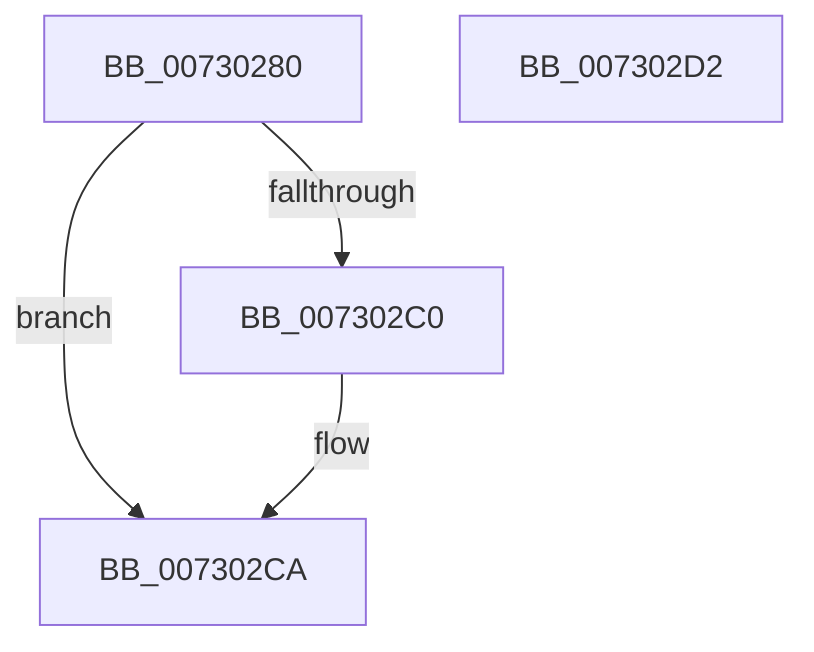

# PiDmListInit

- RVA: `0x00730280`–`0x007302D3` (길이 `83` bytes)
- VA: `0x0000000140730280`
- 실행 섹션: `PAGE`
- PDB 이름 있음: `예`; PDB Function 태그: `아니요`
- unwind 정보 RVA: `0x00064C80`
- 디코드: `23`개 명령, `83/83` bytes 표시
- 미해석 바이트: `0` (있으면 어셈블리에 `.byte`로 보존)

> 이 문서는 커널 이미지의 기계어와 PDB 기호를 분석해 생성했습니다. 4번과 5번은 함수 원형과 자료형을 바이너리 사용 방식에서 추정한 C 해석이며 원본 소스 복구 결과는 아닙니다.

## 1. Dependencies

- 직접 호출 지점: **2**; 고유 호출 대상: **2**
- 직접 호출자로 확인된 함수: **1**
- RIP 상대 이미지 참조: **2**

### Outgoing calls
- `0x007302AF` → [PiDmEnumObjectsWithCallback](../8E/PiDmEnumObjectsWithCallback_function_008E3920.md) (function, `0x008E3920`)
- `0x007302C5` → [ExFreePoolWithTag](../../poolcode/B8/ExFreePoolWithTag_function_00B82870.md) (function, `0x00B82870`)

### Direct callers
- [PiDmInit](../../init/C3/PiDmInit_function_00C343EC.md) at `0x00C344BC`

### Static image references
- `0x00730291` → RVA `0x007302E0` (`PiDmListInitEnumCallback`; read)
- `0x007302A5` → RVA `0x000018B0` (`.rdata`; read)

## 2. Other-region calls and transfers

- 다른 실행 섹션으로 향하는 call: **1**
  - `0x007302C5` → [ExFreePoolWithTag](../../poolcode/B8/ExFreePoolWithTag_function_00B82870.md) (`PAGE` → `POOLCODE`)
- 별도 외부 분기/꼬리 이동을 확인하지 못했습니다.

## 3. Assembly (complete function range)

```asm
00730280  40 53                           push rbx
00730282  48 83 EC 30                     sub rsp, 0x30
00730286  48 63 C1                        movsxd rax, ecx
00730289  4C 8D 44 24 20                  lea r8, [rsp + 0x20]
0073028E  0F 57 C0                        xorps xmm0, xmm0
00730291  48 8D 15 48 00 00 00            lea rdx, [rip + 0x48]
00730298  0F 11 44 24 20                  movups xmmword ptr [rsp + 0x20], xmm0
0073029D  89 4C 24 2C                     mov dword ptr [rsp + 0x2c], ecx
007302A1  48 8D 0C 80                     lea rcx, [rax + rax*4]
007302A5  48 8D 05 04 16 8D FF            lea rax, [rip - 0x72e9fc]
007302AC  8B 0C C8                        mov ecx, dword ptr [rax + rcx*8]
007302AF  E8 6C 36 1B 00                  call 0x1408e3920
007302B4  48 8B 4C 24 20                  mov rcx, qword ptr [rsp + 0x20]
007302B9  8B D8                           mov ebx, eax
007302BB  48 85 C9                        test rcx, rcx
007302BE  74 0A                           je 0x1407302ca
007302C0  BA 50 6E 70 5A                  mov edx, 0x5a706e50
007302C5  E8 A6 25 45 00                  call 0x140b82870
007302CA  8B C3                           mov eax, ebx
007302CC  48 83 C4 30                     add rsp, 0x30
007302D0  5B                              pop rbx
007302D1  C3                              ret
007302D2  CC                              int3
```

## 4. C-style interpretation (structured pseudocode)

```c
__int64 __fastcall PiDmListInit(int a1)
{
    __int64 result;
    __int64 v_rsp;
    unsigned __int64 v_stack_m18;
    unsigned int v_stack_mC;

    v_rsp = (v_rsp) - (48);
    v_stack_m18 = v_xmm0;
    v_stack_mC = a1;
    result = PiDmEnumObjectsWithCallback((unsigned int)(*(unsigned int *)(v_rip - 7531004 + (int)(a1) + (int)(a1) * 4 * 8)), v_rip + 72, v_stack_m18, a4);
    if (v_stack_m18 != 0) {
        a2 = 0x5A706E50ULL;
        result = ExFreePoolWithTag(v_stack_m18, a2, v_stack_m18, a4);
    }
    v_rsp = (v_rsp) + (48);
    return (unsigned int)((unsigned int)((unsigned int)((unsigned int)(result))));
}
```

## 5. (Beta) C Style

```c
int64_t PiDmListInit(void *Arg1)
{
    uint8_t *arg1 = (uint8_t *)Arg1;

    int64_t result;
    int64_t local_rsp;
    uint64_t v_stack_m18;
    uint32_t v_stack_mC;

    local_rsp = (local_rsp) - (48);
    v_stack_m18 = v_xmm0;
    v_stack_mC = Arg1;
    result = PiDmEnumObjectsWithCallback((uint32_t)(*(uint32_t *)(v_rip - 0x72E9FC + (int32_t)(arg1) + (int32_t)(arg1) * 4 * 8)), v_rip + 72, v_stack_m18, a4);
    if (v_stack_m18 != 0) {
        a2 = 0x5A706E50ULL;
        result = ExFreePoolWithTag(v_stack_m18, a2, v_stack_m18, a4);
    }
    local_rsp = (local_rsp) + (48);
    return (uint32_t)((uint32_t)((uint32_t)((uint32_t)(result))));
}
```

### 관측된 메모리 오프셋

구조체 형식이 확인되지 않은 접근은 인자 기준의 오프셋으로만 기록했습니다.

| 기준 인자 | 오프셋 표현 | 폭 (bit) | 접근 |
|---|---:|---:|---|
| `Arg1` | `+ 0x0 + rax*4` | `64` | `R` |

## 6. Execution-region graph

[열기: 2D/3D 그래프와 함수 탐색 컨트롤 패널](../../../control-panel.html?section=page&rva=0x00730280&view=graph)

- 2D 그래프는 위에서 아래로 흐르고, 3D 그래프는 빈 공간을 드래그해 회전합니다. Shift+드래그는 이동, 휠은 확대·축소, 함수 노드 선택은 대상 보고서 이동입니다.

### Static fallback


