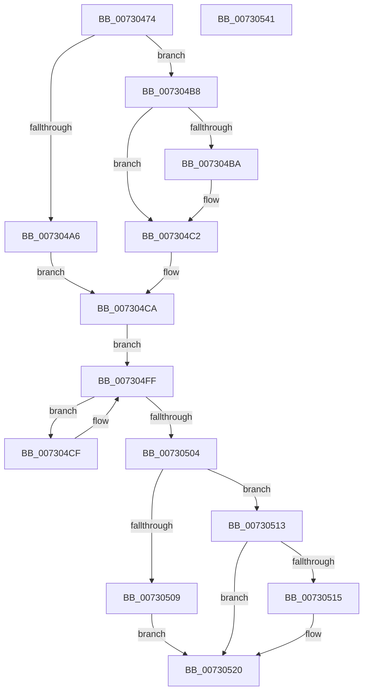

# PiDmListRemoveList

- RVA: `0x00730474`–`0x00730542` (길이 `206` bytes)
- VA: `0x0000000140730474`
- 실행 섹션: `PAGE`
- PDB 이름 있음: `예`; PDB Function 태그: `아니요`
- unwind 정보 RVA: `0x00084C9C`
- 디코드: `61`개 명령, `206/206` bytes 표시
- 미해석 바이트: `0` (있으면 어셈블리에 `.byte`로 보존)

> 이 문서는 커널 이미지의 기계어와 PDB 기호를 분석해 생성했습니다. 4번과 5번은 함수 원형과 자료형을 바이너리 사용 방식에서 추정한 C 해석이며 원본 소스 복구 결과는 아닙니다.

## 1. Dependencies

- 직접 호출 지점: **11**; 고유 호출 대상: **5**
- 직접 호출자로 확인된 함수: **1**
- RIP 상대 이미지 참조: **0**

### Outgoing calls
- `0x00730495` → [PiDmGetObjectManagerForObjectType](../95/PiDmGetObjectManagerForObjectType_function_00951140.md) (function, `0x00951140`)
- `0x007304A9` → [CmpLockSiloKeyLockTrackerExclusive](../8F/CmpLockSiloKeyLockTrackerExclusive_function_008F9EF8.md) (function, `0x008F9EF8`)
- `0x007304B1` → [PiDmObjectAcquireSharedLock](../8E/PiDmObjectAcquireSharedLock_function_008E38B8.md) (function, `0x008E38B8`)
- `0x007304BD` → [PiDmObjectAcquireSharedLock](../8E/PiDmObjectAcquireSharedLock_function_008E38B8.md) (function, `0x008E38B8`)
- `0x007304C5` → [CmpLockSiloKeyLockTrackerExclusive](../8F/CmpLockSiloKeyLockTrackerExclusive_function_008F9EF8.md) (function, `0x008F9EF8`)
- `0x007304D6` → [PiDmObjectAcquireSharedLock](../8E/PiDmObjectAcquireSharedLock_function_008E38B8.md) (function, `0x008E38B8`)
- `0x007304EF` → [PiDmListRemoveObjectWorker](../A8/PiDmListRemoveObjectWorker_function_00A88748.md) (function, `0x00A88748`)
- `0x007304F7` → [PiDmObjectReleaseLock](../8E/PiDmObjectReleaseLock_function_008E5584.md) (function, `0x008E5584`)
- `0x0073050C` → [PiDmObjectReleaseLock](../8E/PiDmObjectReleaseLock_function_008E5584.md) (function, `0x008E5584`)
- `0x00730518` → [PiDmObjectReleaseLock](../8E/PiDmObjectReleaseLock_function_008E5584.md) (function, `0x008E5584`)
- `0x00730523` → [PiDmObjectReleaseLock](../8E/PiDmObjectReleaseLock_function_008E5584.md) (function, `0x008E5584`)

### Direct callers
- [sub_00B1DC0E](../B1/Unknown_function_00B1DC0E.md) at `0x00B1E0B9`

### Static image references
- 디코드된 RIP-relative 메모리 참조가 없습니다.

## 2. Other-region calls and transfers

- 다른 실행 섹션으로 향하는 call: **0**
- 별도 외부 분기/꼬리 이동을 확인하지 못했습니다.

## 3. Assembly (complete function range)

```asm
00730474  48 89 5C 24 08                  mov qword ptr [rsp + 8], rbx
00730479  48 89 6C 24 10                  mov qword ptr [rsp + 0x10], rbp
0073047E  48 89 74 24 18                  mov qword ptr [rsp + 0x18], rsi
00730483  57                              push rdi
00730484  41 56                           push r14
00730486  41 57                           push r15
00730488  48 83 EC 30                     sub rsp, 0x30
0073048C  8B 4A 1C                        mov ecx, dword ptr [rdx + 0x1c]
0073048F  49 8B F1                        mov rsi, r9
00730492  48 8B FA                        mov rdi, rdx
00730495  E8 A6 0C 22 00                  call 0x140951140
0073049A  4D 8D 79 58                     lea r15, [r9 + 0x58]
0073049E  48 8B E8                        mov rbp, rax
007304A1  49 3B D1                        cmp rdx, r9
007304A4  73 12                           jae 0x1407304b8
007304A6  48 8B CA                        mov rcx, rdx
007304A9  E8 4A 9A 1C 00                  call 0x1408f9ef8
007304AE  48 8B CE                        mov rcx, rsi
007304B1  E8 02 34 1B 00                  call 0x1408e38b8
007304B6  EB 12                           jmp 0x1407304ca
007304B8  76 08                           jbe 0x1407304c2
007304BA  48 8B CE                        mov rcx, rsi
007304BD  E8 F6 33 1B 00                  call 0x1408e38b8
007304C2  48 8B CF                        mov rcx, rdi
007304C5  E8 2E 9A 1C 00                  call 0x1408f9ef8
007304CA  4D 8B 37                        mov r14, qword ptr [r15]
007304CD  EB 30                           jmp 0x1407304ff
007304CF  49 8D 5E C0                     lea rbx, [r14 - 0x40]
007304D3  48 8B CB                        mov rcx, rbx
007304D6  E8 DD 33 1B 00                  call 0x1408e38b8
007304DB  48 83 64 24 20 00               and qword ptr [rsp + 0x20], 0
007304E1  4C 8B CB                        mov r9, rbx
007304E4  4C 8B C7                        mov r8, rdi
007304E7  48 8B D5                        mov rdx, rbp
007304EA  B9 02 00 00 00                  mov ecx, 2
007304EF  E8 54 82 35 00                  call 0x140a88748
007304F4  48 8B CB                        mov rcx, rbx
007304F7  E8 88 50 1B 00                  call 0x1408e5584
007304FC  4D 8B 36                        mov r14, qword ptr [r14]
007304FF  4D 3B F7                        cmp r14, r15
00730502  75 CB                           jne 0x1407304cf
00730504  48 3B FE                        cmp rdi, rsi
00730507  73 0A                           jae 0x140730513
00730509  48 8B CE                        mov rcx, rsi
0073050C  E8 73 50 1B 00                  call 0x1408e5584
00730511  EB 0D                           jmp 0x140730520
00730513  76 0B                           jbe 0x140730520
00730515  48 8B CF                        mov rcx, rdi
00730518  E8 67 50 1B 00                  call 0x1408e5584
0073051D  48 8B FE                        mov rdi, rsi
00730520  48 8B CF                        mov rcx, rdi
00730523  E8 5C 50 1B 00                  call 0x1408e5584
00730528  48 8B 5C 24 50                  mov rbx, qword ptr [rsp + 0x50]
0073052D  48 8B 6C 24 58                  mov rbp, qword ptr [rsp + 0x58]
00730532  48 8B 74 24 60                  mov rsi, qword ptr [rsp + 0x60]
00730537  48 83 C4 30                     add rsp, 0x30
0073053B  41 5F                           pop r15
0073053D  41 5E                           pop r14
0073053F  5F                              pop rdi
00730540  C3                              ret
00730541  CC                              int3
```

## 4. C-style interpretation (structured pseudocode)

```c
__int64 __fastcall PiDmListRemoveList(__int64 a1, __int64 a2, __int64 a3, __int64 a4)
{
    __int64 result;
    __int64 v_rdi;
    __int64 v_rsp;
    unsigned __int64 v_stack_m28;
    unsigned __int64 v_stack_p10;
    unsigned __int64 v_stack_p18;
    unsigned __int64 v_stack_p8;

    v_stack_p8 = v_rbx;
    v_stack_p10 = v_rbp;
    v_stack_p18 = v_rsi;
    v_rsp = (v_rsp) - (48);
    result = PiDmGetObjectManagerForObjectType((unsigned int)(*(unsigned int *)(a2 + 28)), a2, a3, a4);
    if (a2 >= a4) goto loc_007304B8;
    result = CmpLockSiloKeyLockTrackerExclusive(a2, a2, a3, a4);
    result = PiDmObjectAcquireSharedLock(a4, a2, a3, a4);
    goto loc_007304CA;
loc_007304B8:
    if (a2 >= = a4) {
        a1 = a4;
        result = PiDmObjectAcquireSharedLock(a1, a2, a3, a4);
    }
    result = CmpLockSiloKeyLockTrackerExclusive(a2, a2, a3, a4);
loc_007304CA:
    goto loc_007304FF;
loc_007304CF:
    result = PiDmObjectAcquireSharedLock(*(unsigned __int64 *)(a4 + 88) - 64, a2, a3, a4);
    result = PiDmListRemoveObjectWorker(2, result, a2, *(unsigned __int64 *)(a4 + 88) - 64);
    result = PiDmObjectReleaseLock(*(unsigned __int64 *)(a4 + 88) - 64, result, a2, *(unsigned __int64 *)(a4 + 88) - 64);
loc_007304FF:
    if ((*(unsigned __int64 *)(*(unsigned __int64 *)(a4 + 88))) != (a4 + 88)) goto loc_007304CF;
    if (a2 >= a4) goto loc_00730513;
    result = PiDmObjectReleaseLock(a4, result, a2, *(unsigned __int64 *)(a4 + 88) - 64);
    goto loc_00730520;
loc_00730513:
    v_rdi = a2;
    if (a2 >= = a4) {
        a1 = a2;
        result = PiDmObjectReleaseLock(a1, result, a2, *(unsigned __int64 *)(a4 + 88) - 64);
        v_rdi = a4;
    }
    result = PiDmObjectReleaseLock(v_rdi, result, a2, *(unsigned __int64 *)(a4 + 88) - 64);
    v_rsp = (v_rsp) + (48);
    return result;
}
```

## 5. (Beta) C Style

```c
int64_t PiDmListRemoveList(int64_t Arg1, void *Arg2, int64_t Arg3, int64_t Arg4)
{
    uint8_t *arg2 = (uint8_t *)Arg2;

    int64_t result;
    int64_t local_rdi;
    int64_t local_rsp;
    uint64_t v_stack_m28;
    uint64_t v_stack_p10;
    uint64_t v_stack_p18;
    uint64_t v_stack_p8;

    v_stack_p8 = local_rbx;
    v_stack_p10 = local_rbp;
    v_stack_p18 = local_rsi;
    local_rsp = (local_rsp) - (48);
    result = PiDmGetObjectManagerForObjectType((uint32_t)(*(uint32_t *)(arg2 + 0x1C)), Arg2, Arg3, Arg4);
    if (Arg2 >= Arg4) goto loc_007304B8;
    result = CmpLockSiloKeyLockTrackerExclusive(Arg2, Arg2, Arg3, Arg4);
    result = PiDmObjectAcquireSharedLock(Arg4, Arg2, Arg3, Arg4);
    goto loc_007304CA;
loc_007304B8:
    if (Arg2 >= = Arg4) {
        Arg1 = Arg4;
        result = PiDmObjectAcquireSharedLock(Arg1, Arg2, Arg3, Arg4);
    }
    result = CmpLockSiloKeyLockTrackerExclusive(Arg2, Arg2, Arg3, Arg4);
loc_007304CA:
    goto loc_007304FF;
loc_007304CF:
    result = PiDmObjectAcquireSharedLock(*(uint64_t *)(Arg4 + 0x58) - 64, Arg2, Arg3, Arg4);
    result = PiDmListRemoveObjectWorker(2, result, Arg2, *(uint64_t *)(Arg4 + 0x58) - 64);
    result = PiDmObjectReleaseLock(*(uint64_t *)(Arg4 + 0x58) - 64, result, Arg2, *(uint64_t *)(Arg4 + 0x58) - 64);
loc_007304FF:
    if ((*(uint64_t *)(*(uint64_t *)(Arg4 + 0x58))) != (Arg4 + 88)) goto loc_007304CF;
    if (Arg2 >= Arg4) goto loc_00730513;
    result = PiDmObjectReleaseLock(Arg4, result, Arg2, *(uint64_t *)(Arg4 + 0x58) - 64);
    goto loc_00730520;
loc_00730513:
    local_rdi = Arg2;
    if (Arg2 >= = Arg4) {
        Arg1 = Arg2;
        result = PiDmObjectReleaseLock(Arg1, result, Arg2, *(uint64_t *)(Arg4 + 0x58) - 64);
        local_rdi = Arg4;
    }
    result = PiDmObjectReleaseLock(local_rdi, result, Arg2, *(uint64_t *)(Arg4 + 0x58) - 64);
    local_rsp = (local_rsp) + (48);
    return result;
}
```

### 관측된 메모리 오프셋

구조체 형식이 확인되지 않은 접근은 인자 기준의 오프셋으로만 기록했습니다.

| 기준 인자 | 오프셋 표현 | 폭 (bit) | 접근 |
|---|---:|---:|---|
| `Arg2` | `+ 0x1C` | `32` | `R` |

## 6. Execution-region graph

[열기: 2D/3D 그래프와 함수 탐색 컨트롤 패널](../../../control-panel.html?section=page&rva=0x00730474&view=graph)

- 2D 그래프는 위에서 아래로 흐르고, 3D 그래프는 빈 공간을 드래그해 회전합니다. Shift+드래그는 이동, 휠은 확대·축소, 함수 노드 선택은 대상 보고서 이동입니다.

### Static fallback


