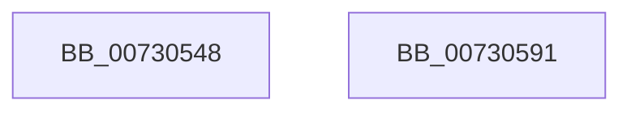

# PiDmObjectManagerInit

- RVA: `0x00730548`–`0x00730592` (길이 `74` bytes)
- VA: `0x0000000140730548`
- 실행 섹션: `PAGE`
- PDB 이름 있음: `예`; PDB Function 태그: `아니요`
- unwind 정보 RVA: `0x0006E5F8`
- 디코드: `18`개 명령, `74/74` bytes 표시
- 미해석 바이트: `0` (있으면 어셈블리에 `.byte`로 보존)

> 이 문서는 커널 이미지의 기계어와 PDB 기호를 분석해 생성했습니다. 4번과 5번은 함수 원형과 자료형을 바이너리 사용 방식에서 추정한 C 해석이며 원본 소스 복구 결과는 아닙니다.

## 1. Dependencies

- 직접 호출 지점: **2**; 고유 호출 대상: **2**
- 직접 호출자로 확인된 함수: **1**
- RIP 상대 이미지 참조: **3**

### Outgoing calls
- `0x00730557` → [ExInitializeResourceLite](../../text/41/ExInitializeResourceLite_function_0041F9A0.md) (function, `0x0041F9A0`)
- `0x0073057B` → [RtlInitializeGenericTableAvl](../../text/46/RtlInitializeGenericTableAvl_function_00466100.md) (function, `0x00466100`)

### Direct callers
- [PiDmInit](../../init/C3/PiDmInit_function_00C343EC.md) at `0x00C343FE`
- [PiDmInit](../../init/C3/PiDmInit_function_00C343EC.md) at `0x00C3440F`
- [PiDmInit](../../init/C3/PiDmInit_function_00C343EC.md) at `0x00C34420`
- [PiDmInit](../../init/C3/PiDmInit_function_00C343EC.md) at `0x00C34431`
- [PiDmInit](../../init/C3/PiDmInit_function_00C343EC.md) at `0x00C34442`
- [PiDmInit](../../init/C3/PiDmInit_function_00C343EC.md) at `0x00C34453`

### Static image references
- `0x00730566` → RVA `0x00730260` (`PiDmFreeGenericTableEntry`; read)
- `0x0073056D` → RVA `0x00AAFB90` (`PiDmAllocateGenericTableEntry`; read)
- `0x00730574` → RVA `0x009A2AD0` (`PiDmCompareObjects`; read)

## 2. Other-region calls and transfers

- 다른 실행 섹션으로 향하는 call: **2**
  - `0x00730557` → [ExInitializeResourceLite](../../text/41/ExInitializeResourceLite_function_0041F9A0.md) (`PAGE` → `.text`)
  - `0x0073057B` → [RtlInitializeGenericTableAvl](../../text/46/RtlInitializeGenericTableAvl_function_00466100.md) (`PAGE` → `.text`)
- 별도 외부 분기/꼬리 이동을 확인하지 못했습니다.

## 3. Assembly (complete function range)

```asm
00730548  48 89 5C 24 08                  mov qword ptr [rsp + 8], rbx
0073054D  57                              push rdi
0073054E  48 83 EC 30                     sub rsp, 0x30
00730552  8B FA                           mov edi, edx
00730554  48 8B D9                        mov rbx, rcx
00730557  E8 44 F4 CE FF                  call 0x14041f9a0
0073055C  48 83 64 24 20 00               and qword ptr [rsp + 0x20], 0
00730562  48 8D 4B 68                     lea rcx, [rbx + 0x68]
00730566  4C 8D 0D F3 FC FF FF            lea r9, [rip - 0x30d]
0073056D  4C 8D 05 1C F6 37 00            lea r8, [rip + 0x37f61c]
00730574  48 8D 15 55 25 27 00            lea rdx, [rip + 0x272555]
0073057B  E8 80 5B D3 FF                  call 0x140466100
00730580  89 BB D0 00 00 00               mov dword ptr [rbx + 0xd0], edi
00730586  48 8B 5C 24 40                  mov rbx, qword ptr [rsp + 0x40]
0073058B  48 83 C4 30                     add rsp, 0x30
0073058F  5F                              pop rdi
00730590  C3                              ret
00730591  CC                              int3
```

## 4. C-style interpretation (structured pseudocode)

```c
__int64 __fastcall PiDmObjectManagerInit(__int64 a1, int a2)
{
    __int64 result;
    __int64 v_rsp;
    unsigned __int64 v_stack_m18;
    unsigned __int64 v_stack_p8;

    v_stack_p8 = v_rbx;
    v_rsp = (v_rsp) - (48);
    result = ExInitializeResourceLite(a1, a2, a3, a4);
    result = RtlInitializeGenericTableAvl(a1 + 104, v_rip + 2565461, v_rip + 3667484, v_rip - 781);
    *(unsigned int *)(a1 + 208) = (unsigned int)((unsigned int)(a2));
    v_rsp = (v_rsp) + (48);
    return result;
}
```

## 5. (Beta) C Style

```c
int64_t PiDmObjectManagerInit(void *Arg1, int32_t Arg2)
{
    uint8_t *arg1 = (uint8_t *)Arg1;

    int64_t result;
    int64_t local_rsp;
    uint64_t v_stack_m18;
    uint64_t v_stack_p8;

    v_stack_p8 = local_rbx;
    local_rsp = (local_rsp) - (48);
    result = ExInitializeResourceLite(Arg1, Arg2, a3, a4);
    result = RtlInitializeGenericTableAvl(Arg1 + 104, v_rip + 2565461, v_rip + 3667484, v_rip - 781);
    *(uint32_t *)(arg1 + 0xD0) = (uint32_t)((uint32_t)(Arg2));
    local_rsp = (local_rsp) + (48);
    return result;
}
```

### 관측된 메모리 오프셋

구조체 형식이 확인되지 않은 접근은 인자 기준의 오프셋으로만 기록했습니다.

| 기준 인자 | 오프셋 표현 | 폭 (bit) | 접근 |
|---|---:|---:|---|
| `Arg1` | `+ 0x68` | `64` | `R` |
| `Arg1` | `+ 0xD0` | `32` | `W` |

## 6. Execution-region graph

[열기: 2D/3D 그래프와 함수 탐색 컨트롤 패널](../../../control-panel.html?section=page&rva=0x00730548&view=graph)

- 2D 그래프는 위에서 아래로 흐르고, 3D 그래프는 빈 공간을 드래그해 회전합니다. Shift+드래그는 이동, 휠은 확대·축소, 함수 노드 선택은 대상 보고서 이동입니다.

### Static fallback


