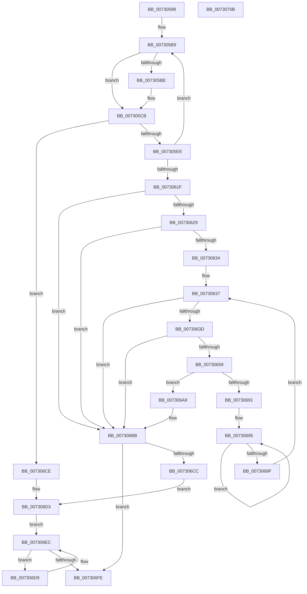

# PiDmObjectManagerPopulate

- RVA: `0x00730598`–`0x0073070C` (길이 `372` bytes)
- VA: `0x0000000140730598`
- 실행 섹션: `PAGE`
- PDB 이름 있음: `예`; PDB Function 태그: `아니요`
- unwind 정보 RVA: `0x000C8938`
- 디코드: `100`개 명령, `372/372` bytes 표시
- 미해석 바이트: `0` (있으면 어셈블리에 `.byte`로 보존)

> 이 문서는 커널 이미지의 기계어와 PDB 기호를 분석해 생성했습니다. 4번과 5번은 함수 원형과 자료형을 바이너리 사용 방식에서 추정한 C 해석이며 원본 소스 복구 결과는 아닙니다.

## 1. Dependencies

- 직접 호출 지점: **10**; 고유 호출 대상: **8**
- 직접 호출자로 확인된 함수: **1**
- RIP 상대 이미지 참조: **0**

### Outgoing calls
- `0x007305C6` → [ExFreePoolWithTag](../../poolcode/B8/ExFreePoolWithTag_function_00B82870.md) (function, `0x00B82870`)
- `0x007305DD` → [ExAllocatePool2](../../poolcode/B8/ExAllocatePool2_function_00B820F0.md) (function, `0x00B820F0`)
- `0x00730613` → [PnpGetObjectList](../8E/PnpGetObjectList_function_008E7520.md) (function, `0x008E7520`)
- `0x0073064E` → [PiDmObjectCreate](../94/PiDmObjectCreate_function_0094F5CC.md) (function, `0x0094F5CC`)
- `0x00730687` → [RtlInsertElementGenericTableAvl](../../text/3E/RtlInsertElementGenericTableAvl_function_003EE510.md) (function, `0x003EE510`)
- `0x007306B1` → [PiDmObjectRelease](../8E/PiDmObjectRelease_function_008E4F70.md) (function, `0x008E4F70`)
- `0x007306C3` → [ExFreePoolWithTag](../../poolcode/B8/ExFreePoolWithTag_function_00B82870.md) (function, `0x00B82870`)
- `0x007306DF` → [RtlDeleteElementGenericTableAvl](../../text/3E/RtlDeleteElementGenericTableAvl_function_003EE750.md) (function, `0x003EE750`)
- `0x007306E7` → [PiDmObjectRelease](../8E/PiDmObjectRelease_function_008E4F70.md) (function, `0x008E4F70`)
- `0x007306F1` → [RtlEnumerateGenericTableAvl](../../text/3E/RtlEnumerateGenericTableAvl_function_003E5AB0.md) (function, `0x003E5AB0`)

### Direct callers
- [PiDmInit](../../init/C3/PiDmInit_function_00C343EC.md) at `0x00C3445F`
- [PiDmInit](../../init/C3/PiDmInit_function_00C343EC.md) at `0x00C3446F`
- [PiDmInit](../../init/C3/PiDmInit_function_00C343EC.md) at `0x00C3447F`
- [PiDmInit](../../init/C3/PiDmInit_function_00C343EC.md) at `0x00C3448F`
- [PiDmInit](../../init/C3/PiDmInit_function_00C343EC.md) at `0x00C3449F`
- [PiDmInit](../../init/C3/PiDmInit_function_00C343EC.md) at `0x00C344AF`

### Static image references
- 디코드된 RIP-relative 메모리 참조가 없습니다.

## 2. Other-region calls and transfers

- 다른 실행 섹션으로 향하는 call: **6**
  - `0x007305C6` → [ExFreePoolWithTag](../../poolcode/B8/ExFreePoolWithTag_function_00B82870.md) (`PAGE` → `POOLCODE`)
  - `0x007305DD` → [ExAllocatePool2](../../poolcode/B8/ExAllocatePool2_function_00B820F0.md) (`PAGE` → `POOLCODE`)
  - `0x00730687` → [RtlInsertElementGenericTableAvl](../../text/3E/RtlInsertElementGenericTableAvl_function_003EE510.md) (`PAGE` → `.text`)
  - `0x007306C3` → [ExFreePoolWithTag](../../poolcode/B8/ExFreePoolWithTag_function_00B82870.md) (`PAGE` → `POOLCODE`)
  - `0x007306DF` → [RtlDeleteElementGenericTableAvl](../../text/3E/RtlDeleteElementGenericTableAvl_function_003EE750.md) (`PAGE` → `.text`)
  - `0x007306F1` → [RtlEnumerateGenericTableAvl](../../text/3E/RtlEnumerateGenericTableAvl_function_003E5AB0.md) (`PAGE` → `.text`)
- 별도 외부 분기/꼬리 이동을 확인하지 못했습니다.

## 3. Assembly (complete function range)

```asm
00730598  48 8B C4                        mov rax, rsp
0073059B  53                              push rbx
0073059C  55                              push rbp
0073059D  56                              push rsi
0073059E  57                              push rdi
0073059F  41 56                           push r14
007305A1  48 83 EC 40                     sub rsp, 0x40
007305A5  45 33 F6                        xor r14d, r14d
007305A8  C7 40 10 00 00 04 00            mov dword ptr [rax + 0x10], 0x40000
007305AF  41 8B FE                        mov edi, r14d
007305B2  4C 89 70 20                     mov qword ptr [rax + 0x20], r14
007305B6  48 8B E9                        mov rbp, rcx
007305B9  48 85 FF                        test rdi, rdi
007305BC  74 0D                           je 0x1407305cb
007305BE  BA 50 6E 70 5A                  mov edx, 0x5a706e50
007305C3  48 8B CF                        mov rcx, rdi
007305C6  E8 A5 22 45 00                  call 0x140b82870
007305CB  8B 54 24 78                     mov edx, dword ptr [rsp + 0x78]
007305CF  B9 00 01 00 00                  mov ecx, 0x100
007305D4  48 03 D2                        add rdx, rdx
007305D7  41 B8 50 6E 70 5A               mov r8d, 0x5a706e50
007305DD  E8 0E 1B 45 00                  call 0x140b820f0
007305E2  48 8B F8                        mov rdi, rax
007305E5  48 85 C0                        test rax, rax
007305E8  0F 84 E0 00 00 00               je 0x1407306ce
007305EE  8B 95 D0 00 00 00               mov edx, dword ptr [rbp + 0xd0]
007305F4  48 8D 44 24 78                  lea rax, [rsp + 0x78]
007305F9  C7 44 24 38 00 00 01 00         mov dword ptr [rsp + 0x38], 0x10000
00730601  48 89 44 24 30                  mov qword ptr [rsp + 0x30], rax
00730606  8B 44 24 78                     mov eax, dword ptr [rsp + 0x78]
0073060A  89 44 24 28                     mov dword ptr [rsp + 0x28], eax
0073060E  48 89 7C 24 20                  mov qword ptr [rsp + 0x20], rdi
00730613  E8 08 6F 1B 00                  call 0x1408e7520
00730618  3D 23 00 00 C0                  cmp eax, 0xc0000023
0073061D  74 9A                           je 0x1407305b9
0073061F  8B D8                           mov ebx, eax
00730621  85 C0                           test eax, eax
00730623  0F 88 92 00 00 00               js 0x1407306bb
00730629  44 39 74 24 78                  cmp dword ptr [rsp + 0x78], r14d
0073062E  0F 86 87 00 00 00               jbe 0x1407306bb
00730634  48 8B F7                        mov rsi, rdi
00730637  66 44 39 36                     cmp word ptr [rsi], r14w
0073063B  74 7E                           je 0x1407306bb
0073063D  8B 8D D0 00 00 00               mov ecx, dword ptr [rbp + 0xd0]
00730643  4C 8D 84 24 88 00 00 00         lea r8, [rsp + 0x88]
0073064B  48 8B D6                        mov rdx, rsi
0073064E  E8 79 EF 21 00                  call 0x14094f5cc
00730653  8B D8                           mov ebx, eax
00730655  85 C0                           test eax, eax
00730657  78 62                           js 0x1407306bb
00730659  48 8B 84 24 88 00 00 00         mov rax, qword ptr [rsp + 0x88]
00730661  48 8D 4D 68                     lea rcx, [rbp + 0x68]
00730665  45 33 C9                        xor r9d, r9d
00730668  48 8D 94 24 88 00 00 00         lea rdx, [rsp + 0x88]
00730670  83 48 20 01                     or dword ptr [rax + 0x20], 1
00730674  48 8B 84 24 88 00 00 00         mov rax, qword ptr [rsp + 0x88]
0073067C  45 8D 41 08                     lea r8d, [r9 + 8]
00730680  C7 40 0C 01 00 00 00            mov dword ptr [rax + 0xc], 1
00730687  E8 84 DE CB FF                  call 0x1403ee510
0073068C  48 85 C0                        test rax, rax
0073068F  74 18                           je 0x1407306a9
00730691  48 83 C8 FF                     or rax, 0xffffffffffffffff
00730695  48 FF C0                        inc rax
00730698  66 44 39 34 46                  cmp word ptr [rsi + rax*2], r14w
0073069D  75 F6                           jne 0x140730695
0073069F  48 8D 34 46                     lea rsi, [rsi + rax*2]
007306A3  48 83 C6 02                     add rsi, 2
007306A7  EB 8E                           jmp 0x140730637
007306A9  48 8B 8C 24 88 00 00 00         mov rcx, qword ptr [rsp + 0x88]
007306B1  E8 BA 48 1B 00                  call 0x1408e4f70
007306B6  BB 9A 00 00 C0                  mov ebx, 0xc000009a
007306BB  BA 50 6E 70 5A                  mov edx, 0x5a706e50
007306C0  48 8B CF                        mov rcx, rdi
007306C3  E8 A8 21 45 00                  call 0x140b82870
007306C8  85 DB                           test ebx, ebx
007306CA  79 32                           jns 0x1407306fe
007306CC  EB 05                           jmp 0x1407306d3
007306CE  BB 9A 00 00 C0                  mov ebx, 0xc000009a
007306D3  48 8D 75 68                     lea rsi, [rbp + 0x68]
007306D7  EB 13                           jmp 0x1407306ec
007306D9  48 8B D7                        mov rdx, rdi
007306DC  48 8B CE                        mov rcx, rsi
007306DF  E8 6C E0 CB FF                  call 0x1403ee750
007306E4  48 8B 0F                        mov rcx, qword ptr [rdi]
007306E7  E8 84 48 1B 00                  call 0x1408e4f70
007306EC  B2 01                           mov dl, 1
007306EE  48 8B CE                        mov rcx, rsi
007306F1  E8 BA 53 CB FF                  call 0x1403e5ab0
007306F6  48 8B F8                        mov rdi, rax
007306F9  48 85 C0                        test rax, rax
007306FC  75 DB                           jne 0x1407306d9
007306FE  8B C3                           mov eax, ebx
00730700  48 83 C4 40                     add rsp, 0x40
00730704  41 5E                           pop r14
00730706  5F                              pop rdi
00730707  5E                              pop rsi
00730708  5D                              pop rbp
00730709  5B                              pop rbx
0073070A  C3                              ret
0073070B  CC                              int3
```

## 4. C-style interpretation (structured pseudocode)

```c
__int64 __fastcall PiDmObjectManagerPopulate(__int64 a1, __int64 a2, __int64 a3, int a4)
{
    __int64 result;
    __int64 v_r14;
    __int64 v_rsi;
    __int64 v_rsp;
    unsigned int v_stack_m30;
    unsigned __int64 v_stack_m38;
    unsigned int v_stack_m40;
    unsigned __int64 v_stack_m48;
    unsigned int v_stack_p10;
    unsigned __int64 v_stack_p20;

    v_rsp = (v_rsp) - (64);
    v_r14 = 0;
    *(unsigned int *)(v_rsp + 16) = 0x40000ULL;
    *(unsigned __int64 *)(v_rsp + 32) = 0;
loc_007305B9:
    result = v_rsp;
    if (0 != 0) {
        a2 = 0x5A706E50ULL;
        a1 = 0;
        result = ExFreePoolWithTag(a1, a2, a3, a4);
    }
    a2 = ((unsigned int)(v_stack_p10)) + ((unsigned int)(v_stack_p10));
    result = ExAllocatePool2(256, a2, (unsigned int)(0x5A706E50ULL), a4);
    if (result == 0) goto loc_007306CE;
    v_stack_m30 = 0x10000ULL;
    v_stack_m38 = v_stack_p10;
    v_stack_m40 = (unsigned int)((unsigned int)(v_stack_p10));
    v_stack_m48 = result;
    result = PnpGetObjectList(256, (unsigned int)(*(unsigned int *)(a1 + 208)), (unsigned int)(0x5A706E50ULL), a4);
    if (((unsigned int)(result)) == 0xC0000023ULL) goto loc_007305B9;
    if (sign_flag) goto loc_007306BB;
    if (v_stack_p10 <= 0) goto loc_007306BB;
loc_00730637:
    if ((*(unsigned __int16 *)(result)) == 0) goto loc_007306BB;
    result = PiDmObjectCreate((unsigned int)(*(unsigned int *)(a1 + 208)), result, v_stack_p20, a4);
    if (sign_flag) goto loc_007306BB;
    a4 = 0;
    *(unsigned int *)(v_stack_p20 + 12) = 1;
    result = RtlInsertElementGenericTableAvl(a1 + 104, v_stack_p20, a4 + 8, a4);
    if (result == 0) goto loc_007306A9;
    result = (result) | (-1);
loc_00730695:
    result = (result) + 1;
    if ((*(unsigned __int16 *)(result + result * 2)) != 0) goto loc_00730695;
    v_rsi = (result + result * 2) + (2);
    goto loc_00730637;
loc_007306A9:
    result = PiDmObjectRelease(v_stack_p20, v_stack_p20, a4 + 8, a4);
loc_007306BB:
    result = ExFreePoolWithTag(result, (unsigned int)(0x5A706E50ULL), a4 + 8, a4);
    if (!sign_flag) goto loc_007306FE;
    goto loc_007306D3;
loc_007306CE:
loc_007306D3:
    goto loc_007306EC;
loc_007306D9:
    result = RtlDeleteElementGenericTableAvl(a1 + 104, result, a4 + 8, a4);
    result = PiDmObjectRelease(*(unsigned __int64 *)(result), result, a4 + 8, a4);
loc_007306EC:
    result = RtlEnumerateGenericTableAvl(a1 + 104, 1, a4 + 8, a4);
    if (result != 0) goto loc_007306D9;
loc_007306FE:
    v_rsp = (v_rsp) + (64);
    return (unsigned int)((unsigned int)((unsigned int)(0xC000009AULL)));
}
```

## 5. (Beta) C Style

```c
int64_t PiDmObjectManagerPopulate(void *Arg1, int64_t Arg2, int64_t Arg3, int32_t Arg4)
{
    uint8_t *arg1 = (uint8_t *)Arg1;

    int64_t result;
    int64_t local_r14;
    int64_t local_rsi;
    int64_t local_rsp;
    uint32_t v_stack_m30;
    uint64_t v_stack_m38;
    uint32_t v_stack_m40;
    uint64_t v_stack_m48;
    uint32_t v_stack_p10;
    uint64_t v_stack_p20;

    local_rsp = (local_rsp) - (64);
    local_r14 = 0;
    *(uint32_t *)(local_rsp + 0x10) = 0x40000ULL;
    *(uint64_t *)(local_rsp + 0x20) = 0;
loc_007305B9:
    result = local_rsp;
    if (0 != 0) {
        Arg2 = 0x5A706E50ULL;
        Arg1 = 0;
        result = ExFreePoolWithTag(Arg1, Arg2, Arg3, Arg4);
    }
    Arg2 = ((uint32_t)(v_stack_p10)) + ((uint32_t)(v_stack_p10));
    result = ExAllocatePool2(256, Arg2, (uint32_t)(0x5A706E50ULL), Arg4);
    if (result == 0) goto loc_007306CE;
    v_stack_m30 = 0x10000ULL;
    v_stack_m38 = v_stack_p10;
    v_stack_m40 = (uint32_t)((uint32_t)(v_stack_p10));
    v_stack_m48 = result;
    result = PnpGetObjectList(256, (uint32_t)(*(uint32_t *)(arg1 + 0xD0)), (uint32_t)(0x5A706E50ULL), Arg4);
    if (((uint32_t)(result)) == 0xC0000023ULL) goto loc_007305B9;
    if (sign_flag) goto loc_007306BB;
    if (v_stack_p10 <= 0) goto loc_007306BB;
loc_00730637:
    if ((*(uint16_t *)(result)) == 0) goto loc_007306BB;
    result = PiDmObjectCreate((uint32_t)(*(uint32_t *)(arg1 + 0xD0)), result, v_stack_p20, Arg4);
    if (sign_flag) goto loc_007306BB;
    Arg4 = 0;
    *(uint32_t *)(v_stack_p20 + 0xC) = 1;
    result = RtlInsertElementGenericTableAvl(Arg1 + 104, v_stack_p20, Arg4 + 8, Arg4);
    if (result == 0) goto loc_007306A9;
    result = (result) | (-1);
loc_00730695:
    result = (result) + 1;
    if ((*(uint16_t *)(result + result * 2)) != 0) goto loc_00730695;
    local_rsi = (result + result * 2) + (2);
    goto loc_00730637;
loc_007306A9:
    result = PiDmObjectRelease(v_stack_p20, v_stack_p20, Arg4 + 8, Arg4);
loc_007306BB:
    result = ExFreePoolWithTag(result, (uint32_t)(0x5A706E50ULL), Arg4 + 8, Arg4);
    if (!sign_flag) goto loc_007306FE;
    goto loc_007306D3;
loc_007306CE:
loc_007306D3:
    goto loc_007306EC;
loc_007306D9:
    result = RtlDeleteElementGenericTableAvl(Arg1 + 104, result, Arg4 + 8, Arg4);
    result = PiDmObjectRelease(*(uint64_t *)(result), result, Arg4 + 8, Arg4);
loc_007306EC:
    result = RtlEnumerateGenericTableAvl(Arg1 + 104, 1, Arg4 + 8, Arg4);
    if (result != 0) goto loc_007306D9;
loc_007306FE:
    local_rsp = (local_rsp) + (64);
    return (uint32_t)((uint32_t)((uint32_t)(0xC000009AULL)));
}
```

### 관측된 메모리 오프셋

구조체 형식이 확인되지 않은 접근은 인자 기준의 오프셋으로만 기록했습니다.

| 기준 인자 | 오프셋 표현 | 폭 (bit) | 접근 |
|---|---:|---:|---|
| `Arg1` | `+ 0x68` | `64` | `R` |
| `Arg1` | `+ 0xD0` | `32` | `R` |

## 6. Execution-region graph

[열기: 2D/3D 그래프와 함수 탐색 컨트롤 패널](../../../control-panel.html?section=page&rva=0x00730598&view=graph)

- 2D 그래프는 위에서 아래로 흐르고, 3D 그래프는 빈 공간을 드래그해 회전합니다. Shift+드래그는 이동, 휠은 확대·축소, 함수 노드 선택은 대상 보고서 이동입니다.

### Static fallback


