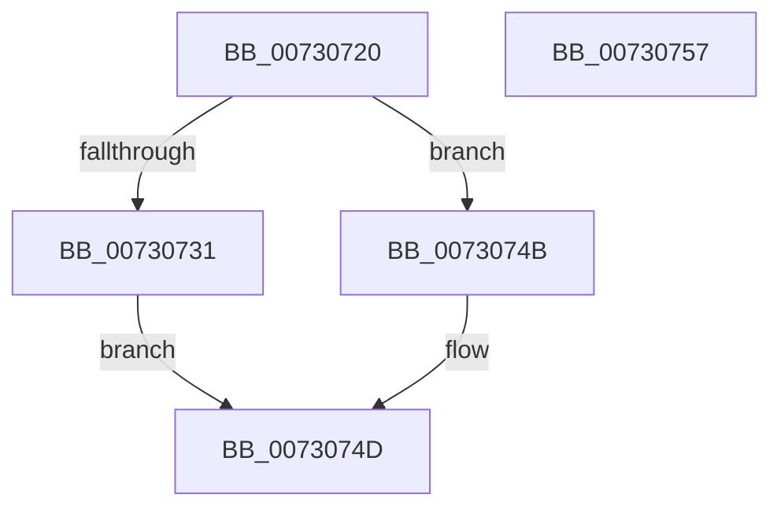

# PiDmPnpObjectMatchCallback

- RVA: `0x00730720`–`0x00730758` (길이 `56` bytes)
- VA: `0x0000000140730720`
- 실행 섹션: `PAGE`
- PDB 이름 있음: `예`; PDB Function 태그: `아니요`
- unwind 정보 RVA: `0x00064C80`
- 디코드: `19`개 명령, `56/56` bytes 표시
- 미해석 바이트: `0` (있으면 어셈블리에 `.byte`로 보존)

> 이 문서는 커널 이미지의 기계어와 PDB 기호를 분석해 생성했습니다. 4번과 5번은 함수 원형과 자료형을 바이너리 사용 방식에서 추정한 C 해석이며 원본 소스 복구 결과는 아닙니다.

## 1. Dependencies

- 직접 호출 지점: **1**; 고유 호출 대상: **1**
- 직접 호출자로 확인된 함수: **0**
- RIP 상대 이미지 참조: **1**

### Outgoing calls
- `0x00730744` → [guard_dispatch_icall](../../text/6B/guard_dispatch_icall_function_006BAAD0.md) (function, `0x006BAAD0`)

### Direct callers
- 이 함수 시작 RVA로 연결되는 직접 call은 확인되지 않았습니다. 간접 호출은 완전히 역산할 수 없습니다.

### Static image references
- `0x0073073D` → RVA `0x00E66398` (`.data`; read)

## 2. Other-region calls and transfers

- 다른 실행 섹션으로 향하는 call: **1**
  - `0x00730744` → [guard_dispatch_icall](../../text/6B/guard_dispatch_icall_function_006BAAD0.md) (`PAGE` → `.text`)
- 별도 외부 분기/꼬리 이동을 확인하지 못했습니다.

## 3. Assembly (complete function range)

```asm
00730720  40 53                           push rbx
00730722  48 83 EC 30                     sub rsp, 0x30
00730726  48 8B 02                        mov rax, qword ptr [rdx]
00730729  49 8B D8                        mov rbx, r8
0073072C  48 85 C0                        test rax, rax
0073072F  74 1A                           je 0x14073074b
00730731  4C 8B 4A 08                     mov r9, qword ptr [rdx + 8]
00730735  48 8B 51 10                     mov rdx, qword ptr [rcx + 0x10]
00730739  44 8B 41 1C                     mov r8d, dword ptr [rcx + 0x1c]
0073073D  48 8B 0D 54 5C 73 00            mov rcx, qword ptr [rip + 0x735c54]
00730744  E8 87 A3 F8 FF                  call 0x1406baad0
00730749  EB 02                           jmp 0x14073074d
0073074B  B0 01                           mov al, 1
0073074D  88 03                           mov byte ptr [rbx], al
0073074F  33 C0                           xor eax, eax
00730751  48 83 C4 30                     add rsp, 0x30
00730755  5B                              pop rbx
00730756  C3                              ret
00730757  CC                              int3
```

## 4. C-style interpretation (structured pseudocode)

```c
__int64 __fastcall PiDmPnpObjectMatchCallback(__int64 a1, __int64 a2, __int64 a3)
{
    __int64 result;
    __int64 v_rsp;

    v_rsp = (v_rsp) - (48);
    if (*(unsigned __int64 *)(a2) == 0) goto loc_0073074B;
    result = guard_dispatch_icall(*(unsigned __int64 *)(v_rip + 7560276), *(unsigned __int64 *)(a1 + 16), (unsigned int)(*(unsigned int *)(a1 + 28)), *(unsigned __int64 *)(a2 + 8));
    goto loc_0073074D;
loc_0073074B:
loc_0073074D:
    *(unsigned __int8 *)(a3) = 1;
    result = 0;
    v_rsp = (v_rsp) + (48);
    return result;
}
```

## 5. (Beta) C Style

```c
int64_t PiDmPnpObjectMatchCallback(void *Arg1, void *Arg2, void *Arg3)
{
    uint8_t *arg1 = (uint8_t *)Arg1;
    uint8_t *arg2 = (uint8_t *)Arg2;
    uint8_t *arg3 = (uint8_t *)Arg3;

    int64_t result;
    int64_t local_rsp;

    local_rsp = (local_rsp) - (48);
    if (*(uint64_t *)(arg2) == 0) goto loc_0073074B;
    result = guard_dispatch_icall(*(uint64_t *)(v_rip + 0x735C54), *(uint64_t *)(arg1 + 0x10), (uint32_t)(*(uint32_t *)(arg1 + 0x1C)), *(uint64_t *)(arg2 + 0x8));
    goto loc_0073074D;
loc_0073074B:
loc_0073074D:
    *(uint8_t *)(arg3) = 1;
    result = 0;
    local_rsp = (local_rsp) + (48);
    return result;
}
```

### 관측된 메모리 오프셋

구조체 형식이 확인되지 않은 접근은 인자 기준의 오프셋으로만 기록했습니다.

| 기준 인자 | 오프셋 표현 | 폭 (bit) | 접근 |
|---|---:|---:|---|
| `Arg1` | `+ 0x10` | `64` | `R` |
| `Arg1` | `+ 0x1C` | `32` | `R` |
| `Arg2` | `+ 0x0` | `64` | `R` |
| `Arg2` | `+ 0x8` | `64` | `R` |
| `Arg3` | `+ 0x0` | `8` | `W` |

## 6. Execution-region graph

[열기: 2D/3D 그래프와 함수 탐색 컨트롤 패널](../../../control-panel.html?section=page&rva=0x00730720&view=graph)

- 2D 그래프는 위에서 아래로 흐르고, 3D 그래프는 빈 공간을 드래그해 회전합니다. Shift+드래그는 이동, 휠은 확대·축소, 함수 노드 선택은 대상 보고서 이동입니다.

### Static fallback


