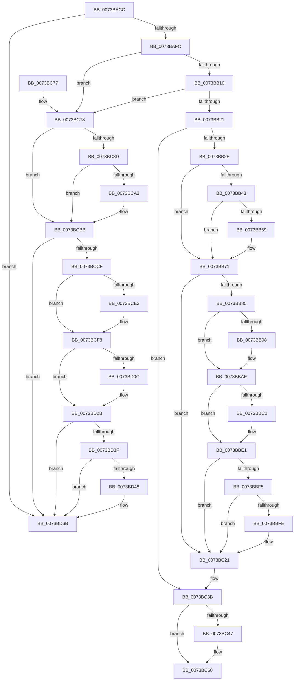

# PiDmaGuardProcessUpdateConsoleLockStateAction

- RVA: `0x0073BACC`–`0x0073BD84` (길이 `696` bytes)
- VA: `0x000000014073BACC`
- 실행 섹션: `PAGE`
- PDB 이름 있음: `예`; PDB Function 태그: `아니요`
- unwind 정보 RVA: `0x000BCBEC`
- 디코드: `174`개 명령, `696/696` bytes 표시
- 미해석 바이트: `0` (있으면 어셈블리에 `.byte`로 보존)

> 이 문서는 커널 이미지의 기계어와 PDB 기호를 분석해 생성했습니다. 4번과 5번은 함수 원형과 자료형을 바이너리 사용 방식에서 추정한 C 해석이며 원본 소스 복구 결과는 아닙니다.

## 1. Dependencies

- 직접 호출 지점: **26**; 고유 호출 대상: **4**
- 직접 호출자로 확인된 함수: **1**
- RIP 상대 이미지 참조: **1**

### Outgoing calls
- `0x0073BB35` → [IoAddTriageDumpDataBlock](../../text/42/IoAddTriageDumpDataBlock_function_00428374.md) (function, `0x00428374`)
- `0x0073BB47` → [IoAddTriageDumpDataBlock](../../text/42/IoAddTriageDumpDataBlock_function_00428374.md) (function, `0x00428374`)
- `0x0073BB5B` → [IoAddTriageDumpDataBlock](../../text/42/IoAddTriageDumpDataBlock_function_00428374.md) (function, `0x00428374`)
- `0x0073BB6C` → [IoAddTriageDumpDataBlock](../../text/42/IoAddTriageDumpDataBlock_function_00428374.md) (function, `0x00428374`)
- `0x0073BB8E` → [IoAddTriageDumpDataBlock](../../text/42/IoAddTriageDumpDataBlock_function_00428374.md) (function, `0x00428374`)
- `0x0073BB9D` → [IoAddTriageDumpDataBlock](../../text/42/IoAddTriageDumpDataBlock_function_00428374.md) (function, `0x00428374`)
- `0x0073BBA9` → [IoAddTriageDumpDataBlock](../../text/42/IoAddTriageDumpDataBlock_function_00428374.md) (function, `0x00428374`)
- `0x0073BBC4` → [IoAddTriageDumpDataBlock](../../text/42/IoAddTriageDumpDataBlock_function_00428374.md) (function, `0x00428374`)
- `0x0073BBDC` → [IoAddTriageDumpDataBlock](../../text/42/IoAddTriageDumpDataBlock_function_00428374.md) (function, `0x00428374`)
- `0x0073BC00` → [IoAddTriageDumpDataBlock](../../text/42/IoAddTriageDumpDataBlock_function_00428374.md) (function, `0x00428374`)
- `0x0073BC1C` → [IoAddTriageDumpDataBlock](../../text/42/IoAddTriageDumpDataBlock_function_00428374.md) (function, `0x00428374`)
- `0x0073BC35` → [KeBugCheckEx](../../text/4F/KeBugCheckEx_function_004FD660.md) (function, `0x004FD660`)
- `0x0073BC47` → [PiIommuIsDeviceSafeWhileConsoleLocked](../74/PiIommuIsDeviceSafeWhileConsoleLocked_function_00740238.md) (function, `0x00740238`)
- `0x0073BC59` → [PipDmgSetIommuDomainPolicyAndNotifyHal](PipDmgSetIommuDomainPolicyAndNotifyHal_function_0073C718.md) (function, `0x0073C718`)
- `0x0073BC7F` → [IoAddTriageDumpDataBlock](../../text/42/IoAddTriageDumpDataBlock_function_00428374.md) (function, `0x00428374`)
- `0x0073BC91` → [IoAddTriageDumpDataBlock](../../text/42/IoAddTriageDumpDataBlock_function_00428374.md) (function, `0x00428374`)
- `0x0073BCA5` → [IoAddTriageDumpDataBlock](../../text/42/IoAddTriageDumpDataBlock_function_00428374.md) (function, `0x00428374`)
- `0x0073BCB6` → [IoAddTriageDumpDataBlock](../../text/42/IoAddTriageDumpDataBlock_function_00428374.md) (function, `0x00428374`)
- `0x0073BCD8` → [IoAddTriageDumpDataBlock](../../text/42/IoAddTriageDumpDataBlock_function_00428374.md) (function, `0x00428374`)
- `0x0073BCE7` → [IoAddTriageDumpDataBlock](../../text/42/IoAddTriageDumpDataBlock_function_00428374.md) (function, `0x00428374`)
- `0x0073BCF3` → [IoAddTriageDumpDataBlock](../../text/42/IoAddTriageDumpDataBlock_function_00428374.md) (function, `0x00428374`)
- `0x0073BD0E` → [IoAddTriageDumpDataBlock](../../text/42/IoAddTriageDumpDataBlock_function_00428374.md) (function, `0x00428374`)
- `0x0073BD26` → [IoAddTriageDumpDataBlock](../../text/42/IoAddTriageDumpDataBlock_function_00428374.md) (function, `0x00428374`)
- `0x0073BD4A` → [IoAddTriageDumpDataBlock](../../text/42/IoAddTriageDumpDataBlock_function_00428374.md) (function, `0x00428374`)
- `0x0073BD66` → [IoAddTriageDumpDataBlock](../../text/42/IoAddTriageDumpDataBlock_function_00428374.md) (function, `0x00428374`)
- `0x0073BD7E` → [KeBugCheckEx](../../text/4F/KeBugCheckEx_function_004FD660.md) (function, `0x004FD660`)

### Direct callers
- [sub_006F45AA](../../text/6F/Unknown_function_006F45AA.md) at `0x006F46D2`

### Static image references
- `0x0073BB21` → RVA `0x00F8A9AC` (`.data`; read)

## 2. Other-region calls and transfers

- 다른 실행 섹션으로 향하는 call: **24**
  - `0x0073BB35` → [IoAddTriageDumpDataBlock](../../text/42/IoAddTriageDumpDataBlock_function_00428374.md) (`PAGE` → `.text`)
  - `0x0073BB47` → [IoAddTriageDumpDataBlock](../../text/42/IoAddTriageDumpDataBlock_function_00428374.md) (`PAGE` → `.text`)
  - `0x0073BB5B` → [IoAddTriageDumpDataBlock](../../text/42/IoAddTriageDumpDataBlock_function_00428374.md) (`PAGE` → `.text`)
  - `0x0073BB6C` → [IoAddTriageDumpDataBlock](../../text/42/IoAddTriageDumpDataBlock_function_00428374.md) (`PAGE` → `.text`)
  - `0x0073BB8E` → [IoAddTriageDumpDataBlock](../../text/42/IoAddTriageDumpDataBlock_function_00428374.md) (`PAGE` → `.text`)
  - `0x0073BB9D` → [IoAddTriageDumpDataBlock](../../text/42/IoAddTriageDumpDataBlock_function_00428374.md) (`PAGE` → `.text`)
  - `0x0073BBA9` → [IoAddTriageDumpDataBlock](../../text/42/IoAddTriageDumpDataBlock_function_00428374.md) (`PAGE` → `.text`)
  - `0x0073BBC4` → [IoAddTriageDumpDataBlock](../../text/42/IoAddTriageDumpDataBlock_function_00428374.md) (`PAGE` → `.text`)
  - `0x0073BBDC` → [IoAddTriageDumpDataBlock](../../text/42/IoAddTriageDumpDataBlock_function_00428374.md) (`PAGE` → `.text`)
  - `0x0073BC00` → [IoAddTriageDumpDataBlock](../../text/42/IoAddTriageDumpDataBlock_function_00428374.md) (`PAGE` → `.text`)
  - `0x0073BC1C` → [IoAddTriageDumpDataBlock](../../text/42/IoAddTriageDumpDataBlock_function_00428374.md) (`PAGE` → `.text`)
  - `0x0073BC35` → [KeBugCheckEx](../../text/4F/KeBugCheckEx_function_004FD660.md) (`PAGE` → `.text`)
  - `0x0073BC7F` → [IoAddTriageDumpDataBlock](../../text/42/IoAddTriageDumpDataBlock_function_00428374.md) (`PAGE` → `.text`)
  - `0x0073BC91` → [IoAddTriageDumpDataBlock](../../text/42/IoAddTriageDumpDataBlock_function_00428374.md) (`PAGE` → `.text`)
  - `0x0073BCA5` → [IoAddTriageDumpDataBlock](../../text/42/IoAddTriageDumpDataBlock_function_00428374.md) (`PAGE` → `.text`)
  - `0x0073BCB6` → [IoAddTriageDumpDataBlock](../../text/42/IoAddTriageDumpDataBlock_function_00428374.md) (`PAGE` → `.text`)
  - `0x0073BCD8` → [IoAddTriageDumpDataBlock](../../text/42/IoAddTriageDumpDataBlock_function_00428374.md) (`PAGE` → `.text`)
  - `0x0073BCE7` → [IoAddTriageDumpDataBlock](../../text/42/IoAddTriageDumpDataBlock_function_00428374.md) (`PAGE` → `.text`)
  - `0x0073BCF3` → [IoAddTriageDumpDataBlock](../../text/42/IoAddTriageDumpDataBlock_function_00428374.md) (`PAGE` → `.text`)
  - `0x0073BD0E` → [IoAddTriageDumpDataBlock](../../text/42/IoAddTriageDumpDataBlock_function_00428374.md) (`PAGE` → `.text`)
  - `0x0073BD26` → [IoAddTriageDumpDataBlock](../../text/42/IoAddTriageDumpDataBlock_function_00428374.md) (`PAGE` → `.text`)
  - `0x0073BD4A` → [IoAddTriageDumpDataBlock](../../text/42/IoAddTriageDumpDataBlock_function_00428374.md) (`PAGE` → `.text`)
  - `0x0073BD66` → [IoAddTriageDumpDataBlock](../../text/42/IoAddTriageDumpDataBlock_function_00428374.md) (`PAGE` → `.text`)
  - `0x0073BD7E` → [KeBugCheckEx](../../text/4F/KeBugCheckEx_function_004FD660.md) (`PAGE` → `.text`)
- 별도 외부 분기/꼬리 이동을 확인하지 못했습니다.

## 3. Assembly (complete function range)

```asm
0073BACC  48 89 5C 24 08                  mov qword ptr [rsp + 8], rbx
0073BAD1  48 89 6C 24 10                  mov qword ptr [rsp + 0x10], rbp
0073BAD6  48 89 74 24 18                  mov qword ptr [rsp + 0x18], rsi
0073BADB  57                              push rdi
0073BADC  48 83 EC 30                     sub rsp, 0x30
0073BAE0  48 8B 59 10                     mov rbx, qword ptr [rcx + 0x10]
0073BAE4  33 ED                           xor ebp, ebp
0073BAE6  4C 8B D1                        mov r10, rcx
0073BAE9  BA 01 00 00 C0                  mov edx, 0xc0000001
0073BAEE  BF 02 00 00 00                  mov edi, 2
0073BAF3  48 85 DB                        test rbx, rbx
0073BAF6  0F 84 6F 02 00 00               je 0x14073bd6b
0073BAFC  48 8B 83 38 01 00 00            mov rax, qword ptr [rbx + 0x138]
0073BB03  4C 8B 48 28                     mov r9, qword ptr [rax + 0x28]
0073BB07  4D 85 C9                        test r9, r9
0073BB0A  0F 84 68 01 00 00               je 0x14073bc78
0073BB10  41 F7 81 8C 01 00 00 00 00 02 00  test dword ptr [r9 + 0x18c], 0x20000
0073BB1B  0F 85 57 01 00 00               jne 0x14073bc78
0073BB21  83 3D 84 EE 84 00 03            cmp dword ptr [rip + 0x84ee84], 3
0073BB28  0F 85 0D 01 00 00               jne 0x14073bc3b
0073BB2E  0F B7 53 02                     movzx edx, word ptr [rbx + 2]
0073BB32  48 8B CB                        mov rcx, rbx
0073BB35  E8 3A C8 CE FF                  call 0x140428374
0073BB3A  48 8B 4B 08                     mov rcx, qword ptr [rbx + 8]
0073BB3E  48 85 C9                        test rcx, rcx
0073BB41  74 2E                           je 0x14073bb71
0073BB43  0F BF 51 02                     movsx edx, word ptr [rcx + 2]
0073BB47  E8 28 C8 CE FF                  call 0x140428374
0073BB4C  48 8B 4B 08                     mov rcx, qword ptr [rbx + 8]
0073BB50  48 83 C1 38                     add rcx, 0x38
0073BB54  66 39 29                        cmp word ptr [rcx], bp
0073BB57  74 18                           je 0x14073bb71
0073BB59  8B D7                           mov edx, edi
0073BB5B  E8 14 C8 CE FF                  call 0x140428374
0073BB60  48 8B 4B 08                     mov rcx, qword ptr [rbx + 8]
0073BB64  0F B7 51 38                     movzx edx, word ptr [rcx + 0x38]
0073BB68  48 8B 49 40                     mov rcx, qword ptr [rcx + 0x40]
0073BB6C  E8 03 C8 CE FF                  call 0x140428374
0073BB71  48 8B 83 38 01 00 00            mov rax, qword ptr [rbx + 0x138]
0073BB78  48 8B 48 28                     mov rcx, qword ptr [rax + 0x28]
0073BB7C  48 85 C9                        test rcx, rcx
0073BB7F  0F 84 9C 00 00 00               je 0x14073bc21
0073BB85  BA 88 03 00 00                  mov edx, 0x388
0073BB8A  48 8D 71 28                     lea rsi, [rcx + 0x28]
0073BB8E  E8 E1 C7 CE FF                  call 0x140428374
0073BB93  66 39 2E                        cmp word ptr [rsi], bp
0073BB96  74 16                           je 0x14073bbae
0073BB98  8B D7                           mov edx, edi
0073BB9A  48 8B CE                        mov rcx, rsi
0073BB9D  E8 D2 C7 CE FF                  call 0x140428374
0073BBA2  0F B7 16                        movzx edx, word ptr [rsi]
0073BBA5  48 8B 4E 08                     mov rcx, qword ptr [rsi + 8]
0073BBA9  E8 C6 C7 CE FF                  call 0x140428374
0073BBAE  48 8B 83 38 01 00 00            mov rax, qword ptr [rbx + 0x138]
0073BBB5  48 8B 48 28                     mov rcx, qword ptr [rax + 0x28]
0073BBB9  48 83 C1 38                     add rcx, 0x38
0073BBBD  66 39 29                        cmp word ptr [rcx], bp
0073BBC0  74 1F                           je 0x14073bbe1
0073BBC2  8B D7                           mov edx, edi
0073BBC4  E8 AB C7 CE FF                  call 0x140428374
0073BBC9  48 8B 83 38 01 00 00            mov rax, qword ptr [rbx + 0x138]
0073BBD0  48 8B 48 28                     mov rcx, qword ptr [rax + 0x28]
0073BBD4  0F B7 51 38                     movzx edx, word ptr [rcx + 0x38]
0073BBD8  48 8B 49 40                     mov rcx, qword ptr [rcx + 0x40]
0073BBDC  E8 93 C7 CE FF                  call 0x140428374
0073BBE1  48 8B 83 38 01 00 00            mov rax, qword ptr [rbx + 0x138]
0073BBE8  48 8B 48 28                     mov rcx, qword ptr [rax + 0x28]
0073BBEC  48 8B 41 10                     mov rax, qword ptr [rcx + 0x10]
0073BBF0  48 85 C0                        test rax, rax
0073BBF3  74 2C                           je 0x14073bc21
0073BBF5  48 8D 48 38                     lea rcx, [rax + 0x38]
0073BBF9  66 39 29                        cmp word ptr [rcx], bp
0073BBFC  74 23                           je 0x14073bc21
0073BBFE  8B D7                           mov edx, edi
0073BC00  E8 6F C7 CE FF                  call 0x140428374
0073BC05  48 8B 83 38 01 00 00            mov rax, qword ptr [rbx + 0x138]
0073BC0C  48 8B 48 28                     mov rcx, qword ptr [rax + 0x28]
0073BC10  48 8B 49 10                     mov rcx, qword ptr [rcx + 0x10]
0073BC14  0F B7 51 38                     movzx edx, word ptr [rcx + 0x38]
0073BC18  48 8B 49 40                     mov rcx, qword ptr [rcx + 0x40]
0073BC1C  E8 53 C7 CE FF                  call 0x140428374
0073BC21  45 33 C9                        xor r9d, r9d
0073BC24  48 89 6C 24 20                  mov qword ptr [rsp + 0x20], rbp
0073BC29  4C 8B C3                        mov r8, rbx
0073BC2C  B9 CA 00 00 00                  mov ecx, 0xca
0073BC31  41 8D 51 11                     lea edx, [r9 + 0x11]
0073BC35  E8 26 1A DC FF                  call 0x1404fd660
0073BC3A  CC                              int3
0073BC3B  49 8B 89 D0 02 00 00            mov rcx, qword ptr [r9 + 0x2d0]
0073BC42  48 85 C9                        test rcx, rcx
0073BC45  74 19                           je 0x14073bc60
0073BC47  E8 EC 45 00 00                  call 0x140740238
0073BC4C  41 8B 52 28                     mov edx, dword ptr [r10 + 0x28]
0073BC50  84 C0                           test al, al
0073BC52  49 8B C9                        mov rcx, r9
0073BC55  41 0F 94 C0                     sete r8b
0073BC59  E8 BA 0A 00 00                  call 0x14073c718
0073BC5E  8B D0                           mov edx, eax
0073BC60  48 8B 5C 24 40                  mov rbx, qword ptr [rsp + 0x40]
0073BC65  8B C2                           mov eax, edx
0073BC67  48 8B 6C 24 48                  mov rbp, qword ptr [rsp + 0x48]
0073BC6C  48 8B 74 24 50                  mov rsi, qword ptr [rsp + 0x50]
0073BC71  48 83 C4 30                     add rsp, 0x30
0073BC75  5F                              pop rdi
0073BC76  C3                              ret
0073BC77  CC                              int3
0073BC78  0F B7 53 02                     movzx edx, word ptr [rbx + 2]
0073BC7C  48 8B CB                        mov rcx, rbx
0073BC7F  E8 F0 C6 CE FF                  call 0x140428374
0073BC84  48 8B 4B 08                     mov rcx, qword ptr [rbx + 8]
0073BC88  48 85 C9                        test rcx, rcx
0073BC8B  74 2E                           je 0x14073bcbb
0073BC8D  0F BF 51 02                     movsx edx, word ptr [rcx + 2]
0073BC91  E8 DE C6 CE FF                  call 0x140428374
0073BC96  48 8B 4B 08                     mov rcx, qword ptr [rbx + 8]
0073BC9A  48 83 C1 38                     add rcx, 0x38
0073BC9E  66 39 29                        cmp word ptr [rcx], bp
0073BCA1  74 18                           je 0x14073bcbb
0073BCA3  8B D7                           mov edx, edi
0073BCA5  E8 CA C6 CE FF                  call 0x140428374
0073BCAA  48 8B 4B 08                     mov rcx, qword ptr [rbx + 8]
0073BCAE  0F B7 51 38                     movzx edx, word ptr [rcx + 0x38]
0073BCB2  48 8B 49 40                     mov rcx, qword ptr [rcx + 0x40]
0073BCB6  E8 B9 C6 CE FF                  call 0x140428374
0073BCBB  48 8B 83 38 01 00 00            mov rax, qword ptr [rbx + 0x138]
0073BCC2  48 8B 48 28                     mov rcx, qword ptr [rax + 0x28]
0073BCC6  48 85 C9                        test rcx, rcx
0073BCC9  0F 84 9C 00 00 00               je 0x14073bd6b
0073BCCF  BA 88 03 00 00                  mov edx, 0x388
0073BCD4  48 8D 71 28                     lea rsi, [rcx + 0x28]
0073BCD8  E8 97 C6 CE FF                  call 0x140428374
0073BCDD  66 39 2E                        cmp word ptr [rsi], bp
0073BCE0  74 16                           je 0x14073bcf8
0073BCE2  8B D7                           mov edx, edi
0073BCE4  48 8B CE                        mov rcx, rsi
0073BCE7  E8 88 C6 CE FF                  call 0x140428374
0073BCEC  0F B7 16                        movzx edx, word ptr [rsi]
0073BCEF  48 8B 4E 08                     mov rcx, qword ptr [rsi + 8]
0073BCF3  E8 7C C6 CE FF                  call 0x140428374
0073BCF8  48 8B 83 38 01 00 00            mov rax, qword ptr [rbx + 0x138]
0073BCFF  48 8B 48 28                     mov rcx, qword ptr [rax + 0x28]
0073BD03  48 83 C1 38                     add rcx, 0x38
0073BD07  66 39 29                        cmp word ptr [rcx], bp
0073BD0A  74 1F                           je 0x14073bd2b
0073BD0C  8B D7                           mov edx, edi
0073BD0E  E8 61 C6 CE FF                  call 0x140428374
0073BD13  48 8B 83 38 01 00 00            mov rax, qword ptr [rbx + 0x138]
0073BD1A  48 8B 48 28                     mov rcx, qword ptr [rax + 0x28]
0073BD1E  0F B7 51 38                     movzx edx, word ptr [rcx + 0x38]
0073BD22  48 8B 49 40                     mov rcx, qword ptr [rcx + 0x40]
0073BD26  E8 49 C6 CE FF                  call 0x140428374
0073BD2B  48 8B 83 38 01 00 00            mov rax, qword ptr [rbx + 0x138]
0073BD32  48 8B 48 28                     mov rcx, qword ptr [rax + 0x28]
0073BD36  48 8B 41 10                     mov rax, qword ptr [rcx + 0x10]
0073BD3A  48 85 C0                        test rax, rax
0073BD3D  74 2C                           je 0x14073bd6b
0073BD3F  48 8D 48 38                     lea rcx, [rax + 0x38]
0073BD43  66 39 29                        cmp word ptr [rcx], bp
0073BD46  74 23                           je 0x14073bd6b
0073BD48  8B D7                           mov edx, edi
0073BD4A  E8 25 C6 CE FF                  call 0x140428374
0073BD4F  48 8B 83 38 01 00 00            mov rax, qword ptr [rbx + 0x138]
0073BD56  48 8B 48 28                     mov rcx, qword ptr [rax + 0x28]
0073BD5A  48 8B 49 10                     mov rcx, qword ptr [rcx + 0x10]
0073BD5E  0F B7 51 38                     movzx edx, word ptr [rcx + 0x38]
0073BD62  48 8B 49 40                     mov rcx, qword ptr [rcx + 0x40]
0073BD66  E8 09 C6 CE FF                  call 0x140428374
0073BD6B  45 33 C9                        xor r9d, r9d
0073BD6E  48 89 6C 24 20                  mov qword ptr [rsp + 0x20], rbp
0073BD73  4C 8B C3                        mov r8, rbx
0073BD76  48 8B D7                        mov rdx, rdi
0073BD79  B9 CA 00 00 00                  mov ecx, 0xca
0073BD7E  E8 DD 18 DC FF                  call 0x1404fd660
0073BD83  CC                              int3
```

## 4. C-style interpretation (structured pseudocode)

```c
__int64 __fastcall PiDmaGuardProcessUpdateConsoleLockStateAction(__int64 a1)
{
    __int64 result;
    __int64 v_rbp;
    __int64 v_rsp;
    unsigned __int64 v_stack_m18;
    unsigned __int64 v_stack_p10;
    unsigned __int64 v_stack_p18;
    unsigned __int64 v_stack_p20;
    unsigned __int64 v_stack_p8;

    v_stack_p8 = v_rbx;
    v_stack_p10 = v_rbp;
    v_stack_p18 = v_rsi;
    v_rsp = (v_rsp) - (48);
    v_rbp = 0;
    if (*(unsigned __int64 *)(a1 + 16) == 0) goto loc_0073BD6B;
    if (*(unsigned __int64 *)(*(unsigned __int64 *)(*(unsigned __int64 *)(a1 + 16) + 312) + 40) == 0) goto loc_0073BC78;
    if (((*(unsigned int *)(*(unsigned __int64 *)(*(unsigned __int64 *)(*(unsigned __int64 *)(a1 + 16) + 312) + 40) + 396)) & (0x20000ULL)) != 0) goto loc_0073BC78;
    if ((*(unsigned int *)(v_rip + 8711812)) != 3) goto loc_0073BC3B;
    result = IoAddTriageDumpDataBlock(*(unsigned __int64 *)(a1 + 16), *(unsigned __int16 *)(*(unsigned __int64 *)(a1 + 16) + 2), a3, *(unsigned __int64 *)(*(unsigned __int64 *)(*(unsigned __int64 *)(a1 + 16) + 312) + 40));
    if (*(unsigned __int64 *)(*(unsigned __int64 *)(a1 + 16) + 8) == 0) goto loc_0073BB71;
    result = IoAddTriageDumpDataBlock(*(unsigned __int64 *)(*(unsigned __int64 *)(a1 + 16) + 8), (__int16)(*(unsigned __int16 *)(*(unsigned __int64 *)(*(unsigned __int64 *)(a1 + 16) + 8) + 2)), a3, *(unsigned __int64 *)(*(unsigned __int64 *)(*(unsigned __int64 *)(a1 + 16) + 312) + 40));
    a1 = (*(unsigned __int64 *)(*(unsigned __int64 *)(a1 + 16) + 8)) + (56);
    if ((*(unsigned __int16 *)(a1)) != 0) {
        a2 = 2;
        result = IoAddTriageDumpDataBlock(a1, a2, a3, *(unsigned __int64 *)(*(unsigned __int64 *)(*(unsigned __int64 *)(a1 + 16) + 312) + 40));
        a1 = *(unsigned __int64 *)(*(unsigned __int64 *)(a1 + 16) + 8);
        a2 = *(unsigned __int16 *)(a1 + 56);
        a1 = *(unsigned __int64 *)(a1 + 64);
        result = IoAddTriageDumpDataBlock(a1, a2, a3, *(unsigned __int64 *)(*(unsigned __int64 *)(*(unsigned __int64 *)(a1 + 16) + 312) + 40));
    }
    if (*(unsigned __int64 *)(*(unsigned __int64 *)(*(unsigned __int64 *)(a1 + 16) + 312) + 40) == 0) goto loc_0073BC21;
    result = IoAddTriageDumpDataBlock(*(unsigned __int64 *)(*(unsigned __int64 *)(*(unsigned __int64 *)(a1 + 16) + 312) + 40), 904, a3, *(unsigned __int64 *)(*(unsigned __int64 *)(*(unsigned __int64 *)(a1 + 16) + 312) + 40));
    if ((*(unsigned __int16 *)(*(unsigned __int64 *)(*(unsigned __int64 *)(*(unsigned __int64 *)(a1 + 16) + 312) + 40) + 40)) != 0) {
        a2 = 2;
        a1 = *(unsigned __int64 *)(*(unsigned __int64 *)(*(unsigned __int64 *)(a1 + 16) + 312) + 40) + 40;
        result = IoAddTriageDumpDataBlock(a1, a2, a3, *(unsigned __int64 *)(*(unsigned __int64 *)(*(unsigned __int64 *)(a1 + 16) + 312) + 40));
        a2 = *(unsigned __int16 *)(*(unsigned __int64 *)(*(unsigned __int64 *)(*(unsigned __int64 *)(a1 + 16) + 312) + 40) + 40);
        a1 = *(unsigned __int64 *)(*(unsigned __int64 *)(*(unsigned __int64 *)(*(unsigned __int64 *)(a1 + 16) + 312) + 40) + 40 + 8);
        result = IoAddTriageDumpDataBlock(a1, a2, a3, *(unsigned __int64 *)(*(unsigned __int64 *)(*(unsigned __int64 *)(a1 + 16) + 312) + 40));
    }
    a1 = (*(unsigned __int64 *)(*(unsigned __int64 *)(*(unsigned __int64 *)(a1 + 16) + 312) + 40)) + (56);
    result = *(unsigned __int64 *)(*(unsigned __int64 *)(a1 + 16) + 312);
    if ((*(unsigned __int16 *)(a1)) != 0) {
        a2 = 2;
        result = IoAddTriageDumpDataBlock(a1, a2, a3, *(unsigned __int64 *)(*(unsigned __int64 *)(*(unsigned __int64 *)(a1 + 16) + 312) + 40));
        result = *(unsigned __int64 *)(*(unsigned __int64 *)(a1 + 16) + 312);
        a1 = *(unsigned __int64 *)(result + 40);
        a2 = *(unsigned __int16 *)(a1 + 56);
        a1 = *(unsigned __int64 *)(a1 + 64);
        result = IoAddTriageDumpDataBlock(a1, a2, a3, *(unsigned __int64 *)(*(unsigned __int64 *)(*(unsigned __int64 *)(a1 + 16) + 312) + 40));
    }
    if (*(unsigned __int64 *)(*(unsigned __int64 *)(*(unsigned __int64 *)(*(unsigned __int64 *)(a1 + 16) + 312) + 40) + 16) == 0) goto loc_0073BC21;
    result = *(unsigned __int64 *)(*(unsigned __int64 *)(*(unsigned __int64 *)(*(unsigned __int64 *)(a1 + 16) + 312) + 40) + 16);
    if ((*(unsigned __int16 *)(*(unsigned __int64 *)(*(unsigned __int64 *)(*(unsigned __int64 *)(*(unsigned __int64 *)(a1 + 16) + 312) + 40) + 16) + 56)) != 0) {
        a2 = 2;
        result = IoAddTriageDumpDataBlock(*(unsigned __int64 *)(*(unsigned __int64 *)(*(unsigned __int64 *)(*(unsigned __int64 *)(a1 + 16) + 312) + 40) + 16) + 56, a2, a3, *(unsigned __int64 *)(*(unsigned __int64 *)(*(unsigned __int64 *)(a1 + 16) + 312) + 40));
        result = *(unsigned __int64 *)(*(unsigned __int64 *)(a1 + 16) + 312);
        a1 = *(unsigned __int64 *)(result + 40);
        a1 = *(unsigned __int64 *)(a1 + 16);
        a2 = *(unsigned __int16 *)(a1 + 56);
        a1 = *(unsigned __int64 *)(a1 + 64);
        result = IoAddTriageDumpDataBlock(a1, a2, a3, *(unsigned __int64 *)(*(unsigned __int64 *)(*(unsigned __int64 *)(a1 + 16) + 312) + 40));
    }
    a4 = 0;
    v_stack_m18 = 0;
    result = KeBugCheckEx(202, a4 + 17, *(unsigned __int64 *)(a1 + 16), a4);
loc_0073BC3B:
    if (*(unsigned __int64 *)(a4 + 720) != 0) {
        result = PiIommuIsDeviceSafeWhileConsoleLocked(*(unsigned __int64 *)(a4 + 720), a4 + 17, *(unsigned __int64 *)(a1 + 16), a4);
        a2 = *(unsigned int *)(a1 + 40);
        a1 = 0;
        a3 = ((unsigned __int8)(result) == 0) ? 1 : 0;
        result = PipDmgSetIommuDomainPolicyAndNotifyHal(a1, a2, a3, a4);
        a2 = (unsigned int)(result);
    }
    v_rsp = (v_rsp) + (48);
    return (unsigned int)((unsigned int)(a2));
loc_0073BC78:
    result = IoAddTriageDumpDataBlock(v_stack_p8, *(unsigned __int16 *)(v_stack_p8 + 2), a3, a4);
    if (*(unsigned __int64 *)(v_stack_p8 + 8) == 0) goto loc_0073BCBB;
    result = IoAddTriageDumpDataBlock(*(unsigned __int64 *)(v_stack_p8 + 8), (__int16)(*(unsigned __int16 *)(*(unsigned __int64 *)(v_stack_p8 + 8) + 2)), a3, a4);
    a1 = (*(unsigned __int64 *)(v_stack_p8 + 8)) + (56);
    if ((*(unsigned __int16 *)(a1)) != ((unsigned __int16)(v_stack_p10))) {
        a2 = 2;
        result = IoAddTriageDumpDataBlock(a1, a2, a3, a4);
        a1 = *(unsigned __int64 *)(v_stack_p8 + 8);
        a2 = *(unsigned __int16 *)(a1 + 56);
        a1 = *(unsigned __int64 *)(a1 + 64);
        result = IoAddTriageDumpDataBlock(a1, a2, a3, a4);
    }
    if (*(unsigned __int64 *)(*(unsigned __int64 *)(v_stack_p8 + 312) + 40) == 0) goto loc_0073BD6B;
    result = IoAddTriageDumpDataBlock(*(unsigned __int64 *)(*(unsigned __int64 *)(v_stack_p8 + 312) + 40), 904, a3, a4);
    if ((*(unsigned __int16 *)(*(unsigned __int64 *)(*(unsigned __int64 *)(v_stack_p8 + 312) + 40) + 40)) != ((unsigned __int16)(v_stack_p10))) {
        a2 = 2;
        a1 = *(unsigned __int64 *)(*(unsigned __int64 *)(v_stack_p8 + 312) + 40) + 40;
        result = IoAddTriageDumpDataBlock(a1, a2, a3, a4);
        a2 = *(unsigned __int16 *)(*(unsigned __int64 *)(*(unsigned __int64 *)(v_stack_p8 + 312) + 40) + 40);
        a1 = *(unsigned __int64 *)(*(unsigned __int64 *)(*(unsigned __int64 *)(v_stack_p8 + 312) + 40) + 40 + 8);
        result = IoAddTriageDumpDataBlock(a1, a2, a3, a4);
    }
    a1 = (*(unsigned __int64 *)(*(unsigned __int64 *)(v_stack_p8 + 312) + 40)) + (56);
    result = *(unsigned __int64 *)(v_stack_p8 + 312);
    if ((*(unsigned __int16 *)(a1)) != ((unsigned __int16)(v_stack_p10))) {
        a2 = 2;
        result = IoAddTriageDumpDataBlock(a1, a2, a3, a4);
        result = *(unsigned __int64 *)(v_stack_p8 + 312);
        a1 = *(unsigned __int64 *)(result + 40);
        a2 = *(unsigned __int16 *)(a1 + 56);
        a1 = *(unsigned __int64 *)(a1 + 64);
        result = IoAddTriageDumpDataBlock(a1, a2, a3, a4);
    }
    if (*(unsigned __int64 *)(*(unsigned __int64 *)(*(unsigned __int64 *)(v_stack_p8 + 312) + 40) + 16) == 0) goto loc_0073BD6B;
    result = *(unsigned __int64 *)(*(unsigned __int64 *)(*(unsigned __int64 *)(v_stack_p8 + 312) + 40) + 16);
    if ((*(unsigned __int16 *)(*(unsigned __int64 *)(*(unsigned __int64 *)(*(unsigned __int64 *)(v_stack_p8 + 312) + 40) + 16) + 56)) != ((unsigned __int16)(v_stack_p10))) {
        a2 = 2;
        result = IoAddTriageDumpDataBlock(*(unsigned __int64 *)(*(unsigned __int64 *)(*(unsigned __int64 *)(v_stack_p8 + 312) + 40) + 16) + 56, a2, a3, a4);
        result = *(unsigned __int64 *)(v_stack_p8 + 312);
        a1 = *(unsigned __int64 *)(result + 40);
        a1 = *(unsigned __int64 *)(a1 + 16);
        a2 = *(unsigned __int16 *)(a1 + 56);
        a1 = *(unsigned __int64 *)(a1 + 64);
        result = IoAddTriageDumpDataBlock(a1, a2, a3, a4);
    }
    a4 = 0;
    v_stack_p20 = v_stack_p10;
    result = KeBugCheckEx(202, 2, v_stack_p8, a4);
    return result;
}
```

## 5. (Beta) C Style

```c
int64_t PiDmaGuardProcessUpdateConsoleLockStateAction(void *Arg1)
{
    uint8_t *arg1 = (uint8_t *)Arg1;

    int64_t result;
    int64_t local_rbp;
    int64_t local_rsp;
    uint64_t v_stack_m18;
    uint64_t v_stack_p10;
    uint64_t v_stack_p18;
    uint64_t v_stack_p20;
    uint64_t v_stack_p8;

    v_stack_p8 = local_rbx;
    v_stack_p10 = local_rbp;
    v_stack_p18 = local_rsi;
    local_rsp = (local_rsp) - (48);
    local_rbp = 0;
    if (*(uint64_t *)(arg1 + 0x10) == 0) goto loc_0073BD6B;
    if (*(uint64_t *)(*(uint64_t *)(*(uint64_t *)(arg1 + 0x10) + 0x138) + 0x28) == 0) goto loc_0073BC78;
    if (((*(uint32_t *)(*(uint64_t *)(*(uint64_t *)(*(uint64_t *)(arg1 + 0x10) + 0x138) + 0x28) + 0x18C)) & (0x20000ULL)) != 0) goto loc_0073BC78;
    if ((*(uint32_t *)(v_rip + 0x84EE84)) != 3) goto loc_0073BC3B;
    result = IoAddTriageDumpDataBlock(*(uint64_t *)(arg1 + 0x10), *(uint16_t *)(*(uint64_t *)(arg1 + 0x10) + 0x2), a3, *(uint64_t *)(*(uint64_t *)(*(uint64_t *)(arg1 + 0x10) + 0x138) + 0x28));
    if (*(uint64_t *)(*(uint64_t *)(arg1 + 0x10) + 0x8) == 0) goto loc_0073BB71;
    result = IoAddTriageDumpDataBlock(*(uint64_t *)(*(uint64_t *)(arg1 + 0x10) + 0x8), (int16_t)(*(uint16_t *)(*(uint64_t *)(*(uint64_t *)(arg1 + 0x10) + 0x8) + 0x2)), a3, *(uint64_t *)(*(uint64_t *)(*(uint64_t *)(arg1 + 0x10) + 0x138) + 0x28));
    Arg1 = (*(uint64_t *)(*(uint64_t *)(arg1 + 0x10) + 0x8)) + (56);
    if ((*(uint16_t *)(arg1)) != 0) {
        a2 = 2;
        result = IoAddTriageDumpDataBlock(Arg1, a2, a3, *(uint64_t *)(*(uint64_t *)(*(uint64_t *)(arg1 + 0x10) + 0x138) + 0x28));
        Arg1 = *(uint64_t *)(*(uint64_t *)(arg1 + 0x10) + 0x8);
        a2 = *(uint16_t *)(arg1 + 0x38);
        Arg1 = *(uint64_t *)(arg1 + 0x40);
        result = IoAddTriageDumpDataBlock(Arg1, a2, a3, *(uint64_t *)(*(uint64_t *)(*(uint64_t *)(arg1 + 0x10) + 0x138) + 0x28));
    }
    if (*(uint64_t *)(*(uint64_t *)(*(uint64_t *)(arg1 + 0x10) + 0x138) + 0x28) == 0) goto loc_0073BC21;
    result = IoAddTriageDumpDataBlock(*(uint64_t *)(*(uint64_t *)(*(uint64_t *)(arg1 + 0x10) + 0x138) + 0x28), 904, a3, *(uint64_t *)(*(uint64_t *)(*(uint64_t *)(arg1 + 0x10) + 0x138) + 0x28));
    if ((*(uint16_t *)(*(uint64_t *)(*(uint64_t *)(*(uint64_t *)(arg1 + 0x10) + 0x138) + 0x28) + 0x28)) != 0) {
        a2 = 2;
        Arg1 = *(uint64_t *)(*(uint64_t *)(*(uint64_t *)(arg1 + 0x10) + 0x138) + 0x28) + 40;
        result = IoAddTriageDumpDataBlock(Arg1, a2, a3, *(uint64_t *)(*(uint64_t *)(*(uint64_t *)(arg1 + 0x10) + 0x138) + 0x28));
        a2 = *(uint16_t *)(*(uint64_t *)(*(uint64_t *)(*(uint64_t *)(arg1 + 0x10) + 0x138) + 0x28) + 0x28);
        Arg1 = *(uint64_t *)(*(uint64_t *)(*(uint64_t *)(*(uint64_t *)(arg1 + 0x10) + 0x138) + 0x28) + 0x28 + 0x8);
        result = IoAddTriageDumpDataBlock(Arg1, a2, a3, *(uint64_t *)(*(uint64_t *)(*(uint64_t *)(arg1 + 0x10) + 0x138) + 0x28));
    }
    Arg1 = (*(uint64_t *)(*(uint64_t *)(*(uint64_t *)(arg1 + 0x10) + 0x138) + 0x28)) + (56);
    result = *(uint64_t *)(*(uint64_t *)(arg1 + 0x10) + 0x138);
    if ((*(uint16_t *)(arg1)) != 0) {
        a2 = 2;
        result = IoAddTriageDumpDataBlock(Arg1, a2, a3, *(uint64_t *)(*(uint64_t *)(*(uint64_t *)(arg1 + 0x10) + 0x138) + 0x28));
        result = *(uint64_t *)(*(uint64_t *)(arg1 + 0x10) + 0x138);
        Arg1 = *(uint64_t *)(result + 0x28);
        a2 = *(uint16_t *)(arg1 + 0x38);
        Arg1 = *(uint64_t *)(arg1 + 0x40);
        result = IoAddTriageDumpDataBlock(Arg1, a2, a3, *(uint64_t *)(*(uint64_t *)(*(uint64_t *)(arg1 + 0x10) + 0x138) + 0x28));
    }
    if (*(uint64_t *)(*(uint64_t *)(*(uint64_t *)(*(uint64_t *)(arg1 + 0x10) + 0x138) + 0x28) + 0x10) == 0) goto loc_0073BC21;
    result = *(uint64_t *)(*(uint64_t *)(*(uint64_t *)(*(uint64_t *)(arg1 + 0x10) + 0x138) + 0x28) + 0x10);
    if ((*(uint16_t *)(*(uint64_t *)(*(uint64_t *)(*(uint64_t *)(*(uint64_t *)(arg1 + 0x10) + 0x138) + 0x28) + 0x10) + 0x38)) != 0) {
        a2 = 2;
        result = IoAddTriageDumpDataBlock(*(uint64_t *)(*(uint64_t *)(*(uint64_t *)(*(uint64_t *)(arg1 + 0x10) + 0x138) + 0x28) + 0x10) + 56, a2, a3, *(uint64_t *)(*(uint64_t *)(*(uint64_t *)(arg1 + 0x10) + 0x138) + 0x28));
        result = *(uint64_t *)(*(uint64_t *)(arg1 + 0x10) + 0x138);
        Arg1 = *(uint64_t *)(result + 0x28);
        Arg1 = *(uint64_t *)(arg1 + 0x10);
        a2 = *(uint16_t *)(arg1 + 0x38);
        Arg1 = *(uint64_t *)(arg1 + 0x40);
        result = IoAddTriageDumpDataBlock(Arg1, a2, a3, *(uint64_t *)(*(uint64_t *)(*(uint64_t *)(arg1 + 0x10) + 0x138) + 0x28));
    }
    a4 = 0;
    v_stack_m18 = 0;
    result = KeBugCheckEx(202, a4 + 17, *(uint64_t *)(arg1 + 0x10), a4);
loc_0073BC3B:
    if (*(uint64_t *)(a4 + 0x2D0) != 0) {
        result = PiIommuIsDeviceSafeWhileConsoleLocked(*(uint64_t *)(a4 + 0x2D0), a4 + 17, *(uint64_t *)(arg1 + 0x10), a4);
        a2 = *(uint32_t *)(arg1 + 0x28);
        Arg1 = 0;
        a3 = ((uint8_t)(result) == 0) ? 1 : 0;
        result = PipDmgSetIommuDomainPolicyAndNotifyHal(Arg1, a2, a3, a4);
        a2 = (uint32_t)(result);
    }
    local_rsp = (local_rsp) + (48);
    return (uint32_t)((uint32_t)(a2));
loc_0073BC78:
    result = IoAddTriageDumpDataBlock(v_stack_p8, *(uint16_t *)(v_stack_p8 + 0x2), a3, a4);
    if (*(uint64_t *)(v_stack_p8 + 0x8) == 0) goto loc_0073BCBB;
    result = IoAddTriageDumpDataBlock(*(uint64_t *)(v_stack_p8 + 0x8), (int16_t)(*(uint16_t *)(*(uint64_t *)(v_stack_p8 + 0x8) + 0x2)), a3, a4);
    Arg1 = (*(uint64_t *)(v_stack_p8 + 0x8)) + (56);
    if ((*(uint16_t *)(arg1)) != ((uint16_t)(v_stack_p10))) {
        a2 = 2;
        result = IoAddTriageDumpDataBlock(Arg1, a2, a3, a4);
        Arg1 = *(uint64_t *)(v_stack_p8 + 0x8);
        a2 = *(uint16_t *)(arg1 + 0x38);
        Arg1 = *(uint64_t *)(arg1 + 0x40);
        result = IoAddTriageDumpDataBlock(Arg1, a2, a3, a4);
    }
    if (*(uint64_t *)(*(uint64_t *)(v_stack_p8 + 0x138) + 0x28) == 0) goto loc_0073BD6B;
    result = IoAddTriageDumpDataBlock(*(uint64_t *)(*(uint64_t *)(v_stack_p8 + 0x138) + 0x28), 904, a3, a4);
    if ((*(uint16_t *)(*(uint64_t *)(*(uint64_t *)(v_stack_p8 + 0x138) + 0x28) + 0x28)) != ((uint16_t)(v_stack_p10))) {
        a2 = 2;
        Arg1 = *(uint64_t *)(*(uint64_t *)(v_stack_p8 + 0x138) + 0x28) + 40;
        result = IoAddTriageDumpDataBlock(Arg1, a2, a3, a4);
        a2 = *(uint16_t *)(*(uint64_t *)(*(uint64_t *)(v_stack_p8 + 0x138) + 0x28) + 0x28);
        Arg1 = *(uint64_t *)(*(uint64_t *)(*(uint64_t *)(v_stack_p8 + 0x138) + 0x28) + 0x28 + 0x8);
        result = IoAddTriageDumpDataBlock(Arg1, a2, a3, a4);
    }
    Arg1 = (*(uint64_t *)(*(uint64_t *)(v_stack_p8 + 0x138) + 0x28)) + (56);
    result = *(uint64_t *)(v_stack_p8 + 0x138);
    if ((*(uint16_t *)(arg1)) != ((uint16_t)(v_stack_p10))) {
        a2 = 2;
        result = IoAddTriageDumpDataBlock(Arg1, a2, a3, a4);
        result = *(uint64_t *)(v_stack_p8 + 0x138);
        Arg1 = *(uint64_t *)(result + 0x28);
        a2 = *(uint16_t *)(arg1 + 0x38);
        Arg1 = *(uint64_t *)(arg1 + 0x40);
        result = IoAddTriageDumpDataBlock(Arg1, a2, a3, a4);
    }
    if (*(uint64_t *)(*(uint64_t *)(*(uint64_t *)(v_stack_p8 + 0x138) + 0x28) + 0x10) == 0) goto loc_0073BD6B;
    result = *(uint64_t *)(*(uint64_t *)(*(uint64_t *)(v_stack_p8 + 0x138) + 0x28) + 0x10);
    if ((*(uint16_t *)(*(uint64_t *)(*(uint64_t *)(*(uint64_t *)(v_stack_p8 + 0x138) + 0x28) + 0x10) + 0x38)) != ((uint16_t)(v_stack_p10))) {
        a2 = 2;
        result = IoAddTriageDumpDataBlock(*(uint64_t *)(*(uint64_t *)(*(uint64_t *)(v_stack_p8 + 0x138) + 0x28) + 0x10) + 56, a2, a3, a4);
        result = *(uint64_t *)(v_stack_p8 + 0x138);
        Arg1 = *(uint64_t *)(result + 0x28);
        Arg1 = *(uint64_t *)(arg1 + 0x10);
        a2 = *(uint16_t *)(arg1 + 0x38);
        Arg1 = *(uint64_t *)(arg1 + 0x40);
        result = IoAddTriageDumpDataBlock(Arg1, a2, a3, a4);
    }
    a4 = 0;
    v_stack_p20 = v_stack_p10;
    result = KeBugCheckEx(202, 2, v_stack_p8, a4);
    return result;
}
```

### 관측된 메모리 오프셋

구조체 형식이 확인되지 않은 접근은 인자 기준의 오프셋으로만 기록했습니다.

| 기준 인자 | 오프셋 표현 | 폭 (bit) | 접근 |
|---|---:|---:|---|
| `Arg1` | `+ 0x10` | `64` | `R` |

## 6. Execution-region graph

[열기: 2D/3D 그래프와 함수 탐색 컨트롤 패널](../../../control-panel.html?section=page&rva=0x0073BACC&view=graph)

- 2D 그래프는 위에서 아래로 흐르고, 3D 그래프는 빈 공간을 드래그해 회전합니다. Shift+드래그는 이동, 휠은 확대·축소, 함수 노드 선택은 대상 보고서 이동입니다.

### Static fallback


