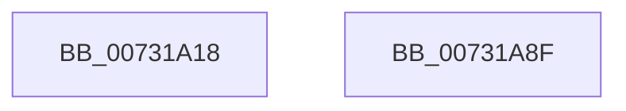

# PiDqObjectManagerInit

- RVA: `0x00731A18`–`0x00731A90` (길이 `120` bytes)
- VA: `0x0000000140731A18`
- 실행 섹션: `PAGE`
- PDB 이름 있음: `예`; PDB Function 태그: `아니요`
- unwind 정보 RVA: `0x0005CAAC`
- 디코드: `28`개 명령, `120/120` bytes 표시
- 미해석 바이트: `0` (있으면 어셈블리에 `.byte`로 보존)

> 이 문서는 커널 이미지의 기계어와 PDB 기호를 분석해 생성했습니다. 4번과 5번은 함수 원형과 자료형을 바이너리 사용 방식에서 추정한 C 해석이며 원본 소스 복구 결과는 아닙니다.

## 1. Dependencies

- 직접 호출 지점: **3**; 고유 호출 대상: **3**
- 직접 호출자로 확인된 함수: **1**
- RIP 상대 이미지 참조: **1**

### Outgoing calls
- `0x00731A2F` → [memset](../../text/6C/memset_function_006C6C40.md) (function, `0x006C6C40`)
- `0x00731A3D` → [ExInitializeResourceLite](../../text/41/ExInitializeResourceLite_function_0041F9A0.md) (function, `0x0041F9A0`)
- `0x00731A46` → [KeInitializeGuardedMutex](../../text/46/KeInitializeGuardedMutex_function_00466E90.md) (function, `0x00466E90`)

### Direct callers
- [PiDqInit](../../init/C3/PiDqInit_function_00C35120.md) at `0x00C35130`
- [PiDqInit](../../init/C3/PiDqInit_function_00C35120.md) at `0x00C35141`
- [PiDqInit](../../init/C3/PiDqInit_function_00C35120.md) at `0x00C35152`
- [PiDqInit](../../init/C3/PiDqInit_function_00C35120.md) at `0x00C35163`
- [PiDqInit](../../init/C3/PiDqInit_function_00C35120.md) at `0x00C35174`
- [PiDqInit](../../init/C3/PiDqInit_function_00C35120.md) at `0x00C35185`

### Static image references
- `0x00731A6C` → RVA `0x008DD640` (`PiDqObjectManagerServiceActionQueue`; read)

## 2. Other-region calls and transfers

- 다른 실행 섹션으로 향하는 call: **3**
  - `0x00731A2F` → [memset](../../text/6C/memset_function_006C6C40.md) (`PAGE` → `.text`)
  - `0x00731A3D` → [ExInitializeResourceLite](../../text/41/ExInitializeResourceLite_function_0041F9A0.md) (`PAGE` → `.text`)
  - `0x00731A46` → [KeInitializeGuardedMutex](../../text/46/KeInitializeGuardedMutex_function_00466E90.md) (`PAGE` → `.text`)
- 별도 외부 분기/꼬리 이동을 확인하지 못했습니다.

## 3. Assembly (complete function range)

```asm
00731A18  48 89 5C 24 08                  mov qword ptr [rsp + 8], rbx
00731A1D  57                              push rdi
00731A1E  48 83 EC 20                     sub rsp, 0x20
00731A22  8B DA                           mov ebx, edx
00731A24  41 B8 F0 00 00 00               mov r8d, 0xf0
00731A2A  33 D2                           xor edx, edx
00731A2C  48 8B F9                        mov rdi, rcx
00731A2F  E8 0C 52 F9 FF                  call 0x1406c6c40
00731A34  48 8B CF                        mov rcx, rdi
00731A37  89 9F E8 00 00 00               mov dword ptr [rdi + 0xe8], ebx
00731A3D  E8 5E DF CE FF                  call 0x14041f9a0
00731A42  48 8D 4F 68                     lea rcx, [rdi + 0x68]
00731A46  E8 45 54 D3 FF                  call 0x140466e90
00731A4B  48 8B 5C 24 30                  mov rbx, qword ptr [rsp + 0x30]
00731A50  48 8D 87 C0 00 00 00            lea rax, [rdi + 0xc0]
00731A57  48 89 40 08                     mov qword ptr [rax + 8], rax
00731A5B  48 89 00                        mov qword ptr [rax], rax
00731A5E  48 8D 87 D0 00 00 00            lea rax, [rdi + 0xd0]
00731A65  48 89 40 08                     mov qword ptr [rax + 8], rax
00731A69  48 89 00                        mov qword ptr [rax], rax
00731A6C  48 8D 05 CD BB 1A 00            lea rax, [rip + 0x1abbcd]
00731A73  48 83 A7 A0 00 00 00 00         and qword ptr [rdi + 0xa0], 0
00731A7B  48 89 87 B0 00 00 00            mov qword ptr [rdi + 0xb0], rax
00731A82  48 89 BF B8 00 00 00            mov qword ptr [rdi + 0xb8], rdi
00731A89  48 83 C4 20                     add rsp, 0x20
00731A8D  5F                              pop rdi
00731A8E  C3                              ret
00731A8F  CC                              int3
```

## 4. C-style interpretation (structured pseudocode)

```c
__int64 __fastcall PiDqObjectManagerInit(__int64 a1, int a2)
{
    __int64 result;
    __int64 v_rsp;
    unsigned __int64 v_stack_p8;

    v_stack_p8 = v_rbx;
    v_rsp = (v_rsp) - (32);
    a2 = 0;
    result = memset(a1, a2, 240, a4);
    *(unsigned int *)(a1 + 232) = (unsigned int)((unsigned int)(a2));
    result = ExInitializeResourceLite(a1, a2, 240, a4);
    result = KeInitializeGuardedMutex(a1 + 104, a2, 240, a4);
    *(unsigned __int64 *)(a1 + 192 + 8) = a1 + 192;
    *(unsigned __int64 *)(a1 + 192) = a1 + 192;
    *(unsigned __int64 *)(a1 + 208 + 8) = a1 + 208;
    *(unsigned __int64 *)(a1 + 208) = a1 + 208;
    *(unsigned __int64 *)(a1 + 176) = v_rip + 1752013;
    *(unsigned __int64 *)(a1 + 184) = a1;
    v_rsp = (v_rsp) + (32);
    return v_rip + 1752013;
}
```

## 5. (Beta) C Style

```c
int64_t PiDqObjectManagerInit(void *Arg1, int32_t Arg2)
{
    uint8_t *arg1 = (uint8_t *)Arg1;

    int64_t result;
    int64_t local_rsp;
    uint64_t v_stack_p8;

    v_stack_p8 = local_rbx;
    local_rsp = (local_rsp) - (32);
    Arg2 = 0;
    result = memset(Arg1, Arg2, 240, a4);
    *(uint32_t *)(arg1 + 0xE8) = (uint32_t)((uint32_t)(Arg2));
    result = ExInitializeResourceLite(Arg1, Arg2, 240, a4);
    result = KeInitializeGuardedMutex(Arg1 + 104, Arg2, 240, a4);
    *(void **)(arg1 + 0xC0 + 0x8) = Arg1 + 192;
    *(void **)(arg1 + 0xC0) = Arg1 + 192;
    *(void **)(arg1 + 0xD0 + 0x8) = Arg1 + 208;
    *(void **)(arg1 + 0xD0) = Arg1 + 208;
    *(uint64_t *)(arg1 + 0xB0) = v_rip + 1752013;
    *(void **)(arg1 + 0xB8) = Arg1;
    local_rsp = (local_rsp) + (32);
    return v_rip + 1752013;
}
```

### 관측된 메모리 오프셋

구조체 형식이 확인되지 않은 접근은 인자 기준의 오프셋으로만 기록했습니다.

| 기준 인자 | 오프셋 표현 | 폭 (bit) | 접근 |
|---|---:|---:|---|
| `Arg1` | `+ 0x0` | `64` | `W` |
| `Arg1` | `+ 0x8` | `64` | `W` |
| `Arg1` | `+ 0x68` | `64` | `R` |
| `Arg1` | `+ 0xA0` | `64` | `R/W` |
| `Arg1` | `+ 0xB0` | `64` | `W` |
| `Arg1` | `+ 0xB8` | `64` | `W` |
| `Arg1` | `+ 0xC0` | `64` | `R` |
| `Arg1` | `+ 0xD0` | `64` | `R` |
| `Arg1` | `+ 0xE8` | `32` | `W` |

## 6. Execution-region graph

[열기: 2D/3D 그래프와 함수 탐색 컨트롤 패널](../../../control-panel.html?section=page&rva=0x00731A18&view=graph)

- 2D 그래프는 위에서 아래로 흐르고, 3D 그래프는 빈 공간을 드래그해 회전합니다. Shift+드래그는 이동, 휠은 확대·축소, 함수 노드 선택은 대상 보고서 이동입니다.

### Static fallback


