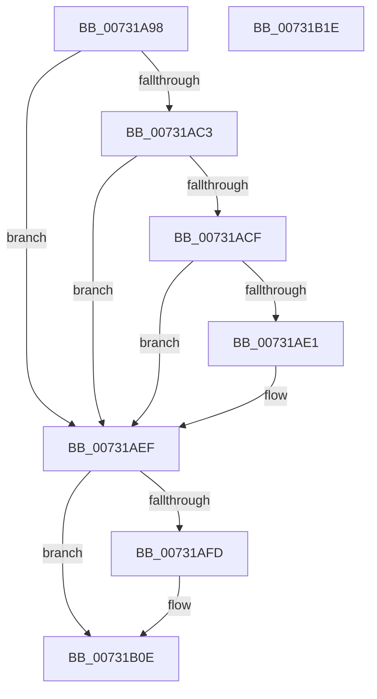

# PiDqObjectManagerMakeInconsistent

- RVA: `0x00731A98`–`0x00731B1F` (길이 `135` bytes)
- VA: `0x0000000140731A98`
- 실행 섹션: `PAGE`
- PDB 이름 있음: `예`; PDB Function 태그: `아니요`
- unwind 정보 RVA: `0x00060BC4`
- 디코드: `35`개 명령, `135/135` bytes 표시
- 미해석 바이트: `0` (있으면 어셈블리에 `.byte`로 보존)

> 이 문서는 커널 이미지의 기계어와 PDB 기호를 분석해 생성했습니다. 4번과 5번은 함수 원형과 자료형을 바이너리 사용 방식에서 추정한 C 해석이며 원본 소스 복구 결과는 아닙니다.

## 1. Dependencies

- 직접 호출 지점: **3**; 고유 호출 대상: **3**
- 직접 호출자로 확인된 함수: **1**
- RIP 상대 이미지 참조: **0**

### Outgoing calls
- `0x00731AB1` → [ExAcquireFastMutex](../../text/20/ExAcquireFastMutex_function_0020E5A0.md) (function, `0x0020E5A0`)
- `0x00731AF3` → [ExReleaseFastMutex](../../text/25/ExReleaseFastMutex_function_002519C0.md) (function, `0x002519C0`)
- `0x00731B09` → [ExQueueWorkItem](../../text/2F/ExQueueWorkItem_function_002F9520.md) (function, `0x002F9520`)

### Direct callers
- [PiPnpRtlObjectEventWorker](../8F/PiPnpRtlObjectEventWorker_function_008F8630.md) at `0x008F8A37`

### Static image references
- 디코드된 RIP-relative 메모리 참조가 없습니다.

## 2. Other-region calls and transfers

- 다른 실행 섹션으로 향하는 call: **3**
  - `0x00731AB1` → [ExAcquireFastMutex](../../text/20/ExAcquireFastMutex_function_0020E5A0.md) (`PAGE` → `.text`)
  - `0x00731AF3` → [ExReleaseFastMutex](../../text/25/ExReleaseFastMutex_function_002519C0.md) (`PAGE` → `.text`)
  - `0x00731B09` → [ExQueueWorkItem](../../text/2F/ExQueueWorkItem_function_002F9520.md) (`PAGE` → `.text`)
- 별도 외부 분기/꼬리 이동을 확인하지 못했습니다.

## 3. Assembly (complete function range)

```asm
00731A98  48 89 5C 24 08                  mov qword ptr [rsp + 8], rbx
00731A9D  48 89 74 24 10                  mov qword ptr [rsp + 0x10], rsi
00731AA2  57                              push rdi
00731AA3  48 83 EC 20                     sub rsp, 0x20
00731AA7  48 8B D9                        mov rbx, rcx
00731AAA  40 32 FF                        xor dil, dil
00731AAD  48 83 C1 68                     add rcx, 0x68
00731AB1  E8 EA CA AD FF                  call 0x14020e5a0
00731AB6  44 8B 83 E4 00 00 00            mov r8d, dword ptr [rbx + 0xe4]
00731ABD  41 F6 C0 02                     test r8b, 2
00731AC1  75 2C                           jne 0x140731aef
00731AC3  48 8D 83 C0 00 00 00            lea rax, [rbx + 0xc0]
00731ACA  48 39 00                        cmp qword ptr [rax], rax
00731ACD  74 20                           je 0x140731aef
00731ACF  41 8B C0                        mov eax, r8d
00731AD2  83 C8 02                        or eax, 2
00731AD5  89 83 E4 00 00 00               mov dword ptr [rbx + 0xe4], eax
00731ADB  41 F6 C0 01                     test r8b, 1
00731ADF  75 0E                           jne 0x140731aef
00731AE1  41 83 C8 03                     or r8d, 3
00731AE5  40 B7 01                        mov dil, 1
00731AE8  44 89 83 E4 00 00 00            mov dword ptr [rbx + 0xe4], r8d
00731AEF  48 8D 4B 68                     lea rcx, [rbx + 0x68]
00731AF3  E8 C8 FE B1 FF                  call 0x1402519c0
00731AF8  40 84 FF                        test dil, dil
00731AFB  74 11                           je 0x140731b0e
00731AFD  48 8D 8B A0 00 00 00            lea rcx, [rbx + 0xa0]
00731B04  BA 03 00 00 00                  mov edx, 3
00731B09  E8 12 7A BC FF                  call 0x1402f9520
00731B0E  48 8B 5C 24 30                  mov rbx, qword ptr [rsp + 0x30]
00731B13  48 8B 74 24 38                  mov rsi, qword ptr [rsp + 0x38]
00731B18  48 83 C4 20                     add rsp, 0x20
00731B1C  5F                              pop rdi
00731B1D  C3                              ret
00731B1E  CC                              int3
```

## 4. C-style interpretation (structured pseudocode)

```c
__int64 __fastcall PiDqObjectManagerMakeInconsistent(__int64 a1)
{
    __int64 result;
    __int64 v_rdi;
    __int64 v_rsp;
    unsigned __int64 v_stack_p10;
    unsigned __int64 v_stack_p8;

    v_stack_p8 = v_rbx;
    v_stack_p10 = v_rsi;
    v_rsp = (v_rsp) - (32);
    v_rdi = 0;
    a1 = (a1) + (104);
    result = ExAcquireFastMutex(a1, a2, a3, a4);
    if ((((unsigned __int8)((unsigned int)(*(unsigned int *)(a1 + 228)))) & (2)) != 0) goto loc_00731AEF;
    if ((*(unsigned __int64 *)(a1 + 192)) == (a1 + 192)) goto loc_00731AEF;
    result = (unsigned int)(((unsigned int)((unsigned int)((unsigned int)(*(unsigned int *)(a1 + 228))))) | (2));
    *(unsigned int *)(a1 + 228) = (unsigned int)(result);
    if ((((unsigned __int8)((unsigned int)(*(unsigned int *)(a1 + 228)))) & (1)) == 0) {
        a3 = (unsigned int)(((unsigned int)(*(unsigned int *)(a1 + 228))) | (3));
        v_rdi = 1;
        *(unsigned int *)(a1 + 228) = (unsigned int)(a3);
    }
    result = ExReleaseFastMutex(a1 + 104, a2, a3, a4);
    if ((unsigned __int8)(v_rdi) != 0) {
        a1 = a1 + 160;
        a2 = 3;
        result = ExQueueWorkItem(a1, a2, a3, a4);
    }
    v_rsp = (v_rsp) + (32);
    return result;
}
```

## 5. (Beta) C Style

```c
int64_t PiDqObjectManagerMakeInconsistent(void *Arg1)
{
    uint8_t *arg1 = (uint8_t *)Arg1;

    int64_t result;
    int64_t local_rdi;
    int64_t local_rsp;
    uint64_t v_stack_p10;
    uint64_t v_stack_p8;

    v_stack_p8 = local_rbx;
    v_stack_p10 = local_rsi;
    local_rsp = (local_rsp) - (32);
    local_rdi = 0;
    Arg1 = (Arg1) + (104);
    result = ExAcquireFastMutex(Arg1, a2, a3, a4);
    if ((((uint8_t)((uint32_t)(*(uint32_t *)(arg1 + 0xE4)))) & (2)) != 0) goto loc_00731AEF;
    if ((*(uint64_t *)(arg1 + 0xC0)) == (Arg1 + 192)) goto loc_00731AEF;
    result = (uint32_t)(((uint32_t)((uint32_t)((uint32_t)(*(uint32_t *)(arg1 + 0xE4))))) | (2));
    *(uint32_t *)(arg1 + 0xE4) = (uint32_t)(result);
    if ((((uint8_t)((uint32_t)(*(uint32_t *)(arg1 + 0xE4)))) & (1)) == 0) {
        a3 = (uint32_t)(((uint32_t)(*(uint32_t *)(arg1 + 0xE4))) | (3));
        local_rdi = 1;
        *(uint32_t *)(arg1 + 0xE4) = (uint32_t)(a3);
    }
    result = ExReleaseFastMutex(Arg1 + 104, a2, a3, a4);
    if ((uint8_t)(local_rdi) != 0) {
        Arg1 = Arg1 + 160;
        a2 = 3;
        result = ExQueueWorkItem(Arg1, a2, a3, a4);
    }
    local_rsp = (local_rsp) + (32);
    return result;
}
```

### 관측된 메모리 오프셋

구조체 형식이 확인되지 않은 접근은 인자 기준의 오프셋으로만 기록했습니다.

| 기준 인자 | 오프셋 표현 | 폭 (bit) | 접근 |
|---|---:|---:|---|
| `Arg1` | `+ 0x0` | `64` | `R` |
| `Arg1` | `+ 0x68` | `64` | `R` |
| `Arg1` | `+ 0xA0` | `64` | `R` |
| `Arg1` | `+ 0xC0` | `64` | `R` |
| `Arg1` | `+ 0xE4` | `32` | `R` |
| `Arg1` | `+ 0xE4` | `32` | `W` |

## 6. Execution-region graph

[열기: 2D/3D 그래프와 함수 탐색 컨트롤 패널](../../../control-panel.html?section=page&rva=0x00731A98&view=graph)

- 2D 그래프는 위에서 아래로 흐르고, 3D 그래프는 빈 공간을 드래그해 회전합니다. Shift+드래그는 이동, 휠은 확대·축소, 함수 노드 선택은 대상 보고서 이동입니다.

### Static fallback


