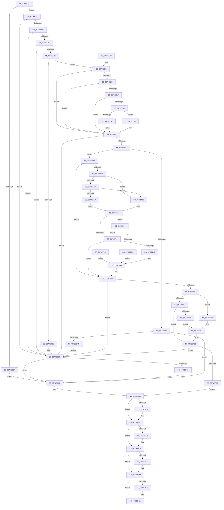

# PiInitializeDevice

- RVA: `0x0073EC5C`–`0x0073F041` (길이 `997` bytes)
- VA: `0x000000014073EC5C`
- 실행 섹션: `PAGE`
- PDB 이름 있음: `예`; PDB Function 태그: `아니요`
- unwind 정보 RVA: `0x000C9188`
- 디코드: `269`개 명령, `997/997` bytes 표시
- 미해석 바이트: `0` (있으면 어셈블리에 `.byte`로 보존)

> 이 문서는 커널 이미지의 기계어와 PDB 기호를 분석해 생성했습니다. 4번과 5번은 함수 원형과 자료형을 바이너리 사용 방식에서 추정한 C 해석이며 원본 소스 복구 결과는 아닙니다.

## 1. Dependencies

- 직접 호출 지점: **38**; 고유 호출 대상: **33**
- 직접 호출자로 확인된 함수: **1**
- RIP 상대 이미지 참조: **4**

### Outgoing calls
- `0x0073ECA0` → [PpDevNodeLockTree](../A1/PpDevNodeLockTree_function_00A19310.md) (function, `0x00A19310`)
- `0x0073ECBF` → [ExAcquireResourceExclusiveLite](../../text/21/ExAcquireResourceExclusiveLite_function_00214E20.md) (function, `0x00214E20`)
- `0x0073ECCE` → [PnpDeviceObjectFromDeviceInstanceWithTag](../8E/PnpDeviceObjectFromDeviceInstanceWithTag_function_008E7490.md) (function, `0x008E7490`)
- `0x0073ECE4` → [ObfDereferenceObjectWithTag](../../text/2F/ObfDereferenceObjectWithTag_function_002F78E0.md) (function, `0x002F78E0`)
- `0x0073ECFD` → [PnpUnicodeStringToWstr](../9D/PnpUnicodeStringToWstr_function_009D90C0.md) (function, `0x009D90C0`)
- `0x0073ED10` → [PiPnpRtlBeginOperation](../8E/PiPnpRtlBeginOperation_function_008E033C.md) (function, `0x008E033C`)
- `0x0073ED47` → [_CmOpenDeviceRegKey](../8E/_CmOpenDeviceRegKey_function_008EE540.md) (function, `0x008EE540`)
- `0x0073ED70` → [ExAllocatePool2](../../poolcode/B8/ExAllocatePool2_function_00B820F0.md) (function, `0x00B820F0`)
- `0x0073ED8E` → [IoDeleteDevice](../../text/26/IoDeleteDevice_function_0026FE90.md) (function, `0x0026FE90`)
- `0x0073ED9A` → [ExReleaseResourceLite](../../text/25/ExReleaseResourceLite_function_0025FA10.md) (function, `0x0025FA10`)
- `0x0073ED9F` → [KeLeaveCriticalRegion](../../text/25/KeLeaveCriticalRegion_function_0025D8B0.md) (function, `0x0025D8B0`)
- `0x0073EDA9` → [PpDevNodeUnlockTree](../A2/PpDevNodeUnlockTree_function_00A21290.md) (function, `0x00A21290`)
- `0x0073EDB7` → [ZwClose](../../text/6A/ZwClose_function_006AD2B0.md) (function, `0x006AD2B0`)
- `0x0073EDC5` → [PiPnpRtlEndOperation](../8E/PiPnpRtlEndOperation_function_008E0518.md) (function, `0x008E0518`)
- `0x0073EDD6` → [PnpUnicodeStringToWstrFree](../8F/PnpUnicodeStringToWstrFree_function_008F59F0.md) (function, `0x008F59F0`)
- `0x0073EDE5` → [ExFreePoolWithTag](../../poolcode/B8/ExFreePoolWithTag_function_00B82870.md) (function, `0x00B82870`)
- `0x0073EE30` → [CmGetDeviceRegProp](../8E/CmGetDeviceRegProp_function_008ED870.md) (function, `0x008ED870`)
- `0x0073EE4B` → [RtlInitUnicodeStringEx](../../text/46/RtlInitUnicodeStringEx_function_00463960.md) (function, `0x00463960`)
- `0x0073EE69` → [IopCreateRootEnumeratedDeviceObject](IopCreateRootEnumeratedDeviceObject_function_00737D1C.md) (function, `0x00737D1C`)
- `0x0073EE88` → [PipAllocateDeviceNode](../A9/PipAllocateDeviceNode_function_00A9C8F8.md) (function, `0x00A9C8F8`)
- `0x0073EEBC` → [PipSetDevNodeFlags](../8F/PipSetDevNodeFlags_function_008FC048.md) (function, `0x008FC048`)
- `0x0073EEC9` → [PipSetDevNodeState](../../text/47/PipSetDevNodeState_function_00470708.md) (function, `0x00470708`)
- `0x0073EF08` → [CmGetDeviceRegProp](../8E/CmGetDeviceRegProp_function_008ED870.md) (function, `0x008ED870`)
- `0x0073EF4E` → [PiDevCfgGetFailedInstallProblemStatus](PiDevCfgGetFailedInstallProblemStatus_function_00733730.md) (function, `0x00733730`)
- `0x0073EF5E` → [PipSetDevNodeProblem](../8F/PipSetDevNodeProblem_function_008FDE0C.md) (function, `0x008FDE0C`)
- `0x0073EF6E` → [PnpAllocateDeviceInstancePath](../72/PnpAllocateDeviceInstancePath_function_0072DC30.md) (function, `0x0072DC30`)
- `0x0073EF85` → [RtlCopyUnicodeString](../../text/3F/RtlCopyUnicodeString_function_003FEF30.md) (function, `0x003FEF30`)
- `0x0073EF98` → [PnpConcatenateUnicodeStrings](../95/PnpConcatenateUnicodeStrings_function_00951ED0.md) (function, `0x00951ED0`)
- `0x0073EFB9` → [PnpMapDeviceObjectToDeviceInstance](../A9/PnpMapDeviceObjectToDeviceInstance_function_00A9D884.md) (function, `0x00A9D884`)
- `0x0073EFD2` → [PpDevNodeInsertIntoTree](../../text/4C/PpDevNodeInsertIntoTree_function_004CA274.md) (function, `0x004CA274`)
- `0x0073EFDA` → [ObfReferenceObject](../../text/20/ObfReferenceObject_function_0020FA20.md) (function, `0x0020FA20`)
- `0x0073EFE6` → [ExReleaseResourceLite](../../text/25/ExReleaseResourceLite_function_0025FA10.md) (function, `0x0025FA10`)
- `0x0073EFEB` → [KeLeaveCriticalRegion](../../text/25/KeLeaveCriticalRegion_function_0025D8B0.md) (function, `0x0025D8B0`)
- `0x0073EFF3` → [PnpQueryAndSaveDeviceNodeCapabilities](../8F/PnpQueryAndSaveDeviceNodeCapabilities_function_008FBCE8.md) (function, `0x008FBCE8`)
- `0x0073F002` → [PnpRaiseNtPlugPlayDevicePropertyChangeEvent](../8F/PnpRaiseNtPlugPlayDevicePropertyChangeEvent_function_008F7D80.md) (function, `0x008F7D80`)
- `0x0073F011` → [PnpRaiseNtPlugPlayDevicePropertyChangeEvent](../8F/PnpRaiseNtPlugPlayDevicePropertyChangeEvent_function_008F7D80.md) (function, `0x008F7D80`)
- `0x0073F027` → [PnpRaiseNtPlugPlayDevicePropertyChangeEvent](../8F/PnpRaiseNtPlugPlayDevicePropertyChangeEvent_function_008F7D80.md) (function, `0x008F7D80`)
- `0x0073F037` → [PnpSetPlugPlayEvent](../8F/PnpSetPlugPlayEvent_function_008FBE04.md) (function, `0x008FBE04`)

### Direct callers
- [PiCMCreateDevice](../AC/PiCMCreateDevice_function_00ACB824.md) at `0x00ACBCF0`

### Static image references
- `0x0073ECAE` → RVA `0x00F8C600` (`.data`; read)
- `0x0073ED1B` → RVA `0x00E66398` (`.data`; read)
- `0x0073EFC8` → RVA `0x00F8C438` (`.data`; read)
- `0x0073F030` → RVA `0x00011610` (`.rdata`; read)

## 2. Other-region calls and transfers

- 다른 실행 섹션으로 향하는 call: **15**
  - `0x0073ECBF` → [ExAcquireResourceExclusiveLite](../../text/21/ExAcquireResourceExclusiveLite_function_00214E20.md) (`PAGE` → `.text`)
  - `0x0073ECE4` → [ObfDereferenceObjectWithTag](../../text/2F/ObfDereferenceObjectWithTag_function_002F78E0.md) (`PAGE` → `.text`)
  - `0x0073ED70` → [ExAllocatePool2](../../poolcode/B8/ExAllocatePool2_function_00B820F0.md) (`PAGE` → `POOLCODE`)
  - `0x0073ED8E` → [IoDeleteDevice](../../text/26/IoDeleteDevice_function_0026FE90.md) (`PAGE` → `.text`)
  - `0x0073ED9A` → [ExReleaseResourceLite](../../text/25/ExReleaseResourceLite_function_0025FA10.md) (`PAGE` → `.text`)
  - `0x0073ED9F` → [KeLeaveCriticalRegion](../../text/25/KeLeaveCriticalRegion_function_0025D8B0.md) (`PAGE` → `.text`)
  - `0x0073EDB7` → [ZwClose](../../text/6A/ZwClose_function_006AD2B0.md) (`PAGE` → `.text`)
  - `0x0073EDE5` → [ExFreePoolWithTag](../../poolcode/B8/ExFreePoolWithTag_function_00B82870.md) (`PAGE` → `POOLCODE`)
  - `0x0073EE4B` → [RtlInitUnicodeStringEx](../../text/46/RtlInitUnicodeStringEx_function_00463960.md) (`PAGE` → `.text`)
  - `0x0073EEC9` → [PipSetDevNodeState](../../text/47/PipSetDevNodeState_function_00470708.md) (`PAGE` → `.text`)
  - `0x0073EF85` → [RtlCopyUnicodeString](../../text/3F/RtlCopyUnicodeString_function_003FEF30.md) (`PAGE` → `.text`)
  - `0x0073EFD2` → [PpDevNodeInsertIntoTree](../../text/4C/PpDevNodeInsertIntoTree_function_004CA274.md) (`PAGE` → `.text`)
  - `0x0073EFDA` → [ObfReferenceObject](../../text/20/ObfReferenceObject_function_0020FA20.md) (`PAGE` → `.text`)
  - `0x0073EFE6` → [ExReleaseResourceLite](../../text/25/ExReleaseResourceLite_function_0025FA10.md) (`PAGE` → `.text`)
  - `0x0073EFEB` → [KeLeaveCriticalRegion](../../text/25/KeLeaveCriticalRegion_function_0025D8B0.md) (`PAGE` → `.text`)
- 별도 외부 분기/꼬리 이동을 확인하지 못했습니다.

## 3. Assembly (complete function range)

```asm
0073EC5C  48 89 4C 24 08                  mov qword ptr [rsp + 8], rcx
0073EC61  55                              push rbp
0073EC62  53                              push rbx
0073EC63  56                              push rsi
0073EC64  57                              push rdi
0073EC65  41 54                           push r12
0073EC67  41 55                           push r13
0073EC69  41 56                           push r14
0073EC6B  41 57                           push r15
0073EC6D  48 8D 6C 24 E1                  lea rbp, [rsp - 0x1f]
0073EC72  48 81 EC 88 00 00 00            sub rsp, 0x88
0073EC79  33 FF                           xor edi, edi
0073EC7B  4C 8B E9                        mov r13, rcx
0073EC7E  89 7D 7F                        mov dword ptr [rbp + 0x7f], edi
0073EC81  44 8B E7                        mov r12d, edi
0073EC84  89 7D 6F                        mov dword ptr [rbp + 0x6f], edi
0073EC87  89 7D 77                        mov dword ptr [rbp + 0x77], edi
0073EC8A  8D 4F 01                        lea ecx, [rdi + 1]
0073EC8D  89 7D 03                        mov dword ptr [rbp + 3], edi
0073EC90  48 89 7D F7                     mov qword ptr [rbp - 9], rdi
0073EC94  48 89 7D D7                     mov qword ptr [rbp - 0x29], rdi
0073EC98  48 89 7D EF                     mov qword ptr [rbp - 0x11], rdi
0073EC9C  48 89 7D DF                     mov qword ptr [rbp - 0x21], rdi
0073ECA0  E8 6B A6 2D 00                  call 0x140a19310
0073ECA5  65 48 8B 04 25 88 01 00 00      mov rax, qword ptr gs:[0x188]
0073ECAE  48 8D 0D 4B D9 84 00            lea rcx, [rip + 0x84d94b]
0073ECB5  B2 01                           mov dl, 1
0073ECB7  66 FF 88 E4 01 00 00            dec word ptr [rax + 0x1e4]
0073ECBE  90                              nop
0073ECBF  E8 5C 61 AD FF                  call 0x140214e20
0073ECC4  BB 50 6E 70 43                  mov ebx, 0x43706e50
0073ECC9  49 8B CD                        mov rcx, r13
0073ECCC  8B D3                           mov edx, ebx
0073ECCE  E8 BD 87 1A 00                  call 0x1408e7490
0073ECD3  48 89 45 E7                     mov qword ptr [rbp - 0x19], rax
0073ECD7  48 8B F0                        mov rsi, rax
0073ECDA  48 85 C0                        test rax, rax
0073ECDD  74 15                           je 0x14073ecf4
0073ECDF  8B D3                           mov edx, ebx
0073ECE1  48 8B C8                        mov rcx, rax
0073ECE4  E8 F7 8B BB FF                  call 0x1402f78e0
0073ECE9  4C 8B 75 D7                     mov r14, qword ptr [rbp - 0x29]
0073ECED  8B DF                           mov ebx, edi
0073ECEF  E9 9F 00 00 00                  jmp 0x14073ed93
0073ECF4  4D 8B C5                        mov r8, r13
0073ECF7  48 8D 4D D7                     lea rcx, [rbp - 0x29]
0073ECFB  33 D2                           xor edx, edx
0073ECFD  E8 BE A3 29 00                  call 0x1409d90c0
0073ED02  4C 8B 75 D7                     mov r14, qword ptr [rbp - 0x29]
0073ED06  8B D8                           mov ebx, eax
0073ED08  85 C0                           test eax, eax
0073ED0A  78 7A                           js 0x14073ed86
0073ED0C  48 8D 4D F7                     lea rcx, [rbp - 9]
0073ED10  E8 27 16 1A 00                  call 0x1408e033c
0073ED15  8B D8                           mov ebx, eax
0073ED17  85 C0                           test eax, eax
0073ED19  78 6B                           js 0x14073ed86
0073ED1B  48 8B 0D 76 76 72 00            mov rcx, qword ptr [rip + 0x727676]
0073ED22  48 8D 45 DF                     lea rax, [rbp - 0x21]
0073ED26  48 89 7C 24 38                  mov qword ptr [rsp + 0x38], rdi
0073ED2B  45 33 C9                        xor r9d, r9d
0073ED2E  48 89 44 24 30                  mov qword ptr [rsp + 0x30], rax
0073ED33  49 8B D6                        mov rdx, r14
0073ED36  40 88 7C 24 28                  mov byte ptr [rsp + 0x28], dil
0073ED3B  C7 44 24 20 3F 00 0F 00         mov dword ptr [rsp + 0x20], 0xf003f
0073ED43  45 8D 41 10                     lea r8d, [r9 + 0x10]
0073ED47  E8 F4 F7 1A 00                  call 0x1408ee540
0073ED4C  8B D8                           mov ebx, eax
0073ED4E  85 C0                           test eax, eax
0073ED50  78 34                           js 0x14073ed86
0073ED52  BA 00 02 00 00                  mov edx, 0x200
0073ED57  89 7D FF                        mov dword ptr [rbp - 1], edi
0073ED5A  B9 00 01 00 00                  mov ecx, 0x100
0073ED5F  89 55 6F                        mov dword ptr [rbp + 0x6f], edx
0073ED62  41 B8 50 70 20 20               mov r8d, 0x20207050
0073ED68  48 89 7D 07                     mov qword ptr [rbp + 7], rdi
0073ED6C  44 0F B7 FF                     movzx r15d, di
0073ED70  E8 7B 33 44 00                  call 0x140b820f0
0073ED75  4C 8B E0                        mov r12, rax
0073ED78  48 85 C0                        test rax, rax
0073ED7B  0F 85 80 00 00 00               jne 0x14073ee01
0073ED81  BB 9A 00 00 C0                  mov ebx, 0xc000009a
0073ED86  48 85 F6                        test rsi, rsi
0073ED89  74 08                           je 0x14073ed93
0073ED8B  48 8B CE                        mov rcx, rsi
0073ED8E  E8 FD 10 B3 FF                  call 0x14026fe90
0073ED93  48 8D 0D 66 D8 84 00            lea rcx, [rip + 0x84d866]
0073ED9A  E8 71 0C B2 FF                  call 0x14025fa10
0073ED9F  E8 0C EB B1 FF                  call 0x14025d8b0
0073EDA4  B9 01 00 00 00                  mov ecx, 1
0073EDA9  E8 E2 24 2E 00                  call 0x140a21290
0073EDAE  48 8B 4D DF                     mov rcx, qword ptr [rbp - 0x21]
0073EDB2  48 85 C9                        test rcx, rcx
0073EDB5  74 05                           je 0x14073edbc
0073EDB7  E8 F4 E4 F6 FF                  call 0x1406ad2b0
0073EDBC  48 8B 4D F7                     mov rcx, qword ptr [rbp - 9]
0073EDC0  48 85 C9                        test rcx, rcx
0073EDC3  74 05                           je 0x14073edca
0073EDC5  E8 4E 17 1A 00                  call 0x1408e0518
0073EDCA  4D 85 F6                        test r14, r14
0073EDCD  74 0C                           je 0x14073eddb
0073EDCF  48 8B 55 67                     mov rdx, qword ptr [rbp + 0x67]
0073EDD3  49 8B CE                        mov rcx, r14
0073EDD6  E8 15 6C 1B 00                  call 0x1408f59f0
0073EDDB  4D 85 E4                        test r12, r12
0073EDDE  74 0A                           je 0x14073edea
0073EDE0  33 D2                           xor edx, edx
0073EDE2  49 8B CC                        mov rcx, r12
0073EDE5  E8 86 3A 44 00                  call 0x140b82870
0073EDEA  8B C3                           mov eax, ebx
0073EDEC  48 81 C4 88 00 00 00            add rsp, 0x88
0073EDF3  41 5F                           pop r15
0073EDF5  41 5E                           pop r14
0073EDF7  41 5D                           pop r13
0073EDF9  41 5C                           pop r12
0073EDFB  5F                              pop rdi
0073EDFC  5E                              pop rsi
0073EDFD  5B                              pop rbx
0073EDFE  5D                              pop rbp
0073EDFF  C3                              ret
0073EE00  CC                              int3
0073EE01  4C 8B 45 DF                     mov r8, qword ptr [rbp - 0x21]
0073EE05  48 8D 45 6F                     lea rax, [rbp + 0x6f]
0073EE09  48 8B 0D 88 75 72 00            mov rcx, qword ptr [rip + 0x727588]
0073EE10  41 B9 05 00 00 00               mov r9d, 5
0073EE16  89 7C 24 38                     mov dword ptr [rsp + 0x38], edi
0073EE1A  49 8B D6                        mov rdx, r14
0073EE1D  48 89 44 24 30                  mov qword ptr [rsp + 0x30], rax
0073EE22  48 8D 45 77                     lea rax, [rbp + 0x77]
0073EE26  4C 89 64 24 28                  mov qword ptr [rsp + 0x28], r12
0073EE2B  48 89 44 24 20                  mov qword ptr [rsp + 0x20], rax
0073EE30  E8 3B EA 1A 00                  call 0x1408ed870
0073EE35  85 C0                           test eax, eax
0073EE37  78 2C                           js 0x14073ee65
0073EE39  83 7D 77 01                     cmp dword ptr [rbp + 0x77], 1
0073EE3D  75 26                           jne 0x14073ee65
0073EE3F  39 7D 6F                        cmp dword ptr [rbp + 0x6f], edi
0073EE42  74 21                           je 0x14073ee65
0073EE44  49 8B D4                        mov rdx, r12
0073EE47  48 8D 4D FF                     lea rcx, [rbp - 1]
0073EE4B  E8 10 4B D2 FF                  call 0x140463960
0073EE50  85 C0                           test eax, eax
0073EE52  79 0C                           jns 0x14073ee60
0073EE54  89 7D FF                        mov dword ptr [rbp - 1], edi
0073EE57  44 8B FF                        mov r15d, edi
0073EE5A  48 89 7D 07                     mov qword ptr [rbp + 7], rdi
0073EE5E  EB 05                           jmp 0x14073ee65
0073EE60  44 0F B7 7D FF                  movzx r15d, word ptr [rbp - 1]
0073EE65  48 8D 4D E7                     lea rcx, [rbp - 0x19]
0073EE69  E8 AE 8E FF FF                  call 0x140737d1c
0073EE6E  48 8B 75 E7                     mov rsi, qword ptr [rbp - 0x19]
0073EE72  8B D8                           mov ebx, eax
0073EE74  85 C0                           test eax, eax
0073EE76  0F 88 0A FF FF FF               js 0x14073ed86
0073EE7C  0F BA 6E 30 0C                  bts dword ptr [rsi + 0x30], 0xc
0073EE81  48 8D 55 EF                     lea rdx, [rbp - 0x11]
0073EE85  48 8B CE                        mov rcx, rsi
0073EE88  E8 6B DA 35 00                  call 0x140a9c8f8
0073EE8D  48 8B 7D EF                     mov rdi, qword ptr [rbp - 0x11]
0073EE91  33 DB                           xor ebx, ebx
0073EE93  48 85 FF                        test rdi, rdi
0073EE96  75 1C                           jne 0x14073eeb4
0073EE98  BB 9A 00 00 C0                  mov ebx, 0xc000009a
0073EE9D  3D 6E 03 00 C0                  cmp eax, 0xc000036e
0073EEA2  0F 44 C3                        cmove eax, ebx
0073EEA5  8B D8                           mov ebx, eax
0073EEA7  85 C0                           test eax, eax
0073EEA9  0F 89 E4 FE FF FF               jns 0x14073ed93
0073EEAF  E9 D2 FE FF FF                  jmp 0x14073ed86
0073EEB4  BA 11 00 00 00                  mov edx, 0x11
0073EEB9  48 8B CF                        mov rcx, rdi
0073EEBC  E8 87 D1 1B 00                  call 0x1408fc048
0073EEC1  BA 04 03 00 00                  mov edx, 0x304
0073EEC6  48 8B CF                        mov rcx, rdi
0073EEC9  E8 3A 18 D3 FF                  call 0x140470708
0073EECE  4C 8B 45 DF                     mov r8, qword ptr [rbp - 0x21]
0073EED2  48 8D 45 6F                     lea rax, [rbp + 0x6f]
0073EED6  48 8B 0D BB 74 72 00            mov rcx, qword ptr [rip + 0x7274bb]
0073EEDD  41 B9 0B 00 00 00               mov r9d, 0xb
0073EEE3  89 5C 24 38                     mov dword ptr [rsp + 0x38], ebx
0073EEE7  49 8B D6                        mov rdx, r14
0073EEEA  48 89 44 24 30                  mov qword ptr [rsp + 0x30], rax
0073EEEF  48 8D 45 7F                     lea rax, [rbp + 0x7f]
0073EEF3  48 89 44 24 28                  mov qword ptr [rsp + 0x28], rax
0073EEF8  48 8D 45 77                     lea rax, [rbp + 0x77]
0073EEFC  48 89 44 24 20                  mov qword ptr [rsp + 0x20], rax
0073EF01  C7 45 6F 04 00 00 00            mov dword ptr [rbp + 0x6f], 4
0073EF08  E8 63 E9 1A 00                  call 0x1408ed870
0073EF0D  85 C0                           test eax, eax
0073EF0F  78 52                           js 0x14073ef63
0073EF11  83 7D 77 04                     cmp dword ptr [rbp + 0x77], 4
0073EF15  75 0B                           jne 0x14073ef22
0073EF17  83 7D 6F 04                     cmp dword ptr [rbp + 0x6f], 4
0073EF1B  75 05                           jne 0x14073ef22
0073EF1D  8B 45 7F                        mov eax, dword ptr [rbp + 0x7f]
0073EF20  EB 05                           jmp 0x14073ef27
0073EF22  8B C3                           mov eax, ebx
0073EF24  89 5D 7F                        mov dword ptr [rbp + 0x7f], ebx
0073EF27  A8 20                           test al, 0x20
0073EF29  74 09                           je 0x14073ef34
0073EF2B  45 33 C0                        xor r8d, r8d
0073EF2E  41 8D 50 12                     lea edx, [r8 + 0x12]
0073EF32  EB 27                           jmp 0x14073ef5b
0073EF34  0F BA E0 0D                     bt eax, 0xd
0073EF38  73 09                           jae 0x14073ef43
0073EF3A  45 33 C0                        xor r8d, r8d
0073EF3D  41 8D 50 10                     lea edx, [r8 + 0x10]
0073EF41  EB 18                           jmp 0x14073ef5b
0073EF43  A8 40                           test al, 0x40
0073EF45  74 1C                           je 0x14073ef63
0073EF47  48 8B 55 DF                     mov rdx, qword ptr [rbp - 0x21]
0073EF4B  49 8B CE                        mov rcx, r14
0073EF4E  E8 DD 47 FF FF                  call 0x140733730
0073EF53  44 8B C0                        mov r8d, eax
0073EF56  BA 1C 00 00 00                  mov edx, 0x1c
0073EF5B  48 8B CF                        mov rcx, rdi
0073EF5E  E8 A9 EE 1B 00                  call 0x1408fde0c
0073EF63  41 0F B7 55 00                  movzx edx, word ptr [r13]
0073EF68  48 8B CF                        mov rcx, rdi
0073EF6B  83 C2 02                        add edx, 2
0073EF6E  E8 BD EC FE FF                  call 0x14072dc30
0073EF73  8B D8                           mov ebx, eax
0073EF75  85 C0                           test eax, eax
0073EF77  0F 88 09 FE FF FF               js 0x14073ed86
0073EF7D  48 8B 55 67                     mov rdx, qword ptr [rbp + 0x67]
0073EF81  48 8D 4F 28                     lea rcx, [rdi + 0x28]
0073EF85  E8 A6 FF CB FF                  call 0x1403fef30
0073EF8A  66 45 85 FF                     test r15w, r15w
0073EF8E  74 16                           je 0x14073efa6
0073EF90  48 8D 55 FF                     lea rdx, [rbp - 1]
0073EF94  48 8D 4F 38                     lea rcx, [rdi + 0x38]
0073EF98  E8 33 2F 21 00                  call 0x140951ed0
0073EF9D  45 33 FF                        xor r15d, r15d
0073EFA0  85 C0                           test eax, eax
0073EFA2  79 0D                           jns 0x14073efb1
0073EFA4  EB 03                           jmp 0x14073efa9
0073EFA6  45 33 FF                        xor r15d, r15d
0073EFA9  44 89 7F 38                     mov dword ptr [rdi + 0x38], r15d
0073EFAD  4C 89 7F 40                     mov qword ptr [rdi + 0x40], r15
0073EFB1  48 8B 4F 20                     mov rcx, qword ptr [rdi + 0x20]
0073EFB5  48 8D 57 28                     lea rdx, [rdi + 0x28]
0073EFB9  E8 C6 E8 35 00                  call 0x140a9d884
0073EFBE  8B D8                           mov ebx, eax
0073EFC0  85 C0                           test eax, eax
0073EFC2  0F 88 BE FD FF FF               js 0x14073ed86
0073EFC8  48 8B 0D 69 D4 84 00            mov rcx, qword ptr [rip + 0x84d469]
0073EFCF  48 8B D7                        mov rdx, rdi
0073EFD2  E8 9D B2 D8 FF                  call 0x1404ca274
0073EFD7  48 8B CE                        mov rcx, rsi
0073EFDA  E8 41 0A AD FF                  call 0x14020fa20
0073EFDF  48 8D 0D 1A D6 84 00            lea rcx, [rip + 0x84d61a]
0073EFE6  E8 25 0A B2 FF                  call 0x14025fa10
0073EFEB  E8 C0 E8 B1 FF                  call 0x14025d8b0
0073EFF0  48 8B CF                        mov rcx, rdi
0073EFF3  E8 F0 CC 1B 00                  call 0x1408fbce8
0073EFF8  48 8B 57 30                     mov rdx, qword ptr [rdi + 0x30]
0073EFFC  41 B8 01 00 00 00               mov r8d, 1
0073F002  E8 79 8D 1B 00                  call 0x1408f7d80
0073F007  48 8B 57 30                     mov rdx, qword ptr [rdi + 0x30]
0073F00B  41 B8 0E 00 00 00               mov r8d, 0xe
0073F011  E8 6A 8D 1B 00                  call 0x1408f7d80
0073F016  48 8B 15 1B D4 84 00            mov rdx, qword ptr [rip + 0x84d41b]
0073F01D  41 B8 0F 00 00 00               mov r8d, 0xf
0073F023  48 8B 52 30                     mov rdx, qword ptr [rdx + 0x30]
0073F027  E8 54 8D 1B 00                  call 0x1408f7d80
0073F02C  48 8B 57 20                     mov rdx, qword ptr [rdi + 0x20]
0073F030  48 8D 0D D9 25 8D FF            lea rcx, [rip - 0x72da27]
0073F037  E8 C8 CD 1B 00                  call 0x1408fbe04
0073F03C  E9 63 FD FF FF                  jmp 0x14073eda4
```

## 4. C-style interpretation (structured pseudocode)

```c
__int64 __fastcall PiInitializeDevice(__int64 a1, __int64 a2, __int64 a3, int a4)
{
    __int64 result;
    __int64 v_r15;
    __int64 v_rbx;
    __int64 v_rdi;
    __int64 v_rsp;
    unsigned __int64 v_stack_m58;
    unsigned int v_stack_m5C;
    unsigned __int64 v_stack_m5F;
    unsigned int v_stack_m60;
    unsigned __int64 v_stack_m68;
    unsigned __int64 v_stack_m70;
    unsigned __int64 v_stack_m78;
    unsigned __int64 v_stack_m80;
    unsigned __int64 v_stack_m88;
    unsigned __int64 v_stack_m90;
    unsigned __int64 v_stack_m98;
    unsigned __int8 v_stack_mA0;
    unsigned int v_stack_mA8;
    unsigned int v_stack_p10;
    unsigned int v_stack_p18;
    unsigned int v_stack_p20;
    unsigned __int64 v_stack_p28;
    unsigned __int64 v_stack_p30;
    unsigned int v_stack_p38;
    unsigned __int64 v_stack_p8;

    v_stack_p8 = a1;
    v_rsp = (v_rsp) - (136);
    v_rdi = 0;
    v_stack_p20 = 0;
    v_stack_p10 = 0;
    v_stack_p18 = 0;
    v_stack_m5C = 0;
    v_stack_m68 = 0;
    v_stack_m88 = 0;
    v_stack_m70 = 0;
    v_stack_m80 = 0;
    result = PpDevNodeLockTree(v_rdi + 1, a2, a3, a4);
    result = ExAcquireResourceExclusiveLite(v_rip + 8706379, 1, a3, a4);
    result = PnpDeviceObjectFromDeviceInstanceWithTag(a1, (unsigned int)((unsigned int)((unsigned int)(0x43706E50ULL))), a3, a4);
    v_stack_m78 = result;
    if (result == 0) goto loc_0073ECF4;
    result = ObfDereferenceObjectWithTag(result, (unsigned int)((unsigned int)((unsigned int)(0x43706E50ULL))), a3, a4);
    goto loc_0073ED93;
loc_0073ECF4:
    a2 = 0;
    result = PnpUnicodeStringToWstr(v_stack_m88, a2, a1, a4);
    if (sign_flag) goto loc_0073ED86;
    result = PiPnpRtlBeginOperation(v_stack_m68, a2, a1, a4);
    if (sign_flag) goto loc_0073ED86;
    v_stack_m90 = 0;
    a4 = 0;
    v_stack_m98 = v_stack_m80;
    v_stack_mA0 = 0;
    v_stack_mA8 = 0xF003FULL;
    result = _CmOpenDeviceRegKey(*(unsigned __int64 *)(v_rip + 7501430), v_stack_m88, a4 + 16, a4);
    if (sign_flag) goto loc_0073ED86;
    v_stack_m60 = 0;
    v_stack_p10 = 512;
    v_stack_m58 = 0;
    result = ExAllocatePool2(256, 512, (unsigned int)(0x20207050ULL), a4);
    if (result != 0) goto loc_0073EE01;
loc_0073ED86:
    if (result != 0) {
        a1 = result;
        result = IoDeleteDevice(a1, 512, (unsigned int)(0x20207050ULL), a4);
    }
    result = ExReleaseResourceLite(v_rip + 8706150, 512, (unsigned int)(0x20207050ULL), a4);
    result = KeLeaveCriticalRegion(v_rip + 8706150, 512, (unsigned int)(0x20207050ULL), a4);
loc_0073EDA4:
    result = PpDevNodeUnlockTree(1, 512, (unsigned int)(0x20207050ULL), a4);
    if (v_stack_m80 != 0) {
        result = ZwClose(v_stack_m80, 512, (unsigned int)(0x20207050ULL), a4);
    }
    if (v_stack_m68 != 0) {
        result = PiPnpRtlEndOperation(v_stack_m68, 512, (unsigned int)(0x20207050ULL), a4);
    }
    if (v_stack_m88 != 0) {
        a2 = v_stack_p8;
        a1 = v_stack_m88;
        result = PnpUnicodeStringToWstrFree(a1, a2, (unsigned int)(0x20207050ULL), a4);
    }
    if (result != 0) {
        a2 = 0;
        a1 = result;
        result = ExFreePoolWithTag(a1, a2, (unsigned int)(0x20207050ULL), a4);
    }
    v_rsp = (v_rsp) + (136);
    return (unsigned int)((unsigned int)((unsigned int)(0xC000009AULL)));
loc_0073EE01:
    v_stack_p38 = 0;
    v_stack_p30 = v_stack_p10;
    v_stack_p28 = result;
    v_stack_p20 = v_stack_p18;
    result = CmGetDeviceRegProp(*(unsigned __int64 *)(v_rip + 7501192), v_stack_m88, v_stack_m80, 5);
    if (sign_flag) goto loc_0073EE65;
    if (v_stack_p18 != 1) goto loc_0073EE65;
    if (v_stack_p10 == 0) goto loc_0073EE65;
    result = RtlInitUnicodeStringEx(v_stack_m60, result, v_stack_m80, 5);
    if (!sign_flag) goto loc_0073EE60;
    v_stack_m60 = 0;
    v_stack_m58 = 0;
    goto loc_0073EE65;
loc_0073EE60:
loc_0073EE65:
    result = IopCreateRootEnumeratedDeviceObject(v_stack_m78, result, v_stack_m80, 5);
    if (sign_flag) goto loc_0073ED86;
    result = PipAllocateDeviceNode(v_stack_m78, v_stack_m70, v_stack_m80, 5);
    v_rbx = 0;
    if (v_stack_m70 != 0) goto loc_0073EEB4;
    if (((unsigned int)(result)) == 0xC000036EULL) { result = (unsigned int)((unsigned int)(0xC000009AULL)); }
    if (!sign_flag) goto loc_0073ED93;
    goto loc_0073ED86;
loc_0073EEB4:
    result = PipSetDevNodeFlags(v_stack_m70, 17, v_stack_m80, 5);
    result = PipSetDevNodeState(v_stack_m70, 772, v_stack_m80, 5);
    v_stack_p38 = (unsigned int)((unsigned int)((unsigned int)(result)));
    v_stack_p30 = v_stack_p10;
    v_stack_p28 = v_stack_p20;
    v_stack_p20 = v_stack_p18;
    v_stack_p10 = 4;
    result = CmGetDeviceRegProp(*(unsigned __int64 *)(v_rip + 7500987), v_stack_m88, v_stack_m80, 11);
    if (sign_flag) goto loc_0073EF63;
    if (v_stack_p18 != 4) goto loc_0073EF22;
    if (v_stack_p10 != 4) goto loc_0073EF22;
    goto loc_0073EF27;
loc_0073EF22:
    v_stack_p20 = (unsigned int)((unsigned int)((unsigned int)(result)));
loc_0073EF27:
    if ((((unsigned __int8)((unsigned int)((unsigned int)((unsigned int)((unsigned int)(result)))))) & (32)) == 0) goto loc_0073EF34;
    a3 = 0;
    goto loc_0073EF5B;
loc_0073EF34:
    if (condition_is_above_or_equal) goto loc_0073EF43;
    a3 = 0;
    goto loc_0073EF5B;
loc_0073EF43:
    if ((((unsigned __int8)((unsigned int)((unsigned int)((unsigned int)((unsigned int)(result)))))) & (64)) == 0) goto loc_0073EF63;
    result = PiDevCfgGetFailedInstallProblemStatus(v_stack_m88, v_stack_m80, a3, 11);
loc_0073EF5B:
    result = PipSetDevNodeProblem(v_stack_m70, 28, (unsigned int)((unsigned int)(result)), 11);
loc_0073EF63:
    a2 = (unsigned int)((*(unsigned __int16 *)(a1)) + (2));
    result = PnpAllocateDeviceInstancePath(v_stack_m70, a2, (unsigned int)((unsigned int)(result)), 11);
    if (sign_flag) goto loc_0073ED86;
    result = RtlCopyUnicodeString(v_stack_m70 + 40, v_stack_p8, (unsigned int)((unsigned int)(result)), 11);
    if ((unsigned __int16)(v_stack_m60) == 0) goto loc_0073EFA6;
    result = PnpConcatenateUnicodeStrings(v_stack_m70 + 56, v_stack_m60, (unsigned int)((unsigned int)(result)), 11);
    v_r15 = 0;
    if (!sign_flag) goto loc_0073EFB1;
    goto loc_0073EFA9;
loc_0073EFA6:
    v_r15 = 0;
loc_0073EFA9:
    *(unsigned int *)(v_stack_m70 + 56) = 0;
    *(unsigned __int64 *)(v_stack_m70 + 64) = 0;
loc_0073EFB1:
    result = PnpMapDeviceObjectToDeviceInstance(*(unsigned __int64 *)(v_stack_m70 + 32), v_stack_m70 + 40, (unsigned int)((unsigned int)(result)), 11);
    if (sign_flag) goto loc_0073ED86;
    result = PpDevNodeInsertIntoTree(*(unsigned __int64 *)(v_rip + 8705129), v_stack_m70, (unsigned int)((unsigned int)(result)), 11);
    result = ObfReferenceObject(v_stack_m78, v_stack_m70, (unsigned int)((unsigned int)(result)), 11);
    result = ExReleaseResourceLite(v_rip + 8705562, v_stack_m70, (unsigned int)((unsigned int)(result)), 11);
    result = KeLeaveCriticalRegion(v_rip + 8705562, v_stack_m70, (unsigned int)((unsigned int)(result)), 11);
    result = PnpQueryAndSaveDeviceNodeCapabilities(v_stack_m70, v_stack_m70, (unsigned int)((unsigned int)(result)), 11);
    result = PnpRaiseNtPlugPlayDevicePropertyChangeEvent(v_stack_m70, *(unsigned __int64 *)(v_stack_m70 + 48), 1, 11);
    result = PnpRaiseNtPlugPlayDevicePropertyChangeEvent(v_stack_m70, *(unsigned __int64 *)(v_stack_m70 + 48), 14, 11);
    result = PnpRaiseNtPlugPlayDevicePropertyChangeEvent(v_stack_m70, *(unsigned __int64 *)(*(unsigned __int64 *)(v_rip + 8705051) + 48), 15, 11);
    result = PnpSetPlugPlayEvent(v_rip - 7526951, *(unsigned __int64 *)(v_stack_m70 + 32), 15, 11);
    goto loc_0073EDA4;
}
```

## 5. (Beta) C Style

```c
int64_t PiInitializeDevice(void *Arg1, int64_t Arg2, int64_t Arg3, int32_t Arg4)
{
    uint8_t *arg1 = (uint8_t *)Arg1;

    int64_t result;
    int64_t local_r15;
    int64_t local_rbx;
    int64_t local_rdi;
    int64_t local_rsp;
    uint64_t v_stack_m58;
    uint32_t v_stack_m5C;
    uint64_t v_stack_m5F;
    uint32_t v_stack_m60;
    uint64_t v_stack_m68;
    uint64_t v_stack_m70;
    uint64_t v_stack_m78;
    uint64_t v_stack_m80;
    uint64_t v_stack_m88;
    uint64_t v_stack_m90;
    uint64_t v_stack_m98;
    uint8_t v_stack_mA0;
    uint32_t v_stack_mA8;
    uint32_t v_stack_p10;
    uint32_t v_stack_p18;
    uint32_t v_stack_p20;
    uint64_t v_stack_p28;
    uint64_t v_stack_p30;
    uint32_t v_stack_p38;
    uint64_t v_stack_p8;

    v_stack_p8 = Arg1;
    local_rsp = (local_rsp) - (136);
    local_rdi = 0;
    v_stack_p20 = 0;
    v_stack_p10 = 0;
    v_stack_p18 = 0;
    v_stack_m5C = 0;
    v_stack_m68 = 0;
    v_stack_m88 = 0;
    v_stack_m70 = 0;
    v_stack_m80 = 0;
    result = PpDevNodeLockTree(local_rdi + 1, Arg2, Arg3, Arg4);
    result = ExAcquireResourceExclusiveLite(v_rip + 8706379, 1, Arg3, Arg4);
    result = PnpDeviceObjectFromDeviceInstanceWithTag(Arg1, (uint32_t)((uint32_t)((uint32_t)(0x43706E50ULL))), Arg3, Arg4);
    v_stack_m78 = result;
    if (result == 0) goto loc_0073ECF4;
    result = ObfDereferenceObjectWithTag(result, (uint32_t)((uint32_t)((uint32_t)(0x43706E50ULL))), Arg3, Arg4);
    goto loc_0073ED93;
loc_0073ECF4:
    Arg2 = 0;
    result = PnpUnicodeStringToWstr(v_stack_m88, Arg2, Arg1, Arg4);
    if (sign_flag) goto loc_0073ED86;
    result = PiPnpRtlBeginOperation(v_stack_m68, Arg2, Arg1, Arg4);
    if (sign_flag) goto loc_0073ED86;
    v_stack_m90 = 0;
    Arg4 = 0;
    v_stack_m98 = v_stack_m80;
    v_stack_mA0 = 0;
    v_stack_mA8 = 0xF003FULL;
    result = _CmOpenDeviceRegKey(*(uint64_t *)(v_rip + 0x727676), v_stack_m88, Arg4 + 16, Arg4);
    if (sign_flag) goto loc_0073ED86;
    v_stack_m60 = 0;
    v_stack_p10 = 512;
    v_stack_m58 = 0;
    result = ExAllocatePool2(256, 512, (uint32_t)(0x20207050ULL), Arg4);
    if (result != 0) goto loc_0073EE01;
loc_0073ED86:
    if (result != 0) {
        Arg1 = result;
        result = IoDeleteDevice(Arg1, 512, (uint32_t)(0x20207050ULL), Arg4);
    }
    result = ExReleaseResourceLite(v_rip + 8706150, 512, (uint32_t)(0x20207050ULL), Arg4);
    result = KeLeaveCriticalRegion(v_rip + 8706150, 512, (uint32_t)(0x20207050ULL), Arg4);
loc_0073EDA4:
    result = PpDevNodeUnlockTree(1, 512, (uint32_t)(0x20207050ULL), Arg4);
    if (v_stack_m80 != 0) {
        result = ZwClose(v_stack_m80, 512, (uint32_t)(0x20207050ULL), Arg4);
    }
    if (v_stack_m68 != 0) {
        result = PiPnpRtlEndOperation(v_stack_m68, 512, (uint32_t)(0x20207050ULL), Arg4);
    }
    if (v_stack_m88 != 0) {
        Arg2 = v_stack_p8;
        Arg1 = v_stack_m88;
        result = PnpUnicodeStringToWstrFree(Arg1, Arg2, (uint32_t)(0x20207050ULL), Arg4);
    }
    if (result != 0) {
        Arg2 = 0;
        Arg1 = result;
        result = ExFreePoolWithTag(Arg1, Arg2, (uint32_t)(0x20207050ULL), Arg4);
    }
    local_rsp = (local_rsp) + (136);
    return (uint32_t)((uint32_t)((uint32_t)(0xC000009AULL)));
loc_0073EE01:
    v_stack_p38 = 0;
    v_stack_p30 = v_stack_p10;
    v_stack_p28 = result;
    v_stack_p20 = v_stack_p18;
    result = CmGetDeviceRegProp(*(uint64_t *)(v_rip + 0x727588), v_stack_m88, v_stack_m80, 5);
    if (sign_flag) goto loc_0073EE65;
    if (v_stack_p18 != 1) goto loc_0073EE65;
    if (v_stack_p10 == 0) goto loc_0073EE65;
    result = RtlInitUnicodeStringEx(v_stack_m60, result, v_stack_m80, 5);
    if (!sign_flag) goto loc_0073EE60;
    v_stack_m60 = 0;
    v_stack_m58 = 0;
    goto loc_0073EE65;
loc_0073EE60:
loc_0073EE65:
    result = IopCreateRootEnumeratedDeviceObject(v_stack_m78, result, v_stack_m80, 5);
    if (sign_flag) goto loc_0073ED86;
    result = PipAllocateDeviceNode(v_stack_m78, v_stack_m70, v_stack_m80, 5);
    local_rbx = 0;
    if (v_stack_m70 != 0) goto loc_0073EEB4;
    if (((uint32_t)(result)) == 0xC000036EULL) { result = (uint32_t)((uint32_t)(0xC000009AULL)); }
    if (!sign_flag) goto loc_0073ED93;
    goto loc_0073ED86;
loc_0073EEB4:
    result = PipSetDevNodeFlags(v_stack_m70, 17, v_stack_m80, 5);
    result = PipSetDevNodeState(v_stack_m70, 772, v_stack_m80, 5);
    v_stack_p38 = (uint32_t)((uint32_t)((uint32_t)(result)));
    v_stack_p30 = v_stack_p10;
    v_stack_p28 = v_stack_p20;
    v_stack_p20 = v_stack_p18;
    v_stack_p10 = 4;
    result = CmGetDeviceRegProp(*(uint64_t *)(v_rip + 0x7274BB), v_stack_m88, v_stack_m80, 11);
    if (sign_flag) goto loc_0073EF63;
    if (v_stack_p18 != 4) goto loc_0073EF22;
    if (v_stack_p10 != 4) goto loc_0073EF22;
    goto loc_0073EF27;
loc_0073EF22:
    v_stack_p20 = (uint32_t)((uint32_t)((uint32_t)(result)));
loc_0073EF27:
    if ((((uint8_t)((uint32_t)((uint32_t)((uint32_t)((uint32_t)(result)))))) & (32)) == 0) goto loc_0073EF34;
    Arg3 = 0;
    goto loc_0073EF5B;
loc_0073EF34:
    if (condition_is_above_or_equal) goto loc_0073EF43;
    Arg3 = 0;
    goto loc_0073EF5B;
loc_0073EF43:
    if ((((uint8_t)((uint32_t)((uint32_t)((uint32_t)((uint32_t)(result)))))) & (64)) == 0) goto loc_0073EF63;
    result = PiDevCfgGetFailedInstallProblemStatus(v_stack_m88, v_stack_m80, Arg3, 11);
loc_0073EF5B:
    result = PipSetDevNodeProblem(v_stack_m70, 28, (uint32_t)((uint32_t)(result)), 11);
loc_0073EF63:
    Arg2 = (uint32_t)((*(uint16_t *)(arg1)) + (2));
    result = PnpAllocateDeviceInstancePath(v_stack_m70, Arg2, (uint32_t)((uint32_t)(result)), 11);
    if (sign_flag) goto loc_0073ED86;
    result = RtlCopyUnicodeString(v_stack_m70 + 40, v_stack_p8, (uint32_t)((uint32_t)(result)), 11);
    if ((uint16_t)(v_stack_m60) == 0) goto loc_0073EFA6;
    result = PnpConcatenateUnicodeStrings(v_stack_m70 + 56, v_stack_m60, (uint32_t)((uint32_t)(result)), 11);
    local_r15 = 0;
    if (!sign_flag) goto loc_0073EFB1;
    goto loc_0073EFA9;
loc_0073EFA6:
    local_r15 = 0;
loc_0073EFA9:
    *(uint32_t *)(v_stack_m70 + 0x38) = 0;
    *(uint64_t *)(v_stack_m70 + 0x40) = 0;
loc_0073EFB1:
    result = PnpMapDeviceObjectToDeviceInstance(*(uint64_t *)(v_stack_m70 + 0x20), v_stack_m70 + 40, (uint32_t)((uint32_t)(result)), 11);
    if (sign_flag) goto loc_0073ED86;
    result = PpDevNodeInsertIntoTree(*(uint64_t *)(v_rip + 0x84D469), v_stack_m70, (uint32_t)((uint32_t)(result)), 11);
    result = ObfReferenceObject(v_stack_m78, v_stack_m70, (uint32_t)((uint32_t)(result)), 11);
    result = ExReleaseResourceLite(v_rip + 8705562, v_stack_m70, (uint32_t)((uint32_t)(result)), 11);
    result = KeLeaveCriticalRegion(v_rip + 8705562, v_stack_m70, (uint32_t)((uint32_t)(result)), 11);
    result = PnpQueryAndSaveDeviceNodeCapabilities(v_stack_m70, v_stack_m70, (uint32_t)((uint32_t)(result)), 11);
    result = PnpRaiseNtPlugPlayDevicePropertyChangeEvent(v_stack_m70, *(uint64_t *)(v_stack_m70 + 0x30), 1, 11);
    result = PnpRaiseNtPlugPlayDevicePropertyChangeEvent(v_stack_m70, *(uint64_t *)(v_stack_m70 + 0x30), 14, 11);
    result = PnpRaiseNtPlugPlayDevicePropertyChangeEvent(v_stack_m70, *(uint64_t *)(*(uint64_t *)(v_rip + 0x84D41B) + 0x30), 15, 11);
    result = PnpSetPlugPlayEvent(v_rip - 7526951, *(uint64_t *)(v_stack_m70 + 0x20), 15, 11);
    goto loc_0073EDA4;
}
```

### 관측된 메모리 오프셋

구조체 형식이 확인되지 않은 접근은 인자 기준의 오프셋으로만 기록했습니다.

| 기준 인자 | 오프셋 표현 | 폭 (bit) | 접근 |
|---|---:|---:|---|
| `Arg1` | `+ 0x0` | `16` | `R` |

## 6. Execution-region graph

[열기: 2D/3D 그래프와 함수 탐색 컨트롤 패널](../../../control-panel.html?section=page&rva=0x0073EC5C&view=graph)

- 2D 그래프는 위에서 아래로 흐르고, 3D 그래프는 빈 공간을 드래그해 회전합니다. Shift+드래그는 이동, 휠은 확대·축소, 함수 노드 선택은 대상 보고서 이동입니다.

### Static fallback


