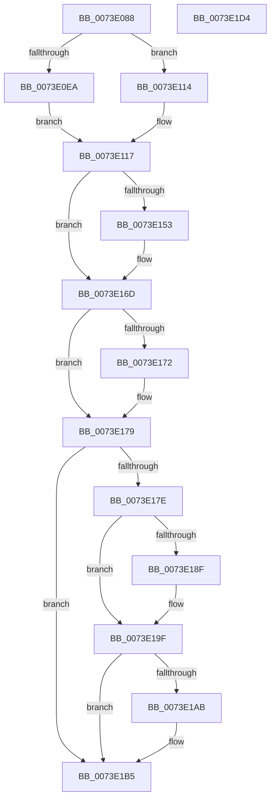

# PiIrpQueryRemoveDevice

- RVA: `0x0073E088`–`0x0073E1D5` (길이 `333` bytes)
- VA: `0x000000014073E088`
- 실행 섹션: `PAGE`
- PDB 이름 있음: `예`; PDB Function 태그: `아니요`
- unwind 정보 RVA: `0x000C9114`
- 디코드: `91`개 명령, `333/333` bytes 표시
- 미해석 바이트: `0` (있으면 어셈블리에 `.byte`로 보존)

> 이 문서는 커널 이미지의 기계어와 PDB 기호를 분석해 생성했습니다. 4번과 5번은 함수 원형과 자료형을 바이너리 사용 방식에서 추정한 C 해석이며 원본 소스 복구 결과는 아닙니다.

## 1. Dependencies

- 직접 호출 지점: **13**; 고유 호출 대상: **11**
- 직접 호출자로 확인된 함수: **2**
- RIP 상대 이미지 참조: **1**

### Outgoing calls
- `0x0073E0D2` → [memset](../../text/6C/memset_function_006C6C40.md) (function, `0x006C6C40`)
- `0x0073E0E0` → [PnpFindMountableDevice](../../text/4B/PnpFindMountableDevice_function_004B1418.md) (function, `0x004B1418`)
- `0x0073E0F3` → [PnpLockMountableDevice](../../text/4C/PnpLockMountableDevice_function_004CFFAC.md) (function, `0x004CFFAC`)
- `0x0073E102` → [PnpMarkDeviceForRemove](../../text/4C/PnpMarkDeviceForRemove_function_004C9DA8.md) (function, `0x004C9DA8`)
- `0x0073E10D` → [PnpUnlockMountableDevice](../../text/4C/PnpUnlockMountableDevice_function_004CDD2C.md) (function, `0x004CDD2C`)
- `0x0073E12E` → [KeInitializeEvent](../../text/40/KeInitializeEvent_function_0040DD10.md) (function, `0x0040DD10`)
- `0x0073E145` → [PnpAsynchronousCall](../A6/PnpAsynchronousCall_function_00A635D0.md) (function, `0x00A635D0`)
- `0x0073E165` → [KeWaitForSingleObject](../../text/20/KeWaitForSingleObject_function_0020E6B0.md) (function, `0x0020E6B0`)
- `0x0073E181` → [PnpLockMountableDevice](../../text/4C/PnpLockMountableDevice_function_004CFFAC.md) (function, `0x004CFFAC`)
- `0x0073E192` → [IopDecrementDeviceObjectHandleCount](../../text/59/IopDecrementDeviceObjectHandleCount_function_00596FE4.md) (function, `0x00596FE4`)
- `0x0073E19A` → [ObfDereferenceObject](../../text/2F/ObfDereferenceObject_function_002F9350.md) (function, `0x002F9350`)
- `0x0073E1A2` → [PnpUnlockMountableDevice](../../text/4C/PnpUnlockMountableDevice_function_004CDD2C.md) (function, `0x004CDD2C`)
- `0x0073E1AE` → [IopInvalidateVolumesForDevice](../9A/IopInvalidateVolumesForDevice_function_009A5E74.md) (function, `0x009A5E74`)

### Direct callers
- [PnpDisableDevice](../72/PnpDisableDevice_function_0072C6FC.md) at `0x0072C743`
- [PnpQueryRemoveLockedDeviceNode](../72/PnpQueryRemoveLockedDeviceNode_function_0072D210.md) at `0x0072D280`

### Static image references
- `0x0073E13A` → RVA `0x005AA540` (`PnpDiagnosticCompletionRoutine`; read)

## 2. Other-region calls and transfers

- 다른 실행 섹션으로 향하는 call: **11**
  - `0x0073E0D2` → [memset](../../text/6C/memset_function_006C6C40.md) (`PAGE` → `.text`)
  - `0x0073E0E0` → [PnpFindMountableDevice](../../text/4B/PnpFindMountableDevice_function_004B1418.md) (`PAGE` → `.text`)
  - `0x0073E0F3` → [PnpLockMountableDevice](../../text/4C/PnpLockMountableDevice_function_004CFFAC.md) (`PAGE` → `.text`)
  - `0x0073E102` → [PnpMarkDeviceForRemove](../../text/4C/PnpMarkDeviceForRemove_function_004C9DA8.md) (`PAGE` → `.text`)
  - `0x0073E10D` → [PnpUnlockMountableDevice](../../text/4C/PnpUnlockMountableDevice_function_004CDD2C.md) (`PAGE` → `.text`)
  - `0x0073E12E` → [KeInitializeEvent](../../text/40/KeInitializeEvent_function_0040DD10.md) (`PAGE` → `.text`)
  - `0x0073E165` → [KeWaitForSingleObject](../../text/20/KeWaitForSingleObject_function_0020E6B0.md) (`PAGE` → `.text`)
  - `0x0073E181` → [PnpLockMountableDevice](../../text/4C/PnpLockMountableDevice_function_004CFFAC.md) (`PAGE` → `.text`)
  - `0x0073E192` → [IopDecrementDeviceObjectHandleCount](../../text/59/IopDecrementDeviceObjectHandleCount_function_00596FE4.md) (`PAGE` → `.text`)
  - `0x0073E19A` → [ObfDereferenceObject](../../text/2F/ObfDereferenceObject_function_002F9350.md) (`PAGE` → `.text`)
  - `0x0073E1A2` → [PnpUnlockMountableDevice](../../text/4C/PnpUnlockMountableDevice_function_004CDD2C.md) (`PAGE` → `.text`)
- 별도 외부 분기/꼬리 이동을 확인하지 못했습니다.

## 3. Assembly (complete function range)

```asm
0073E088  48 8B C4                        mov rax, rsp
0073E08B  48 89 58 08                     mov qword ptr [rax + 8], rbx
0073E08F  48 89 70 10                     mov qword ptr [rax + 0x10], rsi
0073E093  48 89 78 18                     mov qword ptr [rax + 0x18], rdi
0073E097  4C 89 70 20                     mov qword ptr [rax + 0x20], r14
0073E09B  55                              push rbp
0073E09C  48 8D 68 A1                     lea rbp, [rax - 0x5f]
0073E0A0  48 81 EC B0 00 00 00            sub rsp, 0xb0
0073E0A7  48 83 65 EF 00                  and qword ptr [rbp - 0x11], 0
0073E0AC  48 8B F2                        mov rsi, rdx
0073E0AF  83 65 FB 00                     and dword ptr [rbp - 5], 0
0073E0B3  48 8B D9                        mov rbx, rcx
0073E0B6  0F 57 C0                        xorps xmm0, xmm0
0073E0B9  48 8D 4D 0F                     lea rcx, [rbp + 0xf]
0073E0BD  0F 57 C9                        xorps xmm1, xmm1
0073E0C0  45 33 F6                        xor r14d, r14d
0073E0C3  33 D2                           xor edx, edx
0073E0C5  0F 11 45 FF                     movups xmmword ptr [rbp - 1], xmm0
0073E0C9  45 8D 46 48                     lea r8d, [r14 + 0x48]
0073E0CD  F3 0F 7F 4D DF                  movdqu xmmword ptr [rbp - 0x21], xmm1
0073E0D2  E8 69 8B F8 FF                  call 0x1406c6c40
0073E0D7  48 8B CB                        mov rcx, rbx
0073E0DA  66 C7 45 0F 1B 01               mov word ptr [rbp + 0xf], 0x11b
0073E0E0  E8 33 33 D7 FF                  call 0x1404b1418
0073E0E5  48 85 C0                        test rax, rax
0073E0E8  74 2A                           je 0x14073e114
0073E0EA  48 8B CB                        mov rcx, rbx
0073E0ED  41 BE 01 00 00 00               mov r14d, 1
0073E0F3  E8 B4 1E D9 FF                  call 0x1404cffac
0073E0F8  4C 8D 45 FF                     lea r8, [rbp - 1]
0073E0FC  41 8B D6                        mov edx, r14d
0073E0FF  48 8B CB                        mov rcx, rbx
0073E102  E8 A1 BC D8 FF                  call 0x1404c9da8
0073E107  48 8B CB                        mov rcx, rbx
0073E10A  48 8B F8                        mov rdi, rax
0073E10D  E8 1A FC D8 FF                  call 0x1404cdd2c
0073E112  EB 03                           jmp 0x14073e117
0073E114  48 8B FB                        mov rdi, rbx
0073E117  48 83 65 D7 00                  and qword ptr [rbp - 0x29], 0
0073E11C  48 8D 4D DF                     lea rcx, [rbp - 0x21]
0073E120  45 33 C0                        xor r8d, r8d
0073E123  C7 45 F7 01 00 00 C0            mov dword ptr [rbp - 9], 0xc0000001
0073E12A  41 8D 50 01                     lea edx, [r8 + 1]
0073E12E  E8 DD FB CC FF                  call 0x14040dd10
0073E133  4C 8D 4D D7                     lea r9, [rbp - 0x29]
0073E137  48 8B CF                        mov rcx, rdi
0073E13A  4C 8D 05 FF C3 E6 FF            lea r8, [rip - 0x193c01]
0073E141  48 8D 55 0F                     lea rdx, [rbp + 0xf]
0073E145  E8 86 54 32 00                  call 0x140a635d0
0073E14A  8B F8                           mov edi, eax
0073E14C  3D 03 01 00 00                  cmp eax, 0x103
0073E151  75 1A                           jne 0x14073e16d
0073E153  48 83 64 24 20 00               and qword ptr [rsp + 0x20], 0
0073E159  48 8D 4D DF                     lea rcx, [rbp - 0x21]
0073E15D  45 33 C9                        xor r9d, r9d
0073E160  45 33 C0                        xor r8d, r8d
0073E163  33 D2                           xor edx, edx
0073E165  E8 46 05 AD FF                  call 0x14020e6b0
0073E16A  8B 7D F7                        mov edi, dword ptr [rbp - 9]
0073E16D  48 85 F6                        test rsi, rsi
0073E170  74 07                           je 0x14073e179
0073E172  48 8B 45 D7                     mov rax, qword ptr [rbp - 0x29]
0073E176  48 89 06                        mov qword ptr [rsi], rax
0073E179  45 85 F6                        test r14d, r14d
0073E17C  74 37                           je 0x14073e1b5
0073E17E  48 8B CB                        mov rcx, rbx
0073E181  E8 26 1E D9 FF                  call 0x1404cffac
0073E186  48 8B 75 07                     mov rsi, qword ptr [rbp + 7]
0073E18A  48 85 F6                        test rsi, rsi
0073E18D  74 10                           je 0x14073e19f
0073E18F  48 8B CE                        mov rcx, rsi
0073E192  E8 4D 8E E5 FF                  call 0x140596fe4
0073E197  48 8B CE                        mov rcx, rsi
0073E19A  E8 B1 B1 BB FF                  call 0x1402f9350
0073E19F  48 8B CB                        mov rcx, rbx
0073E1A2  E8 85 FB D8 FF                  call 0x1404cdd2c
0073E1A7  85 FF                           test edi, edi
0073E1A9  78 0A                           js 0x14073e1b5
0073E1AB  48 8B CB                        mov rcx, rbx
0073E1AE  E8 C1 7C 26 00                  call 0x1409a5e74
0073E1B3  8B F8                           mov edi, eax
0073E1B5  4C 8D 9C 24 B0 00 00 00         lea r11, [rsp + 0xb0]
0073E1BD  8B C7                           mov eax, edi
0073E1BF  49 8B 5B 10                     mov rbx, qword ptr [r11 + 0x10]
0073E1C3  49 8B 73 18                     mov rsi, qword ptr [r11 + 0x18]
0073E1C7  49 8B 7B 20                     mov rdi, qword ptr [r11 + 0x20]
0073E1CB  4D 8B 73 28                     mov r14, qword ptr [r11 + 0x28]
0073E1CF  49 8B E3                        mov rsp, r11
0073E1D2  5D                              pop rbp
0073E1D3  C3                              ret
0073E1D4  CC                              int3
```

## 4. C-style interpretation (structured pseudocode)

```c
__int64 __fastcall PiIrpQueryRemoveDevice(__int64 a1, __int64 a2)
{
    __int64 result;
    __int64 v_r14;
    __int64 v_rdi;
    __int64 v_rsp;
    unsigned __int64 v_stack_m8;
    unsigned __int64 v_stack_m98;

    *(unsigned __int64 *)(v_rsp + 8) = v_rbx;
    *(unsigned __int64 *)(v_rsp + 16) = v_rsi;
    *(unsigned __int64 *)(v_rsp + 24) = v_rdi;
    *(unsigned __int64 *)(v_rsp + 32) = v_r14;
    v_rsp = (v_rsp) - (176);
    v_r14 = 0;
    a2 = 0;
    *(unsigned __int64 *)(v_rsp - 95 - 1) = v_xmm0;
    *(unsigned __int64 *)(v_rsp - 95 - 33) = v_xmm1;
    result = memset(v_rsp - 95 + 15, a2, v_r14 + 72, a4);
    *(unsigned __int16 *)(v_rsp - 95 + 15) = 283;
    result = PnpFindMountableDevice(a1, a2, v_r14 + 72, a4);
    if (result == 0) goto loc_0073E114;
    result = PnpLockMountableDevice(a1, a2, v_r14 + 72, a4);
    result = PnpMarkDeviceForRemove(a1, 1, v_rsp - 95 - 1, a4);
    result = PnpUnlockMountableDevice(a1, 1, v_rsp - 95 - 1, a4);
    goto loc_0073E117;
loc_0073E114:
loc_0073E117:
    a3 = 0;
    *(unsigned int *)(v_rsp - 95 - 9) = 0xC0000001ULL;
    result = KeInitializeEvent(v_rsp - 95 - 33, a3 + 1, a3, a4);
    result = PnpAsynchronousCall(a1, v_rsp - 95 + 15, v_rip - 1653761, v_rsp - 95 - 41);
    v_rdi = (unsigned int)((unsigned int)(result));
    if (((unsigned int)(result)) == 259) {
        a1 = v_rsp - 95 - 33;
        a4 = 0;
        a3 = 0;
        a2 = 0;
        result = KeWaitForSingleObject(a1, a2, a3, a4);
        v_rdi = *(unsigned int *)(v_rsp - 95 - 9);
    }
    if (0 != 0) {
        result = *(unsigned __int64 *)(v_rsp - 95 - 41);
        *(unsigned __int64 *)(a2) = result;
    }
    if (1 == 0) goto loc_0073E1B5;
    result = PnpLockMountableDevice(a1, a2, a3, a4);
    if (*(unsigned __int64 *)(v_rsp - 95 + 7) != 0) {
        a1 = *(unsigned __int64 *)(v_rsp - 95 + 7);
        result = IopDecrementDeviceObjectHandleCount(a1, a2, a3, a4);
        a1 = *(unsigned __int64 *)(v_rsp - 95 + 7);
        result = ObfDereferenceObject(a1, a2, a3, a4);
    }
    result = PnpUnlockMountableDevice(a1, a2, a3, a4);
    if (!(sign_flag)) {
        a1 = a1;
        result = IopInvalidateVolumesForDevice(a1, a2, a3, a4);
        v_rdi = (unsigned int)(result);
    }
    return (unsigned int)((unsigned int)(v_rdi));
}
```

## 5. (Beta) C Style

```c
int64_t PiIrpQueryRemoveDevice(int64_t Arg1, int64_t Arg2)
{
    int64_t result;
    int64_t local_r14;
    int64_t local_rdi;
    int64_t local_rsp;
    uint64_t v_stack_m8;
    uint64_t v_stack_m98;

    *(uint64_t *)(local_rsp + 0x8) = local_rbx;
    *(uint64_t *)(local_rsp + 0x10) = local_rsi;
    *(uint64_t *)(local_rsp + 0x18) = local_rdi;
    *(uint64_t *)(local_rsp + 0x20) = local_r14;
    local_rsp = (local_rsp) - (176);
    local_r14 = 0;
    Arg2 = 0;
    *(uint64_t *)(local_rsp - 0x5F - 0x1) = v_xmm0;
    *(uint64_t *)(local_rsp - 0x5F - 0x21) = v_xmm1;
    result = memset(local_rsp - 95 + 15, Arg2, local_r14 + 72, a4);
    *(uint16_t *)(local_rsp - 0x5F + 0xF) = 283;
    result = PnpFindMountableDevice(Arg1, Arg2, local_r14 + 72, a4);
    if (result == 0) goto loc_0073E114;
    result = PnpLockMountableDevice(Arg1, Arg2, local_r14 + 72, a4);
    result = PnpMarkDeviceForRemove(Arg1, 1, local_rsp - 95 - 1, a4);
    result = PnpUnlockMountableDevice(Arg1, 1, local_rsp - 95 - 1, a4);
    goto loc_0073E117;
loc_0073E114:
loc_0073E117:
    a3 = 0;
    *(uint32_t *)(local_rsp - 0x5F - 0x9) = 0xC0000001ULL;
    result = KeInitializeEvent(local_rsp - 95 - 33, a3 + 1, a3, a4);
    result = PnpAsynchronousCall(Arg1, local_rsp - 95 + 15, v_rip - 1653761, local_rsp - 95 - 41);
    local_rdi = (uint32_t)((uint32_t)(result));
    if (((uint32_t)(result)) == 259) {
        Arg1 = local_rsp - 95 - 33;
        a4 = 0;
        a3 = 0;
        Arg2 = 0;
        result = KeWaitForSingleObject(Arg1, Arg2, a3, a4);
        local_rdi = *(uint32_t *)(local_rsp - 0x5F - 0x9);
    }
    if (0 != 0) {
        result = *(uint64_t *)(local_rsp - 0x5F - 0x29);
        *(uint64_t *)(Arg2) = result;
    }
    if (1 == 0) goto loc_0073E1B5;
    result = PnpLockMountableDevice(Arg1, Arg2, a3, a4);
    if (*(uint64_t *)(local_rsp - 0x5F + 0x7) != 0) {
        Arg1 = *(uint64_t *)(local_rsp - 0x5F + 0x7);
        result = IopDecrementDeviceObjectHandleCount(Arg1, Arg2, a3, a4);
        Arg1 = *(uint64_t *)(local_rsp - 0x5F + 0x7);
        result = ObfDereferenceObject(Arg1, Arg2, a3, a4);
    }
    result = PnpUnlockMountableDevice(Arg1, Arg2, a3, a4);
    if (!(sign_flag)) {
        Arg1 = Arg1;
        result = IopInvalidateVolumesForDevice(Arg1, Arg2, a3, a4);
        local_rdi = (uint32_t)(result);
    }
    return (uint32_t)((uint32_t)(local_rdi));
}
```

## 6. Execution-region graph

[열기: 2D/3D 그래프와 함수 탐색 컨트롤 패널](../../../control-panel.html?section=page&rva=0x0073E088&view=graph)

- 2D 그래프는 위에서 아래로 흐르고, 3D 그래프는 빈 공간을 드래그해 회전합니다. Shift+드래그는 이동, 휠은 확대·축소, 함수 노드 선택은 대상 보고서 이동입니다.

### Static fallback


