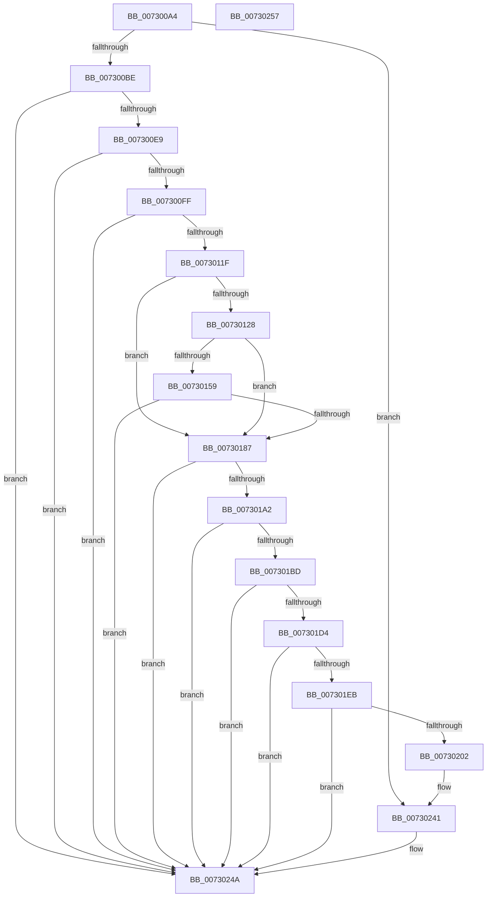

# PiPnpRtlInit

- RVA: `0x007300A4`–`0x00730258` (길이 `436` bytes)
- VA: `0x00000001407300A4`
- 실행 섹션: `PAGE`
- PDB 이름 있음: `예`; PDB Function 태그: `아니요`
- unwind 정보 RVA: `0x00065960`
- 디코드: `99`개 명령, `436/436` bytes 표시
- 미해석 바이트: `0` (있으면 어셈블리에 `.byte`로 보존)

> 이 문서는 커널 이미지의 기계어와 PDB 기호를 분석해 생성했습니다. 4번과 5번은 함수 원형과 자료형을 바이너리 사용 방식에서 추정한 C 해석이며 원본 소스 복구 결과는 아닙니다.

## 1. Dependencies

- 직접 호출 지점: **13**; 고유 호출 대상: **8**
- 직접 호출자로 확인된 함수: **2**
- RIP 상대 이미지 참조: **15**

### Outgoing calls
- `0x007300DA` → [ExInitializeResourceLite](../../text/41/ExInitializeResourceLite_function_0041F9A0.md) (function, `0x0041F9A0`)
- `0x007300F0` → [ExInitializeResourceLite](../../text/41/ExInitializeResourceLite_function_0041F9A0.md) (function, `0x0041F9A0`)
- `0x00730110` → [PnpCtxOpenMachine](../82/PnpCtxOpenMachine_function_00828FB0.md) (function, `0x00828FB0`)
- `0x0073011F` → [CmIsStateSeparationEnabled](../../text/4A/CmIsStateSeparationEnabled_function_004A4754.md) (function, `0x004A4754`)
- `0x00730150` → [PnpCtxRegOpenKey](../8E/PnpCtxRegOpenKey_function_008EF7B8.md) (function, `0x008EF7B8`)
- `0x0073016E` → [PnpCtxRegisterMachineNode](../82/PnpCtxRegisterMachineNode_function_008292BC.md) (function, `0x008292BC`)
- `0x0073017A` → [ZwClose](../../text/6A/ZwClose_function_006AD2B0.md) (function, `0x006AD2B0`)
- `0x00730193` → [PnpCtxSetNtPlugPlayRoutine](../82/PnpCtxSetNtPlugPlayRoutine_function_00829454.md) (function, `0x00829454`)
- `0x007301AE` → [PnpCtxSetNtPlugPlayRoutine](../82/PnpCtxSetNtPlugPlayRoutine_function_00829454.md) (function, `0x00829454`)
- `0x007301C9` → [PnpCtxSetNtPlugPlayRoutine](../82/PnpCtxSetNtPlugPlayRoutine_function_00829454.md) (function, `0x00829454`)
- `0x007301E0` → [PnpCtxSetNtPlugPlayRoutine](../82/PnpCtxSetNtPlugPlayRoutine_function_00829454.md) (function, `0x00829454`)
- `0x007301F7` → [PnpCtxSetNtPlugPlayRoutine](../82/PnpCtxSetNtPlugPlayRoutine_function_00829454.md) (function, `0x00829454`)
- `0x00730243` → [PiDrvDbInit](../74/PiDrvDbInit_function_0074130C.md) (function, `0x0074130C`)

### Direct callers
- [PnpBootPhaseComplete](../72/PnpBootPhaseComplete_function_00723A44.md) at `0x00723A4F`
- [IopInitializePlugPlayServices](../../init/C2/IopInitializePlugPlayServices_function_00C2F298.md) at `0x00C2F606`
- [IopInitializePlugPlayServices](../../init/C2/IopInitializePlugPlayServices_function_00C2F298.md) at `0x00C2FFD0`

### Static image references
- `0x007300BE` → RVA `0x00F8B9D0` (`.data`; read)
- `0x007300C5` → RVA `0x00F8B960` (`.data`; read)
- `0x007300CC` → RVA `0x00F8B9D8` (`.data`; write)
- `0x007300D3` → RVA `0x00F8B9D0` (`.data`; write)
- `0x007300E9` → RVA `0x00F8B9E0` (`.data`; read)
- `0x007300FF` → RVA `0x00E66398` (`.data`; read)
- `0x00730139` → RVA `0x00AFE260` (` ?? ::NNGAKEGL::`string'`; read)
- `0x00730187` → RVA `0x00A2CB90` (`PiPnpRtlGetDeviceNtPropertyRoutine`; read)
- `0x007301A2` → RVA `0x009FE7A0` (`PiPnpRtlGetDeviceStatus`; read)
- `0x007301BD` → RVA `0x00A2CC90` (`PiPnpRtlGetDeviceRelatedDeviceRoutine`; read)
- `0x007301D4` → RVA `0x00A6DD50` (`PiPnpRtlGetDeviceRelationsList`; read)
- `0x007301EB` → RVA `0x009F4310` (`PiPnpRtlGetDeviceInterfaceEnabled`; read)
- `0x00730209` → RVA `0x008E2850` (`PiPnpRtlObjectActionCallback`; read)
- `0x0073021E` → RVA `0x008EF110` (`PiPnpRtlCmActionCallback`; read)
- `0x00730233` → RVA `0x008F8600` (`PiPnpRtlObjectEventCallback`; read)

## 2. Other-region calls and transfers

- 다른 실행 섹션으로 향하는 call: **4**
  - `0x007300DA` → [ExInitializeResourceLite](../../text/41/ExInitializeResourceLite_function_0041F9A0.md) (`PAGE` → `.text`)
  - `0x007300F0` → [ExInitializeResourceLite](../../text/41/ExInitializeResourceLite_function_0041F9A0.md) (`PAGE` → `.text`)
  - `0x0073011F` → [CmIsStateSeparationEnabled](../../text/4A/CmIsStateSeparationEnabled_function_004A4754.md) (`PAGE` → `.text`)
  - `0x0073017A` → [ZwClose](../../text/6A/ZwClose_function_006AD2B0.md) (`PAGE` → `.text`)
- 별도 외부 분기/꼬리 이동을 확인하지 못했습니다.

## 3. Assembly (complete function range)

```asm
007300A4  48 89 5C 24 08                  mov qword ptr [rsp + 8], rbx
007300A9  57                              push rdi
007300AA  48 83 EC 40                     sub rsp, 0x40
007300AE  48 83 64 24 58 00               and qword ptr [rsp + 0x58], 0
007300B4  8B F9                           mov edi, ecx
007300B6  85 C9                           test ecx, ecx
007300B8  0F 85 83 01 00 00               jne 0x140730241
007300BE  48 8D 05 0B B9 85 00            lea rax, [rip + 0x85b90b]
007300C5  48 8D 0D 94 B8 85 00            lea rcx, [rip + 0x85b894]
007300CC  48 89 05 05 B9 85 00            mov qword ptr [rip + 0x85b905], rax
007300D3  48 89 05 F6 B8 85 00            mov qword ptr [rip + 0x85b8f6], rax
007300DA  E8 C1 F8 CE FF                  call 0x14041f9a0
007300DF  8B D8                           mov ebx, eax
007300E1  85 C0                           test eax, eax
007300E3  0F 88 61 01 00 00               js 0x14073024a
007300E9  48 8D 0D F0 B8 85 00            lea rcx, [rip + 0x85b8f0]
007300F0  E8 AB F8 CE FF                  call 0x14041f9a0
007300F5  8B D8                           mov ebx, eax
007300F7  85 C0                           test eax, eax
007300F9  0F 88 4B 01 00 00               js 0x14073024a
007300FF  48 8D 05 92 62 73 00            lea rax, [rip + 0x736292]
00730106  45 33 C9                        xor r9d, r9d
00730109  33 D2                           xor edx, edx
0073010B  48 89 44 24 30                  mov qword ptr [rsp + 0x30], rax
00730110  E8 9B 8E 0F 00                  call 0x140828fb0
00730115  8B D8                           mov ebx, eax
00730117  85 C0                           test eax, eax
00730119  0F 88 2B 01 00 00               js 0x14073024a
0073011F  E8 30 46 D7 FF                  call 0x1404a4754
00730124  84 C0                           test al, al
00730126  74 5F                           je 0x140730187
00730128  48 8B 0D 69 62 73 00            mov rcx, qword ptr [rip + 0x736269]
0073012F  48 8D 44 24 58                  lea rax, [rsp + 0x58]
00730134  48 89 44 24 28                  mov qword ptr [rsp + 0x28], rax
00730139  4C 8D 05 20 E1 3C 00            lea r8, [rip + 0x3ce120]
00730140  45 33 C9                        xor r9d, r9d
00730143  C7 44 24 20 00 00 00 02         mov dword ptr [rsp + 0x20], 0x2000000
0073014B  BA 02 00 00 80                  mov edx, 0x80000002
00730150  E8 63 F6 1B 00                  call 0x1408ef7b8
00730155  85 C0                           test eax, eax
00730157  78 2E                           js 0x140730187
00730159  48 8B 44 24 58                  mov rax, qword ptr [rsp + 0x58]
0073015E  44 8D 47 02                     lea r8d, [rdi + 2]
00730162  48 8D 15 F7 E0 3C 00            lea rdx, [rip + 0x3ce0f7]
00730169  48 89 44 24 20                  mov qword ptr [rsp + 0x20], rax
0073016E  E8 49 91 0F 00                  call 0x1408292bc
00730173  48 8B 4C 24 58                  mov rcx, qword ptr [rsp + 0x58]
00730178  8B D8                           mov ebx, eax
0073017A  E8 31 D1 F7 FF                  call 0x1406ad2b0
0073017F  85 DB                           test ebx, ebx
00730181  0F 88 C3 00 00 00               js 0x14073024a
00730187  4C 8D 05 02 CA 2F 00            lea r8, [rip + 0x2fca02]
0073018E  BA 01 00 00 00                  mov edx, 1
00730193  E8 BC 92 0F 00                  call 0x140829454
00730198  8B D8                           mov ebx, eax
0073019A  85 C0                           test eax, eax
0073019C  0F 88 A8 00 00 00               js 0x14073024a
007301A2  4C 8D 05 F7 E5 2C 00            lea r8, [rip + 0x2ce5f7]
007301A9  BA 02 00 00 00                  mov edx, 2
007301AE  E8 A1 92 0F 00                  call 0x140829454
007301B3  8B D8                           mov ebx, eax
007301B5  85 C0                           test eax, eax
007301B7  0F 88 8D 00 00 00               js 0x14073024a
007301BD  4C 8D 05 CC CA 2F 00            lea r8, [rip + 0x2fcacc]
007301C4  BA 03 00 00 00                  mov edx, 3
007301C9  E8 86 92 0F 00                  call 0x140829454
007301CE  8B D8                           mov ebx, eax
007301D0  85 C0                           test eax, eax
007301D2  78 76                           js 0x14073024a
007301D4  4C 8D 05 75 DB 33 00            lea r8, [rip + 0x33db75]
007301DB  BA 04 00 00 00                  mov edx, 4
007301E0  E8 6F 92 0F 00                  call 0x140829454
007301E5  8B D8                           mov ebx, eax
007301E7  85 C0                           test eax, eax
007301E9  78 5F                           js 0x14073024a
007301EB  4C 8D 05 1E 41 2C 00            lea r8, [rip + 0x2c411e]
007301F2  BA 05 00 00 00                  mov edx, 5
007301F7  E8 58 92 0F 00                  call 0x140829454
007301FC  8B D8                           mov ebx, eax
007301FE  85 C0                           test eax, eax
00730200  78 48                           js 0x14073024a
00730202  48 8B 0D 8F 61 73 00            mov rcx, qword ptr [rip + 0x73618f]
00730209  48 8D 05 40 26 1B 00            lea rax, [rip + 0x1b2640]
00730210  48 87 81 E8 01 00 00            xchg qword ptr [rcx + 0x1e8], rax
00730217  48 8B 0D 7A 61 73 00            mov rcx, qword ptr [rip + 0x73617a]
0073021E  48 8D 05 EB EE 1B 00            lea rax, [rip + 0x1beeeb]
00730225  48 87 81 F8 01 00 00            xchg qword ptr [rcx + 0x1f8], rax
0073022C  48 8B 0D 65 61 73 00            mov rcx, qword ptr [rip + 0x736165]
00730233  48 8D 05 C6 83 1C 00            lea rax, [rip + 0x1c83c6]
0073023A  48 87 81 F0 01 00 00            xchg qword ptr [rcx + 0x1f0], rax
00730241  8B CF                           mov ecx, edi
00730243  E8 C4 10 01 00                  call 0x14074130c
00730248  8B D8                           mov ebx, eax
0073024A  8B C3                           mov eax, ebx
0073024C  48 8B 5C 24 50                  mov rbx, qword ptr [rsp + 0x50]
00730251  48 83 C4 40                     add rsp, 0x40
00730255  5F                              pop rdi
00730256  C3                              ret
00730257  CC                              int3
```

## 4. C-style interpretation (structured pseudocode)

```c
__int64 __fastcall PiPnpRtlInit(int a1, int a2, __int64 a3, int a4)
{
    __int64 result;
    __int64 v_rsp;
    unsigned __int64 v_stack_m18;
    unsigned __int64 v_stack_m20;
    unsigned int v_stack_m28;
    unsigned __int64 v_stack_p10;
    unsigned __int64 v_stack_p8;

    v_stack_p8 = v_rbx;
    v_rsp = (v_rsp) - (64);
    if (a1 != 0) goto loc_00730241;
    *(unsigned __int64 *)(v_rip + 8763653) = v_rip + 8763659;
    *(unsigned __int64 *)(v_rip + 8763638) = v_rip + 8763659;
    result = ExInitializeResourceLite(v_rip + 8763540, a2, a3, a4);
    if (sign_flag) goto loc_0073024A;
    result = ExInitializeResourceLite(v_rip + 8763632, a2, a3, a4);
    if (sign_flag) goto loc_0073024A;
    a4 = 0;
    a2 = 0;
    v_stack_m18 = v_rip + 7561874;
    result = PnpCtxOpenMachine(v_rip + 8763632, a2, a3, a4);
    if (sign_flag) goto loc_0073024A;
    result = CmIsStateSeparationEnabled(v_rip + 8763632, a2, a3, a4);
    if ((unsigned __int8)(result) == 0) goto loc_00730187;
    v_stack_m20 = v_stack_p10;
    a4 = 0;
    v_stack_m28 = 0x2000000ULL;
    result = PnpCtxRegOpenKey(*(unsigned __int64 *)(v_rip + 7561833), (unsigned int)(0x80000002ULL), v_rip + 3989792, a4);
    if (sign_flag) goto loc_00730187;
    v_stack_m28 = v_stack_p10;
    result = PnpCtxRegisterMachineNode(*(unsigned __int64 *)(v_rip + 7561833), v_rip + 3989751, (unsigned int)(a1) + 2, a4);
    result = ZwClose(v_stack_p10, v_rip + 3989751, (unsigned int)(a1) + 2, a4);
    if (sign_flag) goto loc_0073024A;
loc_00730187:
    result = PnpCtxSetNtPlugPlayRoutine(v_stack_p10, 1, v_rip + 3131906, a4);
    if (sign_flag) goto loc_0073024A;
    result = PnpCtxSetNtPlugPlayRoutine(v_stack_p10, 2, v_rip + 2942455, a4);
    if (sign_flag) goto loc_0073024A;
    result = PnpCtxSetNtPlugPlayRoutine(v_stack_p10, 3, v_rip + 3132108, a4);
    if (sign_flag) goto loc_0073024A;
    result = PnpCtxSetNtPlugPlayRoutine(v_stack_p10, 4, v_rip + 3398517, a4);
    if (sign_flag) goto loc_0073024A;
    result = PnpCtxSetNtPlugPlayRoutine(v_stack_p10, 5, v_rip + 2900254, a4);
    if (sign_flag) goto loc_0073024A;
loc_00730241:
    result = PiDrvDbInit((unsigned int)((unsigned int)((unsigned int)(a1))), 5, v_rip + 2900254, a4);
loc_0073024A:
    v_rsp = (v_rsp) + (64);
    return (unsigned int)((unsigned int)((unsigned int)((unsigned int)(result))));
}
```

## 5. (Beta) C Style

```c
int64_t PiPnpRtlInit(void *Arg1, int32_t Arg2, int64_t Arg3, int32_t Arg4)
{
    uint8_t *arg1 = (uint8_t *)Arg1;

    int64_t result;
    int64_t local_rsp;
    uint64_t v_stack_m18;
    uint64_t v_stack_m20;
    uint32_t v_stack_m28;
    uint64_t v_stack_p10;
    uint64_t v_stack_p8;

    v_stack_p8 = local_rbx;
    local_rsp = (local_rsp) - (64);
    if (Arg1 != NULL) goto loc_00730241;
    *(uint64_t *)(v_rip + 0x85B905) = v_rip + 8763659;
    *(uint64_t *)(v_rip + 0x85B8F6) = v_rip + 8763659;
    result = ExInitializeResourceLite(v_rip + 8763540, Arg2, Arg3, Arg4);
    if (sign_flag) goto loc_0073024A;
    result = ExInitializeResourceLite(v_rip + 8763632, Arg2, Arg3, Arg4);
    if (sign_flag) goto loc_0073024A;
    Arg4 = 0;
    Arg2 = 0;
    v_stack_m18 = v_rip + 7561874;
    result = PnpCtxOpenMachine(v_rip + 8763632, Arg2, Arg3, Arg4);
    if (sign_flag) goto loc_0073024A;
    result = CmIsStateSeparationEnabled(v_rip + 8763632, Arg2, Arg3, Arg4);
    if ((uint8_t)(result) == 0) goto loc_00730187;
    v_stack_m20 = v_stack_p10;
    Arg4 = 0;
    v_stack_m28 = 0x2000000ULL;
    result = PnpCtxRegOpenKey(*(uint64_t *)(v_rip + 0x736269), (uint32_t)(0x80000002ULL), v_rip + 3989792, Arg4);
    if (sign_flag) goto loc_00730187;
    v_stack_m28 = v_stack_p10;
    result = PnpCtxRegisterMachineNode(*(uint64_t *)(v_rip + 0x736269), v_rip + 3989751, (uint32_t)(Arg1) + 2, Arg4);
    result = ZwClose(v_stack_p10, v_rip + 3989751, (uint32_t)(Arg1) + 2, Arg4);
    if (sign_flag) goto loc_0073024A;
loc_00730187:
    result = PnpCtxSetNtPlugPlayRoutine(v_stack_p10, 1, v_rip + 3131906, Arg4);
    if (sign_flag) goto loc_0073024A;
    result = PnpCtxSetNtPlugPlayRoutine(v_stack_p10, 2, v_rip + 2942455, Arg4);
    if (sign_flag) goto loc_0073024A;
    result = PnpCtxSetNtPlugPlayRoutine(v_stack_p10, 3, v_rip + 3132108, Arg4);
    if (sign_flag) goto loc_0073024A;
    result = PnpCtxSetNtPlugPlayRoutine(v_stack_p10, 4, v_rip + 3398517, Arg4);
    if (sign_flag) goto loc_0073024A;
    result = PnpCtxSetNtPlugPlayRoutine(v_stack_p10, 5, v_rip + 2900254, Arg4);
    if (sign_flag) goto loc_0073024A;
loc_00730241:
    result = PiDrvDbInit((uint32_t)((uint32_t)((uint32_t)(Arg1))), 5, v_rip + 2900254, Arg4);
loc_0073024A:
    local_rsp = (local_rsp) + (64);
    return (uint32_t)((uint32_t)((uint32_t)((uint32_t)(result))));
}
```

### 관측된 메모리 오프셋

구조체 형식이 확인되지 않은 접근은 인자 기준의 오프셋으로만 기록했습니다.

| 기준 인자 | 오프셋 표현 | 폭 (bit) | 접근 |
|---|---:|---:|---|
| `Arg1` | `+ 0x2` | `32` | `R` |

## 6. Execution-region graph

[열기: 2D/3D 그래프와 함수 탐색 컨트롤 패널](../../../control-panel.html?section=page&rva=0x007300A4&view=graph)

- 2D 그래프는 위에서 아래로 흐르고, 3D 그래프는 빈 공간을 드래그해 회전합니다. Shift+드래그는 이동, 휠은 확대·축소, 함수 노드 선택은 대상 보고서 이동입니다.

### Static fallback


