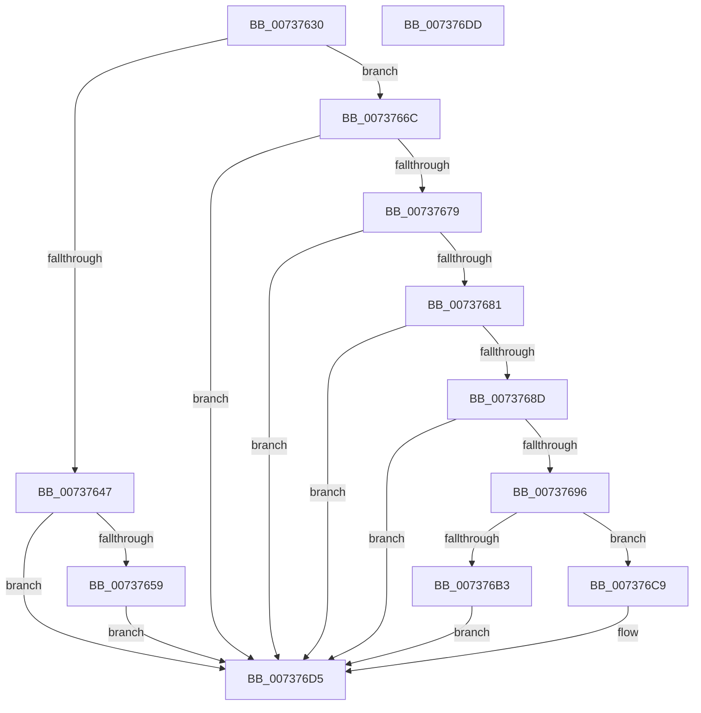

# PiProfileUpdateDeviceTreeCallback

- RVA: `0x00737630`–`0x007376DE` (길이 `174` bytes)
- VA: `0x0000000140737630`
- 실행 섹션: `PAGE`
- PDB 이름 있음: `예`; PDB Function 태그: `아니요`
- unwind 정보 RVA: `0x0005CF00`
- 디코드: `50`개 명령, `174/174` bytes 표시
- 미해석 바이트: `0` (있으면 어셈블리에 `.byte`로 보존)

> 이 문서는 커널 이미지의 기계어와 PDB 기호를 분석해 생성했습니다. 4번과 5번은 함수 원형과 자료형을 바이너리 사용 방식에서 추정한 C 해석이며 원본 소스 복구 결과는 아닙니다.

## 1. Dependencies

- 직접 호출 지점: **7**; 고유 호출 대상: **6**
- 직접 호출자로 확인된 함수: **0**
- RIP 상대 이미지 참조: **0**

### Outgoing calls
- `0x00737650` → [PnpIsDeviceInstanceEnabled](../A7/PnpIsDeviceInstanceEnabled_function_00A75A3C.md) (function, `0x00A75A3C`)
- `0x00737665` → [PnpRequestDeviceRemoval](../8F/PnpRequestDeviceRemoval_function_008FC294.md) (function, `0x008FC294`)
- `0x00737699` → [PipClearDevNodeProblem](../A2/PipClearDevNodeProblem_function_00A27C8C.md) (function, `0x00A27C8C`)
- `0x007376A7` → [PnpIsDeviceInstanceEnabled](../A7/PnpIsDeviceInstanceEnabled_function_00A75A3C.md) (function, `0x00A75A3C`)
- `0x007376B3` → [PnpRestartDeviceNode](../72/PnpRestartDeviceNode_function_0072CD60.md) (function, `0x0072CD60`)
- `0x007376C2` → [IoInvalidateDeviceRelations](../../text/49/IoInvalidateDeviceRelations_function_0049E160.md) (function, `0x0049E160`)
- `0x007376D0` → [PipSetDevNodeProblem](../8F/PipSetDevNodeProblem_function_008FDE0C.md) (function, `0x008FDE0C`)

### Direct callers
- 이 함수 시작 RVA로 연결되는 직접 call은 확인되지 않았습니다. 간접 호출은 완전히 역산할 수 없습니다.

### Static image references
- 디코드된 RIP-relative 메모리 참조가 없습니다.

## 2. Other-region calls and transfers

- 다른 실행 섹션으로 향하는 call: **1**
  - `0x007376C2` → [IoInvalidateDeviceRelations](../../text/49/IoInvalidateDeviceRelations_function_0049E160.md) (`PAGE` → `.text`)
- 별도 외부 분기/꼬리 이동을 확인하지 못했습니다.

## 3. Assembly (complete function range)

```asm
00737630  40 53                           push rbx
00737632  48 83 EC 20                     sub rsp, 0x20
00737636  48 8B D9                        mov rbx, rcx
00737639  8B 89 2C 01 00 00               mov ecx, dword ptr [rcx + 0x12c]
0073763F  81 F9 0A 03 00 00               cmp ecx, 0x30a
00737645  75 25                           jne 0x14073766c
00737647  48 8D 53 28                     lea rdx, [rbx + 0x28]
0073764B  45 33 C0                        xor r8d, r8d
0073764E  33 C9                           xor ecx, ecx
00737650  E8 E7 E3 33 00                  call 0x140a75a3c
00737655  85 C0                           test eax, eax
00737657  75 7C                           jne 0x1407376d5
00737659  45 33 C9                        xor r9d, r9d
0073765C  44 8D 40 16                     lea r8d, [rax + 0x16]
00737660  33 D2                           xor edx, edx
00737662  48 8B CB                        mov rcx, rbx
00737665  E8 2A 4C 1C 00                  call 0x1408fc294
0073766A  EB 69                           jmp 0x1407376d5
0073766C  8D 81 FD FC FF FF               lea eax, [rcx - 0x303]
00737672  A9 EE FF FF FF                  test eax, 0xffffffee
00737677  75 5C                           jne 0x1407376d5
00737679  81 F9 13 03 00 00               cmp ecx, 0x313
0073767F  74 54                           je 0x1407376d5
00737681  F7 83 8C 01 00 00 00 20 00 00   test dword ptr [rbx + 0x18c], 0x2000
0073768B  74 48                           je 0x1407376d5
0073768D  83 BB 94 01 00 00 16            cmp dword ptr [rbx + 0x194], 0x16
00737694  75 3F                           jne 0x1407376d5
00737696  48 8B CB                        mov rcx, rbx
00737699  E8 EE 05 2F 00                  call 0x140a27c8c
0073769E  48 8D 53 28                     lea rdx, [rbx + 0x28]
007376A2  45 33 C0                        xor r8d, r8d
007376A5  33 C9                           xor ecx, ecx
007376A7  E8 90 E3 33 00                  call 0x140a75a3c
007376AC  48 8B CB                        mov rcx, rbx
007376AF  85 C0                           test eax, eax
007376B1  74 16                           je 0x1407376c9
007376B3  E8 A8 56 FF FF                  call 0x14072cd60
007376B8  48 8B 4B 10                     mov rcx, qword ptr [rbx + 0x10]
007376BC  33 D2                           xor edx, edx
007376BE  48 8B 49 20                     mov rcx, qword ptr [rcx + 0x20]
007376C2  E8 99 6A D6 FF                  call 0x14049e160
007376C7  EB 0C                           jmp 0x1407376d5
007376C9  45 33 C0                        xor r8d, r8d
007376CC  41 8D 50 16                     lea edx, [r8 + 0x16]
007376D0  E8 37 67 1C 00                  call 0x1408fde0c
007376D5  33 C0                           xor eax, eax
007376D7  48 83 C4 20                     add rsp, 0x20
007376DB  5B                              pop rbx
007376DC  C3                              ret
007376DD  CC                              int3
```

## 4. C-style interpretation (structured pseudocode)

```c
__int64 __fastcall PiProfileUpdateDeviceTreeCallback(__int64 a1, __int64 a2, int a3, int a4)
{
    __int64 result;
    __int64 v_rsp;

    v_rsp = (v_rsp) - (32);
    if (((unsigned int)((unsigned int)(*(unsigned int *)(a1 + 300)))) != 778) goto loc_0073766C;
    a3 = 0;
    a1 = 0;
    result = PnpIsDeviceInstanceEnabled(a1, a1 + 40, a3, a4);
    if ((unsigned int)(result) != 0) goto loc_007376D5;
    a4 = 0;
    a2 = 0;
    result = PnpRequestDeviceRemoval(0, a2, result + 22, a4);
    goto loc_007376D5;
loc_0073766C:
    if ((((unsigned int)(0 - 771)) & (0xFFFFFFEEULL)) != 0) goto loc_007376D5;
    if (0 == 787) goto loc_007376D5;
    if (((*(unsigned int *)(a1 + 396)) & (0x2000ULL)) == 0) goto loc_007376D5;
    if ((*(unsigned int *)(a1 + 404)) != 22) goto loc_007376D5;
    result = PipClearDevNodeProblem(0, a2, result + 22, a4);
    a3 = 0;
    a1 = 0;
    result = PnpIsDeviceInstanceEnabled(a1, a1 + 40, a3, a4);
    if ((unsigned int)(result) == 0) goto loc_007376C9;
    result = PnpRestartDeviceNode(0, a1 + 40, a3, a4);
    a2 = 0;
    result = IoInvalidateDeviceRelations(*(unsigned __int64 *)(*(unsigned __int64 *)(a1 + 16) + 32), a2, a3, a4);
    goto loc_007376D5;
loc_007376C9:
    a3 = 0;
    result = PipSetDevNodeProblem(*(unsigned __int64 *)(*(unsigned __int64 *)(a1 + 16) + 32), a3 + 22, a3, a4);
loc_007376D5:
    result = 0;
    v_rsp = (v_rsp) + (32);
    return result;
}
```

## 5. (Beta) C Style

```c
int64_t PiProfileUpdateDeviceTreeCallback(void *Arg1, int64_t Arg2, int32_t Arg3, int32_t Arg4)
{
    uint8_t *arg1 = (uint8_t *)Arg1;

    int64_t result;
    int64_t local_rsp;

    local_rsp = (local_rsp) - (32);
    if (((uint32_t)((uint32_t)(*(uint32_t *)(arg1 + 0x12C)))) != 778) goto loc_0073766C;
    Arg3 = 0;
    Arg1 = 0;
    result = PnpIsDeviceInstanceEnabled(Arg1, Arg1 + 40, Arg3, Arg4);
    if ((uint32_t)(result) != 0) goto loc_007376D5;
    Arg4 = 0;
    Arg2 = 0;
    result = PnpRequestDeviceRemoval(0, Arg2, result + 22, Arg4);
    goto loc_007376D5;
loc_0073766C:
    if ((((uint32_t)(0 - 771)) & (0xFFFFFFEEULL)) != 0) goto loc_007376D5;
    if (0 == 787) goto loc_007376D5;
    if (((*(uint32_t *)(arg1 + 0x18C)) & (0x2000ULL)) == 0) goto loc_007376D5;
    if ((*(uint32_t *)(arg1 + 0x194)) != 22) goto loc_007376D5;
    result = PipClearDevNodeProblem(0, Arg2, result + 22, Arg4);
    Arg3 = 0;
    Arg1 = 0;
    result = PnpIsDeviceInstanceEnabled(Arg1, Arg1 + 40, Arg3, Arg4);
    if ((uint32_t)(result) == 0) goto loc_007376C9;
    result = PnpRestartDeviceNode(0, Arg1 + 40, Arg3, Arg4);
    Arg2 = 0;
    result = IoInvalidateDeviceRelations(*(uint64_t *)(*(uint64_t *)(arg1 + 0x10) + 0x20), Arg2, Arg3, Arg4);
    goto loc_007376D5;
loc_007376C9:
    Arg3 = 0;
    result = PipSetDevNodeProblem(*(uint64_t *)(*(uint64_t *)(arg1 + 0x10) + 0x20), Arg3 + 22, Arg3, Arg4);
loc_007376D5:
    result = 0;
    local_rsp = (local_rsp) + (32);
    return result;
}
```

### 관측된 메모리 오프셋

구조체 형식이 확인되지 않은 접근은 인자 기준의 오프셋으로만 기록했습니다.

| 기준 인자 | 오프셋 표현 | 폭 (bit) | 접근 |
|---|---:|---:|---|
| `Arg1` | `+ 0x10` | `64` | `R` |
| `Arg1` | `+ 0x28` | `64` | `R` |
| `Arg1` | `+ 0x12C` | `32` | `R` |
| `Arg1` | `+ 0x18C` | `32` | `R` |
| `Arg1` | `+ 0x194` | `32` | `R` |

## 6. Execution-region graph

[열기: 2D/3D 그래프와 함수 탐색 컨트롤 패널](../../../control-panel.html?section=page&rva=0x00737630&view=graph)

- 2D 그래프는 위에서 아래로 흐르고, 3D 그래프는 빈 공간을 드래그해 회전합니다. Shift+드래그는 이동, 휠은 확대·축소, 함수 노드 선택은 대상 보고서 이동입니다.

### Static fallback


