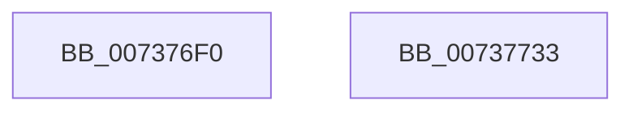

# PiProfileUpdateDeviceTreeWorker

- RVA: `0x007376F0`–`0x00737734` (길이 `68` bytes)
- VA: `0x00000001407376F0`
- 실행 섹션: `PAGE`
- PDB 이름 있음: `예`; PDB Function 태그: `아니요`
- unwind 정보 RVA: `0x0005CF00`
- 디코드: `18`개 명령, `68/68` bytes 표시
- 미해석 바이트: `0` (있으면 어셈블리에 `.byte`로 보존)

> 이 문서는 커널 이미지의 기계어와 PDB 기호를 분석해 생성했습니다. 4번과 5번은 함수 원형과 자료형을 바이너리 사용 방식에서 추정한 C 해석이며 원본 소스 복구 결과는 아닙니다.

## 1. Dependencies

- 직접 호출 지점: **4**; 고유 호출 대상: **4**
- 직접 호출자로 확인된 함수: **0**
- RIP 상대 이미지 참조: **2**

### Outgoing calls
- `0x007376FE` → [PpDevNodeLockTree](../A1/PpDevNodeLockTree_function_00A19310.md) (function, `0x00A19310`)
- `0x00737714` → [PipForDeviceNodeSubtree](../A5/PipForDeviceNodeSubtree_function_00A51920.md) (function, `0x00A51920`)
- `0x0073771E` → [PpDevNodeUnlockTree](../A2/PpDevNodeUnlockTree_function_00A21290.md) (function, `0x00A21290`)
- `0x00737728` → [ExFreePoolWithTag](../../poolcode/B8/ExFreePoolWithTag_function_00B82870.md) (function, `0x00B82870`)

### Direct callers
- 이 함수 시작 RVA로 연결되는 직접 call은 확인되지 않았습니다. 간접 호출은 완전히 역산할 수 없습니다.

### Static image references
- `0x00737703` → RVA `0x00F8C438` (`.data`; read)
- `0x0073770A` → RVA `0x00737630` (`PiProfileUpdateDeviceTreeCallback`; read)

## 2. Other-region calls and transfers

- 다른 실행 섹션으로 향하는 call: **1**
  - `0x00737728` → [ExFreePoolWithTag](../../poolcode/B8/ExFreePoolWithTag_function_00B82870.md) (`PAGE` → `POOLCODE`)
- 별도 외부 분기/꼬리 이동을 확인하지 못했습니다.

## 3. Assembly (complete function range)

```asm
007376F0  40 53                           push rbx
007376F2  48 83 EC 20                     sub rsp, 0x20
007376F6  48 8B D9                        mov rbx, rcx
007376F9  B9 01 00 00 00                  mov ecx, 1
007376FE  E8 0D 1C 2E 00                  call 0x140a19310
00737703  48 8B 0D 2E 4D 85 00            mov rcx, qword ptr [rip + 0x854d2e]
0073770A  48 8D 15 1F FF FF FF            lea rdx, [rip - 0xe1]
00737711  45 33 C0                        xor r8d, r8d
00737714  E8 07 A2 31 00                  call 0x140a51920
00737719  B9 01 00 00 00                  mov ecx, 1
0073771E  E8 6D 9B 2E 00                  call 0x140a21290
00737723  33 D2                           xor edx, edx
00737725  48 8B CB                        mov rcx, rbx
00737728  E8 43 B1 44 00                  call 0x140b82870
0073772D  48 83 C4 20                     add rsp, 0x20
00737731  5B                              pop rbx
00737732  C3                              ret
00737733  CC                              int3
```

## 4. C-style interpretation (structured pseudocode)

```c
__int64 __fastcall PiProfileUpdateDeviceTreeWorker(__int64 a1, __int64 a2, int a3)
{
    __int64 result;
    __int64 v_rsp;

    v_rsp = (v_rsp) - (32);
    result = PpDevNodeLockTree(1, a2, a3, a4);
    a3 = 0;
    result = PipForDeviceNodeSubtree(*(unsigned __int64 *)(v_rip + 8736046), v_rip - 225, a3, a4);
    result = PpDevNodeUnlockTree(1, v_rip - 225, a3, a4);
    a2 = 0;
    result = ExFreePoolWithTag(a1, a2, a3, a4);
    v_rsp = (v_rsp) + (32);
    return result;
}
```

## 5. (Beta) C Style

```c
int64_t PiProfileUpdateDeviceTreeWorker(int64_t Arg1, int64_t Arg2, int32_t Arg3)
{
    int64_t result;
    int64_t local_rsp;

    local_rsp = (local_rsp) - (32);
    result = PpDevNodeLockTree(1, Arg2, Arg3, a4);
    Arg3 = 0;
    result = PipForDeviceNodeSubtree(*(uint64_t *)(v_rip + 0x854D2E), v_rip - 225, Arg3, a4);
    result = PpDevNodeUnlockTree(1, v_rip - 225, Arg3, a4);
    Arg2 = 0;
    result = ExFreePoolWithTag(Arg1, Arg2, Arg3, a4);
    local_rsp = (local_rsp) + (32);
    return result;
}
```

## 6. Execution-region graph

[열기: 2D/3D 그래프와 함수 탐색 컨트롤 패널](../../../control-panel.html?section=page&rva=0x007376F0&view=graph)

- 2D 그래프는 위에서 아래로 흐르고, 3D 그래프는 빈 공간을 드래그해 회전합니다. Shift+드래그는 이동, 휠은 확대·축소, 함수 노드 선택은 대상 보고서 이동입니다.

### Static fallback


