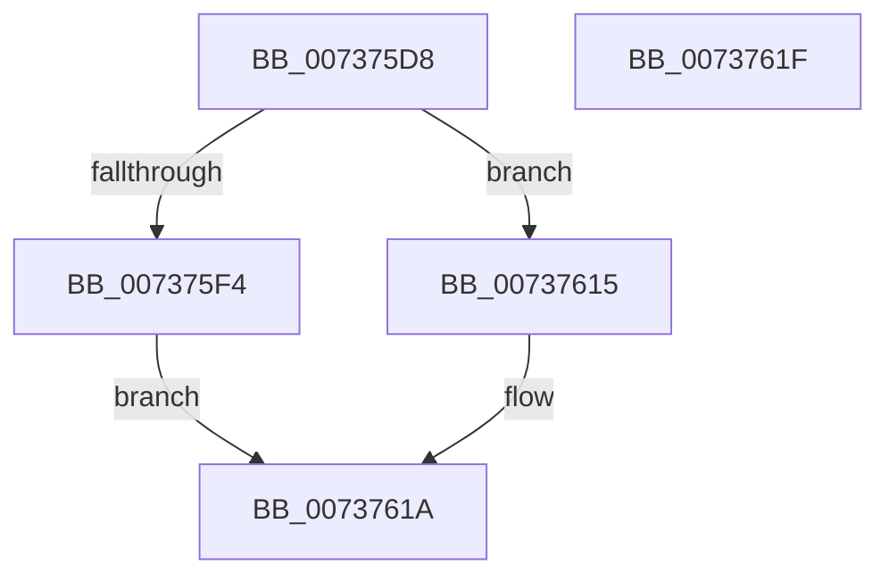

# PiProfileUpdateDeviceTree

- RVA: `0x007375D8`–`0x00737620` (길이 `72` bytes)
- VA: `0x00000001407375D8`
- 실행 섹션: `PAGE`
- PDB 이름 있음: `예`; PDB Function 태그: `아니요`
- unwind 정보 RVA: `0x0005C788`
- 디코드: `20`개 명령, `72/72` bytes 표시
- 미해석 바이트: `0` (있으면 어셈블리에 `.byte`로 보존)

> 이 문서는 커널 이미지의 기계어와 PDB 기호를 분석해 생성했습니다. 4번과 5번은 함수 원형과 자료형을 바이너리 사용 방식에서 추정한 C 해석이며 원본 소스 복구 결과는 아닙니다.

## 1. Dependencies

- 직접 호출 지점: **2**; 고유 호출 대상: **2**
- 직접 호출자로 확인된 함수: **2**
- RIP 상대 이미지 참조: **1**

### Outgoing calls
- `0x007375EA` → [ExAllocatePool2](../../poolcode/B8/ExAllocatePool2_function_00B820F0.md) (function, `0x00B820F0`)
- `0x0073760C` → [ExQueueWorkItem](../../text/2F/ExQueueWorkItem_function_002F9520.md) (function, `0x002F9520`)

### Direct callers
- [PpProfileCancelTransitioningDock](PpProfileCancelTransitioningDock_function_007379A0.md) at `0x00737A0D`
- [PpProfileCommitTransitioningDock](PpProfileCommitTransitioningDock_function_00737A4C.md) at `0x00737B4D`

### Static image references
- `0x007375F8` → RVA `0x007376F0` (`PiProfileUpdateDeviceTreeWorker`; read)

## 2. Other-region calls and transfers

- 다른 실행 섹션으로 향하는 call: **2**
  - `0x007375EA` → [ExAllocatePool2](../../poolcode/B8/ExAllocatePool2_function_00B820F0.md) (`PAGE` → `POOLCODE`)
  - `0x0073760C` → [ExQueueWorkItem](../../text/2F/ExQueueWorkItem_function_002F9520.md) (`PAGE` → `.text`)
- 별도 외부 분기/꼬리 이동을 확인하지 못했습니다.

## 3. Assembly (complete function range)

```asm
007375D8  48 83 EC 28                     sub rsp, 0x28
007375DC  BA 20 00 00 00                  mov edx, 0x20
007375E1  41 B8 50 70 20 20               mov r8d, 0x20207050
007375E7  8D 4A 20                        lea ecx, [rdx + 0x20]
007375EA  E8 01 AB 44 00                  call 0x140b820f0
007375EF  48 85 C0                        test rax, rax
007375F2  74 21                           je 0x140737615
007375F4  48 83 20 00                     and qword ptr [rax], 0
007375F8  48 8D 0D F1 00 00 00            lea rcx, [rip + 0xf1]
007375FF  48 89 48 10                     mov qword ptr [rax + 0x10], rcx
00737603  33 D2                           xor edx, edx
00737605  48 8B C8                        mov rcx, rax
00737608  48 89 40 18                     mov qword ptr [rax + 0x18], rax
0073760C  E8 0F 1F BC FF                  call 0x1402f9520
00737611  33 C0                           xor eax, eax
00737613  EB 05                           jmp 0x14073761a
00737615  B8 9A 00 00 C0                  mov eax, 0xc000009a
0073761A  48 83 C4 28                     add rsp, 0x28
0073761E  C3                              ret
0073761F  CC                              int3
```

## 4. C-style interpretation (structured pseudocode)

```c
__int64 __fastcall PiProfileUpdateDeviceTree(void)
{
    __int64 result;
    __int64 v_rsp;

    v_rsp = (v_rsp) - (40);
    result = ExAllocatePool2(32 + 32, 32, (unsigned int)(0x20207050ULL), a4);
    if (result == 0) goto loc_00737615;
    *(unsigned __int64 *)(result + 16) = v_rip + 241;
    a2 = 0;
    *(unsigned __int64 *)(result + 24) = result;
    result = ExQueueWorkItem(result, a2, (unsigned int)(0x20207050ULL), a4);
    result = 0;
    goto loc_0073761A;
loc_00737615:
loc_0073761A:
    v_rsp = (v_rsp) + (40);
    return (unsigned int)(0xC000009AULL);
}
```

## 5. (Beta) C Style

```c
void PiProfileUpdateDeviceTree(void)
{
    int64_t result;
    int64_t local_rsp;

    local_rsp = (local_rsp) - (40);
    result = ExAllocatePool2(32 + 32, 32, (uint32_t)(0x20207050ULL), a4);
    if (result == 0) goto loc_00737615;
    *(uint64_t *)(result + 0x10) = v_rip + 241;
    a2 = 0;
    *(uint64_t *)(result + 0x18) = result;
    result = ExQueueWorkItem(result, a2, (uint32_t)(0x20207050ULL), a4);
    result = 0;
    goto loc_0073761A;
loc_00737615:
loc_0073761A:
    local_rsp = (local_rsp) + (40);
    return (uint32_t)(0xC000009AULL);
}
```

## 6. Execution-region graph

[열기: 2D/3D 그래프와 함수 탐색 컨트롤 패널](../../../control-panel.html?section=page&rva=0x007375D8&view=graph)

- 2D 그래프는 위에서 아래로 흐르고, 3D 그래프는 빈 공간을 드래그해 회전합니다. Shift+드래그는 이동, 휠은 확대·축소, 함수 노드 선택은 대상 보고서 이동입니다.

### Static fallback


