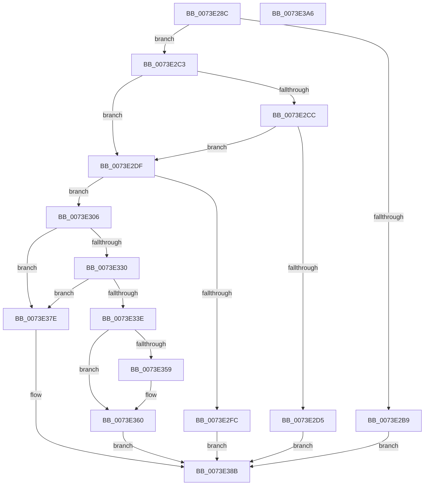

# PiRegisterKernelSoftRestartNotification

- RVA: `0x0073E28C`–`0x0073E3A7` (길이 `283` bytes)
- VA: `0x000000014073E28C`
- 실행 섹션: `PAGE`
- PDB 이름 있음: `예`; PDB Function 태그: `아니요`
- unwind 정보 RVA: `0x000C9154`
- 디코드: `75`개 명령, `283/283` bytes 표시
- 미해석 바이트: `0` (있으면 어셈블리에 `.byte`로 보존)

> 이 문서는 커널 이미지의 기계어와 PDB 기호를 분석해 생성했습니다. 4번과 5번은 함수 원형과 자료형을 바이너리 사용 방식에서 추정한 C 해석이며 원본 소스 복구 결과는 아닙니다.

## 1. Dependencies

- 직접 호출 지점: **6**; 고유 호출 대상: **6**
- 직접 호출자로 확인된 함수: **1**
- RIP 상대 이미지 참조: **7**

### Outgoing calls
- `0x0073E2EF` → [ExAllocatePool2](../../poolcode/B8/ExAllocatePool2_function_00B820F0.md) (function, `0x00B820F0`)
- `0x0073E325` → [PnpInitializeNotifyEntry](../A4/PnpInitializeNotifyEntry_function_00A456D0.md) (function, `0x00A456D0`)
- `0x0073E333` → [PnpDeferNotification](../95/PnpDeferNotification_function_00951888.md) (function, `0x00951888`)
- `0x0073E341` → [ExAcquireFastMutex](../../text/20/ExAcquireFastMutex_function_0020E5A0.md) (function, `0x0020E5A0`)
- `0x0073E374` → [ExReleaseFastMutex](../../text/25/ExReleaseFastMutex_function_002519C0.md) (function, `0x002519C0`)
- `0x0073E386` → [ExFreePoolWithTag](../../poolcode/B8/ExFreePoolWithTag_function_00B82870.md) (function, `0x00B82870`)

### Direct callers
- [IoRegisterPlugPlayNotification](../95/IoRegisterPlugPlayNotification_function_009535A0.md) at `0x0095370B`

### Static image references
- `0x0073E2A4` → RVA `0x00F8A988` (`.data`; read)
- `0x0073E2C3` → RVA `0x00F8A880` (`.data`; read)
- `0x0073E2CC` → RVA `0x00F8A8F0` (`.data`; read)
- `0x0073E306` → RVA `0x00F8A8A0` (`.data`; read)
- `0x0073E346` → RVA `0x00F8A8E8` (`.data`; read)
- `0x0073E34D` → RVA `0x00F8A8E0` (`.data`; read)
- `0x0073E36D` → RVA `0x00F8A8E8` (`.data`; write)

## 2. Other-region calls and transfers

- 다른 실행 섹션으로 향하는 call: **4**
  - `0x0073E2EF` → [ExAllocatePool2](../../poolcode/B8/ExAllocatePool2_function_00B820F0.md) (`PAGE` → `POOLCODE`)
  - `0x0073E341` → [ExAcquireFastMutex](../../text/20/ExAcquireFastMutex_function_0020E5A0.md) (`PAGE` → `.text`)
  - `0x0073E374` → [ExReleaseFastMutex](../../text/25/ExReleaseFastMutex_function_002519C0.md) (`PAGE` → `.text`)
  - `0x0073E386` → [ExFreePoolWithTag](../../poolcode/B8/ExFreePoolWithTag_function_00B82870.md) (`PAGE` → `POOLCODE`)
- 별도 외부 분기/꼬리 이동을 확인하지 못했습니다.

## 3. Assembly (complete function range)

```asm
0073E28C  48 89 5C 24 08                  mov qword ptr [rsp + 8], rbx
0073E291  48 89 6C 24 10                  mov qword ptr [rsp + 0x10], rbp
0073E296  48 89 74 24 18                  mov qword ptr [rsp + 0x18], rsi
0073E29B  57                              push rdi
0073E29C  41 54                           push r12
0073E29E  41 56                           push r14
0073E2A0  48 83 EC 30                     sub rsp, 0x30
0073E2A4  80 3D DD C6 84 00 00            cmp byte ptr [rip + 0x84c6dd], 0
0073E2AB  49 8B F1                        mov rsi, r9
0073E2AE  49 8B D8                        mov rbx, r8
0073E2B1  48 8B EA                        mov rbp, rdx
0073E2B4  4C 8B F1                        mov r14, rcx
0073E2B7  75 0A                           jne 0x14073e2c3
0073E2B9  BB BB 00 00 C0                  mov ebx, 0xc00000bb
0073E2BE  E9 C8 00 00 00                  jmp 0x14073e38b
0073E2C3  80 3D B6 C5 84 00 00            cmp byte ptr [rip + 0x84c5b6], 0
0073E2CA  74 13                           je 0x14073e2df
0073E2CC  80 3D 1D C6 84 00 00            cmp byte ptr [rip + 0x84c61d], 0
0073E2D3  75 0A                           jne 0x14073e2df
0073E2D5  BB FE 02 00 C0                  mov ebx, 0xc00002fe
0073E2DA  E9 AC 00 00 00                  jmp 0x14073e38b
0073E2DF  BA 58 00 00 00                  mov edx, 0x58
0073E2E4  B9 00 01 00 00                  mov ecx, 0x100
0073E2E9  41 B8 50 6E 70 61               mov r8d, 0x61706e50
0073E2EF  E8 FC 3D 44 00                  call 0x140b820f0
0073E2F4  48 8B F8                        mov rdi, rax
0073E2F7  48 85 C0                        test rax, rax
0073E2FA  75 0A                           jne 0x14073e306
0073E2FC  BB 9A 00 00 C0                  mov ebx, 0xc000009a
0073E301  E9 85 00 00 00                  jmp 0x14073e38b
0073E306  4C 8D 25 93 C5 84 00            lea r12, [rip + 0x84c593]
0073E30D  4C 8B CB                        mov r9, rbx
0073E310  4C 89 64 24 28                  mov qword ptr [rsp + 0x28], r12
0073E315  4C 8B C5                        mov r8, rbp
0073E318  BA 04 00 00 00                  mov edx, 4
0073E31D  4C 89 74 24 20                  mov qword ptr [rsp + 0x20], r14
0073E322  48 8B CF                        mov rcx, rdi
0073E325  E8 A6 73 30 00                  call 0x140a456d0
0073E32A  8B D8                           mov ebx, eax
0073E32C  85 C0                           test eax, eax
0073E32E  78 4E                           js 0x14073e37e
0073E330  48 8B CF                        mov rcx, rdi
0073E333  E8 50 35 21 00                  call 0x140951888
0073E338  8B D8                           mov ebx, eax
0073E33A  85 C0                           test eax, eax
0073E33C  78 40                           js 0x14073e37e
0073E33E  49 8B CC                        mov rcx, r12
0073E341  E8 5A 02 AD FF                  call 0x14020e5a0
0073E346  48 8B 05 9B C5 84 00            mov rax, qword ptr [rip + 0x84c59b]
0073E34D  48 8D 0D 8C C5 84 00            lea rcx, [rip + 0x84c58c]
0073E354  48 39 08                        cmp qword ptr [rax], rcx
0073E357  74 07                           je 0x14073e360
0073E359  B9 03 00 00 00                  mov ecx, 3
0073E35E  CD 29                           int 0x29
0073E360  48 89 0F                        mov qword ptr [rdi], rcx
0073E363  49 8B CC                        mov rcx, r12
0073E366  48 89 47 08                     mov qword ptr [rdi + 8], rax
0073E36A  48 89 38                        mov qword ptr [rax], rdi
0073E36D  48 89 3D 74 C5 84 00            mov qword ptr [rip + 0x84c574], rdi
0073E374  E8 47 36 B1 FF                  call 0x1402519c0
0073E379  48 89 3E                        mov qword ptr [rsi], rdi
0073E37C  EB 0D                           jmp 0x14073e38b
0073E37E  BA 50 6E 70 61                  mov edx, 0x61706e50
0073E383  48 8B CF                        mov rcx, rdi
0073E386  E8 E5 44 44 00                  call 0x140b82870
0073E38B  48 8B 6C 24 58                  mov rbp, qword ptr [rsp + 0x58]
0073E390  8B C3                           mov eax, ebx
0073E392  48 8B 5C 24 50                  mov rbx, qword ptr [rsp + 0x50]
0073E397  48 8B 74 24 60                  mov rsi, qword ptr [rsp + 0x60]
0073E39C  48 83 C4 30                     add rsp, 0x30
0073E3A0  41 5E                           pop r14
0073E3A2  41 5C                           pop r12
0073E3A4  5F                              pop rdi
0073E3A5  C3                              ret
0073E3A6  CC                              int3
```

## 4. C-style interpretation (structured pseudocode)

```c
__int64 __fastcall PiRegisterKernelSoftRestartNotification(__int64 a1, __int64 a2, __int64 a3, __int64 a4)
{
    __int64 result;
    __int64 v_rsp;
    unsigned __int64 v_stack_m20;
    unsigned __int64 v_stack_m28;
    unsigned __int64 v_stack_p10;
    unsigned __int64 v_stack_p18;
    unsigned __int64 v_stack_p8;

    v_stack_p8 = v_rbx;
    v_stack_p10 = v_rbp;
    v_stack_p18 = v_rsi;
    v_rsp = (v_rsp) - (48);
    if ((*(unsigned __int8 *)(v_rip + 8701661)) != 0) goto loc_0073E2C3;
    goto loc_0073E38B;
loc_0073E2C3:
    if ((*(unsigned __int8 *)(v_rip + 8701366)) == 0) goto loc_0073E2DF;
    if ((*(unsigned __int8 *)(v_rip + 8701469)) != 0) goto loc_0073E2DF;
    goto loc_0073E38B;
loc_0073E2DF:
    result = ExAllocatePool2(256, 88, (unsigned int)(0x61706E50ULL), a4);
    if (result != 0) goto loc_0073E306;
    goto loc_0073E38B;
loc_0073E306:
    v_stack_m20 = v_rip + 8701331;
    v_stack_m28 = a1;
    result = PnpInitializeNotifyEntry(result, 4, a2, (unsigned int)(0xC000009AULL));
    if (sign_flag) goto loc_0073E37E;
    result = PnpDeferNotification(result, 4, a2, (unsigned int)(0xC000009AULL));
    if (sign_flag) goto loc_0073E37E;
    result = ExAcquireFastMutex(v_rip + 8701331, 4, a2, (unsigned int)(0xC000009AULL));
    if ((*(unsigned __int64 *)(*(unsigned __int64 *)(v_rip + 8701339))) != (v_rip + 8701324)) {
        a1 = 3;
    }
    *(unsigned __int64 *)(result) = a1;
    *(unsigned __int64 *)(result + 8) = *(unsigned __int64 *)(v_rip + 8701339);
    *(unsigned __int64 *)(*(unsigned __int64 *)(v_rip + 8701339)) = result;
    *(unsigned __int64 *)(v_rip + 8701300) = result;
    result = ExReleaseFastMutex(v_rip + 8701331, 4, a2, (unsigned int)(0xC000009AULL));
    *(unsigned __int64 *)(a4) = result;
    goto loc_0073E38B;
loc_0073E37E:
    result = ExFreePoolWithTag(result, (unsigned int)(0x61706E50ULL), a2, (unsigned int)(0xC000009AULL));
loc_0073E38B:
    v_rsp = (v_rsp) + (48);
    return (unsigned int)((unsigned int)((unsigned int)((unsigned int)(result))));
}
```

## 5. (Beta) C Style

```c
int64_t PiRegisterKernelSoftRestartNotification(int64_t Arg1, int64_t Arg2, int64_t Arg3, void *Arg4)
{
    uint8_t *arg4 = (uint8_t *)Arg4;

    int64_t result;
    int64_t local_rsp;
    uint64_t v_stack_m20;
    uint64_t v_stack_m28;
    uint64_t v_stack_p10;
    uint64_t v_stack_p18;
    uint64_t v_stack_p8;

    v_stack_p8 = local_rbx;
    v_stack_p10 = local_rbp;
    v_stack_p18 = local_rsi;
    local_rsp = (local_rsp) - (48);
    if ((*(uint8_t *)(v_rip + 0x84C6DD)) != 0) goto loc_0073E2C3;
    goto loc_0073E38B;
loc_0073E2C3:
    if ((*(uint8_t *)(v_rip + 0x84C5B6)) == 0) goto loc_0073E2DF;
    if ((*(uint8_t *)(v_rip + 0x84C61D)) != 0) goto loc_0073E2DF;
    goto loc_0073E38B;
loc_0073E2DF:
    result = ExAllocatePool2(256, 88, (uint32_t)(0x61706E50ULL), Arg4);
    if (result != 0) goto loc_0073E306;
    goto loc_0073E38B;
loc_0073E306:
    v_stack_m20 = v_rip + 8701331;
    v_stack_m28 = Arg1;
    result = PnpInitializeNotifyEntry(result, 4, Arg2, (uint32_t)(0xC000009AULL));
    if (sign_flag) goto loc_0073E37E;
    result = PnpDeferNotification(result, 4, Arg2, (uint32_t)(0xC000009AULL));
    if (sign_flag) goto loc_0073E37E;
    result = ExAcquireFastMutex(v_rip + 8701331, 4, Arg2, (uint32_t)(0xC000009AULL));
    if ((*(uint64_t *)(*(uint64_t *)(v_rip + 0x84C59B))) != (v_rip + 8701324)) {
        Arg1 = 3;
    }
    *(uint64_t *)(result) = Arg1;
    *(uint64_t *)(result + 0x8) = *(uint64_t *)(v_rip + 0x84C59B);
    *(uint64_t *)(*(uint64_t *)(v_rip + 0x84C59B)) = result;
    *(uint64_t *)(v_rip + 0x84C574) = result;
    result = ExReleaseFastMutex(v_rip + 8701331, 4, Arg2, (uint32_t)(0xC000009AULL));
    *(uint64_t *)(arg4) = result;
    goto loc_0073E38B;
loc_0073E37E:
    result = ExFreePoolWithTag(result, (uint32_t)(0x61706E50ULL), Arg2, (uint32_t)(0xC000009AULL));
loc_0073E38B:
    local_rsp = (local_rsp) + (48);
    return (uint32_t)((uint32_t)((uint32_t)((uint32_t)(result))));
}
```

### 관측된 메모리 오프셋

구조체 형식이 확인되지 않은 접근은 인자 기준의 오프셋으로만 기록했습니다.

| 기준 인자 | 오프셋 표현 | 폭 (bit) | 접근 |
|---|---:|---:|---|
| `Arg4` | `+ 0x0` | `64` | `W` |

## 6. Execution-region graph

[열기: 2D/3D 그래프와 함수 탐색 컨트롤 패널](../../../control-panel.html?section=page&rva=0x0073E28C&view=graph)

- 2D 그래프는 위에서 아래로 흐르고, 3D 그래프는 빈 공간을 드래그해 회전합니다. Shift+드래그는 이동, 휠은 확대·축소, 함수 노드 선택은 대상 보고서 이동입니다.

### Static fallback


