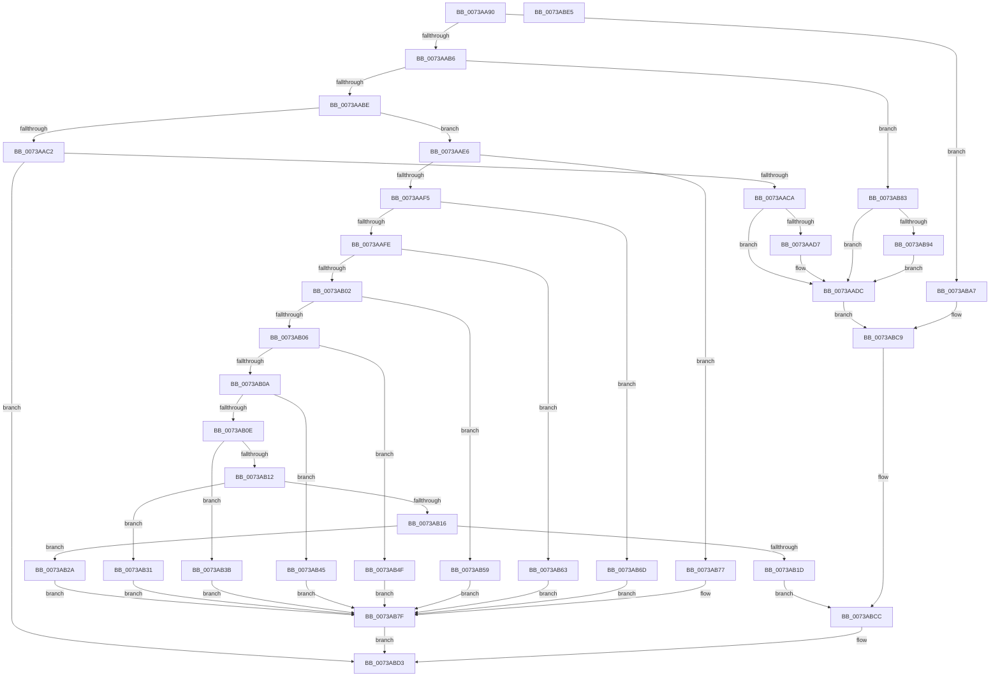

# PiSwDispatch

- RVA: `0x0073AA90`–`0x0073ABE6` (길이 `342` bytes)
- VA: `0x000000014073AA90`
- 실행 섹션: `PAGE`
- PDB 이름 있음: `예`; PDB Function 태그: `아니요`
- unwind 정보 RVA: `0x00060BC4`
- 디코드: `102`개 명령, `342/342` bytes 표시
- 미해석 바이트: `0` (있으면 어셈블리에 `.byte`로 보존)

> 이 문서는 커널 이미지의 기계어와 PDB 기호를 분석해 생성했습니다. 4번과 5번은 함수 원형과 자료형을 바이너리 사용 방식에서 추정한 C 해석이며 원본 소스 복구 결과는 아닙니다.

## 1. Dependencies

- 직접 호출 지점: **13**; 고유 호출 대상: **13**
- 직접 호출자로 확인된 함수: **0**
- RIP 상대 이미지 참조: **0**

### Outgoing calls
- `0x0073AAD7` → [PiSwIrpCleanup](PiSwIrpCleanup_function_0073AC10.md) (function, `0x0073AC10`)
- `0x0073AB2A` → [PiSwIrpGetAttributes](PiSwIrpGetAttributes_function_0073AE04.md) (function, `0x0073AE04`)
- `0x0073AB34` → [PiSwIrpSetAttributes](PiSwIrpSetAttributes_function_0073AF44.md) (function, `0x0073AF44`)
- `0x0073AB3E` → [PiSwIrpGetLifetime](PiSwIrpGetLifetime_function_0073AEA4.md) (function, `0x0073AEA4`)
- `0x0073AB48` → [PiSwIrpSetLifetime](PiSwIrpSetLifetime_function_0073B080.md) (function, `0x0073B080`)
- `0x0073AB52` → [PiSwIrpInterfacePropertySet](../8F/PiSwIrpInterfacePropertySet_function_008F7900.md) (function, `0x008F7900`)
- `0x0073AB5C` → [PiSwIrpInterfaceSetState](../94/PiSwIrpInterfaceSetState_function_0094DC24.md) (function, `0x0094DC24`)
- `0x0073AB66` → [PiSwIrpInterfaceRegister](../94/PiSwIrpInterfaceRegister_function_0094F01C.md) (function, `0x0094F01C`)
- `0x0073AB70` → [PiSwIrpPropertySet](../94/PiSwIrpPropertySet_function_0094E97C.md) (function, `0x0094E97C`)
- `0x0073AB7A` → [PiSwIrpStartCreate](../8D/PiSwIrpStartCreate_function_008DA834.md) (function, `0x008DA834`)
- `0x0073AB94` → [PiSwDeviceDereference](../94/PiSwDeviceDereference_function_0094E8A8.md) (function, `0x0094E8A8`)
- `0x0073ABB5` → [PiAuDoesClientHaveAccess](../96/PiAuDoesClientHaveAccess_function_00962940.md) (function, `0x00962940`)
- `0x0073ABCE` → [IofCompleteRequest](../../text/29/IofCompleteRequest_function_0029B5C0.md) (function, `0x0029B5C0`)

### Direct callers
- 이 함수 시작 RVA로 연결되는 직접 call은 확인되지 않았습니다. 간접 호출은 완전히 역산할 수 없습니다.

### Static image references
- 디코드된 RIP-relative 메모리 참조가 없습니다.

## 2. Other-region calls and transfers

- 다른 실행 섹션으로 향하는 call: **1**
  - `0x0073ABCE` → [IofCompleteRequest](../../text/29/IofCompleteRequest_function_0029B5C0.md) (`PAGE` → `.text`)
- 별도 외부 분기/꼬리 이동을 확인하지 못했습니다.

## 3. Assembly (complete function range)

```asm
0073AA90  48 89 5C 24 08                  mov qword ptr [rsp + 8], rbx
0073AA95  48 89 74 24 10                  mov qword ptr [rsp + 0x10], rsi
0073AA9A  57                              push rdi
0073AA9B  48 83 EC 20                     sub rsp, 0x20
0073AA9F  48 8B B2 B8 00 00 00            mov rsi, qword ptr [rdx + 0xb8]
0073AAA6  48 8B FA                        mov rdi, rdx
0073AAA9  8B 5A 30                        mov ebx, dword ptr [rdx + 0x30]
0073AAAC  8A 06                           mov al, byte ptr [rsi]
0073AAAE  84 C0                           test al, al
0073AAB0  0F 84 F1 00 00 00               je 0x14073aba7
0073AAB6  3C 02                           cmp al, 2
0073AAB8  0F 84 C5 00 00 00               je 0x14073ab83
0073AABE  3C 0E                           cmp al, 0xe
0073AAC0  74 24                           je 0x14073aae6
0073AAC2  3C 12                           cmp al, 0x12
0073AAC4  0F 85 09 01 00 00               jne 0x14073abd3
0073AACA  48 8B 46 30                     mov rax, qword ptr [rsi + 0x30]
0073AACE  48 8B 48 20                     mov rcx, qword ptr [rax + 0x20]
0073AAD2  48 85 C9                        test rcx, rcx
0073AAD5  74 05                           je 0x14073aadc
0073AAD7  E8 34 01 00 00                  call 0x14073ac10
0073AADC  33 DB                           xor ebx, ebx
0073AADE  21 5F 30                        and dword ptr [rdi + 0x30], ebx
0073AAE1  E9 E3 00 00 00                  jmp 0x14073abc9
0073AAE6  8B 4E 18                        mov ecx, dword ptr [rsi + 0x18]
0073AAE9  81 E9 00 04 47 00               sub ecx, 0x470400
0073AAEF  0F 84 82 00 00 00               je 0x14073ab77
0073AAF5  B8 04 00 00 00                  mov eax, 4
0073AAFA  2B C8                           sub ecx, eax
0073AAFC  74 6F                           je 0x14073ab6d
0073AAFE  2B C8                           sub ecx, eax
0073AB00  74 61                           je 0x14073ab63
0073AB02  2B C8                           sub ecx, eax
0073AB04  74 53                           je 0x14073ab59
0073AB06  2B C8                           sub ecx, eax
0073AB08  74 45                           je 0x14073ab4f
0073AB0A  2B C8                           sub ecx, eax
0073AB0C  74 37                           je 0x14073ab45
0073AB0E  2B C8                           sub ecx, eax
0073AB10  74 29                           je 0x14073ab3b
0073AB12  2B C8                           sub ecx, eax
0073AB14  74 1B                           je 0x14073ab31
0073AB16  3B C8                           cmp ecx, eax
0073AB18  48 8B CF                        mov rcx, rdi
0073AB1B  74 0D                           je 0x14073ab2a
0073AB1D  BB BB 00 00 C0                  mov ebx, 0xc00000bb
0073AB22  89 5A 30                        mov dword ptr [rdx + 0x30], ebx
0073AB25  E9 A2 00 00 00                  jmp 0x14073abcc
0073AB2A  E8 D5 02 00 00                  call 0x14073ae04
0073AB2F  EB 4E                           jmp 0x14073ab7f
0073AB31  48 8B CF                        mov rcx, rdi
0073AB34  E8 0B 04 00 00                  call 0x14073af44
0073AB39  EB 44                           jmp 0x14073ab7f
0073AB3B  48 8B CF                        mov rcx, rdi
0073AB3E  E8 61 03 00 00                  call 0x14073aea4
0073AB43  EB 3A                           jmp 0x14073ab7f
0073AB45  48 8B CF                        mov rcx, rdi
0073AB48  E8 33 05 00 00                  call 0x14073b080
0073AB4D  EB 30                           jmp 0x14073ab7f
0073AB4F  48 8B CF                        mov rcx, rdi
0073AB52  E8 A9 CD 1B 00                  call 0x1408f7900
0073AB57  EB 26                           jmp 0x14073ab7f
0073AB59  48 8B CF                        mov rcx, rdi
0073AB5C  E8 C3 30 21 00                  call 0x14094dc24
0073AB61  EB 1C                           jmp 0x14073ab7f
0073AB63  48 8B CF                        mov rcx, rdi
0073AB66  E8 B1 44 21 00                  call 0x14094f01c
0073AB6B  EB 12                           jmp 0x14073ab7f
0073AB6D  48 8B CF                        mov rcx, rdi
0073AB70  E8 07 3E 21 00                  call 0x14094e97c
0073AB75  EB 08                           jmp 0x14073ab7f
0073AB77  48 8B CF                        mov rcx, rdi
0073AB7A  E8 B5 FC 19 00                  call 0x1408da834
0073AB7F  8B D8                           mov ebx, eax
0073AB81  EB 50                           jmp 0x14073abd3
0073AB83  48 8B 46 30                     mov rax, qword ptr [rsi + 0x30]
0073AB87  48 8B 48 20                     mov rcx, qword ptr [rax + 0x20]
0073AB8B  48 85 C9                        test rcx, rcx
0073AB8E  0F 84 48 FF FF FF               je 0x14073aadc
0073AB94  E8 0F 3D 21 00                  call 0x14094e8a8
0073AB99  48 8B 46 30                     mov rax, qword ptr [rsi + 0x30]
0073AB9D  48 83 60 20 00                  and qword ptr [rax + 0x20], 0
0073ABA2  E9 35 FF FF FF                  jmp 0x14073aadc
0073ABA7  48 8B 46 30                     mov rax, qword ptr [rsi + 0x30]
0073ABAB  B9 80 00 00 00                  mov ecx, 0x80
0073ABB0  48 83 60 20 00                  and qword ptr [rax + 0x20], 0
0073ABB5  E8 86 7D 22 00                  call 0x140962940
0073ABBA  F6 D8                           neg al
0073ABBC  1B DB                           sbb ebx, ebx
0073ABBE  F7 D3                           not ebx
0073ABC0  81 E3 22 00 00 C0               and ebx, 0xc0000022
0073ABC6  89 5F 30                        mov dword ptr [rdi + 0x30], ebx
0073ABC9  48 8B CF                        mov rcx, rdi
0073ABCC  33 D2                           xor edx, edx
0073ABCE  E8 ED 09 B6 FF                  call 0x14029b5c0
0073ABD3  48 8B 74 24 38                  mov rsi, qword ptr [rsp + 0x38]
0073ABD8  8B C3                           mov eax, ebx
0073ABDA  48 8B 5C 24 30                  mov rbx, qword ptr [rsp + 0x30]
0073ABDF  48 83 C4 20                     add rsp, 0x20
0073ABE3  5F                              pop rdi
0073ABE4  C3                              ret
0073ABE5  CC                              int3
```

## 4. C-style interpretation (structured pseudocode)

```c
__int64 __fastcall PiSwDispatch(__int64 a1, __int64 a2)
{
    __int64 result;
    __int64 v_rbx;
    __int64 v_rsp;
    unsigned __int64 v_stack_p10;
    unsigned __int64 v_stack_p8;

    v_stack_p8 = v_rbx;
    v_stack_p10 = v_rsi;
    v_rsp = (v_rsp) - (32);
    if ((unsigned __int8)(*(unsigned __int8 *)(*(unsigned __int64 *)(a2 + 184))) == 0) goto loc_0073ABA7;
    if (((unsigned __int8)(*(unsigned __int8 *)(*(unsigned __int64 *)(a2 + 184)))) == 2) goto loc_0073AB83;
    if (((unsigned __int8)(*(unsigned __int8 *)(*(unsigned __int64 *)(a2 + 184)))) == 14) goto loc_0073AAE6;
    if (((unsigned __int8)(*(unsigned __int8 *)(*(unsigned __int64 *)(a2 + 184)))) != 18) goto loc_0073ABD3;
    result = *(unsigned __int64 *)(*(unsigned __int64 *)(a2 + 184) + 48);
    if (*(unsigned __int64 *)(*(unsigned __int64 *)(*(unsigned __int64 *)(a2 + 184) + 48) + 32) != 0) {
        result = PiSwIrpCleanup(*(unsigned __int64 *)(*(unsigned __int64 *)(*(unsigned __int64 *)(a2 + 184) + 48) + 32), a2, a3, a4);
    }
    v_rbx = 0;
    goto loc_0073ABC9;
loc_0073AAE6:
    a1 = (unsigned int)(((unsigned int)(*(unsigned int *)(*(unsigned __int64 *)(a2 + 184) + 24))) - (0x470400ULL));
    if (condition_is_equal) goto loc_0073AB77;
    a1 = (unsigned int)((a1) - (4));
    if (condition_is_equal) goto loc_0073AB6D;
    a1 = (unsigned int)((a1) - (4));
    if (condition_is_equal) goto loc_0073AB63;
    a1 = (unsigned int)((a1) - (4));
    if (condition_is_equal) goto loc_0073AB59;
    a1 = (unsigned int)((a1) - (4));
    if (condition_is_equal) goto loc_0073AB4F;
    a1 = (unsigned int)((a1) - (4));
    if (condition_is_equal) goto loc_0073AB45;
    a1 = (unsigned int)((a1) - (4));
    if (condition_is_equal) goto loc_0073AB3B;
    a1 = (unsigned int)((a1) - (4));
    if (condition_is_equal) goto loc_0073AB31;
    if (((unsigned int)(a1)) == 4) goto loc_0073AB2A;
    *(unsigned int *)(a2 + 48) = (unsigned int)((unsigned int)(0xC00000BBULL));
    goto loc_0073ABCC;
loc_0073AB2A:
    result = PiSwIrpGetAttributes(a2, a2, a3, a4);
    goto loc_0073AB7F;
loc_0073AB31:
    result = PiSwIrpSetAttributes(a2, a2, a3, a4);
    goto loc_0073AB7F;
loc_0073AB3B:
    result = PiSwIrpGetLifetime(a2, a2, a3, a4);
    goto loc_0073AB7F;
loc_0073AB45:
    result = PiSwIrpSetLifetime(a2, a2, a3, a4);
    goto loc_0073AB7F;
loc_0073AB4F:
    result = PiSwIrpInterfacePropertySet(a2, a2, a3, a4);
    goto loc_0073AB7F;
loc_0073AB59:
    result = PiSwIrpInterfaceSetState(a2, a2, a3, a4);
    goto loc_0073AB7F;
loc_0073AB63:
    result = PiSwIrpInterfaceRegister(a2, a2, a3, a4);
    goto loc_0073AB7F;
loc_0073AB6D:
    result = PiSwIrpPropertySet(a2, a2, a3, a4);
    goto loc_0073AB7F;
loc_0073AB77:
    result = PiSwIrpStartCreate(a2, a2, a3, a4);
loc_0073AB7F:
    goto loc_0073ABD3;
loc_0073AB83:
    if (*(unsigned __int64 *)(*(unsigned __int64 *)(*(unsigned __int64 *)(a2 + 184) + 48) + 32) == 0) goto loc_0073AADC;
    result = PiSwDeviceDereference(*(unsigned __int64 *)(*(unsigned __int64 *)(*(unsigned __int64 *)(a2 + 184) + 48) + 32), a2, a3, a4);
    goto loc_0073AADC;
loc_0073ABA7:
    result = PiAuDoesClientHaveAccess(128, a2, a3, a4);
    result = (unsigned __int8)(-(result));
    v_rbx = (unsigned int)(~((unsigned int)((unsigned int)(result))));
    v_rbx = (unsigned int)((v_rbx) & (0xC0000022ULL));
    *(unsigned int *)(a2 + 48) = (unsigned int)(v_rbx);
loc_0073ABC9:
loc_0073ABCC:
    a2 = 0;
    result = IofCompleteRequest(a2, a2, a3, a4);
loc_0073ABD3:
    v_rsp = (v_rsp) + (32);
    return (unsigned int)((unsigned int)(v_rbx));
}
```

## 5. (Beta) C Style

```c
int64_t PiSwDispatch(int64_t Arg1, void *Arg2)
{
    uint8_t *arg2 = (uint8_t *)Arg2;

    int64_t result;
    int64_t local_rbx;
    int64_t local_rsp;
    uint64_t v_stack_p10;
    uint64_t v_stack_p8;

    v_stack_p8 = local_rbx;
    v_stack_p10 = local_rsi;
    local_rsp = (local_rsp) - (32);
    if ((uint8_t)(*(uint8_t *)(*(uint64_t *)(arg2 + 0xB8))) == 0) goto loc_0073ABA7;
    if (((uint8_t)(*(uint8_t *)(*(uint64_t *)(arg2 + 0xB8)))) == 2) goto loc_0073AB83;
    if (((uint8_t)(*(uint8_t *)(*(uint64_t *)(arg2 + 0xB8)))) == 14) goto loc_0073AAE6;
    if (((uint8_t)(*(uint8_t *)(*(uint64_t *)(arg2 + 0xB8)))) != 18) goto loc_0073ABD3;
    result = *(uint64_t *)(*(uint64_t *)(arg2 + 0xB8) + 0x30);
    if (*(uint64_t *)(*(uint64_t *)(*(uint64_t *)(arg2 + 0xB8) + 0x30) + 0x20) != 0) {
        result = PiSwIrpCleanup(*(uint64_t *)(*(uint64_t *)(*(uint64_t *)(arg2 + 0xB8) + 0x30) + 0x20), Arg2, a3, a4);
    }
    local_rbx = 0;
    goto loc_0073ABC9;
loc_0073AAE6:
    Arg1 = (uint32_t)(((uint32_t)(*(uint32_t *)(*(uint64_t *)(arg2 + 0xB8) + 0x18))) - (0x470400ULL));
    if (condition_is_equal) goto loc_0073AB77;
    Arg1 = (uint32_t)((Arg1) - (4));
    if (condition_is_equal) goto loc_0073AB6D;
    Arg1 = (uint32_t)((Arg1) - (4));
    if (condition_is_equal) goto loc_0073AB63;
    Arg1 = (uint32_t)((Arg1) - (4));
    if (condition_is_equal) goto loc_0073AB59;
    Arg1 = (uint32_t)((Arg1) - (4));
    if (condition_is_equal) goto loc_0073AB4F;
    Arg1 = (uint32_t)((Arg1) - (4));
    if (condition_is_equal) goto loc_0073AB45;
    Arg1 = (uint32_t)((Arg1) - (4));
    if (condition_is_equal) goto loc_0073AB3B;
    Arg1 = (uint32_t)((Arg1) - (4));
    if (condition_is_equal) goto loc_0073AB31;
    if (((uint32_t)(Arg1)) == 4) goto loc_0073AB2A;
    *(uint32_t *)(arg2 + 0x30) = (uint32_t)((uint32_t)(0xC00000BBULL));
    goto loc_0073ABCC;
loc_0073AB2A:
    result = PiSwIrpGetAttributes(Arg2, Arg2, a3, a4);
    goto loc_0073AB7F;
loc_0073AB31:
    result = PiSwIrpSetAttributes(Arg2, Arg2, a3, a4);
    goto loc_0073AB7F;
loc_0073AB3B:
    result = PiSwIrpGetLifetime(Arg2, Arg2, a3, a4);
    goto loc_0073AB7F;
loc_0073AB45:
    result = PiSwIrpSetLifetime(Arg2, Arg2, a3, a4);
    goto loc_0073AB7F;
loc_0073AB4F:
    result = PiSwIrpInterfacePropertySet(Arg2, Arg2, a3, a4);
    goto loc_0073AB7F;
loc_0073AB59:
    result = PiSwIrpInterfaceSetState(Arg2, Arg2, a3, a4);
    goto loc_0073AB7F;
loc_0073AB63:
    result = PiSwIrpInterfaceRegister(Arg2, Arg2, a3, a4);
    goto loc_0073AB7F;
loc_0073AB6D:
    result = PiSwIrpPropertySet(Arg2, Arg2, a3, a4);
    goto loc_0073AB7F;
loc_0073AB77:
    result = PiSwIrpStartCreate(Arg2, Arg2, a3, a4);
loc_0073AB7F:
    goto loc_0073ABD3;
loc_0073AB83:
    if (*(uint64_t *)(*(uint64_t *)(*(uint64_t *)(arg2 + 0xB8) + 0x30) + 0x20) == 0) goto loc_0073AADC;
    result = PiSwDeviceDereference(*(uint64_t *)(*(uint64_t *)(*(uint64_t *)(arg2 + 0xB8) + 0x30) + 0x20), Arg2, a3, a4);
    goto loc_0073AADC;
loc_0073ABA7:
    result = PiAuDoesClientHaveAccess(128, Arg2, a3, a4);
    result = (uint8_t)(-(result));
    local_rbx = (uint32_t)(~((uint32_t)((uint32_t)(result))));
    local_rbx = (uint32_t)((local_rbx) & (0xC0000022ULL));
    *(uint32_t *)(arg2 + 0x30) = (uint32_t)(local_rbx);
loc_0073ABC9:
loc_0073ABCC:
    Arg2 = 0;
    result = IofCompleteRequest(Arg2, Arg2, a3, a4);
loc_0073ABD3:
    local_rsp = (local_rsp) + (32);
    return (uint32_t)((uint32_t)(local_rbx));
}
```

### 관측된 메모리 오프셋

구조체 형식이 확인되지 않은 접근은 인자 기준의 오프셋으로만 기록했습니다.

| 기준 인자 | 오프셋 표현 | 폭 (bit) | 접근 |
|---|---:|---:|---|
| `Arg2` | `+ 0x30` | `32` | `R` |
| `Arg2` | `+ 0x30` | `32` | `R/W` |
| `Arg2` | `+ 0x30` | `32` | `W` |
| `Arg2` | `+ 0xB8` | `64` | `R` |

## 6. Execution-region graph

[열기: 2D/3D 그래프와 함수 탐색 컨트롤 패널](../../../control-panel.html?section=page&rva=0x0073AA90&view=graph)

- 2D 그래프는 위에서 아래로 흐르고, 3D 그래프는 빈 공간을 드래그해 회전합니다. Shift+드래그는 이동, 휠은 확대·축소, 함수 노드 선택은 대상 보고서 이동입니다.

### Static fallback


