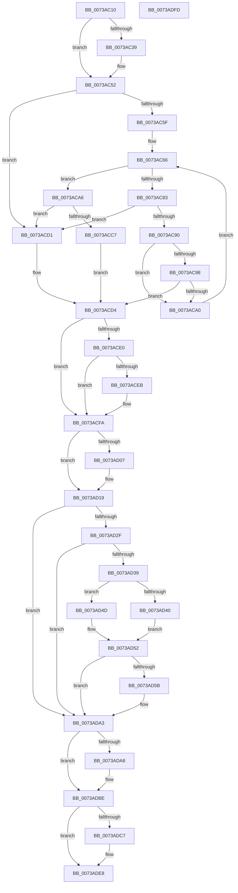

# PiSwIrpCleanup

- RVA: `0x0073AC10`–`0x0073ADFE` (길이 `494` bytes)
- VA: `0x000000014073AC10`
- 실행 섹션: `PAGE`
- PDB 이름 있음: `예`; PDB Function 태그: `아니요`
- unwind 정보 RVA: `0x0006F874`
- 디코드: `127`개 명령, `494/494` bytes 표시
- 미해석 바이트: `0` (있으면 어셈블리에 `.byte`로 보존)

> 이 문서는 커널 이미지의 기계어와 PDB 기호를 분석해 생성했습니다. 4번과 5번은 함수 원형과 자료형을 바이너리 사용 방식에서 추정한 C 해석이며 원본 소스 복구 결과는 아닙니다.

## 1. Dependencies

- 직접 호출 지점: **15**; 고유 호출 대상: **15**
- 직접 호출자로 확인된 함수: **2**
- RIP 상대 이미지 참조: **7**

### Outgoing calls
- `0x0073AC4D` → [McTemplateK0zz_EtwWriteTransfer](../../text/5A/McTemplateK0zz_EtwWriteTransfer_function_005A9408.md) (function, `0x005A9408`)
- `0x0073AC52` → [PiSwLock](../8F/PiSwLock_function_008F7D50.md) (function, `0x008F7D50`)
- `0x0073AC7A` → [wcsnicmp](../../text/50/wcsnicmp_function_005001C0.md) (function, `0x005001C0`)
- `0x0073AC86` → [PiSwFindSwDevice](../A9/PiSwFindSwDevice_function_00A9CA84.md) (function, `0x00A9CA84`)
- `0x0073ACAE` → [RtlInitUnicodeString](../../text/42/RtlInitUnicodeString_function_0042A780.md) (function, `0x0042A780`)
- `0x0073ACBD` → [PnpDeviceObjectFromDeviceInstanceWithTag](../8E/PnpDeviceObjectFromDeviceInstanceWithTag_function_008E7490.md) (function, `0x008E7490`)
- `0x0073ACCA` → [ObfDereferenceObject](../../text/2F/ObfDereferenceObject_function_002F9350.md) (function, `0x002F9350`)
- `0x0073AD0C` → [PiSwCloseDescendants](../A9/PiSwCloseDescendants_function_00A9E564.md) (function, `0x00A9E564`)
- `0x0073AD14` → [PiSwCloseDevice](../AA/PiSwCloseDevice_function_00AAB6F4.md) (function, `0x00AAB6F4`)
- `0x0073AD20` → [ExReleaseResourceLite](../../text/25/ExReleaseResourceLite_function_0025FA10.md) (function, `0x0025FA10`)
- `0x0073AD25` → [KeLeaveCriticalRegion](../../text/25/KeLeaveCriticalRegion_function_0025D8B0.md) (function, `0x0025D8B0`)
- `0x0073AD44` → [PiCMDeleteDeviceWorker](PiCMDeleteDeviceWorker_function_0073B420.md) (function, `0x0073B420`)
- `0x0073AD9E` → [McTemplateK0zzzd_EtwWriteTransfer](../../text/5A/McTemplateK0zzzd_EtwWriteTransfer_function_005A97D4.md) (function, `0x005A97D4`)
- `0x0073ADB9` → [IofCompleteRequest](../../text/29/IofCompleteRequest_function_0029B5C0.md) (function, `0x0029B5C0`)
- `0x0073ADE3` → [McTemplateK0zzd_EtwWriteTransfer](../../text/42/McTemplateK0zzd_EtwWriteTransfer_function_00424414.md) (function, `0x00424414`)

### Direct callers
- [PiSwDispatch](PiSwDispatch_function_0073AA90.md) at `0x0073AAD7`
- [sub_00B1C4F6](../B1/Unknown_function_00B1C4F6.md) at `0x00B1C8AB`

### Static image references
- `0x0073AC29` → RVA `0x00EF012C` (`.data`; read)
- `0x0073AC3D` → RVA `0x000274D0` (`.rdata`; read)
- `0x0073AC6A` → RVA `0x0001C650` (`.rdata`; read)
- `0x0073AD19` → RVA `0x00F8AB20` (`.data`; read)
- `0x0073AD5F` → RVA `0x00AFCAD0` (` ?? ::NNGAKEGL::`string'`; read)
- `0x0073AD93` → RVA `0x000272C0` (`.rdata`; read)
- `0x0073ADCB` → RVA `0x000272B0` (`.rdata`; read)

## 2. Other-region calls and transfers

- 다른 실행 섹션으로 향하는 call: **9**
  - `0x0073AC4D` → [McTemplateK0zz_EtwWriteTransfer](../../text/5A/McTemplateK0zz_EtwWriteTransfer_function_005A9408.md) (`PAGE` → `.text`)
  - `0x0073AC7A` → [wcsnicmp](../../text/50/wcsnicmp_function_005001C0.md) (`PAGE` → `.text`)
  - `0x0073ACAE` → [RtlInitUnicodeString](../../text/42/RtlInitUnicodeString_function_0042A780.md) (`PAGE` → `.text`)
  - `0x0073ACCA` → [ObfDereferenceObject](../../text/2F/ObfDereferenceObject_function_002F9350.md) (`PAGE` → `.text`)
  - `0x0073AD20` → [ExReleaseResourceLite](../../text/25/ExReleaseResourceLite_function_0025FA10.md) (`PAGE` → `.text`)
  - `0x0073AD25` → [KeLeaveCriticalRegion](../../text/25/KeLeaveCriticalRegion_function_0025D8B0.md) (`PAGE` → `.text`)
  - `0x0073AD9E` → [McTemplateK0zzzd_EtwWriteTransfer](../../text/5A/McTemplateK0zzzd_EtwWriteTransfer_function_005A97D4.md) (`PAGE` → `.text`)
  - `0x0073ADB9` → [IofCompleteRequest](../../text/29/IofCompleteRequest_function_0029B5C0.md) (`PAGE` → `.text`)
  - `0x0073ADE3` → [McTemplateK0zzd_EtwWriteTransfer](../../text/42/McTemplateK0zzd_EtwWriteTransfer_function_00424414.md) (`PAGE` → `.text`)
- 별도 외부 분기/꼬리 이동을 확인하지 못했습니다.

## 3. Assembly (complete function range)

```asm
0073AC10  48 8B C4                        mov rax, rsp
0073AC13  48 89 58 08                     mov qword ptr [rax + 8], rbx
0073AC17  48 89 68 10                     mov qword ptr [rax + 0x10], rbp
0073AC1B  48 89 70 18                     mov qword ptr [rax + 0x18], rsi
0073AC1F  57                              push rdi
0073AC20  48 83 EC 50                     sub rsp, 0x50
0073AC24  33 F6                           xor esi, esi
0073AC26  0F 57 C0                        xorps xmm0, xmm0
0073AC29  F6 05 FC 54 7B 00 40            test byte ptr [rip + 0x7b54fc], 0x40
0073AC30  48 8B D9                        mov rbx, rcx
0073AC33  0F 11 40 E8                     movups xmmword ptr [rax - 0x18], xmm0
0073AC37  74 19                           je 0x14073ac52
0073AC39  48 8B 41 10                     mov rax, qword ptr [rcx + 0x10]
0073AC3D  48 8D 15 8C C8 8E FF            lea rdx, [rip - 0x713774]
0073AC44  4C 8B 49 08                     mov r9, qword ptr [rcx + 8]
0073AC48  48 89 44 24 20                  mov qword ptr [rsp + 0x20], rax
0073AC4D  E8 B6 E7 E6 FF                  call 0x1405a9408
0073AC52  E8 F9 D0 1B 00                  call 0x1408f7d50
0073AC57  39 B3 B4 00 00 00               cmp dword ptr [rbx + 0xb4], esi
0073AC5D  74 72                           je 0x14073acd1
0073AC5F  48 8B 43 70                     mov rax, qword ptr [rbx + 0x70]
0073AC63  40 32 FF                        xor dil, dil
0073AC66  48 8B 68 08                     mov rbp, qword ptr [rax + 8]
0073AC6A  48 8D 15 DF 19 8E FF            lea rdx, [rip - 0x71e621]
0073AC71  48 8B CD                        mov rcx, rbp
0073AC74  41 B8 04 00 00 00               mov r8d, 4
0073AC7A  E8 41 55 DC FF                  call 0x1405001c0
0073AC7F  85 C0                           test eax, eax
0073AC81  75 23                           jne 0x14073aca6
0073AC83  48 8B CD                        mov rcx, rbp
0073AC86  E8 F9 1D 36 00                  call 0x140a9ca84
0073AC8B  48 85 C0                        test rax, rax
0073AC8E  74 41                           je 0x14073acd1
0073AC90  39 B0 B4 00 00 00               cmp dword ptr [rax + 0xb4], esi
0073AC96  75 08                           jne 0x14073aca0
0073AC98  8B 48 04                        mov ecx, dword ptr [rax + 4]
0073AC9B  F6 C1 02                        test cl, 2
0073AC9E  74 34                           je 0x14073acd4
0073ACA0  48 8B 40 70                     mov rax, qword ptr [rax + 0x70]
0073ACA4  EB C0                           jmp 0x14073ac66
0073ACA6  48 8B D5                        mov rdx, rbp
0073ACA9  48 8D 4C 24 40                  lea rcx, [rsp + 0x40]
0073ACAE  E8 CD FA CE FF                  call 0x14042a780
0073ACB3  BA 44 66 6C 74                  mov edx, 0x746c6644
0073ACB8  48 8D 4C 24 40                  lea rcx, [rsp + 0x40]
0073ACBD  E8 CE C7 1A 00                  call 0x1408e7490
0073ACC2  48 85 C0                        test rax, rax
0073ACC5  74 0A                           je 0x14073acd1
0073ACC7  48 8B C8                        mov rcx, rax
0073ACCA  E8 81 E6 BB FF                  call 0x1402f9350
0073ACCF  EB 03                           jmp 0x14073acd4
0073ACD1  40 B7 01                        mov dil, 1
0073ACD4  48 8B 8B 90 00 00 00            mov rcx, qword ptr [rbx + 0x90]
0073ACDB  48 85 C9                        test rcx, rcx
0073ACDE  74 1A                           je 0x14073acfa
0073ACE0  33 C0                           xor eax, eax
0073ACE2  48 87 41 68                     xchg qword ptr [rcx + 0x68], rax
0073ACE6  48 85 C0                        test rax, rax
0073ACE9  74 0F                           je 0x14073acfa
0073ACEB  48 8B B3 90 00 00 00            mov rsi, qword ptr [rbx + 0x90]
0073ACF2  48 83 A3 90 00 00 00 00         and qword ptr [rbx + 0x90], 0
0073ACFA  83 63 04 FE                     and dword ptr [rbx + 4], 0xfffffffe
0073ACFE  48 8D 6B 48                     lea rbp, [rbx + 0x48]
0073AD02  40 84 FF                        test dil, dil
0073AD05  74 12                           je 0x14073ad19
0073AD07  33 D2                           xor edx, edx
0073AD09  48 8B CD                        mov rcx, rbp
0073AD0C  E8 53 38 36 00                  call 0x140a9e564
0073AD11  48 8B CB                        mov rcx, rbx
0073AD14  E8 DB 09 37 00                  call 0x140aab6f4
0073AD19  48 8D 0D 00 FE 84 00            lea rcx, [rip + 0x84fe00]
0073AD20  E8 EB 4C B2 FF                  call 0x14025fa10
0073AD25  E8 86 2B B2 FF                  call 0x14025d8b0
0073AD2A  40 84 FF                        test dil, dil
0073AD2D  74 74                           je 0x14073ada3
0073AD2F  8B 83 CC 00 00 00               mov eax, dword ptr [rbx + 0xcc]
0073AD35  A8 01                           test al, 1
0073AD37  74 6A                           je 0x14073ada3
0073AD39  66 83 7D 00 02                  cmp word ptr [rbp], 2
0073AD3E  76 0D                           jbe 0x14073ad4d
0073AD40  48 8B 4B 50                     mov rcx, qword ptr [rbx + 0x50]
0073AD44  E8 D7 06 00 00                  call 0x14073b420
0073AD49  8B C8                           mov ecx, eax
0073AD4B  EB 05                           jmp 0x14073ad52
0073AD4D  B9 5E 02 00 C0                  mov ecx, 0xc000025e
0073AD52  F6 05 D3 53 7B 00 40            test byte ptr [rip + 0x7b53d3], 0x40
0073AD59  74 48                           je 0x14073ada3
0073AD5B  48 8B 43 50                     mov rax, qword ptr [rbx + 0x50]
0073AD5F  4C 8D 0D 6A 1D 3C 00            lea r9, [rip + 0x3c1d6a]
0073AD66  48 85 C0                        test rax, rax
0073AD69  89 4C 24 30                     mov dword ptr [rsp + 0x30], ecx
0073AD6D  4D 8B C1                        mov r8, r9
0073AD70  49 8B D1                        mov rdx, r9
0073AD73  4C 0F 45 C0                     cmovne r8, rax
0073AD77  48 8B 43 10                     mov rax, qword ptr [rbx + 0x10]
0073AD7B  48 85 C0                        test rax, rax
0073AD7E  4C 89 44 24 28                  mov qword ptr [rsp + 0x28], r8
0073AD83  48 0F 45 D0                     cmovne rdx, rax
0073AD87  48 8B 43 08                     mov rax, qword ptr [rbx + 8]
0073AD8B  48 85 C0                        test rax, rax
0073AD8E  48 89 54 24 20                  mov qword ptr [rsp + 0x20], rdx
0073AD93  48 8D 15 26 C5 8E FF            lea rdx, [rip - 0x713ada]
0073AD9A  4C 0F 45 C8                     cmovne r9, rax
0073AD9E  E8 31 EA E6 FF                  call 0x1405a97d4
0073ADA3  48 85 F6                        test rsi, rsi
0073ADA6  74 16                           je 0x14073adbe
0073ADA8  48 83 66 38 00                  and qword ptr [rsi + 0x38], 0
0073ADAD  33 D2                           xor edx, edx
0073ADAF  48 8B CE                        mov rcx, rsi
0073ADB2  C7 46 30 20 01 00 C0            mov dword ptr [rsi + 0x30], 0xc0000120
0073ADB9  E8 02 08 B6 FF                  call 0x14029b5c0
0073ADBE  F6 05 67 53 7B 00 40            test byte ptr [rip + 0x7b5367], 0x40
0073ADC5  74 21                           je 0x14073ade8
0073ADC7  4C 8B 4B 08                     mov r9, qword ptr [rbx + 8]
0073ADCB  48 8D 15 DE C4 8E FF            lea rdx, [rip - 0x713b22]
0073ADD2  40 0F B6 C7                     movzx eax, dil
0073ADD6  89 44 24 28                     mov dword ptr [rsp + 0x28], eax
0073ADDA  48 8B 43 10                     mov rax, qword ptr [rbx + 0x10]
0073ADDE  48 89 44 24 20                  mov qword ptr [rsp + 0x20], rax
0073ADE3  E8 2C 96 CE FF                  call 0x140424414
0073ADE8  48 8B 5C 24 60                  mov rbx, qword ptr [rsp + 0x60]
0073ADED  48 8B 6C 24 68                  mov rbp, qword ptr [rsp + 0x68]
0073ADF2  48 8B 74 24 70                  mov rsi, qword ptr [rsp + 0x70]
0073ADF7  48 83 C4 50                     add rsp, 0x50
0073ADFB  5F                              pop rdi
0073ADFC  C3                              ret
0073ADFD  CC                              int3
```

## 4. C-style interpretation (structured pseudocode)

```c
__int64 __fastcall PiSwIrpCleanup(__int64 a1)
{
    __int64 result;
    __int64 v_rdi;
    __int64 v_rsi;
    __int64 v_rsp;
    unsigned __int64 v_stack_m18;
    unsigned int v_stack_m28;
    unsigned __int64 v_stack_m30;
    unsigned __int64 v_stack_m38;
    unsigned __int64 v_stack_p10;
    unsigned __int64 v_stack_p18;
    unsigned __int64 v_stack_p8;

    *(unsigned __int64 *)(v_rsp + 8) = v_rbx;
    *(unsigned __int64 *)(v_rsp + 16) = v_rbp;
    *(unsigned __int64 *)(v_rsp + 24) = v_rsi;
    v_rsp = (v_rsp) - (80);
    v_rsi = 0;
    *(unsigned __int64 *)(v_rsp - 24) = v_xmm0;
    result = v_rsp;
    if (((*(unsigned __int8 *)(v_rip + 8082684)) & (64)) != 0) {
        result = *(unsigned __int64 *)(a1 + 16);
        a2 = v_rip - 7419764;
        a4 = *(unsigned __int64 *)(a1 + 8);
        v_stack_m38 = result;
        result = McTemplateK0zz_EtwWriteTransfer(a1, a2, a3, a4);
    }
    result = PiSwLock(a1, a2, a3, a4);
    if ((*(unsigned int *)(a1 + 180)) == 0) goto loc_0073ACD1;
    v_rdi = 0;
loc_0073AC66:
    result = wcsnicmp(*(unsigned __int64 *)(*(unsigned __int64 *)(a1 + 112) + 8), v_rip - 7464481, 4, a4);
    if ((unsigned int)(result) != 0) goto loc_0073ACA6;
    result = PiSwFindSwDevice(*(unsigned __int64 *)(*(unsigned __int64 *)(a1 + 112) + 8), v_rip - 7464481, 4, a4);
    if (result == 0) goto loc_0073ACD1;
    if ((*(unsigned int *)(result + 180)) != 0) goto loc_0073ACA0;
    if ((((unsigned __int8)((unsigned int)(*(unsigned int *)(result + 4)))) & (2)) == 0) goto loc_0073ACD4;
loc_0073ACA0:
    goto loc_0073AC66;
loc_0073ACA6:
    result = RtlInitUnicodeString(v_stack_m18, *(unsigned __int64 *)(*(unsigned __int64 *)(a1 + 112) + 8), 4, a4);
    result = PnpDeviceObjectFromDeviceInstanceWithTag(v_stack_m18, (unsigned int)(0x746C6644ULL), 4, a4);
    if (result == 0) goto loc_0073ACD1;
    result = ObfDereferenceObject(result, (unsigned int)(0x746C6644ULL), 4, a4);
    goto loc_0073ACD4;
loc_0073ACD1:
loc_0073ACD4:
    if (*(unsigned __int64 *)(a1 + 144) == 0) goto loc_0073ACFA;
    result = 0;
    if (0 != 0) {
        v_rsi = *(unsigned __int64 *)(a1 + 144);
    }
    if (1 != 0) {
        a2 = 0;
        a1 = a1 + 72;
        result = PiSwCloseDescendants(a1, a2, 4, a4);
        a1 = a1;
        result = PiSwCloseDevice(a1, a2, 4, a4);
    }
    result = ExReleaseResourceLite(v_rip + 8715776, a2, 4, a4);
    result = KeLeaveCriticalRegion(v_rip + 8715776, a2, 4, a4);
    if (1 == 0) goto loc_0073ADA3;
    if ((((unsigned __int8)((unsigned int)(*(unsigned int *)(a1 + 204)))) & (1)) == 0) goto loc_0073ADA3;
    if ((*(unsigned __int16 *)(a1 + 72)) <= 2) goto loc_0073AD4D;
    result = PiCMDeleteDeviceWorker(*(unsigned __int64 *)(a1 + 80), a2, 4, a4);
    goto loc_0073AD52;
loc_0073AD4D:
loc_0073AD52:
    if (((*(unsigned __int8 *)(v_rip + 8082387)) & (64)) != 0) {
        result = *(unsigned __int64 *)(a1 + 80);
        a4 = v_rip + 3939690;
        v_stack_m28 = (unsigned int)((unsigned int)(0xC000025EULL));
        a3 = a4;
        a2 = a4;
        if (result != 0) { a3 = result; }
        result = *(unsigned __int64 *)(a1 + 16);
        v_stack_m30 = a3;
        if (result != 0) { a2 = result; }
        result = *(unsigned __int64 *)(a1 + 8);
        v_stack_m38 = a2;
        a2 = v_rip - 7420634;
        if (result != 0) { a4 = result; }
        result = McTemplateK0zzzd_EtwWriteTransfer((unsigned int)(0xC000025EULL), a2, a3, a4);
    }
    if (v_rsi != 0) {
        a2 = 0;
        a1 = v_rsi;
        *(unsigned int *)(v_rsi + 48) = 0xC0000120ULL;
        result = IofCompleteRequest(a1, a2, a3, a4);
    }
    if (((*(unsigned __int8 *)(v_rip + 8082279)) & (64)) != 0) {
        a4 = *(unsigned __int64 *)(a1 + 8);
        a2 = v_rip - 7420706;
        result = 1;
        v_stack_m30 = (unsigned int)(result);
        result = *(unsigned __int64 *)(a1 + 16);
        v_stack_m38 = result;
        result = McTemplateK0zzd_EtwWriteTransfer(a1, a2, a3, a4);
    }
    v_rsp = (v_rsp) + (80);
    return result;
}
```

## 5. (Beta) C Style

```c
int64_t PiSwIrpCleanup(void *Arg1)
{
    uint8_t *arg1 = (uint8_t *)Arg1;

    int64_t result;
    int64_t local_rdi;
    int64_t local_rsi;
    int64_t local_rsp;
    uint64_t v_stack_m18;
    uint32_t v_stack_m28;
    uint64_t v_stack_m30;
    uint64_t v_stack_m38;
    uint64_t v_stack_p10;
    uint64_t v_stack_p18;
    uint64_t v_stack_p8;

    *(uint64_t *)(local_rsp + 0x8) = local_rbx;
    *(uint64_t *)(local_rsp + 0x10) = local_rbp;
    *(uint64_t *)(local_rsp + 0x18) = local_rsi;
    local_rsp = (local_rsp) - (80);
    local_rsi = 0;
    *(uint64_t *)(local_rsp - 0x18) = v_xmm0;
    result = local_rsp;
    if (((*(uint8_t *)(v_rip + 0x7B54FC)) & (64)) != 0) {
        result = *(uint64_t *)(arg1 + 0x10);
        a2 = v_rip - 7419764;
        a4 = *(uint64_t *)(arg1 + 0x8);
        v_stack_m38 = result;
        result = McTemplateK0zz_EtwWriteTransfer(Arg1, a2, a3, a4);
    }
    result = PiSwLock(Arg1, a2, a3, a4);
    if ((*(uint32_t *)(arg1 + 0xB4)) == 0) goto loc_0073ACD1;
    local_rdi = 0;
loc_0073AC66:
    result = wcsnicmp(*(uint64_t *)(*(uint64_t *)(arg1 + 0x70) + 0x8), v_rip - 7464481, 4, a4);
    if ((uint32_t)(result) != 0) goto loc_0073ACA6;
    result = PiSwFindSwDevice(*(uint64_t *)(*(uint64_t *)(arg1 + 0x70) + 0x8), v_rip - 7464481, 4, a4);
    if (result == 0) goto loc_0073ACD1;
    if ((*(uint32_t *)(result + 0xB4)) != 0) goto loc_0073ACA0;
    if ((((uint8_t)((uint32_t)(*(uint32_t *)(result + 0x4)))) & (2)) == 0) goto loc_0073ACD4;
loc_0073ACA0:
    goto loc_0073AC66;
loc_0073ACA6:
    result = RtlInitUnicodeString(v_stack_m18, *(uint64_t *)(*(uint64_t *)(arg1 + 0x70) + 0x8), 4, a4);
    result = PnpDeviceObjectFromDeviceInstanceWithTag(v_stack_m18, (uint32_t)(0x746C6644ULL), 4, a4);
    if (result == 0) goto loc_0073ACD1;
    result = ObfDereferenceObject(result, (uint32_t)(0x746C6644ULL), 4, a4);
    goto loc_0073ACD4;
loc_0073ACD1:
loc_0073ACD4:
    if (*(uint64_t *)(arg1 + 0x90) == 0) goto loc_0073ACFA;
    result = 0;
    if (0 != 0) {
        local_rsi = *(uint64_t *)(arg1 + 0x90);
    }
    if (1 != 0) {
        a2 = 0;
        Arg1 = Arg1 + 72;
        result = PiSwCloseDescendants(Arg1, a2, 4, a4);
        Arg1 = Arg1;
        result = PiSwCloseDevice(Arg1, a2, 4, a4);
    }
    result = ExReleaseResourceLite(v_rip + 8715776, a2, 4, a4);
    result = KeLeaveCriticalRegion(v_rip + 8715776, a2, 4, a4);
    if (1 == 0) goto loc_0073ADA3;
    if ((((uint8_t)((uint32_t)(*(uint32_t *)(arg1 + 0xCC)))) & (1)) == 0) goto loc_0073ADA3;
    if ((*(uint16_t *)(arg1 + 0x48)) <= 2) goto loc_0073AD4D;
    result = PiCMDeleteDeviceWorker(*(uint64_t *)(arg1 + 0x50), a2, 4, a4);
    goto loc_0073AD52;
loc_0073AD4D:
loc_0073AD52:
    if (((*(uint8_t *)(v_rip + 0x7B53D3)) & (64)) != 0) {
        result = *(uint64_t *)(arg1 + 0x50);
        a4 = v_rip + 3939690;
        v_stack_m28 = (uint32_t)((uint32_t)(0xC000025EULL));
        a3 = a4;
        a2 = a4;
        if (result != 0) { a3 = result; }
        result = *(uint64_t *)(arg1 + 0x10);
        v_stack_m30 = a3;
        if (result != 0) { a2 = result; }
        result = *(uint64_t *)(arg1 + 0x8);
        v_stack_m38 = a2;
        a2 = v_rip - 7420634;
        if (result != 0) { a4 = result; }
        result = McTemplateK0zzzd_EtwWriteTransfer((uint32_t)(0xC000025EULL), a2, a3, a4);
    }
    if (local_rsi != 0) {
        a2 = 0;
        Arg1 = local_rsi;
        *(uint32_t *)(local_rsi + 0x30) = 0xC0000120ULL;
        result = IofCompleteRequest(Arg1, a2, a3, a4);
    }
    if (((*(uint8_t *)(v_rip + 0x7B5367)) & (64)) != 0) {
        a4 = *(uint64_t *)(arg1 + 0x8);
        a2 = v_rip - 7420706;
        result = 1;
        v_stack_m30 = (uint32_t)(result);
        result = *(uint64_t *)(arg1 + 0x10);
        v_stack_m38 = result;
        result = McTemplateK0zzd_EtwWriteTransfer(Arg1, a2, a3, a4);
    }
    local_rsp = (local_rsp) + (80);
    return result;
}
```

### 관측된 메모리 오프셋

구조체 형식이 확인되지 않은 접근은 인자 기준의 오프셋으로만 기록했습니다.

| 기준 인자 | 오프셋 표현 | 폭 (bit) | 접근 |
|---|---:|---:|---|
| `Arg1` | `+ 0x0` | `16` | `R` |
| `Arg1` | `+ 0x4` | `32` | `R/W` |
| `Arg1` | `+ 0x8` | `64` | `R` |
| `Arg1` | `+ 0x10` | `64` | `R` |
| `Arg1` | `+ 0x48` | `64` | `R` |
| `Arg1` | `+ 0x50` | `64` | `R` |
| `Arg1` | `+ 0x70` | `64` | `R` |
| `Arg1` | `+ 0x90` | `64` | `R` |
| `Arg1` | `+ 0x90` | `64` | `R/W` |
| `Arg1` | `+ 0xB4` | `32` | `R` |
| `Arg1` | `+ 0xCC` | `32` | `R` |

## 6. Execution-region graph

[열기: 2D/3D 그래프와 함수 탐색 컨트롤 패널](../../../control-panel.html?section=page&rva=0x0073AC10&view=graph)

- 2D 그래프는 위에서 아래로 흐르고, 3D 그래프는 빈 공간을 드래그해 회전합니다. Shift+드래그는 이동, 휠은 확대·축소, 함수 노드 선택은 대상 보고서 이동입니다.

### Static fallback


