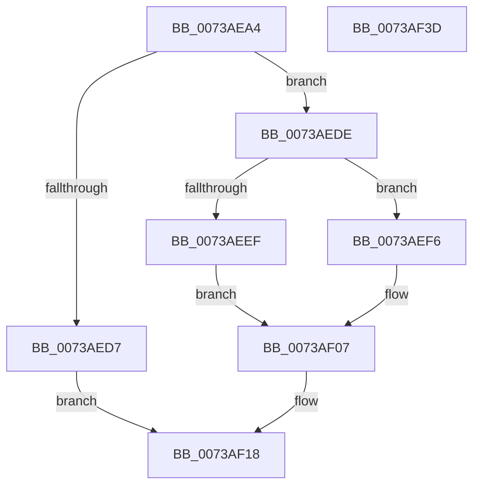

# PiSwIrpGetLifetime

- RVA: `0x0073AEA4`–`0x0073AF3E` (길이 `154` bytes)
- VA: `0x000000014073AEA4`
- 실행 섹션: `PAGE`
- PDB 이름 있음: `예`; PDB Function 태그: `아니요`
- unwind 정보 RVA: `0x0006F978`
- 디코드: `40`개 명령, `154/154` bytes 표시
- 미해석 바이트: `0` (있으면 어셈블리에 `.byte`로 보존)

> 이 문서는 커널 이미지의 기계어와 PDB 기호를 분석해 생성했습니다. 4번과 5번은 함수 원형과 자료형을 바이너리 사용 방식에서 추정한 C 해석이며 원본 소스 복구 결과는 아닙니다.

## 1. Dependencies

- 직접 호출 지점: **5**; 고유 호출 대상: **5**
- 직접 호출자로 확인된 함수: **1**
- RIP 상대 이미지 참조: **1**

### Outgoing calls
- `0x0073AEDE` → [PiSwLock](../8F/PiSwLock_function_008F7D50.md) (function, `0x008F7D50`)
- `0x0073AEE6` → [PiSwDeviceOperationsAllowed](../8F/PiSwDeviceOperationsAllowed_function_008F8EF4.md) (function, `0x008F8EF4`)
- `0x0073AF0E` → [ExReleaseResourceLite](../../text/25/ExReleaseResourceLite_function_0025FA10.md) (function, `0x0025FA10`)
- `0x0073AF13` → [KeLeaveCriticalRegion](../../text/25/KeLeaveCriticalRegion_function_0025D8B0.md) (function, `0x0025D8B0`)
- `0x0073AF20` → [IofCompleteRequest](../../text/29/IofCompleteRequest_function_0029B5C0.md) (function, `0x0029B5C0`)

### Direct callers
- [PiSwDispatch](PiSwDispatch_function_0073AA90.md) at `0x0073AB3E`

### Static image references
- `0x0073AF07` → RVA `0x00F8AB20` (`.data`; read)

## 2. Other-region calls and transfers

- 다른 실행 섹션으로 향하는 call: **3**
  - `0x0073AF0E` → [ExReleaseResourceLite](../../text/25/ExReleaseResourceLite_function_0025FA10.md) (`PAGE` → `.text`)
  - `0x0073AF13` → [KeLeaveCriticalRegion](../../text/25/KeLeaveCriticalRegion_function_0025D8B0.md) (`PAGE` → `.text`)
  - `0x0073AF20` → [IofCompleteRequest](../../text/29/IofCompleteRequest_function_0029B5C0.md) (`PAGE` → `.text`)
- 별도 외부 분기/꼬리 이동을 확인하지 못했습니다.

## 3. Assembly (complete function range)

```asm
0073AEA4  48 89 5C 24 08                  mov qword ptr [rsp + 8], rbx
0073AEA9  48 89 74 24 10                  mov qword ptr [rsp + 0x10], rsi
0073AEAE  48 89 7C 24 18                  mov qword ptr [rsp + 0x18], rdi
0073AEB3  41 56                           push r14
0073AEB5  48 83 EC 20                     sub rsp, 0x20
0073AEB9  48 8B 91 B8 00 00 00            mov rdx, qword ptr [rcx + 0xb8]
0073AEC0  33 DB                           xor ebx, ebx
0073AEC2  4C 8B 71 18                     mov r14, qword ptr [rcx + 0x18]
0073AEC6  48 8B F9                        mov rdi, rcx
0073AEC9  83 7A 08 04                     cmp dword ptr [rdx + 8], 4
0073AECD  48 8B 42 30                     mov rax, qword ptr [rdx + 0x30]
0073AED1  48 8B 70 20                     mov rsi, qword ptr [rax + 0x20]
0073AED5  73 07                           jae 0x14073aede
0073AED7  BB 0D 00 00 C0                  mov ebx, 0xc000000d
0073AEDC  EB 3A                           jmp 0x14073af18
0073AEDE  E8 6D CE 1B 00                  call 0x1408f7d50
0073AEE3  48 8B CE                        mov rcx, rsi
0073AEE6  E8 09 E0 1B 00                  call 0x1408f8ef4
0073AEEB  84 C0                           test al, al
0073AEED  75 07                           jne 0x14073aef6
0073AEEF  BB BB 00 00 C0                  mov ebx, 0xc00000bb
0073AEF4  EB 11                           jmp 0x14073af07
0073AEF6  8B 8E B4 00 00 00               mov ecx, dword ptr [rsi + 0xb4]
0073AEFC  41 89 0E                        mov dword ptr [r14], ecx
0073AEFF  48 C7 47 38 04 00 00 00         mov qword ptr [rdi + 0x38], 4
0073AF07  48 8D 0D 12 FC 84 00            lea rcx, [rip + 0x84fc12]
0073AF0E  E8 FD 4A B2 FF                  call 0x14025fa10
0073AF13  E8 98 29 B2 FF                  call 0x14025d8b0
0073AF18  33 D2                           xor edx, edx
0073AF1A  89 5F 30                        mov dword ptr [rdi + 0x30], ebx
0073AF1D  48 8B CF                        mov rcx, rdi
0073AF20  E8 9B 06 B6 FF                  call 0x14029b5c0
0073AF25  48 8B 74 24 38                  mov rsi, qword ptr [rsp + 0x38]
0073AF2A  8B C3                           mov eax, ebx
0073AF2C  48 8B 5C 24 30                  mov rbx, qword ptr [rsp + 0x30]
0073AF31  48 8B 7C 24 40                  mov rdi, qword ptr [rsp + 0x40]
0073AF36  48 83 C4 20                     add rsp, 0x20
0073AF3A  41 5E                           pop r14
0073AF3C  C3                              ret
0073AF3D  CC                              int3
```

## 4. C-style interpretation (structured pseudocode)

```c
__int64 __fastcall PiSwIrpGetLifetime(__int64 a1)
{
    __int64 result;
    __int64 v_rbx;
    __int64 v_rsp;
    unsigned __int64 v_stack_p10;
    unsigned __int64 v_stack_p18;
    unsigned __int64 v_stack_p8;

    v_stack_p8 = v_rbx;
    v_stack_p10 = v_rsi;
    v_stack_p18 = v_rdi;
    v_rsp = (v_rsp) - (32);
    v_rbx = 0;
    if ((*(unsigned int *)(*(unsigned __int64 *)(a1 + 184) + 8)) >= 4) goto loc_0073AEDE;
    goto loc_0073AF18;
loc_0073AEDE:
    result = PiSwLock(a1, *(unsigned __int64 *)(a1 + 184), a3, a4);
    result = PiSwDeviceOperationsAllowed(*(unsigned __int64 *)(*(unsigned __int64 *)(*(unsigned __int64 *)(a1 + 184) + 48) + 32), *(unsigned __int64 *)(a1 + 184), a3, a4);
    if ((unsigned __int8)(result) != 0) goto loc_0073AEF6;
    goto loc_0073AF07;
loc_0073AEF6:
    *(unsigned int *)(*(unsigned __int64 *)(a1 + 24)) = (unsigned int)((unsigned int)(*(unsigned int *)(*(unsigned __int64 *)(*(unsigned __int64 *)(*(unsigned __int64 *)(a1 + 184) + 48) + 32) + 180)));
    *(unsigned __int64 *)(a1 + 56) = 4;
loc_0073AF07:
    result = ExReleaseResourceLite(v_rip + 8715282, *(unsigned __int64 *)(a1 + 184), a3, a4);
    result = KeLeaveCriticalRegion(v_rip + 8715282, *(unsigned __int64 *)(a1 + 184), a3, a4);
loc_0073AF18:
    a2 = 0;
    *(unsigned int *)(a1 + 48) = (unsigned int)((unsigned int)(0xC00000BBULL));
    result = IofCompleteRequest(a1, a2, a3, a4);
    v_rsp = (v_rsp) + (32);
    return (unsigned int)((unsigned int)((unsigned int)(0xC00000BBULL)));
}
```

## 5. (Beta) C Style

```c
int64_t PiSwIrpGetLifetime(void *Arg1)
{
    uint8_t *arg1 = (uint8_t *)Arg1;

    int64_t result;
    int64_t local_rbx;
    int64_t local_rsp;
    uint64_t v_stack_p10;
    uint64_t v_stack_p18;
    uint64_t v_stack_p8;

    v_stack_p8 = local_rbx;
    v_stack_p10 = local_rsi;
    v_stack_p18 = local_rdi;
    local_rsp = (local_rsp) - (32);
    local_rbx = 0;
    if ((*(uint32_t *)(*(uint64_t *)(arg1 + 0xB8) + 0x8)) >= 4) goto loc_0073AEDE;
    goto loc_0073AF18;
loc_0073AEDE:
    result = PiSwLock(Arg1, *(uint64_t *)(arg1 + 0xB8), a3, a4);
    result = PiSwDeviceOperationsAllowed(*(uint64_t *)(*(uint64_t *)(*(uint64_t *)(arg1 + 0xB8) + 0x30) + 0x20), *(uint64_t *)(arg1 + 0xB8), a3, a4);
    if ((uint8_t)(result) != 0) goto loc_0073AEF6;
    goto loc_0073AF07;
loc_0073AEF6:
    *(uint32_t *)(*(uint64_t *)(arg1 + 0x18)) = (uint32_t)((uint32_t)(*(uint32_t *)(*(uint64_t *)(*(uint64_t *)(*(uint64_t *)(arg1 + 0xB8) + 0x30) + 0x20) + 0xB4)));
    *(uint64_t *)(arg1 + 0x38) = 4;
loc_0073AF07:
    result = ExReleaseResourceLite(v_rip + 8715282, *(uint64_t *)(arg1 + 0xB8), a3, a4);
    result = KeLeaveCriticalRegion(v_rip + 8715282, *(uint64_t *)(arg1 + 0xB8), a3, a4);
loc_0073AF18:
    a2 = 0;
    *(uint32_t *)(arg1 + 0x30) = (uint32_t)((uint32_t)(0xC00000BBULL));
    result = IofCompleteRequest(Arg1, a2, a3, a4);
    local_rsp = (local_rsp) + (32);
    return (uint32_t)((uint32_t)((uint32_t)(0xC00000BBULL)));
}
```

### 관측된 메모리 오프셋

구조체 형식이 확인되지 않은 접근은 인자 기준의 오프셋으로만 기록했습니다.

| 기준 인자 | 오프셋 표현 | 폭 (bit) | 접근 |
|---|---:|---:|---|
| `Arg1` | `+ 0x18` | `64` | `R` |
| `Arg1` | `+ 0x30` | `32` | `W` |
| `Arg1` | `+ 0x38` | `64` | `W` |
| `Arg1` | `+ 0xB8` | `64` | `R` |

## 6. Execution-region graph

[열기: 2D/3D 그래프와 함수 탐색 컨트롤 패널](../../../control-panel.html?section=page&rva=0x0073AEA4&view=graph)

- 2D 그래프는 위에서 아래로 흐르고, 3D 그래프는 빈 공간을 드래그해 회전합니다. Shift+드래그는 이동, 휠은 확대·축소, 함수 노드 선택은 대상 보고서 이동입니다.

### Static fallback


