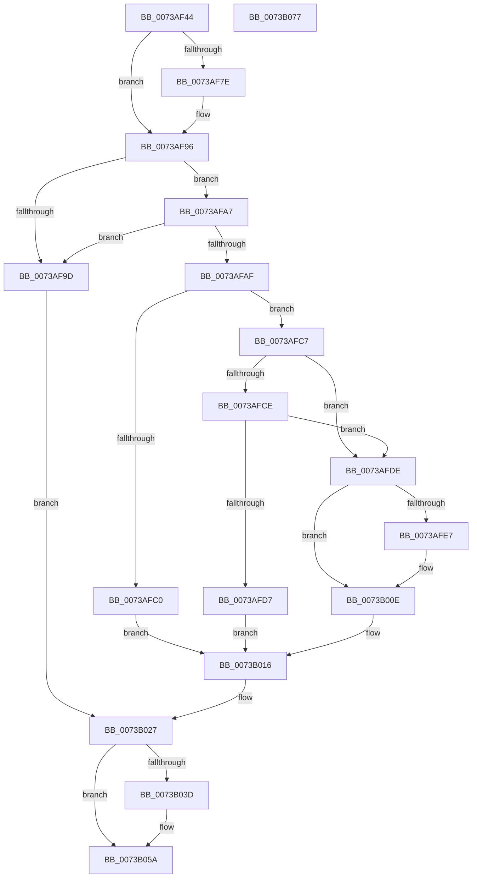

# PiSwIrpSetAttributes

- RVA: `0x0073AF44`–`0x0073B078` (길이 `308` bytes)
- VA: `0x000000014073AF44`
- 실행 섹션: `PAGE`
- PDB 이름 있음: `예`; PDB Function 태그: `아니요`
- unwind 정보 RVA: `0x00060130`
- 디코드: `76`개 명령, `308/308` bytes 표시
- 미해석 바이트: `0` (있으면 어셈블리에 `.byte`로 보존)

> 이 문서는 커널 이미지의 기계어와 PDB 기호를 분석해 생성했습니다. 4번과 5번은 함수 원형과 자료형을 바이너리 사용 방식에서 추정한 C 해석이며 원본 소스 복구 결과는 아닙니다.

## 1. Dependencies

- 직접 호출 지점: **8**; 고유 호출 대상: **8**
- 직접 호출자로 확인된 함수: **1**
- RIP 상대 이미지 참조: **5**

### Outgoing calls
- `0x0073AF91` → [McTemplateK0zz_EtwWriteTransfer](../../text/5A/McTemplateK0zz_EtwWriteTransfer_function_005A9408.md) (function, `0x005A9408`)
- `0x0073AFAF` → [PiSwLock](../8F/PiSwLock_function_008F7D50.md) (function, `0x008F7D50`)
- `0x0073AFB7` → [PiSwDeviceOperationsAllowed](../8F/PiSwDeviceOperationsAllowed_function_008F8EF4.md) (function, `0x008F8EF4`)
- `0x0073B009` → [McTemplateK0zzqq_EtwWriteTransfer](../../text/5A/McTemplateK0zzqq_EtwWriteTransfer_function_005A95C0.md) (function, `0x005A95C0`)
- `0x0073B01D` → [ExReleaseResourceLite](../../text/25/ExReleaseResourceLite_function_0025FA10.md) (function, `0x0025FA10`)
- `0x0073B022` → [KeLeaveCriticalRegion](../../text/25/KeLeaveCriticalRegion_function_0025D8B0.md) (function, `0x0025D8B0`)
- `0x0073B02F` → [IofCompleteRequest](../../text/29/IofCompleteRequest_function_0029B5C0.md) (function, `0x0029B5C0`)
- `0x0073B055` → [McTemplateK0zzd_EtwWriteTransfer](../../text/42/McTemplateK0zzd_EtwWriteTransfer_function_00424414.md) (function, `0x00424414`)

### Direct callers
- [PiSwDispatch](PiSwDispatch_function_0073AA90.md) at `0x0073AB34`

### Static image references
- `0x0073AF66` → RVA `0x00EF012C` (`.data`; read)
- `0x0073AF82` → RVA `0x000270D0` (`.rdata`; read)
- `0x0073AFED` → RVA `0x000273C0` (`.rdata`; read)
- `0x0073B016` → RVA `0x00F8AB20` (`.data`; read)
- `0x0073B041` → RVA `0x000272F0` (`.rdata`; read)

## 2. Other-region calls and transfers

- 다른 실행 섹션으로 향하는 call: **6**
  - `0x0073AF91` → [McTemplateK0zz_EtwWriteTransfer](../../text/5A/McTemplateK0zz_EtwWriteTransfer_function_005A9408.md) (`PAGE` → `.text`)
  - `0x0073B009` → [McTemplateK0zzqq_EtwWriteTransfer](../../text/5A/McTemplateK0zzqq_EtwWriteTransfer_function_005A95C0.md) (`PAGE` → `.text`)
  - `0x0073B01D` → [ExReleaseResourceLite](../../text/25/ExReleaseResourceLite_function_0025FA10.md) (`PAGE` → `.text`)
  - `0x0073B022` → [KeLeaveCriticalRegion](../../text/25/KeLeaveCriticalRegion_function_0025D8B0.md) (`PAGE` → `.text`)
  - `0x0073B02F` → [IofCompleteRequest](../../text/29/IofCompleteRequest_function_0029B5C0.md) (`PAGE` → `.text`)
  - `0x0073B055` → [McTemplateK0zzd_EtwWriteTransfer](../../text/42/McTemplateK0zzd_EtwWriteTransfer_function_00424414.md) (`PAGE` → `.text`)
- 별도 외부 분기/꼬리 이동을 확인하지 못했습니다.

## 3. Assembly (complete function range)

```asm
0073AF44  4C 8B DC                        mov r11, rsp
0073AF47  49 89 5B 08                     mov qword ptr [r11 + 8], rbx
0073AF4B  49 89 6B 10                     mov qword ptr [r11 + 0x10], rbp
0073AF4F  49 89 73 18                     mov qword ptr [r11 + 0x18], rsi
0073AF53  49 89 7B 20                     mov qword ptr [r11 + 0x20], rdi
0073AF57  41 56                           push r14
0073AF59  48 83 EC 40                     sub rsp, 0x40
0073AF5D  4C 8B B1 B8 00 00 00            mov r14, qword ptr [rcx + 0xb8]
0073AF64  33 DB                           xor ebx, ebx
0073AF66  F6 05 BF 51 7B 00 40            test byte ptr [rip + 0x7b51bf], 0x40
0073AF6D  48 8B E9                        mov rbp, rcx
0073AF70  48 8B 71 18                     mov rsi, qword ptr [rcx + 0x18]
0073AF74  49 8B 46 30                     mov rax, qword ptr [r14 + 0x30]
0073AF78  48 8B 78 20                     mov rdi, qword ptr [rax + 0x20]
0073AF7C  74 18                           je 0x14073af96
0073AF7E  48 8B 47 10                     mov rax, qword ptr [rdi + 0x10]
0073AF82  48 8D 15 47 C1 8E FF            lea rdx, [rip - 0x713eb9]
0073AF89  4C 8B 4F 08                     mov r9, qword ptr [rdi + 8]
0073AF8D  49 89 43 D8                     mov qword ptr [r11 - 0x28], rax
0073AF91  E8 72 E4 E6 FF                  call 0x1405a9408
0073AF96  41 83 7E 10 04                  cmp dword ptr [r14 + 0x10], 4
0073AF9B  74 0A                           je 0x14073afa7
0073AF9D  BB 0D 00 00 C0                  mov ebx, 0xc000000d
0073AFA2  E9 80 00 00 00                  jmp 0x14073b027
0073AFA7  F7 06 FE FF FF FF               test dword ptr [rsi], 0xfffffffe
0073AFAD  75 EE                           jne 0x14073af9d
0073AFAF  E8 9C CD 1B 00                  call 0x1408f7d50
0073AFB4  48 8B CF                        mov rcx, rdi
0073AFB7  E8 38 DF 1B 00                  call 0x1408f8ef4
0073AFBC  84 C0                           test al, al
0073AFBE  75 07                           jne 0x14073afc7
0073AFC0  BB BB 00 00 C0                  mov ebx, 0xc00000bb
0073AFC5  EB 4F                           jmp 0x14073b016
0073AFC7  8B 0E                           mov ecx, dword ptr [rsi]
0073AFC9  F6 C1 01                        test cl, 1
0073AFCC  74 10                           je 0x14073afde
0073AFCE  83 BF B4 00 00 00 01            cmp dword ptr [rdi + 0xb4], 1
0073AFD5  75 07                           jne 0x14073afde
0073AFD7  BB 84 01 00 C0                  mov ebx, 0xc0000184
0073AFDC  EB 38                           jmp 0x14073b016
0073AFDE  F6 05 47 51 7B 00 40            test byte ptr [rip + 0x7b5147], 0x40
0073AFE5  74 27                           je 0x14073b00e
0073AFE7  8B 87 CC 00 00 00               mov eax, dword ptr [rdi + 0xcc]
0073AFED  48 8D 15 CC C3 8E FF            lea rdx, [rip - 0x713c34]
0073AFF4  4C 8B 4F 08                     mov r9, qword ptr [rdi + 8]
0073AFF8  89 4C 24 30                     mov dword ptr [rsp + 0x30], ecx
0073AFFC  89 44 24 28                     mov dword ptr [rsp + 0x28], eax
0073B000  48 8B 47 10                     mov rax, qword ptr [rdi + 0x10]
0073B004  48 89 44 24 20                  mov qword ptr [rsp + 0x20], rax
0073B009  E8 B2 E5 E6 FF                  call 0x1405a95c0
0073B00E  8B 06                           mov eax, dword ptr [rsi]
0073B010  89 87 CC 00 00 00               mov dword ptr [rdi + 0xcc], eax
0073B016  48 8D 0D 03 FB 84 00            lea rcx, [rip + 0x84fb03]
0073B01D  E8 EE 49 B2 FF                  call 0x14025fa10
0073B022  E8 89 28 B2 FF                  call 0x14025d8b0
0073B027  33 D2                           xor edx, edx
0073B029  89 5D 30                        mov dword ptr [rbp + 0x30], ebx
0073B02C  48 8B CD                        mov rcx, rbp
0073B02F  E8 8C 05 B6 FF                  call 0x14029b5c0
0073B034  F6 05 F1 50 7B 00 40            test byte ptr [rip + 0x7b50f1], 0x40
0073B03B  74 1D                           je 0x14073b05a
0073B03D  48 8B 4F 10                     mov rcx, qword ptr [rdi + 0x10]
0073B041  48 8D 15 A8 C2 8E FF            lea rdx, [rip - 0x713d58]
0073B048  4C 8B 4F 08                     mov r9, qword ptr [rdi + 8]
0073B04C  89 5C 24 28                     mov dword ptr [rsp + 0x28], ebx
0073B050  48 89 4C 24 20                  mov qword ptr [rsp + 0x20], rcx
0073B055  E8 BA 93 CE FF                  call 0x140424414
0073B05A  48 8B 6C 24 58                  mov rbp, qword ptr [rsp + 0x58]
0073B05F  8B C3                           mov eax, ebx
0073B061  48 8B 5C 24 50                  mov rbx, qword ptr [rsp + 0x50]
0073B066  48 8B 74 24 60                  mov rsi, qword ptr [rsp + 0x60]
0073B06B  48 8B 7C 24 68                  mov rdi, qword ptr [rsp + 0x68]
0073B070  48 83 C4 40                     add rsp, 0x40
0073B074  41 5E                           pop r14
0073B076  C3                              ret
0073B077  CC                              int3
```

## 4. C-style interpretation (structured pseudocode)

```c
__int64 __fastcall PiSwIrpSetAttributes(__int64 a1)
{
    __int64 result;
    __int64 v_rbx;
    __int64 v_rsp;
    unsigned int v_stack_m18;
    unsigned int v_stack_m20;
    unsigned __int64 v_stack_m28;
    unsigned __int64 v_stack_p10;
    unsigned __int64 v_stack_p18;
    unsigned __int64 v_stack_p20;
    unsigned __int64 v_stack_p8;

    *(unsigned __int64 *)(v_rsp + 8) = v_rbx;
    *(unsigned __int64 *)(v_rsp + 16) = v_rbp;
    *(unsigned __int64 *)(v_rsp + 24) = v_rsi;
    *(unsigned __int64 *)(v_rsp + 32) = v_rdi;
    v_rsp = (v_rsp) - (64);
    v_rbx = 0;
    result = *(unsigned __int64 *)(*(unsigned __int64 *)(a1 + 184) + 48);
    if (((*(unsigned __int8 *)(v_rip + 8081855)) & (64)) != 0) {
        result = *(unsigned __int64 *)(*(unsigned __int64 *)(*(unsigned __int64 *)(*(unsigned __int64 *)(a1 + 184) + 48) + 32) + 16);
        a2 = v_rip - 7421625;
        a4 = *(unsigned __int64 *)(*(unsigned __int64 *)(*(unsigned __int64 *)(*(unsigned __int64 *)(a1 + 184) + 48) + 32) + 8);
        *(unsigned __int64 *)(v_rsp - 40) = result;
        result = McTemplateK0zz_EtwWriteTransfer(a1, a2, a3, a4);
    }
    if ((*(unsigned int *)(*(unsigned __int64 *)(a1 + 184) + 16)) == 4) goto loc_0073AFA7;
loc_0073AF9D:
    goto loc_0073B027;
loc_0073AFA7:
    if (((*(unsigned int *)(*(unsigned __int64 *)(a1 + 24))) & (0xFFFFFFFEULL)) != 0) goto loc_0073AF9D;
    result = PiSwLock(a1, a2, a3, a4);
    result = PiSwDeviceOperationsAllowed(*(unsigned __int64 *)(*(unsigned __int64 *)(*(unsigned __int64 *)(a1 + 184) + 48) + 32), a2, a3, a4);
    if ((unsigned __int8)(result) != 0) goto loc_0073AFC7;
    goto loc_0073B016;
loc_0073AFC7:
    if ((((unsigned __int8)((unsigned int)(*(unsigned int *)(*(unsigned __int64 *)(a1 + 24))))) & (1)) == 0) goto loc_0073AFDE;
    if ((*(unsigned int *)(*(unsigned __int64 *)(*(unsigned __int64 *)(*(unsigned __int64 *)(a1 + 184) + 48) + 32) + 180)) != 1) goto loc_0073AFDE;
    goto loc_0073B016;
loc_0073AFDE:
    if (((*(unsigned __int8 *)(v_rip + 8081735)) & (64)) != 0) {
        result = *(unsigned int *)(*(unsigned __int64 *)(*(unsigned __int64 *)(*(unsigned __int64 *)(a1 + 184) + 48) + 32) + 204);
        a2 = v_rip - 7420980;
        a4 = *(unsigned __int64 *)(*(unsigned __int64 *)(*(unsigned __int64 *)(*(unsigned __int64 *)(a1 + 184) + 48) + 32) + 8);
        v_stack_m18 = (unsigned int)((unsigned int)(*(unsigned int *)(*(unsigned __int64 *)(a1 + 24))));
        v_stack_m20 = (unsigned int)(result);
        result = *(unsigned __int64 *)(*(unsigned __int64 *)(*(unsigned __int64 *)(*(unsigned __int64 *)(a1 + 184) + 48) + 32) + 16);
        v_stack_m28 = result;
        result = McTemplateK0zzqq_EtwWriteTransfer((unsigned int)(*(unsigned int *)(*(unsigned __int64 *)(a1 + 24))), a2, a3, a4);
    }
    *(unsigned int *)(*(unsigned __int64 *)(*(unsigned __int64 *)(*(unsigned __int64 *)(a1 + 184) + 48) + 32) + 204) = (unsigned int)((unsigned int)(*(unsigned int *)(*(unsigned __int64 *)(a1 + 24))));
loc_0073B016:
    result = ExReleaseResourceLite(v_rip + 8715011, a2, a3, a4);
    result = KeLeaveCriticalRegion(v_rip + 8715011, a2, a3, a4);
loc_0073B027:
    a2 = 0;
    *(unsigned int *)(a1 + 48) = (unsigned int)((unsigned int)(0xC0000184ULL));
    result = IofCompleteRequest(a1, a2, a3, a4);
    if (((*(unsigned __int8 *)(v_rip + 8081649)) & (64)) != 0) {
        a1 = *(unsigned __int64 *)(*(unsigned __int64 *)(*(unsigned __int64 *)(*(unsigned __int64 *)(a1 + 184) + 48) + 32) + 16);
        a2 = v_rip - 7421272;
        a4 = *(unsigned __int64 *)(*(unsigned __int64 *)(*(unsigned __int64 *)(*(unsigned __int64 *)(a1 + 184) + 48) + 32) + 8);
        v_stack_m20 = (unsigned int)((unsigned int)(0xC0000184ULL));
        v_stack_m28 = a1;
        result = McTemplateK0zzd_EtwWriteTransfer(a1, a2, a3, a4);
    }
    v_rsp = (v_rsp) + (64);
    return (unsigned int)((unsigned int)((unsigned int)(0xC0000184ULL)));
}
```

## 5. (Beta) C Style

```c
int64_t PiSwIrpSetAttributes(void *Arg1)
{
    uint8_t *arg1 = (uint8_t *)Arg1;

    int64_t result;
    int64_t local_rbx;
    int64_t local_rsp;
    uint32_t v_stack_m18;
    uint32_t v_stack_m20;
    uint64_t v_stack_m28;
    uint64_t v_stack_p10;
    uint64_t v_stack_p18;
    uint64_t v_stack_p20;
    uint64_t v_stack_p8;

    *(uint64_t *)(local_rsp + 0x8) = local_rbx;
    *(uint64_t *)(local_rsp + 0x10) = local_rbp;
    *(uint64_t *)(local_rsp + 0x18) = local_rsi;
    *(uint64_t *)(local_rsp + 0x20) = local_rdi;
    local_rsp = (local_rsp) - (64);
    local_rbx = 0;
    result = *(uint64_t *)(*(uint64_t *)(arg1 + 0xB8) + 0x30);
    if (((*(uint8_t *)(v_rip + 0x7B51BF)) & (64)) != 0) {
        result = *(uint64_t *)(*(uint64_t *)(*(uint64_t *)(*(uint64_t *)(arg1 + 0xB8) + 0x30) + 0x20) + 0x10);
        a2 = v_rip - 7421625;
        a4 = *(uint64_t *)(*(uint64_t *)(*(uint64_t *)(*(uint64_t *)(arg1 + 0xB8) + 0x30) + 0x20) + 0x8);
        *(uint64_t *)(local_rsp - 0x28) = result;
        result = McTemplateK0zz_EtwWriteTransfer(Arg1, a2, a3, a4);
    }
    if ((*(uint32_t *)(*(uint64_t *)(arg1 + 0xB8) + 0x10)) == 4) goto loc_0073AFA7;
loc_0073AF9D:
    goto loc_0073B027;
loc_0073AFA7:
    if (((*(uint32_t *)(*(uint64_t *)(arg1 + 0x18))) & (0xFFFFFFFEULL)) != 0) goto loc_0073AF9D;
    result = PiSwLock(Arg1, a2, a3, a4);
    result = PiSwDeviceOperationsAllowed(*(uint64_t *)(*(uint64_t *)(*(uint64_t *)(arg1 + 0xB8) + 0x30) + 0x20), a2, a3, a4);
    if ((uint8_t)(result) != 0) goto loc_0073AFC7;
    goto loc_0073B016;
loc_0073AFC7:
    if ((((uint8_t)((uint32_t)(*(uint32_t *)(*(uint64_t *)(arg1 + 0x18))))) & (1)) == 0) goto loc_0073AFDE;
    if ((*(uint32_t *)(*(uint64_t *)(*(uint64_t *)(*(uint64_t *)(arg1 + 0xB8) + 0x30) + 0x20) + 0xB4)) != 1) goto loc_0073AFDE;
    goto loc_0073B016;
loc_0073AFDE:
    if (((*(uint8_t *)(v_rip + 0x7B5147)) & (64)) != 0) {
        result = *(uint32_t *)(*(uint64_t *)(*(uint64_t *)(*(uint64_t *)(arg1 + 0xB8) + 0x30) + 0x20) + 0xCC);
        a2 = v_rip - 7420980;
        a4 = *(uint64_t *)(*(uint64_t *)(*(uint64_t *)(*(uint64_t *)(arg1 + 0xB8) + 0x30) + 0x20) + 0x8);
        v_stack_m18 = (uint32_t)((uint32_t)(*(uint32_t *)(*(uint64_t *)(arg1 + 0x18))));
        v_stack_m20 = (uint32_t)(result);
        result = *(uint64_t *)(*(uint64_t *)(*(uint64_t *)(*(uint64_t *)(arg1 + 0xB8) + 0x30) + 0x20) + 0x10);
        v_stack_m28 = result;
        result = McTemplateK0zzqq_EtwWriteTransfer((uint32_t)(*(uint32_t *)(*(uint64_t *)(arg1 + 0x18))), a2, a3, a4);
    }
    *(uint32_t *)(*(uint64_t *)(*(uint64_t *)(*(uint64_t *)(arg1 + 0xB8) + 0x30) + 0x20) + 0xCC) = (uint32_t)((uint32_t)(*(uint32_t *)(*(uint64_t *)(arg1 + 0x18))));
loc_0073B016:
    result = ExReleaseResourceLite(v_rip + 8715011, a2, a3, a4);
    result = KeLeaveCriticalRegion(v_rip + 8715011, a2, a3, a4);
loc_0073B027:
    a2 = 0;
    *(uint32_t *)(arg1 + 0x30) = (uint32_t)((uint32_t)(0xC0000184ULL));
    result = IofCompleteRequest(Arg1, a2, a3, a4);
    if (((*(uint8_t *)(v_rip + 0x7B50F1)) & (64)) != 0) {
        Arg1 = *(uint64_t *)(*(uint64_t *)(*(uint64_t *)(*(uint64_t *)(arg1 + 0xB8) + 0x30) + 0x20) + 0x10);
        a2 = v_rip - 7421272;
        a4 = *(uint64_t *)(*(uint64_t *)(*(uint64_t *)(*(uint64_t *)(arg1 + 0xB8) + 0x30) + 0x20) + 0x8);
        v_stack_m20 = (uint32_t)((uint32_t)(0xC0000184ULL));
        v_stack_m28 = Arg1;
        result = McTemplateK0zzd_EtwWriteTransfer(Arg1, a2, a3, a4);
    }
    local_rsp = (local_rsp) + (64);
    return (uint32_t)((uint32_t)((uint32_t)(0xC0000184ULL)));
}
```

### 관측된 메모리 오프셋

구조체 형식이 확인되지 않은 접근은 인자 기준의 오프셋으로만 기록했습니다.

| 기준 인자 | 오프셋 표현 | 폭 (bit) | 접근 |
|---|---:|---:|---|
| `Arg1` | `+ 0x18` | `64` | `R` |
| `Arg1` | `+ 0x30` | `32` | `W` |
| `Arg1` | `+ 0xB8` | `64` | `R` |

## 6. Execution-region graph

[열기: 2D/3D 그래프와 함수 탐색 컨트롤 패널](../../../control-panel.html?section=page&rva=0x0073AF44&view=graph)

- 2D 그래프는 위에서 아래로 흐르고, 3D 그래프는 빈 공간을 드래그해 회전합니다. Shift+드래그는 이동, 휠은 확대·축소, 함수 노드 선택은 대상 보고서 이동입니다.

### Static fallback


