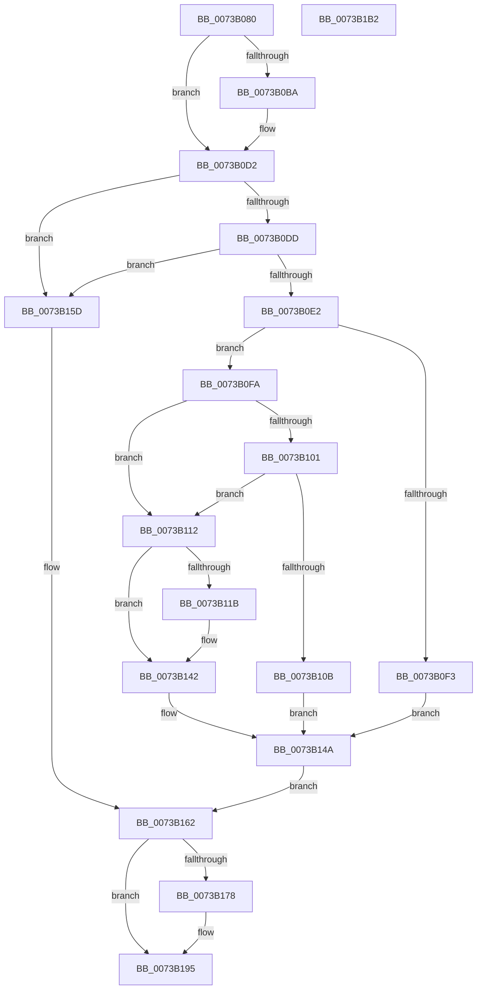

# PiSwIrpSetLifetime

- RVA: `0x0073B080`–`0x0073B1B3` (길이 `307` bytes)
- VA: `0x000000014073B080`
- 실행 섹션: `PAGE`
- PDB 이름 있음: `예`; PDB Function 태그: `아니요`
- unwind 정보 RVA: `0x00060130`
- 디코드: `77`개 명령, `307/307` bytes 표시
- 미해석 바이트: `0` (있으면 어셈블리에 `.byte`로 보존)

> 이 문서는 커널 이미지의 기계어와 PDB 기호를 분석해 생성했습니다. 4번과 5번은 함수 원형과 자료형을 바이너리 사용 방식에서 추정한 C 해석이며 원본 소스 복구 결과는 아닙니다.

## 1. Dependencies

- 직접 호출 지점: **8**; 고유 호출 대상: **8**
- 직접 호출자로 확인된 함수: **1**
- RIP 상대 이미지 참조: **5**

### Outgoing calls
- `0x0073B0CD` → [McTemplateK0zz_EtwWriteTransfer](../../text/5A/McTemplateK0zz_EtwWriteTransfer_function_005A9408.md) (function, `0x005A9408`)
- `0x0073B0E2` → [PiSwLock](../8F/PiSwLock_function_008F7D50.md) (function, `0x008F7D50`)
- `0x0073B0EA` → [PiSwDeviceOperationsAllowed](../8F/PiSwDeviceOperationsAllowed_function_008F8EF4.md) (function, `0x008F8EF4`)
- `0x0073B13D` → [McTemplateK0zzqq_EtwWriteTransfer](../../text/5A/McTemplateK0zzqq_EtwWriteTransfer_function_005A95C0.md) (function, `0x005A95C0`)
- `0x0073B151` → [ExReleaseResourceLite](../../text/25/ExReleaseResourceLite_function_0025FA10.md) (function, `0x0025FA10`)
- `0x0073B156` → [KeLeaveCriticalRegion](../../text/25/KeLeaveCriticalRegion_function_0025D8B0.md) (function, `0x0025D8B0`)
- `0x0073B16A` → [IofCompleteRequest](../../text/29/IofCompleteRequest_function_0029B5C0.md) (function, `0x0029B5C0`)
- `0x0073B190` → [McTemplateK0zzd_EtwWriteTransfer](../../text/42/McTemplateK0zzd_EtwWriteTransfer_function_00424414.md) (function, `0x00424414`)

### Direct callers
- [PiSwDispatch](PiSwDispatch_function_0073AA90.md) at `0x0073AB48`

### Static image references
- `0x0073B0A2` → RVA `0x00EF012C` (`.data`; read)
- `0x0073B0BE` → RVA `0x00027260` (`.rdata`; read)
- `0x0073B121` → RVA `0x000274A0` (`.rdata`; read)
- `0x0073B14A` → RVA `0x00F8AB20` (`.data`; read)
- `0x0073B17C` → RVA `0x00027510` (`.rdata`; read)

## 2. Other-region calls and transfers

- 다른 실행 섹션으로 향하는 call: **6**
  - `0x0073B0CD` → [McTemplateK0zz_EtwWriteTransfer](../../text/5A/McTemplateK0zz_EtwWriteTransfer_function_005A9408.md) (`PAGE` → `.text`)
  - `0x0073B13D` → [McTemplateK0zzqq_EtwWriteTransfer](../../text/5A/McTemplateK0zzqq_EtwWriteTransfer_function_005A95C0.md) (`PAGE` → `.text`)
  - `0x0073B151` → [ExReleaseResourceLite](../../text/25/ExReleaseResourceLite_function_0025FA10.md) (`PAGE` → `.text`)
  - `0x0073B156` → [KeLeaveCriticalRegion](../../text/25/KeLeaveCriticalRegion_function_0025D8B0.md) (`PAGE` → `.text`)
  - `0x0073B16A` → [IofCompleteRequest](../../text/29/IofCompleteRequest_function_0029B5C0.md) (`PAGE` → `.text`)
  - `0x0073B190` → [McTemplateK0zzd_EtwWriteTransfer](../../text/42/McTemplateK0zzd_EtwWriteTransfer_function_00424414.md) (`PAGE` → `.text`)
- 별도 외부 분기/꼬리 이동을 확인하지 못했습니다.

## 3. Assembly (complete function range)

```asm
0073B080  4C 8B DC                        mov r11, rsp
0073B083  49 89 5B 08                     mov qword ptr [r11 + 8], rbx
0073B087  49 89 6B 10                     mov qword ptr [r11 + 0x10], rbp
0073B08B  49 89 73 18                     mov qword ptr [r11 + 0x18], rsi
0073B08F  49 89 7B 20                     mov qword ptr [r11 + 0x20], rdi
0073B093  41 56                           push r14
0073B095  48 83 EC 40                     sub rsp, 0x40
0073B099  4C 8B B1 B8 00 00 00            mov r14, qword ptr [rcx + 0xb8]
0073B0A0  33 DB                           xor ebx, ebx
0073B0A2  F6 05 83 50 7B 00 40            test byte ptr [rip + 0x7b5083], 0x40
0073B0A9  48 8B E9                        mov rbp, rcx
0073B0AC  48 8B 71 18                     mov rsi, qword ptr [rcx + 0x18]
0073B0B0  49 8B 46 30                     mov rax, qword ptr [r14 + 0x30]
0073B0B4  48 8B 78 20                     mov rdi, qword ptr [rax + 0x20]
0073B0B8  74 18                           je 0x14073b0d2
0073B0BA  48 8B 47 10                     mov rax, qword ptr [rdi + 0x10]
0073B0BE  48 8D 15 9B C1 8E FF            lea rdx, [rip - 0x713e65]
0073B0C5  4C 8B 4F 08                     mov r9, qword ptr [rdi + 8]
0073B0C9  49 89 43 D8                     mov qword ptr [r11 - 0x28], rax
0073B0CD  E8 36 E3 E6 FF                  call 0x1405a9408
0073B0D2  41 83 7E 10 04                  cmp dword ptr [r14 + 0x10], 4
0073B0D7  0F 85 80 00 00 00               jne 0x14073b15d
0073B0DD  83 3E 01                        cmp dword ptr [rsi], 1
0073B0E0  77 7B                           ja 0x14073b15d
0073B0E2  E8 69 CC 1B 00                  call 0x1408f7d50
0073B0E7  48 8B CF                        mov rcx, rdi
0073B0EA  E8 05 DE 1B 00                  call 0x1408f8ef4
0073B0EF  84 C0                           test al, al
0073B0F1  75 07                           jne 0x14073b0fa
0073B0F3  BB BB 00 00 C0                  mov ebx, 0xc00000bb
0073B0F8  EB 50                           jmp 0x14073b14a
0073B0FA  8B 0E                           mov ecx, dword ptr [rsi]
0073B0FC  83 F9 01                        cmp ecx, 1
0073B0FF  75 11                           jne 0x14073b112
0073B101  8B 87 CC 00 00 00               mov eax, dword ptr [rdi + 0xcc]
0073B107  84 C1                           test cl, al
0073B109  74 07                           je 0x14073b112
0073B10B  BB 84 01 00 C0                  mov ebx, 0xc0000184
0073B110  EB 38                           jmp 0x14073b14a
0073B112  F6 05 13 50 7B 00 40            test byte ptr [rip + 0x7b5013], 0x40
0073B119  74 27                           je 0x14073b142
0073B11B  8B 87 B4 00 00 00               mov eax, dword ptr [rdi + 0xb4]
0073B121  48 8D 15 78 C3 8E FF            lea rdx, [rip - 0x713c88]
0073B128  4C 8B 4F 08                     mov r9, qword ptr [rdi + 8]
0073B12C  89 4C 24 30                     mov dword ptr [rsp + 0x30], ecx
0073B130  89 44 24 28                     mov dword ptr [rsp + 0x28], eax
0073B134  48 8B 47 10                     mov rax, qword ptr [rdi + 0x10]
0073B138  48 89 44 24 20                  mov qword ptr [rsp + 0x20], rax
0073B13D  E8 7E E4 E6 FF                  call 0x1405a95c0
0073B142  8B 06                           mov eax, dword ptr [rsi]
0073B144  89 87 B4 00 00 00               mov dword ptr [rdi + 0xb4], eax
0073B14A  48 8D 0D CF F9 84 00            lea rcx, [rip + 0x84f9cf]
0073B151  E8 BA 48 B2 FF                  call 0x14025fa10
0073B156  E8 55 27 B2 FF                  call 0x14025d8b0
0073B15B  EB 05                           jmp 0x14073b162
0073B15D  BB 0D 00 00 C0                  mov ebx, 0xc000000d
0073B162  33 D2                           xor edx, edx
0073B164  89 5D 30                        mov dword ptr [rbp + 0x30], ebx
0073B167  48 8B CD                        mov rcx, rbp
0073B16A  E8 51 04 B6 FF                  call 0x14029b5c0
0073B16F  F6 05 B6 4F 7B 00 40            test byte ptr [rip + 0x7b4fb6], 0x40
0073B176  74 1D                           je 0x14073b195
0073B178  48 8B 4F 10                     mov rcx, qword ptr [rdi + 0x10]
0073B17C  48 8D 15 8D C3 8E FF            lea rdx, [rip - 0x713c73]
0073B183  4C 8B 4F 08                     mov r9, qword ptr [rdi + 8]
0073B187  89 5C 24 28                     mov dword ptr [rsp + 0x28], ebx
0073B18B  48 89 4C 24 20                  mov qword ptr [rsp + 0x20], rcx
0073B190  E8 7F 92 CE FF                  call 0x140424414
0073B195  48 8B 6C 24 58                  mov rbp, qword ptr [rsp + 0x58]
0073B19A  8B C3                           mov eax, ebx
0073B19C  48 8B 5C 24 50                  mov rbx, qword ptr [rsp + 0x50]
0073B1A1  48 8B 74 24 60                  mov rsi, qword ptr [rsp + 0x60]
0073B1A6  48 8B 7C 24 68                  mov rdi, qword ptr [rsp + 0x68]
0073B1AB  48 83 C4 40                     add rsp, 0x40
0073B1AF  41 5E                           pop r14
0073B1B1  C3                              ret
0073B1B2  CC                              int3
```

## 4. C-style interpretation (structured pseudocode)

```c
__int64 __fastcall PiSwIrpSetLifetime(__int64 a1)
{
    __int64 result;
    __int64 v_rbx;
    __int64 v_rsp;
    unsigned int v_stack_m18;
    unsigned int v_stack_m20;
    unsigned __int64 v_stack_m28;
    unsigned __int64 v_stack_p10;
    unsigned __int64 v_stack_p18;
    unsigned __int64 v_stack_p20;
    unsigned __int64 v_stack_p8;

    *(unsigned __int64 *)(v_rsp + 8) = v_rbx;
    *(unsigned __int64 *)(v_rsp + 16) = v_rbp;
    *(unsigned __int64 *)(v_rsp + 24) = v_rsi;
    *(unsigned __int64 *)(v_rsp + 32) = v_rdi;
    v_rsp = (v_rsp) - (64);
    v_rbx = 0;
    result = *(unsigned __int64 *)(*(unsigned __int64 *)(a1 + 184) + 48);
    if (((*(unsigned __int8 *)(v_rip + 8081539)) & (64)) != 0) {
        result = *(unsigned __int64 *)(*(unsigned __int64 *)(*(unsigned __int64 *)(*(unsigned __int64 *)(a1 + 184) + 48) + 32) + 16);
        a2 = v_rip - 7421541;
        a4 = *(unsigned __int64 *)(*(unsigned __int64 *)(*(unsigned __int64 *)(*(unsigned __int64 *)(a1 + 184) + 48) + 32) + 8);
        *(unsigned __int64 *)(v_rsp - 40) = result;
        result = McTemplateK0zz_EtwWriteTransfer(a1, a2, a3, a4);
    }
    if ((*(unsigned int *)(*(unsigned __int64 *)(a1 + 184) + 16)) != 4) goto loc_0073B15D;
    if ((*(unsigned int *)(*(unsigned __int64 *)(a1 + 24))) > 1) goto loc_0073B15D;
    result = PiSwLock(a1, a2, a3, a4);
    result = PiSwDeviceOperationsAllowed(*(unsigned __int64 *)(*(unsigned __int64 *)(*(unsigned __int64 *)(a1 + 184) + 48) + 32), a2, a3, a4);
    if ((unsigned __int8)(result) != 0) goto loc_0073B0FA;
    goto loc_0073B14A;
loc_0073B0FA:
    if (((unsigned int)((unsigned int)(*(unsigned int *)(*(unsigned __int64 *)(a1 + 24))))) != 1) goto loc_0073B112;
    if ((((unsigned __int8)((unsigned int)(*(unsigned int *)(*(unsigned __int64 *)(a1 + 24))))) & ((unsigned __int8)((unsigned int)(*(unsigned int *)(*(unsigned __int64 *)(*(unsigned __int64 *)(*(unsigned __int64 *)(a1 + 184) + 48) + 32) + 204))))) == 0) goto loc_0073B112;
    goto loc_0073B14A;
loc_0073B112:
    result = (unsigned int)(*(unsigned int *)(*(unsigned __int64 *)(*(unsigned __int64 *)(*(unsigned __int64 *)(a1 + 184) + 48) + 32) + 204));
    if (((*(unsigned __int8 *)(v_rip + 8081427)) & (64)) != 0) {
        result = *(unsigned int *)(*(unsigned __int64 *)(*(unsigned __int64 *)(*(unsigned __int64 *)(a1 + 184) + 48) + 32) + 180);
        a2 = v_rip - 7421064;
        a4 = *(unsigned __int64 *)(*(unsigned __int64 *)(*(unsigned __int64 *)(*(unsigned __int64 *)(a1 + 184) + 48) + 32) + 8);
        v_stack_m18 = (unsigned int)((unsigned int)(*(unsigned int *)(*(unsigned __int64 *)(a1 + 24))));
        v_stack_m20 = (unsigned int)(result);
        result = *(unsigned __int64 *)(*(unsigned __int64 *)(*(unsigned __int64 *)(*(unsigned __int64 *)(a1 + 184) + 48) + 32) + 16);
        v_stack_m28 = result;
        result = McTemplateK0zzqq_EtwWriteTransfer((unsigned int)(*(unsigned int *)(*(unsigned __int64 *)(a1 + 24))), a2, a3, a4);
    }
    *(unsigned int *)(*(unsigned __int64 *)(*(unsigned __int64 *)(*(unsigned __int64 *)(a1 + 184) + 48) + 32) + 180) = (unsigned int)((unsigned int)(*(unsigned int *)(*(unsigned __int64 *)(a1 + 24))));
loc_0073B14A:
    result = ExReleaseResourceLite(v_rip + 8714703, a2, a3, a4);
    result = KeLeaveCriticalRegion(v_rip + 8714703, a2, a3, a4);
    goto loc_0073B162;
loc_0073B15D:
loc_0073B162:
    a2 = 0;
    *(unsigned int *)(a1 + 48) = (unsigned int)((unsigned int)(0xC000000DULL));
    result = IofCompleteRequest(a1, a2, a3, a4);
    if (((*(unsigned __int8 *)(v_rip + 8081334)) & (64)) != 0) {
        a1 = *(unsigned __int64 *)(*(unsigned __int64 *)(*(unsigned __int64 *)(*(unsigned __int64 *)(a1 + 184) + 48) + 32) + 16);
        a2 = v_rip - 7421043;
        a4 = *(unsigned __int64 *)(*(unsigned __int64 *)(*(unsigned __int64 *)(*(unsigned __int64 *)(a1 + 184) + 48) + 32) + 8);
        v_stack_m20 = (unsigned int)((unsigned int)(0xC000000DULL));
        v_stack_m28 = a1;
        result = McTemplateK0zzd_EtwWriteTransfer(a1, a2, a3, a4);
    }
    v_rsp = (v_rsp) + (64);
    return (unsigned int)((unsigned int)((unsigned int)(0xC000000DULL)));
}
```

## 5. (Beta) C Style

```c
int64_t PiSwIrpSetLifetime(void *Arg1)
{
    uint8_t *arg1 = (uint8_t *)Arg1;

    int64_t result;
    int64_t local_rbx;
    int64_t local_rsp;
    uint32_t v_stack_m18;
    uint32_t v_stack_m20;
    uint64_t v_stack_m28;
    uint64_t v_stack_p10;
    uint64_t v_stack_p18;
    uint64_t v_stack_p20;
    uint64_t v_stack_p8;

    *(uint64_t *)(local_rsp + 0x8) = local_rbx;
    *(uint64_t *)(local_rsp + 0x10) = local_rbp;
    *(uint64_t *)(local_rsp + 0x18) = local_rsi;
    *(uint64_t *)(local_rsp + 0x20) = local_rdi;
    local_rsp = (local_rsp) - (64);
    local_rbx = 0;
    result = *(uint64_t *)(*(uint64_t *)(arg1 + 0xB8) + 0x30);
    if (((*(uint8_t *)(v_rip + 0x7B5083)) & (64)) != 0) {
        result = *(uint64_t *)(*(uint64_t *)(*(uint64_t *)(*(uint64_t *)(arg1 + 0xB8) + 0x30) + 0x20) + 0x10);
        a2 = v_rip - 7421541;
        a4 = *(uint64_t *)(*(uint64_t *)(*(uint64_t *)(*(uint64_t *)(arg1 + 0xB8) + 0x30) + 0x20) + 0x8);
        *(uint64_t *)(local_rsp - 0x28) = result;
        result = McTemplateK0zz_EtwWriteTransfer(Arg1, a2, a3, a4);
    }
    if ((*(uint32_t *)(*(uint64_t *)(arg1 + 0xB8) + 0x10)) != 4) goto loc_0073B15D;
    if ((*(uint32_t *)(*(uint64_t *)(arg1 + 0x18))) > 1) goto loc_0073B15D;
    result = PiSwLock(Arg1, a2, a3, a4);
    result = PiSwDeviceOperationsAllowed(*(uint64_t *)(*(uint64_t *)(*(uint64_t *)(arg1 + 0xB8) + 0x30) + 0x20), a2, a3, a4);
    if ((uint8_t)(result) != 0) goto loc_0073B0FA;
    goto loc_0073B14A;
loc_0073B0FA:
    if (((uint32_t)((uint32_t)(*(uint32_t *)(*(uint64_t *)(arg1 + 0x18))))) != 1) goto loc_0073B112;
    if ((((uint8_t)((uint32_t)(*(uint32_t *)(*(uint64_t *)(arg1 + 0x18))))) & ((uint8_t)((uint32_t)(*(uint32_t *)(*(uint64_t *)(*(uint64_t *)(*(uint64_t *)(arg1 + 0xB8) + 0x30) + 0x20) + 0xCC))))) == 0) goto loc_0073B112;
    goto loc_0073B14A;
loc_0073B112:
    result = (uint32_t)(*(uint32_t *)(*(uint64_t *)(*(uint64_t *)(*(uint64_t *)(arg1 + 0xB8) + 0x30) + 0x20) + 0xCC));
    if (((*(uint8_t *)(v_rip + 0x7B5013)) & (64)) != 0) {
        result = *(uint32_t *)(*(uint64_t *)(*(uint64_t *)(*(uint64_t *)(arg1 + 0xB8) + 0x30) + 0x20) + 0xB4);
        a2 = v_rip - 7421064;
        a4 = *(uint64_t *)(*(uint64_t *)(*(uint64_t *)(*(uint64_t *)(arg1 + 0xB8) + 0x30) + 0x20) + 0x8);
        v_stack_m18 = (uint32_t)((uint32_t)(*(uint32_t *)(*(uint64_t *)(arg1 + 0x18))));
        v_stack_m20 = (uint32_t)(result);
        result = *(uint64_t *)(*(uint64_t *)(*(uint64_t *)(*(uint64_t *)(arg1 + 0xB8) + 0x30) + 0x20) + 0x10);
        v_stack_m28 = result;
        result = McTemplateK0zzqq_EtwWriteTransfer((uint32_t)(*(uint32_t *)(*(uint64_t *)(arg1 + 0x18))), a2, a3, a4);
    }
    *(uint32_t *)(*(uint64_t *)(*(uint64_t *)(*(uint64_t *)(arg1 + 0xB8) + 0x30) + 0x20) + 0xB4) = (uint32_t)((uint32_t)(*(uint32_t *)(*(uint64_t *)(arg1 + 0x18))));
loc_0073B14A:
    result = ExReleaseResourceLite(v_rip + 8714703, a2, a3, a4);
    result = KeLeaveCriticalRegion(v_rip + 8714703, a2, a3, a4);
    goto loc_0073B162;
loc_0073B15D:
loc_0073B162:
    a2 = 0;
    *(uint32_t *)(arg1 + 0x30) = (uint32_t)((uint32_t)(0xC000000DULL));
    result = IofCompleteRequest(Arg1, a2, a3, a4);
    if (((*(uint8_t *)(v_rip + 0x7B4FB6)) & (64)) != 0) {
        Arg1 = *(uint64_t *)(*(uint64_t *)(*(uint64_t *)(*(uint64_t *)(arg1 + 0xB8) + 0x30) + 0x20) + 0x10);
        a2 = v_rip - 7421043;
        a4 = *(uint64_t *)(*(uint64_t *)(*(uint64_t *)(*(uint64_t *)(arg1 + 0xB8) + 0x30) + 0x20) + 0x8);
        v_stack_m20 = (uint32_t)((uint32_t)(0xC000000DULL));
        v_stack_m28 = Arg1;
        result = McTemplateK0zzd_EtwWriteTransfer(Arg1, a2, a3, a4);
    }
    local_rsp = (local_rsp) + (64);
    return (uint32_t)((uint32_t)((uint32_t)(0xC000000DULL)));
}
```

### 관측된 메모리 오프셋

구조체 형식이 확인되지 않은 접근은 인자 기준의 오프셋으로만 기록했습니다.

| 기준 인자 | 오프셋 표현 | 폭 (bit) | 접근 |
|---|---:|---:|---|
| `Arg1` | `+ 0x18` | `64` | `R` |
| `Arg1` | `+ 0x30` | `32` | `W` |
| `Arg1` | `+ 0xB8` | `64` | `R` |

## 6. Execution-region graph

[열기: 2D/3D 그래프와 함수 탐색 컨트롤 패널](../../../control-panel.html?section=page&rva=0x0073B080&view=graph)

- 2D 그래프는 위에서 아래로 흐르고, 3D 그래프는 빈 공간을 드래그해 회전합니다. Shift+드래그는 이동, 휠은 확대·축소, 함수 노드 선택은 대상 보고서 이동입니다.

### Static fallback


