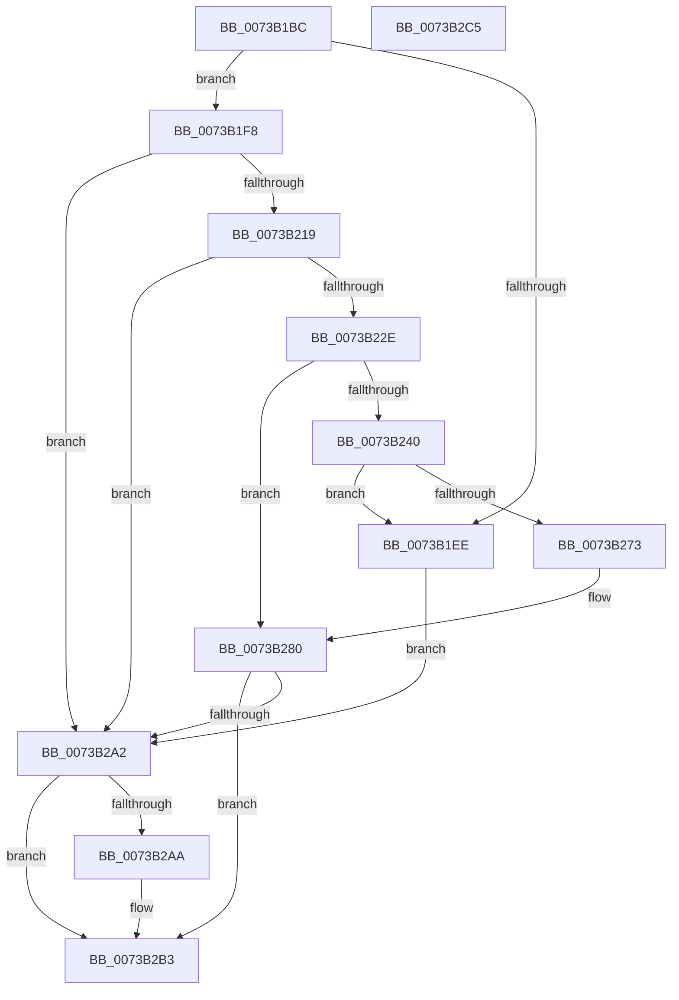

# PiSwQueuedCreateInfoCreate

- RVA: `0x0073B1BC`–`0x0073B2C6` (길이 `266` bytes)
- VA: `0x000000014073B1BC`
- 실행 섹션: `PAGE`
- PDB 이름 있음: `예`; PDB Function 태그: `아니요`
- unwind 정보 RVA: `0x000794E0`
- 디코드: `73`개 명령, `266/266` bytes 표시
- 미해석 바이트: `0` (있으면 어셈블리에 `.byte`로 보존)

> 이 문서는 커널 이미지의 기계어와 PDB 기호를 분석해 생성했습니다. 4번과 5번은 함수 원형과 자료형을 바이너리 사용 방식에서 추정한 C 해석이며 원본 소스 복구 결과는 아닙니다.

## 1. Dependencies

- 직접 호출 지점: **8**; 고유 호출 대상: **7**
- 직접 호출자로 확인된 함수: **1**
- RIP 상대 이미지 참조: **0**

### Outgoing calls
- `0x0073B1E1` → [ExAllocatePool2](../../poolcode/B8/ExAllocatePool2_function_00B820F0.md) (function, `0x00B820F0`)
- `0x0073B20A` → [PnpAllocatePWSTR](../8D/PnpAllocatePWSTR_function_008DE620.md) (function, `0x008DE620`)
- `0x0073B223` → [PiSwPnPInfoInit](../8D/PiSwPnPInfoInit_function_008DB2DC.md) (function, `0x008DB2DC`)
- `0x0073B22E` → [PsGetCurrentProcessId](../../text/43/PsGetCurrentProcessId_function_00433560.md) (function, `0x00433560`)
- `0x0073B257` → [ExAllocatePool2](../../poolcode/B8/ExAllocatePool2_function_00B820F0.md) (function, `0x00B820F0`)
- `0x0073B27B` → [memcpy](../../text/6C/memcpy_function_006C6840.md) (function, `0x006C6840`)
- `0x0073B297` → [PnpCopyDevPropertyArray](../8D/PnpCopyDevPropertyArray_function_008DB0F8.md) (function, `0x008DB0F8`)
- `0x0073B2AA` → [PiSwQueuedCreateInfoFree](../94/PiSwQueuedCreateInfoFree_function_0094D92C.md) (function, `0x0094D92C`)

### Direct callers
- [sub_00B1C4F6](../B1/Unknown_function_00B1C4F6.md) at `0x00B1C617`
- [sub_00B1C4F6](../B1/Unknown_function_00B1C4F6.md) at `0x00B1C69C`

### Static image references
- 디코드된 RIP-relative 메모리 참조가 없습니다.

## 2. Other-region calls and transfers

- 다른 실행 섹션으로 향하는 call: **4**
  - `0x0073B1E1` → [ExAllocatePool2](../../poolcode/B8/ExAllocatePool2_function_00B820F0.md) (`PAGE` → `POOLCODE`)
  - `0x0073B22E` → [PsGetCurrentProcessId](../../text/43/PsGetCurrentProcessId_function_00433560.md) (`PAGE` → `.text`)
  - `0x0073B257` → [ExAllocatePool2](../../poolcode/B8/ExAllocatePool2_function_00B820F0.md) (`PAGE` → `POOLCODE`)
  - `0x0073B27B` → [memcpy](../../text/6C/memcpy_function_006C6840.md) (`PAGE` → `.text`)
- 별도 외부 분기/꼬리 이동을 확인하지 못했습니다.

## 3. Assembly (complete function range)

```asm
0073B1BC  48 89 5C 24 08                  mov qword ptr [rsp + 8], rbx
0073B1C1  48 89 74 24 10                  mov qword ptr [rsp + 0x10], rsi
0073B1C6  57                              push rdi
0073B1C7  48 83 EC 30                     sub rsp, 0x30
0073B1CB  48 8B FA                        mov rdi, rdx
0073B1CE  48 8B F1                        mov rsi, rcx
0073B1D1  BA 58 00 00 00                  mov edx, 0x58
0073B1D6  B9 00 01 00 00                  mov ecx, 0x100
0073B1DB  41 B8 50 6E 70 57               mov r8d, 0x57706e50
0073B1E1  E8 0A 6F 44 00                  call 0x140b820f0
0073B1E6  48 89 06                        mov qword ptr [rsi], rax
0073B1E9  48 85 C0                        test rax, rax
0073B1EC  75 0A                           jne 0x14073b1f8
0073B1EE  BB 9A 00 00 C0                  mov ebx, 0xc000009a
0073B1F3  E9 AA 00 00 00                  jmp 0x14073b2a2
0073B1F8  48 8B 4F 08                     mov rcx, qword ptr [rdi + 8]
0073B1FC  4C 8B C8                        mov r9, rax
0073B1FF  BA C8 00 00 00                  mov edx, 0xc8
0073B204  41 B8 50 6E 70 57               mov r8d, 0x57706e50
0073B20A  E8 11 34 1A 00                  call 0x1408de620
0073B20F  8B D8                           mov ebx, eax
0073B211  85 C0                           test eax, eax
0073B213  0F 88 89 00 00 00               js 0x14073b2a2
0073B219  48 8B 0E                        mov rcx, qword ptr [rsi]
0073B21C  48 8B D7                        mov rdx, rdi
0073B21F  48 83 C1 08                     add rcx, 8
0073B223  E8 B4 00 1A 00                  call 0x1408db2dc
0073B228  8B D8                           mov ebx, eax
0073B22A  85 C0                           test eax, eax
0073B22C  78 74                           js 0x14073b2a2
0073B22E  E8 2D 83 CF FF                  call 0x140433560
0073B233  48 8B 16                        mov rdx, qword ptr [rsi]
0073B236  89 42 44                        mov dword ptr [rdx + 0x44], eax
0073B239  48 83 7F 60 00                  cmp qword ptr [rdi + 0x60], 0
0073B23E  74 40                           je 0x14073b280
0073B240  48 8B 16                        mov rdx, qword ptr [rsi]
0073B243  B9 00 01 00 00                  mov ecx, 0x100
0073B248  8B 47 58                        mov eax, dword ptr [rdi + 0x58]
0073B24B  41 B8 50 6E 70 57               mov r8d, 0x57706e50
0073B251  89 42 40                        mov dword ptr [rdx + 0x40], eax
0073B254  8B 57 58                        mov edx, dword ptr [rdi + 0x58]
0073B257  E8 94 6E 44 00                  call 0x140b820f0
0073B25C  48 8B 0E                        mov rcx, qword ptr [rsi]
0073B25F  48 89 41 38                     mov qword ptr [rcx + 0x38], rax
0073B263  48 8B 06                        mov rax, qword ptr [rsi]
0073B266  48 8B 48 38                     mov rcx, qword ptr [rax + 0x38]
0073B26A  48 85 C9                        test rcx, rcx
0073B26D  0F 84 7B FF FF FF               je 0x14073b1ee
0073B273  44 8B 47 58                     mov r8d, dword ptr [rdi + 0x58]
0073B277  48 8B 57 60                     mov rdx, qword ptr [rdi + 0x60]
0073B27B  E8 C0 B5 F8 FF                  call 0x1406c6840
0073B280  4C 8B 0E                        mov r9, qword ptr [rsi]
0073B283  48 8B 57 70                     mov rdx, qword ptr [rdi + 0x70]
0073B287  8B 4F 68                        mov ecx, dword ptr [rdi + 0x68]
0073B28A  49 8D 41 48                     lea rax, [r9 + 0x48]
0073B28E  49 83 C1 50                     add r9, 0x50
0073B292  48 89 44 24 20                  mov qword ptr [rsp + 0x20], rax
0073B297  E8 5C FE 19 00                  call 0x1408db0f8
0073B29C  8B D8                           mov ebx, eax
0073B29E  85 C0                           test eax, eax
0073B2A0  79 11                           jns 0x14073b2b3
0073B2A2  48 8B 0E                        mov rcx, qword ptr [rsi]
0073B2A5  48 85 C9                        test rcx, rcx
0073B2A8  74 09                           je 0x14073b2b3
0073B2AA  E8 7D 26 21 00                  call 0x14094d92c
0073B2AF  48 83 26 00                     and qword ptr [rsi], 0
0073B2B3  48 8B 74 24 48                  mov rsi, qword ptr [rsp + 0x48]
0073B2B8  8B C3                           mov eax, ebx
0073B2BA  48 8B 5C 24 40                  mov rbx, qword ptr [rsp + 0x40]
0073B2BF  48 83 C4 30                     add rsp, 0x30
0073B2C3  5F                              pop rdi
0073B2C4  C3                              ret
0073B2C5  CC                              int3
```

## 4. C-style interpretation (structured pseudocode)

```c
__int64 __fastcall PiSwQueuedCreateInfoCreate(__int64 a1, __int64 a2)
{
    __int64 result;
    __int64 v_rsp;
    unsigned __int64 v_stack_m18;
    unsigned __int64 v_stack_p10;
    unsigned __int64 v_stack_p8;

    v_stack_p8 = v_rbx;
    v_stack_p10 = v_rsi;
    v_rsp = (v_rsp) - (48);
    result = ExAllocatePool2(256, 88, (unsigned int)(0x57706E50ULL), a4);
    *(unsigned __int64 *)(a1) = result;
    if (result != 0) goto loc_0073B1F8;
loc_0073B1EE:
    goto loc_0073B2A2;
loc_0073B1F8:
    result = PnpAllocatePWSTR(*(unsigned __int64 *)(a2 + 8), 200, (unsigned int)(0x57706E50ULL), result);
    if (sign_flag) goto loc_0073B2A2;
    a1 = (*(unsigned __int64 *)(a1)) + (8);
    result = PiSwPnPInfoInit(a1, a2, (unsigned int)(0x57706E50ULL), result);
    if (sign_flag) goto loc_0073B2A2;
    result = PsGetCurrentProcessId(a1, a2, (unsigned int)(0x57706E50ULL), result);
    *(unsigned int *)(*(unsigned __int64 *)(a1) + 68) = (unsigned int)(result);
    if ((*(unsigned __int64 *)(a2 + 96)) == 0) goto loc_0073B280;
    *(unsigned int *)(*(unsigned __int64 *)(a1) + 64) = (unsigned int)((unsigned int)(*(unsigned int *)(a2 + 88)));
    result = ExAllocatePool2(256, (unsigned int)(*(unsigned int *)(a2 + 88)), (unsigned int)(0x57706E50ULL), result);
    *(unsigned __int64 *)(*(unsigned __int64 *)(a1) + 56) = result;
    if (*(unsigned __int64 *)(*(unsigned __int64 *)(a1) + 56) == 0) goto loc_0073B1EE;
    result = memcpy(*(unsigned __int64 *)(*(unsigned __int64 *)(a1) + 56), *(unsigned __int64 *)(a2 + 96), (unsigned int)(*(unsigned int *)(a2 + 88)), result);
loc_0073B280:
    a4 = (*(unsigned __int64 *)(a1)) + (80);
    v_stack_m18 = *(unsigned __int64 *)(a1) + 72;
    result = PnpCopyDevPropertyArray((unsigned int)(*(unsigned int *)(a2 + 104)), *(unsigned __int64 *)(a2 + 112), (unsigned int)(*(unsigned int *)(a2 + 88)), a4);
    if (!sign_flag) goto loc_0073B2B3;
loc_0073B2A2:
    if (*(unsigned __int64 *)(a1) != 0) {
        result = PiSwQueuedCreateInfoFree(*(unsigned __int64 *)(a1), *(unsigned __int64 *)(a2 + 112), (unsigned int)(*(unsigned int *)(a2 + 88)), a4);
    }
    v_rsp = (v_rsp) + (48);
    return (unsigned int)((unsigned int)((unsigned int)((unsigned int)(result))));
}
```

## 5. (Beta) C Style

```c
int64_t PiSwQueuedCreateInfoCreate(void *Arg1, void *Arg2)
{
    uint8_t *arg1 = (uint8_t *)Arg1;
    uint8_t *arg2 = (uint8_t *)Arg2;

    int64_t result;
    int64_t local_rsp;
    uint64_t v_stack_m18;
    uint64_t v_stack_p10;
    uint64_t v_stack_p8;

    v_stack_p8 = local_rbx;
    v_stack_p10 = local_rsi;
    local_rsp = (local_rsp) - (48);
    result = ExAllocatePool2(256, 88, (uint32_t)(0x57706E50ULL), a4);
    *(uint64_t *)(arg1) = result;
    if (result != 0) goto loc_0073B1F8;
loc_0073B1EE:
    goto loc_0073B2A2;
loc_0073B1F8:
    result = PnpAllocatePWSTR(*(uint64_t *)(arg2 + 0x8), 200, (uint32_t)(0x57706E50ULL), result);
    if (sign_flag) goto loc_0073B2A2;
    Arg1 = (*(uint64_t *)(arg1)) + (8);
    result = PiSwPnPInfoInit(Arg1, Arg2, (uint32_t)(0x57706E50ULL), result);
    if (sign_flag) goto loc_0073B2A2;
    result = PsGetCurrentProcessId(Arg1, Arg2, (uint32_t)(0x57706E50ULL), result);
    *(uint32_t *)(*(uint64_t *)(arg1) + 0x44) = (uint32_t)(result);
    if ((*(uint64_t *)(arg2 + 0x60)) == 0) goto loc_0073B280;
    *(uint32_t *)(*(uint64_t *)(arg1) + 0x40) = (uint32_t)((uint32_t)(*(uint32_t *)(arg2 + 0x58)));
    result = ExAllocatePool2(256, (uint32_t)(*(uint32_t *)(arg2 + 0x58)), (uint32_t)(0x57706E50ULL), result);
    *(uint64_t *)(*(uint64_t *)(arg1) + 0x38) = result;
    if (*(uint64_t *)(*(uint64_t *)(arg1) + 0x38) == 0) goto loc_0073B1EE;
    result = memcpy(*(uint64_t *)(*(uint64_t *)(arg1) + 0x38), *(uint64_t *)(arg2 + 0x60), (uint32_t)(*(uint32_t *)(arg2 + 0x58)), result);
loc_0073B280:
    a4 = (*(uint64_t *)(arg1)) + (80);
    v_stack_m18 = *(uint64_t *)(arg1) + 72;
    result = PnpCopyDevPropertyArray((uint32_t)(*(uint32_t *)(arg2 + 0x68)), *(uint64_t *)(arg2 + 0x70), (uint32_t)(*(uint32_t *)(arg2 + 0x58)), a4);
    if (!sign_flag) goto loc_0073B2B3;
loc_0073B2A2:
    if (*(uint64_t *)(arg1) != 0) {
        result = PiSwQueuedCreateInfoFree(*(uint64_t *)(arg1), *(uint64_t *)(arg2 + 0x70), (uint32_t)(*(uint32_t *)(arg2 + 0x58)), a4);
    }
    local_rsp = (local_rsp) + (48);
    return (uint32_t)((uint32_t)((uint32_t)((uint32_t)(result))));
}
```

### 관측된 메모리 오프셋

구조체 형식이 확인되지 않은 접근은 인자 기준의 오프셋으로만 기록했습니다.

| 기준 인자 | 오프셋 표현 | 폭 (bit) | 접근 |
|---|---:|---:|---|
| `Arg1` | `+ 0x0` | `64` | `R` |
| `Arg1` | `+ 0x0` | `64` | `R/W` |
| `Arg1` | `+ 0x0` | `64` | `W` |
| `Arg2` | `+ 0x8` | `64` | `R` |
| `Arg2` | `+ 0x58` | `32` | `R` |
| `Arg2` | `+ 0x60` | `64` | `R` |
| `Arg2` | `+ 0x68` | `32` | `R` |
| `Arg2` | `+ 0x70` | `64` | `R` |

## 6. Execution-region graph

[열기: 2D/3D 그래프와 함수 탐색 컨트롤 패널](../../../control-panel.html?section=page&rva=0x0073B1BC&view=graph)

- 2D 그래프는 위에서 아래로 흐르고, 3D 그래프는 빈 공간을 드래그해 회전합니다. Shift+드래그는 이동, 휠은 확대·축소, 함수 노드 선택은 대상 보고서 이동입니다.

### Static fallback


