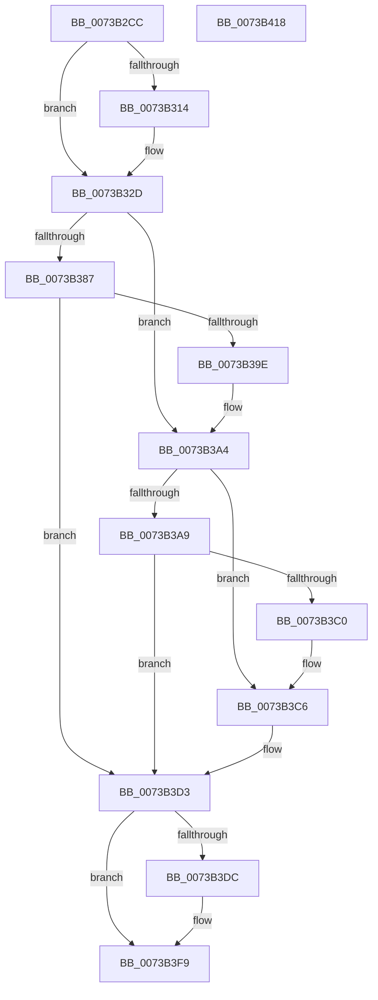

# PiSwStartCreate

- RVA: `0x0073B2CC`–`0x0073B419` (길이 `333` bytes)
- VA: `0x000000014073B2CC`
- 실행 섹션: `PAGE`
- PDB 이름 있음: `예`; PDB Function 태그: `아니요`
- unwind 정보 RVA: `0x000C8F94`
- 디코드: `92`개 명령, `333/333` bytes 표시
- 미해석 바이트: `0` (있으면 어셈블리에 `.byte`로 보존)

> 이 문서는 커널 이미지의 기계어와 PDB 기호를 분석해 생성했습니다. 4번과 5번은 함수 원형과 자료형을 바이너리 사용 방식에서 추정한 C 해석이며 원본 소스 복구 결과는 아닙니다.

## 1. Dependencies

- 직접 호출 지점: **6**; 고유 호출 대상: **5**
- 직접 호출자로 확인된 함수: **2**
- RIP 상대 이미지 참조: **3**

### Outgoing calls
- `0x0073B301` → [memset](../../text/6C/memset_function_006C6C40.md) (function, `0x006C6C40`)
- `0x0073B328` → [McTemplateK0zzz_EtwWriteTransfer](../../text/5A/McTemplateK0zzz_EtwWriteTransfer_function_005A96BC.md) (function, `0x005A96BC`)
- `0x0073B393` → [PnpGetMultiSzLength](../94/PnpGetMultiSzLength_function_0094E690.md) (function, `0x0094E690`)
- `0x0073B3B5` → [PnpGetMultiSzLength](../94/PnpGetMultiSzLength_function_0094E690.md) (function, `0x0094E690`)
- `0x0073B3CC` → [PiSwIrpStartCreateWorker](../8D/PiSwIrpStartCreateWorker_function_008DB398.md) (function, `0x008DB398`)
- `0x0073B3F4` → [McTemplateK0zzzd_EtwWriteTransfer](../../text/5A/McTemplateK0zzzd_EtwWriteTransfer_function_005A97D4.md) (function, `0x005A97D4`)

### Direct callers
- [PiCreateDriverSwDeviceCallback](../AB/PiCreateDriverSwDeviceCallback_function_00ABB420.md) at `0x00ABBE95`
- [PipInitComputerIds](../../init/C7/PipInitComputerIds_function_00C74734.md) at `0x00C75BBA`

### Static image references
- `0x0073B30B` → RVA `0x00EF012C` (`.data`; read)
- `0x0073B319` → RVA `0x000274F0` (`.rdata`; read)
- `0x0073B3E0` → RVA `0x00026FA0` (`.rdata`; read)

## 2. Other-region calls and transfers

- 다른 실행 섹션으로 향하는 call: **3**
  - `0x0073B301` → [memset](../../text/6C/memset_function_006C6C40.md) (`PAGE` → `.text`)
  - `0x0073B328` → [McTemplateK0zzz_EtwWriteTransfer](../../text/5A/McTemplateK0zzz_EtwWriteTransfer_function_005A96BC.md) (`PAGE` → `.text`)
  - `0x0073B3F4` → [McTemplateK0zzzd_EtwWriteTransfer](../../text/5A/McTemplateK0zzzd_EtwWriteTransfer_function_005A97D4.md) (`PAGE` → `.text`)
- 별도 외부 분기/꼬리 이동을 확인하지 못했습니다.

## 3. Assembly (complete function range)

```asm
0073B2CC  48 8B C4                        mov rax, rsp
0073B2CF  48 89 58 10                     mov qword ptr [rax + 0x10], rbx
0073B2D3  48 89 70 18                     mov qword ptr [rax + 0x18], rsi
0073B2D7  48 89 78 20                     mov qword ptr [rax + 0x20], rdi
0073B2DB  55                              push rbp
0073B2DC  41 56                           push r14
0073B2DE  41 57                           push r15
0073B2E0  48 8D 68 E1                     lea rbp, [rax - 0x1f]
0073B2E4  48 81 EC C0 00 00 00            sub rsp, 0xc0
0073B2EB  48 8B F2                        mov rsi, rdx
0073B2EE  49 8B F8                        mov rdi, r8
0073B2F1  33 D2                           xor edx, edx
0073B2F3  4C 8B F1                        mov r14, rcx
0073B2F6  48 8D 4D 87                     lea rcx, [rbp - 0x79]
0073B2FA  49 8B D9                        mov rbx, r9
0073B2FD  44 8D 42 78                     lea r8d, [rdx + 0x78]
0073B301  E8 3A B9 F8 FF                  call 0x1406c6c40
0073B306  48 83 65 27 00                  and qword ptr [rbp + 0x27], 0
0073B30B  F6 05 1A 4E 7B 00 40            test byte ptr [rip + 0x7b4e1a], 0x40
0073B312  74 19                           je 0x14073b32d
0073B314  48 89 74 24 28                  mov qword ptr [rsp + 0x28], rsi
0073B319  48 8D 15 D0 C1 8E FF            lea rdx, [rip - 0x713e30]
0073B320  4D 8B CE                        mov r9, r14
0073B323  48 89 7C 24 20                  mov qword ptr [rsp + 0x20], rdi
0073B328  E8 8F E3 E6 FF                  call 0x1405a96bc
0073B32D  48 8B 45 4F                     mov rax, qword ptr [rbp + 0x4f]
0073B331  4C 8B 7D 47                     mov r15, qword ptr [rbp + 0x47]
0073B335  48 89 45 BF                     mov qword ptr [rbp - 0x41], rax
0073B339  8B 45 57                        mov eax, dword ptr [rbp + 0x57]
0073B33C  89 45 C7                        mov dword ptr [rbp - 0x39], eax
0073B33F  48 8B 45 5F                     mov rax, qword ptr [rbp + 0x5f]
0073B343  48 89 45 CF                     mov qword ptr [rbp - 0x31], rax
0073B347  48 8B 45 67                     mov rax, qword ptr [rbp + 0x67]
0073B34B  48 89 45 D7                     mov qword ptr [rbp - 0x29], rax
0073B34F  8B 45 77                        mov eax, dword ptr [rbp + 0x77]
0073B352  89 45 DF                        mov dword ptr [rbp - 0x21], eax
0073B355  48 8B 45 6F                     mov rax, qword ptr [rbp + 0x6f]
0073B359  48 89 45 E7                     mov qword ptr [rbp - 0x19], rax
0073B35D  8B 85 87 00 00 00               mov eax, dword ptr [rbp + 0x87]
0073B363  89 45 EF                        mov dword ptr [rbp - 0x11], eax
0073B366  48 8B 45 7F                     mov rax, qword ptr [rbp + 0x7f]
0073B36A  48 89 45 F7                     mov qword ptr [rbp - 9], rax
0073B36E  4C 89 75 87                     mov qword ptr [rbp - 0x79], r14
0073B372  48 89 75 8F                     mov qword ptr [rbp - 0x71], rsi
0073B376  48 89 7D 97                     mov qword ptr [rbp - 0x69], rdi
0073B37A  48 89 5D A7                     mov qword ptr [rbp - 0x59], rbx
0073B37E  4C 89 7D B7                     mov qword ptr [rbp - 0x49], r15
0073B382  48 85 DB                        test rbx, rbx
0073B385  74 1D                           je 0x14073b3a4
0073B387  4C 8D 45 27                     lea r8, [rbp + 0x27]
0073B38B  BA 00 04 00 00                  mov edx, 0x400
0073B390  48 8B CB                        mov rcx, rbx
0073B393  E8 F8 32 21 00                  call 0x14094e690
0073B398  8B D8                           mov ebx, eax
0073B39A  85 C0                           test eax, eax
0073B39C  78 35                           js 0x14073b3d3
0073B39E  8B 45 27                        mov eax, dword ptr [rbp + 0x27]
0073B3A1  89 45 9F                        mov dword ptr [rbp - 0x61], eax
0073B3A4  4D 85 FF                        test r15, r15
0073B3A7  74 1D                           je 0x14073b3c6
0073B3A9  4C 8D 45 27                     lea r8, [rbp + 0x27]
0073B3AD  BA 00 04 00 00                  mov edx, 0x400
0073B3B2  49 8B CF                        mov rcx, r15
0073B3B5  E8 D6 32 21 00                  call 0x14094e690
0073B3BA  8B D8                           mov ebx, eax
0073B3BC  85 C0                           test eax, eax
0073B3BE  78 13                           js 0x14073b3d3
0073B3C0  8B 45 27                        mov eax, dword ptr [rbp + 0x27]
0073B3C3  89 45 AF                        mov dword ptr [rbp - 0x51], eax
0073B3C6  33 D2                           xor edx, edx
0073B3C8  48 8D 4D 87                     lea rcx, [rbp - 0x79]
0073B3CC  E8 C7 FF 19 00                  call 0x1408db398
0073B3D1  8B D8                           mov ebx, eax
0073B3D3  F6 05 52 4D 7B 00 40            test byte ptr [rip + 0x7b4d52], 0x40
0073B3DA  74 1D                           je 0x14073b3f9
0073B3DC  89 5C 24 30                     mov dword ptr [rsp + 0x30], ebx
0073B3E0  48 8D 15 B9 BB 8E FF            lea rdx, [rip - 0x714447]
0073B3E7  48 89 74 24 28                  mov qword ptr [rsp + 0x28], rsi
0073B3EC  4D 8B CE                        mov r9, r14
0073B3EF  48 89 7C 24 20                  mov qword ptr [rsp + 0x20], rdi
0073B3F4  E8 DB E3 E6 FF                  call 0x1405a97d4
0073B3F9  4C 8D 9C 24 C0 00 00 00         lea r11, [rsp + 0xc0]
0073B401  8B C3                           mov eax, ebx
0073B403  49 8B 5B 28                     mov rbx, qword ptr [r11 + 0x28]
0073B407  49 8B 73 30                     mov rsi, qword ptr [r11 + 0x30]
0073B40B  49 8B 7B 38                     mov rdi, qword ptr [r11 + 0x38]
0073B40F  49 8B E3                        mov rsp, r11
0073B412  41 5F                           pop r15
0073B414  41 5E                           pop r14
0073B416  5D                              pop rbp
0073B417  C3                              ret
0073B418  CC                              int3
```

## 4. C-style interpretation (structured pseudocode)

```c
__int64 __fastcall PiSwStartCreate(__int64 a1, __int64 a2, __int64 a3, __int64 a4)
{
    __int64 result;
    __int64 v_rsp;
    unsigned __int64 v_stack_m18;
    unsigned int v_stack_mA8;
    unsigned __int64 v_stack_mB0;
    unsigned __int64 v_stack_mB8;

    *(unsigned __int64 *)(v_rsp + 16) = v_rbx;
    *(unsigned __int64 *)(v_rsp + 24) = v_rsi;
    *(unsigned __int64 *)(v_rsp + 32) = v_rdi;
    v_rsp = (v_rsp) - (192);
    a2 = 0;
    result = memset(v_rsp - 31 - 121, a2, a2 + 120, a4);
    if (((*(unsigned __int8 *)(v_rip + 8080922)) & (64)) != 0) {
        v_stack_mB0 = 0;
        a2 = v_rip - 7421488;
        a4 = a1;
        v_stack_mB8 = a3;
        result = McTemplateK0zzz_EtwWriteTransfer(v_rsp - 31 - 121, a2, a2 + 120, a4);
    }
    *(unsigned __int64 *)(v_rsp - 31 - 65) = *(unsigned __int64 *)(v_rsp - 31 + 79);
    *(unsigned int *)(v_rsp - 31 - 57) = (unsigned int)((unsigned int)(*(unsigned int *)(v_rsp - 31 + 87)));
    *(unsigned __int64 *)(v_rsp - 31 - 49) = *(unsigned __int64 *)(v_rsp - 31 + 95);
    *(unsigned __int64 *)(v_rsp - 31 - 41) = *(unsigned __int64 *)(v_rsp - 31 + 103);
    *(unsigned int *)(v_rsp - 31 - 33) = (unsigned int)((unsigned int)(*(unsigned int *)(v_rsp - 31 + 119)));
    *(unsigned __int64 *)(v_rsp - 31 - 25) = *(unsigned __int64 *)(v_rsp - 31 + 111);
    *(unsigned int *)(v_rsp - 31 - 17) = (unsigned int)((unsigned int)(*(unsigned int *)(v_rsp - 31 + 135)));
    *(unsigned __int64 *)(v_rsp - 31 - 9) = *(unsigned __int64 *)(v_rsp - 31 + 127);
    *(unsigned __int64 *)(v_rsp - 31 - 121) = a1;
    *(unsigned __int64 *)(v_rsp - 31 - 113) = a2;
    *(unsigned __int64 *)(v_rsp - 31 - 105) = a3;
    *(unsigned __int64 *)(v_rsp - 31 - 89) = a4;
    *(unsigned __int64 *)(v_rsp - 31 - 73) = *(unsigned __int64 *)(v_rsp - 31 + 71);
    if (a4 == 0) goto loc_0073B3A4;
    result = PnpGetMultiSzLength(a4, (unsigned int)(0x400ULL), v_rsp - 31 + 39, a4);
    if (sign_flag) goto loc_0073B3D3;
    *(unsigned int *)(v_rsp - 31 - 97) = (unsigned int)((unsigned int)(*(unsigned int *)(v_rsp - 31 + 39)));
loc_0073B3A4:
    if (*(unsigned __int64 *)(v_rsp - 31 + 71) == 0) goto loc_0073B3C6;
    result = PnpGetMultiSzLength(*(unsigned __int64 *)(v_rsp - 31 + 71), (unsigned int)(0x400ULL), v_rsp - 31 + 39, a4);
    if (sign_flag) goto loc_0073B3D3;
    *(unsigned int *)(v_rsp - 31 - 81) = (unsigned int)((unsigned int)(*(unsigned int *)(v_rsp - 31 + 39)));
loc_0073B3C6:
    a2 = 0;
    result = PiSwIrpStartCreateWorker(v_rsp - 31 - 121, a2, v_rsp - 31 + 39, a4);
loc_0073B3D3:
    if (((*(unsigned __int8 *)(v_rip + 8080722)) & (64)) != 0) {
        v_stack_mA8 = (unsigned int)((unsigned int)((unsigned int)(result)));
        a2 = v_rip - 7423047;
        v_stack_mB0 = a2;
        a4 = a1;
        v_stack_mB8 = a3;
        result = McTemplateK0zzzd_EtwWriteTransfer(v_rsp - 31 - 121, a2, v_rsp - 31 + 39, a4);
    }
    return (unsigned int)((unsigned int)((unsigned int)((unsigned int)(result))));
}
```

## 5. (Beta) C Style

```c
int64_t PiSwStartCreate(int64_t Arg1, int64_t Arg2, int64_t Arg3, int64_t Arg4)
{
    int64_t result;
    int64_t local_rsp;
    uint64_t v_stack_m18;
    uint32_t v_stack_mA8;
    uint64_t v_stack_mB0;
    uint64_t v_stack_mB8;

    *(uint64_t *)(local_rsp + 0x10) = local_rbx;
    *(uint64_t *)(local_rsp + 0x18) = local_rsi;
    *(uint64_t *)(local_rsp + 0x20) = local_rdi;
    local_rsp = (local_rsp) - (192);
    Arg2 = 0;
    result = memset(local_rsp - 31 - 121, Arg2, Arg2 + 120, Arg4);
    if (((*(uint8_t *)(v_rip + 0x7B4E1A)) & (64)) != 0) {
        v_stack_mB0 = 0;
        Arg2 = v_rip - 7421488;
        Arg4 = Arg1;
        v_stack_mB8 = Arg3;
        result = McTemplateK0zzz_EtwWriteTransfer(local_rsp - 31 - 121, Arg2, Arg2 + 120, Arg4);
    }
    *(uint64_t *)(local_rsp - 0x1F - 0x41) = *(uint64_t *)(local_rsp - 0x1F + 0x4F);
    *(uint32_t *)(local_rsp - 0x1F - 0x39) = (uint32_t)((uint32_t)(*(uint32_t *)(local_rsp - 0x1F + 0x57)));
    *(uint64_t *)(local_rsp - 0x1F - 0x31) = *(uint64_t *)(local_rsp - 0x1F + 0x5F);
    *(uint64_t *)(local_rsp - 0x1F - 0x29) = *(uint64_t *)(local_rsp - 0x1F + 0x67);
    *(uint32_t *)(local_rsp - 0x1F - 0x21) = (uint32_t)((uint32_t)(*(uint32_t *)(local_rsp - 0x1F + 0x77)));
    *(uint64_t *)(local_rsp - 0x1F - 0x19) = *(uint64_t *)(local_rsp - 0x1F + 0x6F);
    *(uint32_t *)(local_rsp - 0x1F - 0x11) = (uint32_t)((uint32_t)(*(uint32_t *)(local_rsp - 0x1F + 0x87)));
    *(uint64_t *)(local_rsp - 0x1F - 0x9) = *(uint64_t *)(local_rsp - 0x1F + 0x7F);
    *(uint64_t *)(local_rsp - 0x1F - 0x79) = Arg1;
    *(uint64_t *)(local_rsp - 0x1F - 0x71) = Arg2;
    *(uint64_t *)(local_rsp - 0x1F - 0x69) = Arg3;
    *(uint64_t *)(local_rsp - 0x1F - 0x59) = Arg4;
    *(uint64_t *)(local_rsp - 0x1F - 0x49) = *(uint64_t *)(local_rsp - 0x1F + 0x47);
    if (Arg4 == 0) goto loc_0073B3A4;
    result = PnpGetMultiSzLength(Arg4, (uint32_t)(0x400ULL), local_rsp - 31 + 39, Arg4);
    if (sign_flag) goto loc_0073B3D3;
    *(uint32_t *)(local_rsp - 0x1F - 0x61) = (uint32_t)((uint32_t)(*(uint32_t *)(local_rsp - 0x1F + 0x27)));
loc_0073B3A4:
    if (*(uint64_t *)(local_rsp - 0x1F + 0x47) == 0) goto loc_0073B3C6;
    result = PnpGetMultiSzLength(*(uint64_t *)(local_rsp - 0x1F + 0x47), (uint32_t)(0x400ULL), local_rsp - 31 + 39, Arg4);
    if (sign_flag) goto loc_0073B3D3;
    *(uint32_t *)(local_rsp - 0x1F - 0x51) = (uint32_t)((uint32_t)(*(uint32_t *)(local_rsp - 0x1F + 0x27)));
loc_0073B3C6:
    Arg2 = 0;
    result = PiSwIrpStartCreateWorker(local_rsp - 31 - 121, Arg2, local_rsp - 31 + 39, Arg4);
loc_0073B3D3:
    if (((*(uint8_t *)(v_rip + 0x7B4D52)) & (64)) != 0) {
        v_stack_mA8 = (uint32_t)((uint32_t)((uint32_t)(result)));
        Arg2 = v_rip - 7423047;
        v_stack_mB0 = Arg2;
        Arg4 = Arg1;
        v_stack_mB8 = Arg3;
        result = McTemplateK0zzzd_EtwWriteTransfer(local_rsp - 31 - 121, Arg2, local_rsp - 31 + 39, Arg4);
    }
    return (uint32_t)((uint32_t)((uint32_t)((uint32_t)(result))));
}
```

## 6. Execution-region graph

[열기: 2D/3D 그래프와 함수 탐색 컨트롤 패널](../../../control-panel.html?section=page&rva=0x0073B2CC&view=graph)

- 2D 그래프는 위에서 아래로 흐르고, 3D 그래프는 빈 공간을 드래그해 회전합니다. Shift+드래그는 이동, 휠은 확대·축소, 함수 노드 선택은 대상 보고서 이동입니다.

### Static fallback


