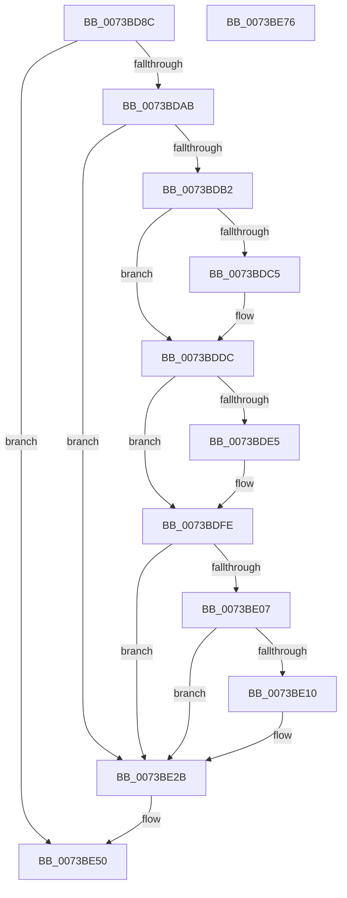

# PipDmaGuardBlockAddDevice

- RVA: `0x0073BD8C`–`0x0073BE77` (길이 `235` bytes)
- VA: `0x000000014073BD8C`
- 실행 섹션: `PAGE`
- PDB 이름 있음: `예`; PDB Function 태그: `아니요`
- unwind 정보 RVA: `0x000794E0`
- 디코드: `61`개 명령, `235/235` bytes 표시
- 미해석 바이트: `0` (있으면 어셈블리에 `.byte`로 보존)

> 이 문서는 커널 이미지의 기계어와 PDB 기호를 분석해 생성했습니다. 4번과 5번은 함수 원형과 자료형을 바이너리 사용 방식에서 추정한 C 해석이며 원본 소스 복구 결과는 아닙니다.

## 1. Dependencies

- 직접 호출 지점: **9**; 고유 호출 대상: **3**
- 직접 호출자로 확인된 함수: **1**
- RIP 상대 이미지 참조: **1**

### Outgoing calls
- `0x0073BDBB` → [IoAddTriageDumpDataBlock](../../text/42/IoAddTriageDumpDataBlock_function_00428374.md) (function, `0x00428374`)
- `0x0073BDCB` → [IoAddTriageDumpDataBlock](../../text/42/IoAddTriageDumpDataBlock_function_00428374.md) (function, `0x00428374`)
- `0x0073BDD7` → [IoAddTriageDumpDataBlock](../../text/42/IoAddTriageDumpDataBlock_function_00428374.md) (function, `0x00428374`)
- `0x0073BDED` → [IoAddTriageDumpDataBlock](../../text/42/IoAddTriageDumpDataBlock_function_00428374.md) (function, `0x00428374`)
- `0x0073BDF9` → [IoAddTriageDumpDataBlock](../../text/42/IoAddTriageDumpDataBlock_function_00428374.md) (function, `0x00428374`)
- `0x0073BE15` → [IoAddTriageDumpDataBlock](../../text/42/IoAddTriageDumpDataBlock_function_00428374.md) (function, `0x00428374`)
- `0x0073BE26` → [IoAddTriageDumpDataBlock](../../text/42/IoAddTriageDumpDataBlock_function_00428374.md) (function, `0x00428374`)
- `0x0073BE4A` → [KeBugCheckEx](../../text/4F/KeBugCheckEx_function_004FD660.md) (function, `0x004FD660`)
- `0x0073BE5C` → [PnpRequestDeviceRemoval](../8F/PnpRequestDeviceRemoval_function_008FC294.md) (function, `0x008FC294`)

### Direct callers
- [PipDmgEnforceEnumerationPolicy](PipDmgEnforceEnumerationPolicy_function_0073BEB4.md) at `0x0073BF54`

### Static image references
- `0x0073BD9B` → RVA `0x00F8A9AC` (`.data`; read)

## 2. Other-region calls and transfers

- 다른 실행 섹션으로 향하는 call: **8**
  - `0x0073BDBB` → [IoAddTriageDumpDataBlock](../../text/42/IoAddTriageDumpDataBlock_function_00428374.md) (`PAGE` → `.text`)
  - `0x0073BDCB` → [IoAddTriageDumpDataBlock](../../text/42/IoAddTriageDumpDataBlock_function_00428374.md) (`PAGE` → `.text`)
  - `0x0073BDD7` → [IoAddTriageDumpDataBlock](../../text/42/IoAddTriageDumpDataBlock_function_00428374.md) (`PAGE` → `.text`)
  - `0x0073BDED` → [IoAddTriageDumpDataBlock](../../text/42/IoAddTriageDumpDataBlock_function_00428374.md) (`PAGE` → `.text`)
  - `0x0073BDF9` → [IoAddTriageDumpDataBlock](../../text/42/IoAddTriageDumpDataBlock_function_00428374.md) (`PAGE` → `.text`)
  - `0x0073BE15` → [IoAddTriageDumpDataBlock](../../text/42/IoAddTriageDumpDataBlock_function_00428374.md) (`PAGE` → `.text`)
  - `0x0073BE26` → [IoAddTriageDumpDataBlock](../../text/42/IoAddTriageDumpDataBlock_function_00428374.md) (`PAGE` → `.text`)
  - `0x0073BE4A` → [KeBugCheckEx](../../text/4F/KeBugCheckEx_function_004FD660.md) (`PAGE` → `.text`)
- 별도 외부 분기/꼬리 이동을 확인하지 못했습니다.

## 3. Assembly (complete function range)

```asm
0073BD8C  48 89 5C 24 08                  mov qword ptr [rsp + 8], rbx
0073BD91  48 89 74 24 10                  mov qword ptr [rsp + 0x10], rsi
0073BD96  57                              push rdi
0073BD97  48 83 EC 30                     sub rsp, 0x30
0073BD9B  83 3D 0A EC 84 00 01            cmp dword ptr [rip + 0x84ec0a], 1
0073BDA2  48 8B D9                        mov rbx, rcx
0073BDA5  0F 85 A5 00 00 00               jne 0x14073be50
0073BDAB  33 F6                           xor esi, esi
0073BDAD  48 85 C9                        test rcx, rcx
0073BDB0  74 79                           je 0x14073be2b
0073BDB2  BA 88 03 00 00                  mov edx, 0x388
0073BDB7  48 8D 79 28                     lea rdi, [rcx + 0x28]
0073BDBB  E8 B4 C5 CE FF                  call 0x140428374
0073BDC0  66 39 37                        cmp word ptr [rdi], si
0073BDC3  74 17                           je 0x14073bddc
0073BDC5  8D 56 02                        lea edx, [rsi + 2]
0073BDC8  48 8B CF                        mov rcx, rdi
0073BDCB  E8 A4 C5 CE FF                  call 0x140428374
0073BDD0  0F B7 17                        movzx edx, word ptr [rdi]
0073BDD3  48 8B 4F 08                     mov rcx, qword ptr [rdi + 8]
0073BDD7  E8 98 C5 CE FF                  call 0x140428374
0073BDDC  48 8D 7B 38                     lea rdi, [rbx + 0x38]
0073BDE0  66 39 37                        cmp word ptr [rdi], si
0073BDE3  74 19                           je 0x14073bdfe
0073BDE5  BA 02 00 00 00                  mov edx, 2
0073BDEA  48 8B CF                        mov rcx, rdi
0073BDED  E8 82 C5 CE FF                  call 0x140428374
0073BDF2  0F B7 17                        movzx edx, word ptr [rdi]
0073BDF5  48 8B 4B 40                     mov rcx, qword ptr [rbx + 0x40]
0073BDF9  E8 76 C5 CE FF                  call 0x140428374
0073BDFE  48 8B 43 10                     mov rax, qword ptr [rbx + 0x10]
0073BE02  48 85 C0                        test rax, rax
0073BE05  74 24                           je 0x14073be2b
0073BE07  48 8D 48 38                     lea rcx, [rax + 0x38]
0073BE0B  66 39 31                        cmp word ptr [rcx], si
0073BE0E  74 1B                           je 0x14073be2b
0073BE10  BA 02 00 00 00                  mov edx, 2
0073BE15  E8 5A C5 CE FF                  call 0x140428374
0073BE1A  48 8B 4B 10                     mov rcx, qword ptr [rbx + 0x10]
0073BE1E  0F B7 51 38                     movzx edx, word ptr [rcx + 0x38]
0073BE22  48 8B 49 40                     mov rcx, qword ptr [rcx + 0x40]
0073BE26  E8 49 C5 CE FF                  call 0x140428374
0073BE2B  8B 83 C0 02 00 00               mov eax, dword ptr [rbx + 0x2c0]
0073BE31  4C 8B C3                        mov r8, rbx
0073BE34  4C 8B 8B D0 02 00 00            mov r9, qword ptr [rbx + 0x2d0]
0073BE3B  BA 11 00 00 00                  mov edx, 0x11
0073BE40  B9 CA 00 00 00                  mov ecx, 0xca
0073BE45  48 89 44 24 20                  mov qword ptr [rsp + 0x20], rax
0073BE4A  E8 11 18 DC FF                  call 0x1404fd660
0073BE4F  CC                              int3
0073BE50  33 D2                           xor edx, edx
0073BE52  41 B9 22 00 00 C0               mov r9d, 0xc0000022
0073BE58  44 8D 42 37                     lea r8d, [rdx + 0x37]
0073BE5C  E8 33 04 1C 00                  call 0x1408fc294
0073BE61  48 8B 5C 24 40                  mov rbx, qword ptr [rsp + 0x40]
0073BE66  B8 CE 02 00 C0                  mov eax, 0xc00002ce
0073BE6B  48 8B 74 24 48                  mov rsi, qword ptr [rsp + 0x48]
0073BE70  48 83 C4 30                     add rsp, 0x30
0073BE74  5F                              pop rdi
0073BE75  C3                              ret
0073BE76  CC                              int3
```

## 4. C-style interpretation (structured pseudocode)

```c
__int64 __fastcall PipDmaGuardBlockAddDevice(__int64 a1)
{
    __int64 result;
    __int64 v_rsi;
    __int64 v_rsp;
    unsigned __int64 v_stack_m18;
    unsigned __int64 v_stack_p10;
    unsigned __int64 v_stack_p8;

    v_stack_p8 = v_rbx;
    v_stack_p10 = v_rsi;
    v_rsp = (v_rsp) - (48);
    if ((*(unsigned int *)(v_rip + 8711178)) != 1) goto loc_0073BE50;
    v_rsi = 0;
    if (a1 == 0) goto loc_0073BE2B;
    result = IoAddTriageDumpDataBlock(a1, 904, a3, a4);
    if ((*(unsigned __int16 *)(a1 + 40)) != 0) {
        a2 = v_rsi + 2;
        a1 = a1 + 40;
        result = IoAddTriageDumpDataBlock(a1, a2, a3, a4);
        a2 = *(unsigned __int16 *)(a1 + 40);
        a1 = *(unsigned __int64 *)(a1 + 40 + 8);
        result = IoAddTriageDumpDataBlock(a1, a2, a3, a4);
    }
    if ((*(unsigned __int16 *)(a1 + 56)) != 0) {
        a2 = 2;
        a1 = a1 + 56;
        result = IoAddTriageDumpDataBlock(a1, a2, a3, a4);
        a2 = *(unsigned __int16 *)(a1 + 56);
        a1 = *(unsigned __int64 *)(a1 + 64);
        result = IoAddTriageDumpDataBlock(a1, a2, a3, a4);
    }
    if (*(unsigned __int64 *)(a1 + 16) == 0) goto loc_0073BE2B;
    result = *(unsigned __int64 *)(a1 + 16);
    if ((*(unsigned __int16 *)(*(unsigned __int64 *)(a1 + 16) + 56)) != 0) {
        a2 = 2;
        result = IoAddTriageDumpDataBlock(*(unsigned __int64 *)(a1 + 16) + 56, a2, a3, a4);
        a1 = *(unsigned __int64 *)(a1 + 16);
        a2 = *(unsigned __int16 *)(a1 + 56);
        a1 = *(unsigned __int64 *)(a1 + 64);
        result = IoAddTriageDumpDataBlock(a1, a2, a3, a4);
    }
    v_stack_m18 = (unsigned int)(*(unsigned int *)(a1 + 704));
    result = KeBugCheckEx(202, 17, a1, *(unsigned __int64 *)(a1 + 720));
loc_0073BE50:
    a2 = 0;
    result = PnpRequestDeviceRemoval(202, a2, a2 + 55, (unsigned int)(0xC0000022ULL));
    v_rsp = (v_rsp) + (48);
    return (unsigned int)(0xC00002CEULL);
}
```

## 5. (Beta) C Style

```c
int64_t PipDmaGuardBlockAddDevice(void *Arg1)
{
    uint8_t *arg1 = (uint8_t *)Arg1;

    int64_t result;
    int64_t local_rsi;
    int64_t local_rsp;
    uint64_t v_stack_m18;
    uint64_t v_stack_p10;
    uint64_t v_stack_p8;

    v_stack_p8 = local_rbx;
    v_stack_p10 = local_rsi;
    local_rsp = (local_rsp) - (48);
    if ((*(uint32_t *)(v_rip + 0x84EC0A)) != 1) goto loc_0073BE50;
    local_rsi = 0;
    if (Arg1 == NULL) goto loc_0073BE2B;
    result = IoAddTriageDumpDataBlock(Arg1, 904, a3, a4);
    if ((*(uint16_t *)(arg1 + 0x28)) != 0) {
        a2 = local_rsi + 2;
        Arg1 = Arg1 + 40;
        result = IoAddTriageDumpDataBlock(Arg1, a2, a3, a4);
        a2 = *(uint16_t *)(arg1 + 0x28);
        Arg1 = *(uint64_t *)(arg1 + 0x28 + 0x8);
        result = IoAddTriageDumpDataBlock(Arg1, a2, a3, a4);
    }
    if ((*(uint16_t *)(arg1 + 0x38)) != 0) {
        a2 = 2;
        Arg1 = Arg1 + 56;
        result = IoAddTriageDumpDataBlock(Arg1, a2, a3, a4);
        a2 = *(uint16_t *)(arg1 + 0x38);
        Arg1 = *(uint64_t *)(arg1 + 0x40);
        result = IoAddTriageDumpDataBlock(Arg1, a2, a3, a4);
    }
    if (*(uint64_t *)(arg1 + 0x10) == 0) goto loc_0073BE2B;
    result = *(uint64_t *)(arg1 + 0x10);
    if ((*(uint16_t *)(*(uint64_t *)(arg1 + 0x10) + 0x38)) != 0) {
        a2 = 2;
        result = IoAddTriageDumpDataBlock(*(uint64_t *)(arg1 + 0x10) + 56, a2, a3, a4);
        Arg1 = *(uint64_t *)(arg1 + 0x10);
        a2 = *(uint16_t *)(arg1 + 0x38);
        Arg1 = *(uint64_t *)(arg1 + 0x40);
        result = IoAddTriageDumpDataBlock(Arg1, a2, a3, a4);
    }
    v_stack_m18 = (uint32_t)(*(uint32_t *)(arg1 + 0x2C0));
    result = KeBugCheckEx(202, 17, Arg1, *(uint64_t *)(arg1 + 0x2D0));
loc_0073BE50:
    a2 = 0;
    result = PnpRequestDeviceRemoval(202, a2, a2 + 55, (uint32_t)(0xC0000022ULL));
    local_rsp = (local_rsp) + (48);
    return (uint32_t)(0xC00002CEULL);
}
```

### 관측된 메모리 오프셋

구조체 형식이 확인되지 않은 접근은 인자 기준의 오프셋으로만 기록했습니다.

| 기준 인자 | 오프셋 표현 | 폭 (bit) | 접근 |
|---|---:|---:|---|
| `Arg1` | `+ 0x0` | `16` | `R` |
| `Arg1` | `+ 0x10` | `64` | `R` |
| `Arg1` | `+ 0x38` | `64` | `R` |
| `Arg1` | `+ 0x40` | `64` | `R` |
| `Arg1` | `+ 0x2C0` | `32` | `R` |
| `Arg1` | `+ 0x2D0` | `64` | `R` |

## 6. Execution-region graph

[열기: 2D/3D 그래프와 함수 탐색 컨트롤 패널](../../../control-panel.html?section=page&rva=0x0073BD8C&view=graph)

- 2D 그래프는 위에서 아래로 흐르고, 3D 그래프는 빈 공간을 드래그해 회전합니다. Shift+드래그는 이동, 휠은 확대·축소, 함수 노드 선택은 대상 보고서 이동입니다.

### Static fallback


