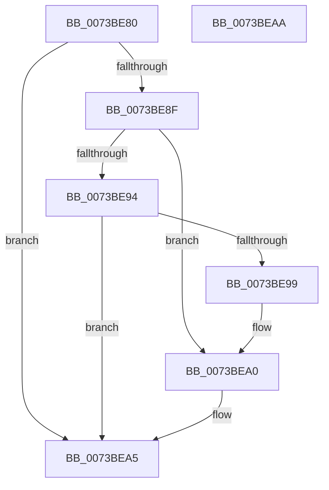

# PipDmgConsoleUnlockCallback

- RVA: `0x0073BE80`–`0x0073BEAB` (길이 `43` bytes)
- VA: `0x000000014073BE80`
- 실행 섹션: `PAGE`
- PDB 이름 있음: `예`; PDB Function 태그: `아니요`
- unwind 정보 RVA: `0x0005C788`
- 디코드: `14`개 명령, `43/43` bytes 표시
- 미해석 바이트: `0` (있으면 어셈블리에 `.byte`로 보존)

> 이 문서는 커널 이미지의 기계어와 PDB 기호를 분석해 생성했습니다. 4번과 5번은 함수 원형과 자료형을 바이너리 사용 방식에서 추정한 C 해석이며 원본 소스 복구 결과는 아닙니다.

## 1. Dependencies

- 직접 호출 지점: **1**; 고유 호출 대상: **1**
- 직접 호출자로 확인된 함수: **0**
- RIP 상대 이미지 참조: **1**

### Outgoing calls
- `0x0073BEA0` → [PipDmgFlushQueueAndRestartDevices](PipDmgFlushQueueAndRestartDevices_function_0073BF9C.md) (function, `0x0073BF9C`)

### Direct callers
- 이 함수 시작 RVA로 연결되는 직접 call은 확인되지 않았습니다. 간접 호출은 완전히 역산할 수 없습니다.

### Static image references
- `0x0073BE84` → RVA `0x00F8A9AC` (`.data`; read)

## 2. Other-region calls and transfers

- 다른 실행 섹션으로 향하는 call: **0**
- 별도 외부 분기/꼬리 이동을 확인하지 못했습니다.

## 3. Assembly (complete function range)

```asm
0073BE80  48 83 EC 28                     sub rsp, 0x28
0073BE84  8B 0D 22 EB 84 00               mov ecx, dword ptr [rip + 0x84eb22]
0073BE8A  83 E9 01                        sub ecx, 1
0073BE8D  74 16                           je 0x14073bea5
0073BE8F  83 E9 01                        sub ecx, 1
0073BE92  74 0C                           je 0x14073bea0
0073BE94  83 F9 01                        cmp ecx, 1
0073BE97  74 0C                           je 0x14073bea5
0073BE99  B9 05 00 00 00                  mov ecx, 5
0073BE9E  CD 29                           int 0x29
0073BEA0  E8 F7 00 00 00                  call 0x14073bf9c
0073BEA5  48 83 C4 28                     add rsp, 0x28
0073BEA9  C3                              ret
0073BEAA  CC                              int3
```

## 4. C-style interpretation (structured pseudocode)

```c
__int64 __fastcall PipDmgConsoleUnlockCallback(void)
{
    __int64 result;
    __int64 v_rsp;

    v_rsp = (v_rsp) - (40);
    a1 = (unsigned int)(((unsigned int)(*(unsigned int *)(v_rip + 8710946))) - (1));
    if (condition_is_equal) goto loc_0073BEA5;
    a1 = (unsigned int)((a1) - (1));
    if (condition_is_equal) goto loc_0073BEA0;
    if (((unsigned int)(a1)) == 1) goto loc_0073BEA5;
loc_0073BEA0:
    result = PipDmgFlushQueueAndRestartDevices(5, a2, a3, a4);
loc_0073BEA5:
    v_rsp = (v_rsp) + (40);
    return result;
}
```

## 5. (Beta) C Style

```c
void PipDmgConsoleUnlockCallback(void)
{
    int64_t result;
    int64_t local_rsp;

    local_rsp = (local_rsp) - (40);
    a1 = (uint32_t)(((uint32_t)(*(uint32_t *)(v_rip + 0x84EB22))) - (1));
    if (condition_is_equal) goto loc_0073BEA5;
    a1 = (uint32_t)((a1) - (1));
    if (condition_is_equal) goto loc_0073BEA0;
    if (((uint32_t)(a1)) == 1) goto loc_0073BEA5;
loc_0073BEA0:
    result = PipDmgFlushQueueAndRestartDevices(5, a2, a3, a4);
loc_0073BEA5:
    local_rsp = (local_rsp) + (40);
    return result;
}
```

## 6. Execution-region graph

[열기: 2D/3D 그래프와 함수 탐색 컨트롤 패널](../../../control-panel.html?section=page&rva=0x0073BE80&view=graph)

- 2D 그래프는 위에서 아래로 흐르고, 3D 그래프는 빈 공간을 드래그해 회전합니다. Shift+드래그는 이동, 휠은 확대·축소, 함수 노드 선택은 대상 보고서 이동입니다.

### Static fallback


