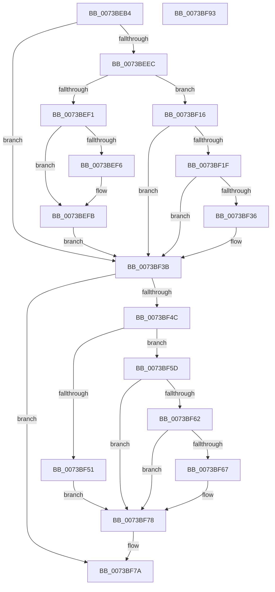

# PipDmgEnforceEnumerationPolicy

- RVA: `0x0073BEB4`–`0x0073BF94` (길이 `224` bytes)
- VA: `0x000000014073BEB4`
- 실행 섹션: `PAGE`
- PDB 이름 있음: `예`; PDB Function 태그: `아니요`
- unwind 정보 RVA: `0x00060300`
- 디코드: `71`개 명령, `224/224` bytes 표시
- 미해석 바이트: `0` (있으면 어셈블리에 `.byte`로 보존)

> 이 문서는 커널 이미지의 기계어와 PDB 기호를 분석해 생성했습니다. 4번과 5번은 함수 원형과 자료형을 바이너리 사용 방식에서 추정한 C 해석이며 원본 소스 복구 결과는 아닙니다.

## 1. Dependencies

- 직접 호출 지점: **9**; 고유 호출 대상: **7**
- 직접 호출자로 확인된 함수: **2**
- RIP 상대 이미지 참조: **1**

### Outgoing calls
- `0x0073BEFE` → [PiIommuIsDeviceSafeWhileConsoleLocked](../74/PiIommuIsDeviceSafeWhileConsoleLocked_function_00740238.md) (function, `0x00740238`)
- `0x0073BF09` → [PiIommuIsPassthroughAllowedWhileConsoleLocked](../74/PiIommuIsPassthroughAllowedWhileConsoleLocked_function_00740254.md) (function, `0x00740254`)
- `0x0073BF16` → [PiCslIsConsoleLocked](../A9/PiCslIsConsoleLocked_function_00A95D38.md) (function, `0x00A95D38`)
- `0x0073BF22` → [PiIommuIsDeviceSafeWhileConsoleLocked](../74/PiIommuIsDeviceSafeWhileConsoleLocked_function_00740238.md) (function, `0x00740238`)
- `0x0073BF2D` → [PiIommuIsPassthroughAllowedWhileConsoleLocked](../74/PiIommuIsPassthroughAllowedWhileConsoleLocked_function_00740254.md) (function, `0x00740254`)
- `0x0073BF43` → [PipDmgSetIommuDomainPolicyAndNotifyHal](PipDmgSetIommuDomainPolicyAndNotifyHal_function_0073C718.md) (function, `0x0073C718`)
- `0x0073BF54` → [PipDmaGuardBlockAddDevice](PipDmaGuardBlockAddDevice_function_0073BD8C.md) (function, `0x0073BD8C`)
- `0x0073BF6E` → [PiDmaGuardQueueInsertEntry](../74/PiDmaGuardQueueInsertEntry_function_007445F0.md) (function, `0x007445F0`)
- `0x0073BF73` → [PipDmgReevaluateQueue](PipDmgReevaluateQueue_function_0073C1A4.md) (function, `0x0073C1A4`)

### Direct callers
- [PipCallDriverAddDevice](../A2/PipCallDriverAddDevice_function_00A272E0.md) at `0x00A277B3`
- [PnpSurpriseFailUnsafeDmaDevices](../A9/PnpSurpriseFailUnsafeDmaDevices_function_00A95B90.md) at `0x00A95CB6`

### Static image references
- `0x0073BED5` → RVA `0x00F8A9AC` (`.data`; read)

## 2. Other-region calls and transfers

- 다른 실행 섹션으로 향하는 call: **0**
- 별도 외부 분기/꼬리 이동을 확인하지 못했습니다.

## 3. Assembly (complete function range)

```asm
0073BEB4  48 89 5C 24 08                  mov qword ptr [rsp + 8], rbx
0073BEB9  48 89 6C 24 10                  mov qword ptr [rsp + 0x10], rbp
0073BEBE  48 89 74 24 18                  mov qword ptr [rsp + 0x18], rsi
0073BEC3  57                              push rdi
0073BEC4  41 56                           push r14
0073BEC6  41 57                           push r15
0073BEC8  48 83 EC 20                     sub rsp, 0x20
0073BECC  4C 8B B1 D0 02 00 00            mov r14, qword ptr [rcx + 0x2d0]
0073BED3  33 DB                           xor ebx, ebx
0073BED5  8B 15 D1 EA 84 00               mov edx, dword ptr [rip + 0x84ead1]
0073BEDB  48 8B E9                        mov rbp, rcx
0073BEDE  8B FB                           mov edi, ebx
0073BEE0  40 8A F3                        mov sil, bl
0073BEE3  45 8B 7E 14                     mov r15d, dword ptr [r14 + 0x14]
0073BEE7  83 EA 01                        sub edx, 1
0073BEEA  74 4F                           je 0x14073bf3b
0073BEEC  83 EA 01                        sub edx, 1
0073BEEF  74 25                           je 0x14073bf16
0073BEF1  83 FA 01                        cmp edx, 1
0073BEF4  74 05                           je 0x14073befb
0073BEF6  8D 4B 05                        lea ecx, [rbx + 5]
0073BEF9  CD 29                           int 0x29
0073BEFB  49 8B CE                        mov rcx, r14
0073BEFE  E8 35 43 00 00                  call 0x140740238
0073BF03  84 C0                           test al, al
0073BF05  40 0F 94 C6                     sete sil
0073BF09  E8 46 43 00 00                  call 0x140740254
0073BF0E  84 C0                           test al, al
0073BF10  40 0F 94 C7                     sete dil
0073BF14  EB 25                           jmp 0x14073bf3b
0073BF16  E8 1D 9E 35 00                  call 0x140a95d38
0073BF1B  84 C0                           test al, al
0073BF1D  74 1C                           je 0x14073bf3b
0073BF1F  49 8B CE                        mov rcx, r14
0073BF22  E8 11 43 00 00                  call 0x140740238
0073BF27  84 C0                           test al, al
0073BF29  40 0F 94 C6                     sete sil
0073BF2D  E8 22 43 00 00                  call 0x140740254
0073BF32  84 C0                           test al, al
0073BF34  75 05                           jne 0x14073bf3b
0073BF36  BF 01 00 00 00                  mov edi, 1
0073BF3B  44 8A C6                        mov r8b, sil
0073BF3E  8B D7                           mov edx, edi
0073BF40  48 8B CD                        mov rcx, rbp
0073BF43  E8 D0 07 00 00                  call 0x14073c718
0073BF48  85 C0                           test eax, eax
0073BF4A  78 2E                           js 0x14073bf7a
0073BF4C  40 84 F6                        test sil, sil
0073BF4F  74 0C                           je 0x14073bf5d
0073BF51  48 8B CD                        mov rcx, rbp
0073BF54  E8 33 FE FF FF                  call 0x14073bd8c
0073BF59  8B D8                           mov ebx, eax
0073BF5B  EB 1B                           jmp 0x14073bf78
0073BF5D  44 3B FF                        cmp r15d, edi
0073BF60  74 16                           je 0x14073bf78
0073BF62  83 FF 01                        cmp edi, 1
0073BF65  75 11                           jne 0x14073bf78
0073BF67  48 8B 4D 20                     mov rcx, qword ptr [rbp + 0x20]
0073BF6B  8D 57 03                        lea edx, [rdi + 3]
0073BF6E  E8 7D 86 00 00                  call 0x1407445f0
0073BF73  E8 2C 02 00 00                  call 0x14073c1a4
0073BF78  8B C3                           mov eax, ebx
0073BF7A  48 8B 5C 24 40                  mov rbx, qword ptr [rsp + 0x40]
0073BF7F  48 8B 6C 24 48                  mov rbp, qword ptr [rsp + 0x48]
0073BF84  48 8B 74 24 50                  mov rsi, qword ptr [rsp + 0x50]
0073BF89  48 83 C4 20                     add rsp, 0x20
0073BF8D  41 5F                           pop r15
0073BF8F  41 5E                           pop r14
0073BF91  5F                              pop rdi
0073BF92  C3                              ret
0073BF93  CC                              int3
```

## 4. C-style interpretation (structured pseudocode)

```c
__int64 __fastcall PipDmgEnforceEnumerationPolicy(__int64 a1)
{
    __int64 result;
    __int64 v_rbx;
    __int64 v_rdi;
    __int64 v_rsi;
    __int64 v_rsp;
    unsigned __int64 v_stack_p10;
    unsigned __int64 v_stack_p18;
    unsigned __int64 v_stack_p8;

    v_stack_p8 = v_rbx;
    v_stack_p10 = v_rbp;
    v_stack_p18 = v_rsi;
    v_rsp = (v_rsp) - (32);
    v_rbx = 0;
    a2 = (unsigned int)(((unsigned int)(*(unsigned int *)(v_rip + 8710865))) - (1));
    if (condition_is_equal) goto loc_0073BF3B;
    a2 = (unsigned int)((a2) - (1));
    if (condition_is_equal) goto loc_0073BF16;
    if (((unsigned int)(a2)) != 1) {
        a1 = v_rbx + 5;
    }
    result = PiIommuIsDeviceSafeWhileConsoleLocked(*(unsigned __int64 *)(a1 + 720), a2, a3, a4);
    v_rsi = ((unsigned __int8)(result) == 0) ? 1 : 0;
    result = PiIommuIsPassthroughAllowedWhileConsoleLocked(*(unsigned __int64 *)(a1 + 720), a2, a3, a4);
    v_rdi = ((unsigned __int8)(result) == 0) ? 1 : 0;
    goto loc_0073BF3B;
loc_0073BF16:
    result = PiCslIsConsoleLocked(*(unsigned __int64 *)(a1 + 720), a2, a3, a4);
    if ((unsigned __int8)(result) == 0) goto loc_0073BF3B;
    result = PiIommuIsDeviceSafeWhileConsoleLocked(*(unsigned __int64 *)(a1 + 720), a2, a3, a4);
    v_rsi = ((unsigned __int8)(result) == 0) ? 1 : 0;
    result = PiIommuIsPassthroughAllowedWhileConsoleLocked(*(unsigned __int64 *)(a1 + 720), a2, a3, a4);
    if ((unsigned __int8)(result) == 0) {
        v_rdi = 1;
    }
    result = PipDmgSetIommuDomainPolicyAndNotifyHal(a1, (unsigned int)((unsigned int)(v_rdi)), (unsigned __int8)(v_rsi), a4);
    if (sign_flag) goto loc_0073BF7A;
    if ((unsigned __int8)(v_rsi) == 0) goto loc_0073BF5D;
    result = PipDmaGuardBlockAddDevice(a1, (unsigned int)((unsigned int)(v_rdi)), (unsigned __int8)(v_rsi), a4);
    goto loc_0073BF78;
loc_0073BF5D:
    if (((unsigned int)((unsigned int)(*(unsigned int *)(*(unsigned __int64 *)(a1 + 720) + 20)))) == ((unsigned int)(v_rdi))) goto loc_0073BF78;
    if (((unsigned int)(v_rdi)) == 1) {
        a1 = *(unsigned __int64 *)(a1 + 32);
        a2 = v_rdi + 3;
        result = PiDmaGuardQueueInsertEntry(a1, a2, (unsigned __int8)(v_rsi), a4);
        result = PipDmgReevaluateQueue(a1, a2, (unsigned __int8)(v_rsi), a4);
    }
loc_0073BF7A:
    v_rsp = (v_rsp) + (32);
    return (unsigned int)((unsigned int)((unsigned int)((unsigned int)(result))));
}
```

## 5. (Beta) C Style

```c
int64_t PipDmgEnforceEnumerationPolicy(void *Arg1)
{
    uint8_t *arg1 = (uint8_t *)Arg1;

    int64_t result;
    int64_t local_rbx;
    int64_t local_rdi;
    int64_t local_rsi;
    int64_t local_rsp;
    uint64_t v_stack_p10;
    uint64_t v_stack_p18;
    uint64_t v_stack_p8;

    v_stack_p8 = local_rbx;
    v_stack_p10 = local_rbp;
    v_stack_p18 = local_rsi;
    local_rsp = (local_rsp) - (32);
    local_rbx = 0;
    a2 = (uint32_t)(((uint32_t)(*(uint32_t *)(v_rip + 0x84EAD1))) - (1));
    if (condition_is_equal) goto loc_0073BF3B;
    a2 = (uint32_t)((a2) - (1));
    if (condition_is_equal) goto loc_0073BF16;
    if (((uint32_t)(a2)) != 1) {
        Arg1 = local_rbx + 5;
    }
    result = PiIommuIsDeviceSafeWhileConsoleLocked(*(uint64_t *)(arg1 + 0x2D0), a2, a3, a4);
    local_rsi = ((uint8_t)(result) == 0) ? 1 : 0;
    result = PiIommuIsPassthroughAllowedWhileConsoleLocked(*(uint64_t *)(arg1 + 0x2D0), a2, a3, a4);
    local_rdi = ((uint8_t)(result) == 0) ? 1 : 0;
    goto loc_0073BF3B;
loc_0073BF16:
    result = PiCslIsConsoleLocked(*(uint64_t *)(arg1 + 0x2D0), a2, a3, a4);
    if ((uint8_t)(result) == 0) goto loc_0073BF3B;
    result = PiIommuIsDeviceSafeWhileConsoleLocked(*(uint64_t *)(arg1 + 0x2D0), a2, a3, a4);
    local_rsi = ((uint8_t)(result) == 0) ? 1 : 0;
    result = PiIommuIsPassthroughAllowedWhileConsoleLocked(*(uint64_t *)(arg1 + 0x2D0), a2, a3, a4);
    if ((uint8_t)(result) == 0) {
        local_rdi = 1;
    }
    result = PipDmgSetIommuDomainPolicyAndNotifyHal(Arg1, (uint32_t)((uint32_t)(local_rdi)), (uint8_t)(local_rsi), a4);
    if (sign_flag) goto loc_0073BF7A;
    if ((uint8_t)(local_rsi) == 0) goto loc_0073BF5D;
    result = PipDmaGuardBlockAddDevice(Arg1, (uint32_t)((uint32_t)(local_rdi)), (uint8_t)(local_rsi), a4);
    goto loc_0073BF78;
loc_0073BF5D:
    if (((uint32_t)((uint32_t)(*(uint32_t *)(*(uint64_t *)(arg1 + 0x2D0) + 0x14)))) == ((uint32_t)(local_rdi))) goto loc_0073BF78;
    if (((uint32_t)(local_rdi)) == 1) {
        Arg1 = *(uint64_t *)(arg1 + 0x20);
        a2 = local_rdi + 3;
        result = PiDmaGuardQueueInsertEntry(Arg1, a2, (uint8_t)(local_rsi), a4);
        result = PipDmgReevaluateQueue(Arg1, a2, (uint8_t)(local_rsi), a4);
    }
loc_0073BF7A:
    local_rsp = (local_rsp) + (32);
    return (uint32_t)((uint32_t)((uint32_t)((uint32_t)(result))));
}
```

### 관측된 메모리 오프셋

구조체 형식이 확인되지 않은 접근은 인자 기준의 오프셋으로만 기록했습니다.

| 기준 인자 | 오프셋 표현 | 폭 (bit) | 접근 |
|---|---:|---:|---|
| `Arg1` | `+ 0x20` | `64` | `R` |
| `Arg1` | `+ 0x2D0` | `64` | `R` |

## 6. Execution-region graph

[열기: 2D/3D 그래프와 함수 탐색 컨트롤 패널](../../../control-panel.html?section=page&rva=0x0073BEB4&view=graph)

- 2D 그래프는 위에서 아래로 흐르고, 3D 그래프는 빈 공간을 드래그해 회전합니다. Shift+드래그는 이동, 휠은 확대·축소, 함수 노드 선택은 대상 보고서 이동입니다.

### Static fallback


