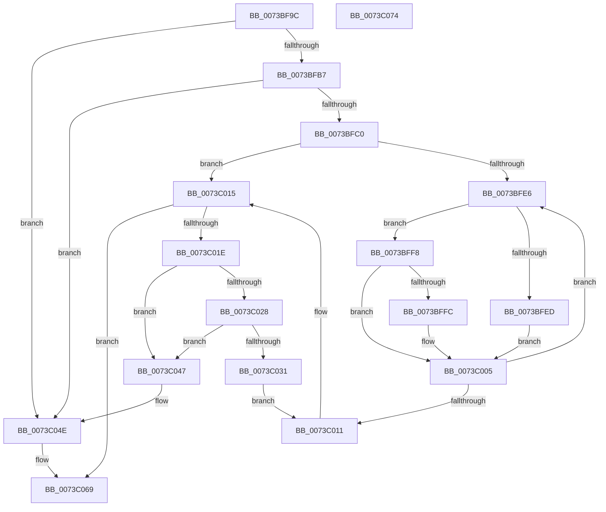

# PipDmgFlushQueueAndRestartDevices

- RVA: `0x0073BF9C`–`0x0073C075` (길이 `217` bytes)
- VA: `0x000000014073BF9C`
- 실행 섹션: `PAGE`
- PDB 이름 있음: `예`; PDB Function 태그: `아니요`
- unwind 정보 RVA: `0x000BB544`
- 디코드: `63`개 명령, `217/217` bytes 표시
- 미해석 바이트: `0` (있으면 어셈블리에 `.byte`로 보존)

> 이 문서는 커널 이미지의 기계어와 PDB 기호를 분석해 생성했습니다. 4번과 5번은 함수 원형과 자료형을 바이너리 사용 방식에서 추정한 C 해석이며 원본 소스 복구 결과는 아닙니다.

## 1. Dependencies

- 직접 호출 지점: **5**; 고유 호출 대상: **5**
- 직접 호출자로 확인된 함수: **2**
- RIP 상대 이미지 참조: **1**

### Outgoing calls
- `0x0073BFD4` → [PiDmaGuardQueueFlush](../AB/PiDmaGuardQueueFlush_function_00ABA480.md) (function, `0x00ABA480`)
- `0x0073BFF1` → [PipDmgRequestRestartOnBlockedDevice](PipDmgRequestRestartOnBlockedDevice_function_0073C1E0.md) (function, `0x0073C1E0`)
- `0x0073C000` → [PipDmgRequestUpdateConsoleLockState](PipDmgRequestUpdateConsoleLockState_function_0073C4B0.md) (function, `0x0073C4B0`)
- `0x0073C040` → [PipDgqFreeEntry](../74/PipDgqFreeEntry_function_007446BC.md) (function, `0x007446BC`)
- `0x0073C063` → [KeBugCheckEx](../../text/4F/KeBugCheckEx_function_004FD660.md) (function, `0x004FD660`)

### Direct callers
- [PipDmgConsoleUnlockCallback](PipDmgConsoleUnlockCallback_function_0073BE80.md) at `0x0073BEA0`
- [PipDmgReevaluateQueue](PipDmgReevaluateQueue_function_0073C1A4.md) at `0x0073C1CD`

### Static image references
- `0x0073BFA9` → RVA `0x00F8A9AC` (`.data`; read)

## 2. Other-region calls and transfers

- 다른 실행 섹션으로 향하는 call: **1**
  - `0x0073C063` → [KeBugCheckEx](../../text/4F/KeBugCheckEx_function_004FD660.md) (`PAGE` → `.text`)
- 별도 외부 분기/꼬리 이동을 확인하지 못했습니다.

## 3. Assembly (complete function range)

```asm
0073BF9C  48 89 5C 24 08                  mov qword ptr [rsp + 8], rbx
0073BFA1  55                              push rbp
0073BFA2  48 8B EC                        mov rbp, rsp
0073BFA5  48 83 EC 40                     sub rsp, 0x40
0073BFA9  8B 05 FD E9 84 00               mov eax, dword ptr [rip + 0x84e9fd]
0073BFAF  85 C0                           test eax, eax
0073BFB1  0F 84 97 00 00 00               je 0x14073c04e
0073BFB7  83 F8 03                        cmp eax, 3
0073BFBA  0F 84 8E 00 00 00               je 0x14073c04e
0073BFC0  48 8D 45 F0                     lea rax, [rbp - 0x10]
0073BFC4  48 89 45 F8                     mov qword ptr [rbp - 8], rax
0073BFC8  48 8D 4D F0                     lea rcx, [rbp - 0x10]
0073BFCC  48 8D 45 F0                     lea rax, [rbp - 0x10]
0073BFD0  48 89 45 F0                     mov qword ptr [rbp - 0x10], rax
0073BFD4  E8 A7 E4 37 00                  call 0x140aba480
0073BFD9  48 8B 5D F0                     mov rbx, qword ptr [rbp - 0x10]
0073BFDD  48 8D 45 F0                     lea rax, [rbp - 0x10]
0073BFE1  48 3B D8                        cmp rbx, rax
0073BFE4  74 2F                           je 0x14073c015
0073BFE6  8B 43 18                        mov eax, dword ptr [rbx + 0x18]
0073BFE9  A8 02                           test al, 2
0073BFEB  74 0B                           je 0x14073bff8
0073BFED  48 8B 4B 10                     mov rcx, qword ptr [rbx + 0x10]
0073BFF1  E8 EA 01 00 00                  call 0x14073c1e0
0073BFF6  EB 0D                           jmp 0x14073c005
0073BFF8  A8 04                           test al, 4
0073BFFA  74 09                           je 0x14073c005
0073BFFC  48 8B 4B 10                     mov rcx, qword ptr [rbx + 0x10]
0073C000  E8 AB 04 00 00                  call 0x14073c4b0
0073C005  48 8B 1B                        mov rbx, qword ptr [rbx]
0073C008  48 8D 45 F0                     lea rax, [rbp - 0x10]
0073C00C  48 3B D8                        cmp rbx, rax
0073C00F  75 D5                           jne 0x14073bfe6
0073C011  48 8B 5D F0                     mov rbx, qword ptr [rbp - 0x10]
0073C015  48 8D 45 F0                     lea rax, [rbp - 0x10]
0073C019  48 3B D8                        cmp rbx, rax
0073C01C  74 4B                           je 0x14073c069
0073C01E  48 8D 45 F0                     lea rax, [rbp - 0x10]
0073C022  48 39 43 08                     cmp qword ptr [rbx + 8], rax
0073C026  75 1F                           jne 0x14073c047
0073C028  48 8B 03                        mov rax, qword ptr [rbx]
0073C02B  48 39 58 08                     cmp qword ptr [rax + 8], rbx
0073C02F  75 16                           jne 0x14073c047
0073C031  48 8D 4D F0                     lea rcx, [rbp - 0x10]
0073C035  48 89 45 F0                     mov qword ptr [rbp - 0x10], rax
0073C039  48 89 48 08                     mov qword ptr [rax + 8], rcx
0073C03D  48 8B CB                        mov rcx, rbx
0073C040  E8 77 86 00 00                  call 0x1407446bc
0073C045  EB CA                           jmp 0x14073c011
0073C047  B9 03 00 00 00                  mov ecx, 3
0073C04C  CD 29                           int 0x29
0073C04E  48 83 64 24 20 00               and qword ptr [rsp + 0x20], 0
0073C054  45 33 C9                        xor r9d, r9d
0073C057  45 33 C0                        xor r8d, r8d
0073C05A  B9 CA 00 00 00                  mov ecx, 0xca
0073C05F  41 8D 51 11                     lea edx, [r9 + 0x11]
0073C063  E8 F8 15 DC FF                  call 0x1404fd660
0073C068  CC                              int3
0073C069  48 8B 5C 24 50                  mov rbx, qword ptr [rsp + 0x50]
0073C06E  48 83 C4 40                     add rsp, 0x40
0073C072  5D                              pop rbp
0073C073  C3                              ret
0073C074  CC                              int3
```

## 4. C-style interpretation (structured pseudocode)

```c
__int64 __fastcall PipDmgFlushQueueAndRestartDevices(__int64 a1, __int64 a2, int a3, int a4)
{
    __int64 result;
    __int64 v_rsp;
    unsigned __int64 v_stack_m10;
    unsigned __int64 v_stack_m18;
    unsigned __int64 v_stack_m28;
    unsigned __int64 v_stack_p8;

    v_stack_p8 = v_rbx;
    v_rsp = (v_rsp) - (64);
    if ((unsigned int)((unsigned int)(*(unsigned int *)(v_rip + 8710653))) == 0) goto loc_0073C04E;
    if (((unsigned int)((unsigned int)(*(unsigned int *)(v_rip + 8710653)))) == 3) goto loc_0073C04E;
    v_stack_m10 = v_stack_m18;
    v_stack_m18 = v_stack_m18;
    result = PiDmaGuardQueueFlush(v_stack_m18, a2, a3, a4);
    if (v_stack_m18 == v_stack_m18) goto loc_0073C015;
loc_0073BFE6:
    if ((((unsigned __int8)((unsigned int)(*(unsigned int *)(v_stack_m18 + 24)))) & (2)) == 0) goto loc_0073BFF8;
    result = PipDmgRequestRestartOnBlockedDevice(*(unsigned __int64 *)(v_stack_m18 + 16), a2, a3, a4);
    goto loc_0073C005;
loc_0073BFF8:
    if ((((unsigned __int8)(result)) & (4)) != 0) {
        a1 = *(unsigned __int64 *)(v_stack_m18 + 16);
        result = PipDmgRequestUpdateConsoleLockState(a1, a2, a3, a4);
    }
    if ((*(unsigned __int64 *)(v_stack_m18)) != v_stack_m18) goto loc_0073BFE6;
loc_0073C011:
loc_0073C015:
    if (v_stack_m18 == v_stack_m18) goto loc_0073C069;
    if ((*(unsigned __int64 *)(v_stack_m18 + 8)) != v_stack_m18) goto loc_0073C047;
    if ((*(unsigned __int64 *)(*(unsigned __int64 *)(v_stack_m18) + 8)) != v_stack_m18) goto loc_0073C047;
    v_stack_m18 = *(unsigned __int64 *)(v_stack_m18);
    *(unsigned __int64 *)(*(unsigned __int64 *)(v_stack_m18) + 8) = v_stack_m18;
    result = PipDgqFreeEntry(v_stack_m18, a2, a3, a4);
    goto loc_0073C011;
loc_0073C047:
loc_0073C04E:
    a4 = 0;
    a3 = 0;
    result = KeBugCheckEx(202, a4 + 17, a3, a4);
loc_0073C069:
    v_rsp = (v_rsp) + (64);
    return result;
}
```

## 5. (Beta) C Style

```c
int64_t PipDmgFlushQueueAndRestartDevices(int64_t Arg1, int64_t Arg2, int32_t Arg3, int32_t Arg4)
{
    int64_t result;
    int64_t local_rsp;
    uint64_t v_stack_m10;
    uint64_t v_stack_m18;
    uint64_t v_stack_m28;
    uint64_t v_stack_p8;

    v_stack_p8 = local_rbx;
    local_rsp = (local_rsp) - (64);
    if ((uint32_t)((uint32_t)(*(uint32_t *)(v_rip + 0x84E9FD))) == 0) goto loc_0073C04E;
    if (((uint32_t)((uint32_t)(*(uint32_t *)(v_rip + 0x84E9FD)))) == 3) goto loc_0073C04E;
    v_stack_m10 = v_stack_m18;
    v_stack_m18 = v_stack_m18;
    result = PiDmaGuardQueueFlush(v_stack_m18, Arg2, Arg3, Arg4);
    if (v_stack_m18 == v_stack_m18) goto loc_0073C015;
loc_0073BFE6:
    if ((((uint8_t)((uint32_t)(*(uint32_t *)(v_stack_m18 + 0x18)))) & (2)) == 0) goto loc_0073BFF8;
    result = PipDmgRequestRestartOnBlockedDevice(*(uint64_t *)(v_stack_m18 + 0x10), Arg2, Arg3, Arg4);
    goto loc_0073C005;
loc_0073BFF8:
    if ((((uint8_t)(result)) & (4)) != 0) {
        Arg1 = *(uint64_t *)(v_stack_m18 + 0x10);
        result = PipDmgRequestUpdateConsoleLockState(Arg1, Arg2, Arg3, Arg4);
    }
    if ((*(uint64_t *)(v_stack_m18)) != v_stack_m18) goto loc_0073BFE6;
loc_0073C011:
loc_0073C015:
    if (v_stack_m18 == v_stack_m18) goto loc_0073C069;
    if ((*(uint64_t *)(v_stack_m18 + 0x8)) != v_stack_m18) goto loc_0073C047;
    if ((*(uint64_t *)(*(uint64_t *)(v_stack_m18) + 0x8)) != v_stack_m18) goto loc_0073C047;
    v_stack_m18 = *(uint64_t *)(v_stack_m18);
    *(uint64_t *)(*(uint64_t *)(v_stack_m18) + 0x8) = v_stack_m18;
    result = PipDgqFreeEntry(v_stack_m18, Arg2, Arg3, Arg4);
    goto loc_0073C011;
loc_0073C047:
loc_0073C04E:
    Arg4 = 0;
    Arg3 = 0;
    result = KeBugCheckEx(202, Arg4 + 17, Arg3, Arg4);
loc_0073C069:
    local_rsp = (local_rsp) + (64);
    return result;
}
```

## 6. Execution-region graph

[열기: 2D/3D 그래프와 함수 탐색 컨트롤 패널](../../../control-panel.html?section=page&rva=0x0073BF9C&view=graph)

- 2D 그래프는 위에서 아래로 흐르고, 3D 그래프는 빈 공간을 드래그해 회전합니다. Shift+드래그는 이동, 휠은 확대·축소, 함수 노드 선택은 대상 보고서 이동입니다.

### Static fallback


