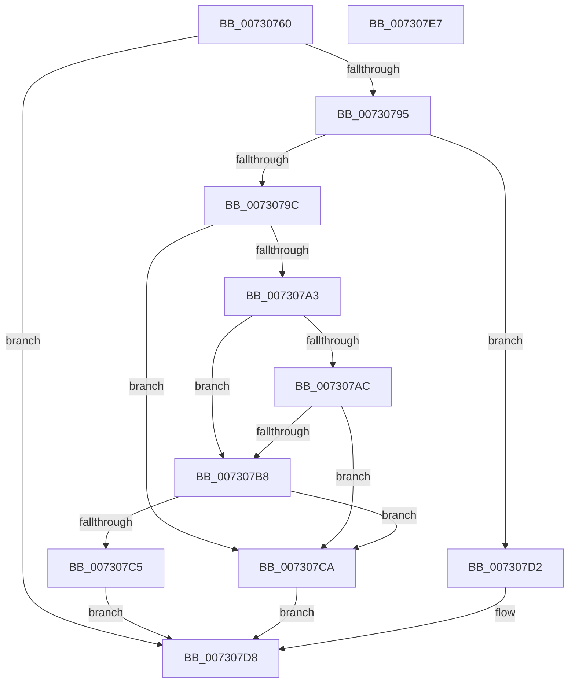

# PipDmgGetDeviceDmarPolicy

- RVA: `0x00730760`–`0x007307E8` (길이 `136` bytes)
- VA: `0x0000000140730760`
- 실행 섹션: `PAGE`
- PDB 이름 있음: `예`; PDB Function 태그: `아니요`
- unwind 정보 RVA: `0x000C8960`
- 디코드: `45`개 명령, `136/136` bytes 표시
- 미해석 바이트: `0` (있으면 어셈블리에 `.byte`로 보존)

> 이 문서는 커널 이미지의 기계어와 PDB 기호를 분석해 생성했습니다. 4번과 5번은 함수 원형과 자료형을 바이너리 사용 방식에서 추정한 C 해석이며 원본 소스 복구 결과는 아닙니다.

## 1. Dependencies

- 직접 호출 지점: **2**; 고유 호출 대상: **2**
- 직접 호출자로 확인된 함수: **1**
- RIP 상대 이미지 참조: **0**

### Outgoing calls
- `0x0073078A` → [PipDmgGetDeviceDmarRegistryValue](PipDmgGetDeviceDmarRegistryValue_function_007307F0.md) (function, `0x007307F0`)
- `0x007307AF` → [PipDmgIsDmaVerifierEnabled](PipDmgIsDmaVerifierEnabled_function_00730A84.md) (function, `0x00730A84`)

### Direct callers
- [PiDmaGuardProcessPreAddDevice](../A2/PiDmaGuardProcessPreAddDevice_function_00A27B50.md) at `0x00A27BBC`

### Static image references
- 디코드된 RIP-relative 메모리 참조가 없습니다.

## 2. Other-region calls and transfers

- 다른 실행 섹션으로 향하는 call: **0**
- 별도 외부 분기/꼬리 이동을 확인하지 못했습니다.

## 3. Assembly (complete function range)

```asm
00730760  48 8B C4                        mov rax, rsp
00730763  48 89 58 10                     mov qword ptr [rax + 0x10], rbx
00730767  55                              push rbp
00730768  56                              push rsi
00730769  57                              push rdi
0073076A  48 83 EC 20                     sub rsp, 0x20
0073076E  48 8B 29                        mov rbp, qword ptr [rcx]
00730771  4C 8D 40 08                     lea r8, [rax + 8]
00730775  83 60 18 00                     and dword ptr [rax + 0x18], 0
00730779  48 8B DA                        mov rbx, rdx
0073077C  48 8B F1                        mov rsi, rcx
0073077F  C6 40 08 00                     mov byte ptr [rax + 8], 0
00730783  48 8B CD                        mov rcx, rbp
00730786  48 8D 50 18                     lea rdx, [rax + 0x18]
0073078A  E8 61 00 00 00                  call 0x1407307f0
0073078F  8B F8                           mov edi, eax
00730791  85 C0                           test eax, eax
00730793  78 43                           js 0x1407307d8
00730795  80 7C 24 40 00                  cmp byte ptr [rsp + 0x40], 0
0073079A  74 36                           je 0x1407307d2
0073079C  F6 44 24 50 01                  test byte ptr [rsp + 0x50], 1
007307A1  74 27                           je 0x1407307ca
007307A3  48 8B 4E 28                     mov rcx, qword ptr [rsi + 0x28]
007307A7  48 85 C9                        test rcx, rcx
007307AA  74 0C                           je 0x1407307b8
007307AC  48 8B 09                        mov rcx, qword ptr [rcx]
007307AF  E8 D0 02 00 00                  call 0x140730a84
007307B4  84 C0                           test al, al
007307B6  75 12                           jne 0x1407307ca
007307B8  48 8B 85 D0 02 00 00            mov rax, qword ptr [rbp + 0x2d0]
007307BF  F6 40 10 24                     test byte ptr [rax + 0x10], 0x24
007307C3  75 05                           jne 0x1407307ca
007307C5  83 23 00                        and dword ptr [rbx], 0
007307C8  EB 0E                           jmp 0x1407307d8
007307CA  C7 03 02 00 00 00               mov dword ptr [rbx], 2
007307D0  EB 06                           jmp 0x1407307d8
007307D2  C7 03 01 00 00 00               mov dword ptr [rbx], 1
007307D8  48 8B 5C 24 48                  mov rbx, qword ptr [rsp + 0x48]
007307DD  8B C7                           mov eax, edi
007307DF  48 83 C4 20                     add rsp, 0x20
007307E3  5F                              pop rdi
007307E4  5E                              pop rsi
007307E5  5D                              pop rbp
007307E6  C3                              ret
007307E7  CC                              int3
```

## 4. C-style interpretation (structured pseudocode)

```c
__int64 __fastcall PipDmgGetDeviceDmarPolicy(__int64 a1, __int64 a2)
{
    __int64 result;
    __int64 v_rsp;
    unsigned __int64 v_stack_p10;
    unsigned __int8 v_stack_p18;
    unsigned __int8 v_stack_p8;

    *(unsigned __int64 *)(v_rsp + 16) = v_rbx;
    v_rsp = (v_rsp) - (32);
    *(unsigned __int8 *)(v_rsp + 8) = 0;
    result = PipDmgGetDeviceDmarRegistryValue(*(unsigned __int64 *)(a1), v_rsp + 24, v_rsp + 8, a4);
    if (sign_flag) goto loc_007307D8;
    if (v_stack_p8 == 0) goto loc_007307D2;
    if (((v_stack_p18) & (1)) == 0) goto loc_007307CA;
    if (*(unsigned __int64 *)(a1 + 40) == 0) goto loc_007307B8;
    result = PipDmgIsDmaVerifierEnabled(*(unsigned __int64 *)(*(unsigned __int64 *)(a1 + 40)), v_rsp + 24, v_rsp + 8, a4);
    if ((unsigned __int8)(result) != 0) goto loc_007307CA;
loc_007307B8:
    if (((*(unsigned __int8 *)(*(unsigned __int64 *)(*(unsigned __int64 *)(a1) + 720) + 16)) & (36)) != 0) goto loc_007307CA;
    goto loc_007307D8;
loc_007307CA:
    *(unsigned int *)(a2) = 2;
    goto loc_007307D8;
loc_007307D2:
    *(unsigned int *)(a2) = 1;
loc_007307D8:
    v_rsp = (v_rsp) + (32);
    return (unsigned int)((unsigned int)((unsigned int)((unsigned int)(result))));
}
```

## 5. (Beta) C Style

```c
int64_t PipDmgGetDeviceDmarPolicy(void *Arg1, void *Arg2)
{
    uint8_t *arg1 = (uint8_t *)Arg1;
    uint8_t *arg2 = (uint8_t *)Arg2;

    int64_t result;
    int64_t local_rsp;
    uint64_t v_stack_p10;
    uint8_t v_stack_p18;
    uint8_t v_stack_p8;

    *(uint64_t *)(local_rsp + 0x10) = local_rbx;
    local_rsp = (local_rsp) - (32);
    *(uint8_t *)(local_rsp + 0x8) = 0;
    result = PipDmgGetDeviceDmarRegistryValue(*(uint64_t *)(arg1), local_rsp + 24, local_rsp + 8, a4);
    if (sign_flag) goto loc_007307D8;
    if (v_stack_p8 == 0) goto loc_007307D2;
    if (((v_stack_p18) & (1)) == 0) goto loc_007307CA;
    if (*(uint64_t *)(arg1 + 0x28) == 0) goto loc_007307B8;
    result = PipDmgIsDmaVerifierEnabled(*(uint64_t *)(*(uint64_t *)(arg1 + 0x28)), local_rsp + 24, local_rsp + 8, a4);
    if ((uint8_t)(result) != 0) goto loc_007307CA;
loc_007307B8:
    if (((*(uint8_t *)(*(uint64_t *)(*(uint64_t *)(arg1) + 0x2D0) + 0x10)) & (36)) != 0) goto loc_007307CA;
    goto loc_007307D8;
loc_007307CA:
    *(uint32_t *)(arg2) = 2;
    goto loc_007307D8;
loc_007307D2:
    *(uint32_t *)(arg2) = 1;
loc_007307D8:
    local_rsp = (local_rsp) + (32);
    return (uint32_t)((uint32_t)((uint32_t)((uint32_t)(result))));
}
```

### 관측된 메모리 오프셋

구조체 형식이 확인되지 않은 접근은 인자 기준의 오프셋으로만 기록했습니다.

| 기준 인자 | 오프셋 표현 | 폭 (bit) | 접근 |
|---|---:|---:|---|
| `Arg1` | `+ 0x0` | `64` | `R` |
| `Arg1` | `+ 0x28` | `64` | `R` |
| `Arg2` | `+ 0x0` | `32` | `R/W` |
| `Arg2` | `+ 0x0` | `32` | `W` |

## 6. Execution-region graph

[열기: 2D/3D 그래프와 함수 탐색 컨트롤 패널](../../../control-panel.html?section=page&rva=0x00730760&view=graph)

- 2D 그래프는 위에서 아래로 흐르고, 3D 그래프는 빈 공간을 드래그해 회전합니다. Shift+드래그는 이동, 휠은 확대·축소, 함수 노드 선택은 대상 보고서 이동입니다.

### Static fallback


