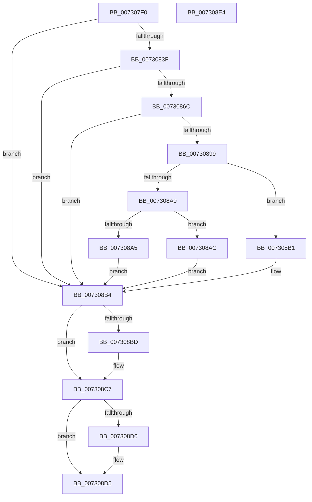

# PipDmgGetDeviceDmarRegistryValue

- RVA: `0x007307F0`–`0x007308E5` (길이 `245` bytes)
- VA: `0x00000001407307F0`
- 실행 섹션: `PAGE`
- PDB 이름 있음: `예`; PDB Function 태그: `아니요`
- unwind 정보 RVA: `0x000C894C`
- 디코드: `72`개 명령, `245/245` bytes 표시
- 미해석 바이트: `0` (있으면 어셈블리에 `.byte`로 보존)

> 이 문서는 커널 이미지의 기계어와 PDB 기호를 분석해 생성했습니다. 4번과 5번은 함수 원형과 자료형을 바이너리 사용 방식에서 추정한 C 해석이며 원본 소스 복구 결과는 아닙니다.

## 1. Dependencies

- 직접 호출 지점: **7**; 고유 호출 대상: **5**
- 직접 호출자로 확인된 함수: **1**
- RIP 상대 이미지 참조: **3**

### Outgoing calls
- `0x00730834` → [IoOpenDeviceRegistryKey](../99/IoOpenDeviceRegistryKey_function_00999250.md) (function, `0x00999250`)
- `0x0073084A` → [RtlInitUnicodeString](../../text/42/RtlInitUnicodeString_function_0042A780.md) (function, `0x0042A780`)
- `0x00730861` → [IopOpenRegistryKeyEx](../A5/IopOpenRegistryKeyEx_function_00A51B44.md) (function, `0x00A51B44`)
- `0x0073087A` → [PnpGetRegistryDword](../../text/4B/PnpGetRegistryDword_function_004BFDE8.md) (function, `0x004BFDE8`)
- `0x0073088E` → [PnpGetRegistryDword](../../text/4B/PnpGetRegistryDword_function_004BFDE8.md) (function, `0x004BFDE8`)
- `0x007308BD` → [ZwClose](../../text/6A/ZwClose_function_006AD2B0.md) (function, `0x006AD2B0`)
- `0x007308D0` → [ZwClose](../../text/6A/ZwClose_function_006AD2B0.md) (function, `0x006AD2B0`)

### Direct callers
- [PipDmgGetDeviceDmarPolicy](PipDmgGetDeviceDmarPolicy_function_00730760.md) at `0x0073078A`

### Static image references
- `0x0073083F` → RVA `0x00AFE3C0` (` ?? ::NNGAKEGL::`string'`; read)
- `0x00730870` → RVA `0x00AFE3E0` (` ?? ::NNGAKEGL::`string'`; read)
- `0x00730887` → RVA `0x00AFE400` (` ?? ::NNGAKEGL::`string'`; read)

## 2. Other-region calls and transfers

- 다른 실행 섹션으로 향하는 call: **5**
  - `0x0073084A` → [RtlInitUnicodeString](../../text/42/RtlInitUnicodeString_function_0042A780.md) (`PAGE` → `.text`)
  - `0x0073087A` → [PnpGetRegistryDword](../../text/4B/PnpGetRegistryDword_function_004BFDE8.md) (`PAGE` → `.text`)
  - `0x0073088E` → [PnpGetRegistryDword](../../text/4B/PnpGetRegistryDword_function_004BFDE8.md) (`PAGE` → `.text`)
  - `0x007308BD` → [ZwClose](../../text/6A/ZwClose_function_006AD2B0.md) (`PAGE` → `.text`)
  - `0x007308D0` → [ZwClose](../../text/6A/ZwClose_function_006AD2B0.md) (`PAGE` → `.text`)
- 별도 외부 분기/꼬리 이동을 확인하지 못했습니다.

## 3. Assembly (complete function range)

```asm
007307F0  48 89 5C 24 20                  mov qword ptr [rsp + 0x20], rbx
007307F5  55                              push rbp
007307F6  56                              push rsi
007307F7  57                              push rdi
007307F8  48 8B EC                        mov rbp, rsp
007307FB  48 83 EC 30                     sub rsp, 0x30
007307FF  83 22 00                        and dword ptr [rdx], 0
00730802  4C 8D 4D 30                     lea r9, [rbp + 0x30]
00730806  48 8B 49 20                     mov rcx, qword ptr [rcx + 0x20]
0073080A  49 8B F8                        mov rdi, r8
0073080D  83 65 20 00                     and dword ptr [rbp + 0x20], 0
00730811  48 8B F2                        mov rsi, rdx
00730814  48 83 65 30 00                  and qword ptr [rbp + 0x30], 0
00730819  0F 57 C0                        xorps xmm0, xmm0
0073081C  48 83 65 28 00                  and qword ptr [rbp + 0x28], 0
00730821  BA 01 00 00 00                  mov edx, 1
00730826  41 C6 00 00                     mov byte ptr [r8], 0
0073082A  41 B8 19 00 02 00               mov r8d, 0x20019
00730830  0F 11 45 F0                     movups xmmword ptr [rbp - 0x10], xmm0
00730834  E8 17 8A 26 00                  call 0x140999250
00730839  8B D8                           mov ebx, eax
0073083B  85 C0                           test eax, eax
0073083D  78 75                           js 0x1407308b4
0073083F  48 8D 15 7A DB 3C 00            lea rdx, [rip + 0x3cdb7a]
00730846  48 8D 4D F0                     lea rcx, [rbp - 0x10]
0073084A  E8 31 9F CF FF                  call 0x14042a780
0073084F  48 8B 55 30                     mov rdx, qword ptr [rbp + 0x30]
00730853  4C 8D 45 F0                     lea r8, [rbp - 0x10]
00730857  41 B9 19 00 02 00               mov r9d, 0x20019
0073085D  48 8D 4D 28                     lea rcx, [rbp + 0x28]
00730861  E8 DE 12 32 00                  call 0x140a51b44
00730866  8B D8                           mov ebx, eax
00730868  85 C0                           test eax, eax
0073086A  78 48                           js 0x1407308b4
0073086C  48 8B 4D 28                     mov rcx, qword ptr [rbp + 0x28]
00730870  48 8D 15 69 DB 3C 00            lea rdx, [rip + 0x3cdb69]
00730877  4C 8B C6                        mov r8, rsi
0073087A  E8 69 F5 D8 FF                  call 0x1404bfde8
0073087F  48 8B 4D 28                     mov rcx, qword ptr [rbp + 0x28]
00730883  4C 8D 45 20                     lea r8, [rbp + 0x20]
00730887  48 8D 15 72 DB 3C 00            lea rdx, [rip + 0x3cdb72]
0073088E  E8 55 F5 D8 FF                  call 0x1404bfde8
00730893  8B D8                           mov ebx, eax
00730895  85 C0                           test eax, eax
00730897  78 1B                           js 0x1407308b4
00730899  8B 45 20                        mov eax, dword ptr [rbp + 0x20]
0073089C  85 C0                           test eax, eax
0073089E  74 11                           je 0x1407308b1
007308A0  83 F8 01                        cmp eax, 1
007308A3  74 07                           je 0x1407308ac
007308A5  BB 0D 00 00 C0                  mov ebx, 0xc000000d
007308AA  EB 08                           jmp 0x1407308b4
007308AC  C6 07 01                        mov byte ptr [rdi], 1
007308AF  EB 03                           jmp 0x1407308b4
007308B1  C6 07 00                        mov byte ptr [rdi], 0
007308B4  48 8B 4D 28                     mov rcx, qword ptr [rbp + 0x28]
007308B8  48 85 C9                        test rcx, rcx
007308BB  74 0A                           je 0x1407308c7
007308BD  E8 EE C9 F7 FF                  call 0x1406ad2b0
007308C2  48 83 65 28 00                  and qword ptr [rbp + 0x28], 0
007308C7  48 8B 4D 30                     mov rcx, qword ptr [rbp + 0x30]
007308CB  48 85 C9                        test rcx, rcx
007308CE  74 05                           je 0x1407308d5
007308D0  E8 DB C9 F7 FF                  call 0x1406ad2b0
007308D5  8B C3                           mov eax, ebx
007308D7  48 8B 5C 24 68                  mov rbx, qword ptr [rsp + 0x68]
007308DC  48 83 C4 30                     add rsp, 0x30
007308E0  5F                              pop rdi
007308E1  5E                              pop rsi
007308E2  5D                              pop rbp
007308E3  C3                              ret
007308E4  CC                              int3
```

## 4. C-style interpretation (structured pseudocode)

```c
__int64 __fastcall PipDmgGetDeviceDmarRegistryValue(__int64 a1, __int64 a2, __int64 a3)
{
    __int64 result;
    __int64 v_rsp;
    unsigned __int64 v_stack_m28;
    unsigned __int64 v_stack_p10;
    unsigned __int64 v_stack_p18;
    unsigned __int64 v_stack_p20;
    unsigned int v_stack_p8;

    v_stack_p20 = v_rbx;
    v_rsp = (v_rsp) - (48);
    *(unsigned __int8 *)(a3) = 0;
    v_stack_m28 = v_xmm0;
    result = IoOpenDeviceRegistryKey(*(unsigned __int64 *)(a1 + 32), 1, (unsigned int)(0x20019ULL), v_stack_p18);
    if (sign_flag) goto loc_007308B4;
    result = RtlInitUnicodeString(v_stack_m28, v_rip + 3988346, (unsigned int)(0x20019ULL), v_stack_p18);
    result = IopOpenRegistryKeyEx(v_stack_p10, v_stack_p18, v_stack_m28, (unsigned int)(0x20019ULL));
    if (sign_flag) goto loc_007308B4;
    result = PnpGetRegistryDword(v_stack_p10, v_rip + 3988329, a2, (unsigned int)(0x20019ULL));
    result = PnpGetRegistryDword(v_stack_p10, v_rip + 3988338, v_stack_p8, (unsigned int)(0x20019ULL));
    if (sign_flag) goto loc_007308B4;
    if ((unsigned int)((unsigned int)(v_stack_p8)) == 0) goto loc_007308B1;
    if (((unsigned int)((unsigned int)(v_stack_p8))) == 1) goto loc_007308AC;
    goto loc_007308B4;
loc_007308AC:
    *(unsigned __int8 *)(a3) = 1;
    goto loc_007308B4;
loc_007308B1:
    *(unsigned __int8 *)(a3) = 0;
loc_007308B4:
    result = (unsigned int)(v_stack_p8);
    if (v_stack_p10 != 0) {
        result = ZwClose(v_stack_p10, v_rip + 3988338, v_stack_p8, (unsigned int)(0x20019ULL));
    }
    if (v_stack_p18 != 0) {
        result = ZwClose(v_stack_p18, v_rip + 3988338, v_stack_p8, (unsigned int)(0x20019ULL));
    }
    v_rsp = (v_rsp) + (48);
    return (unsigned int)((unsigned int)((unsigned int)(0xC000000DULL)));
}
```

## 5. (Beta) C Style

```c
int64_t PipDmgGetDeviceDmarRegistryValue(void *Arg1, void *Arg2, void *Arg3)
{
    uint8_t *arg1 = (uint8_t *)Arg1;
    uint8_t *arg2 = (uint8_t *)Arg2;
    uint8_t *arg3 = (uint8_t *)Arg3;

    int64_t result;
    int64_t local_rsp;
    uint64_t v_stack_m28;
    uint64_t v_stack_p10;
    uint64_t v_stack_p18;
    uint64_t v_stack_p20;
    uint32_t v_stack_p8;

    v_stack_p20 = local_rbx;
    local_rsp = (local_rsp) - (48);
    *(uint8_t *)(arg3) = 0;
    v_stack_m28 = v_xmm0;
    result = IoOpenDeviceRegistryKey(*(uint64_t *)(arg1 + 0x20), 1, (uint32_t)(0x20019ULL), v_stack_p18);
    if (sign_flag) goto loc_007308B4;
    result = RtlInitUnicodeString(v_stack_m28, v_rip + 3988346, (uint32_t)(0x20019ULL), v_stack_p18);
    result = IopOpenRegistryKeyEx(v_stack_p10, v_stack_p18, v_stack_m28, (uint32_t)(0x20019ULL));
    if (sign_flag) goto loc_007308B4;
    result = PnpGetRegistryDword(v_stack_p10, v_rip + 3988329, Arg2, (uint32_t)(0x20019ULL));
    result = PnpGetRegistryDword(v_stack_p10, v_rip + 3988338, v_stack_p8, (uint32_t)(0x20019ULL));
    if (sign_flag) goto loc_007308B4;
    if ((uint32_t)((uint32_t)(v_stack_p8)) == 0) goto loc_007308B1;
    if (((uint32_t)((uint32_t)(v_stack_p8))) == 1) goto loc_007308AC;
    goto loc_007308B4;
loc_007308AC:
    *(uint8_t *)(arg3) = 1;
    goto loc_007308B4;
loc_007308B1:
    *(uint8_t *)(arg3) = 0;
loc_007308B4:
    result = (uint32_t)(v_stack_p8);
    if (v_stack_p10 != 0) {
        result = ZwClose(v_stack_p10, v_rip + 3988338, v_stack_p8, (uint32_t)(0x20019ULL));
    }
    if (v_stack_p18 != 0) {
        result = ZwClose(v_stack_p18, v_rip + 3988338, v_stack_p8, (uint32_t)(0x20019ULL));
    }
    local_rsp = (local_rsp) + (48);
    return (uint32_t)((uint32_t)((uint32_t)(0xC000000DULL)));
}
```

### 관측된 메모리 오프셋

구조체 형식이 확인되지 않은 접근은 인자 기준의 오프셋으로만 기록했습니다.

| 기준 인자 | 오프셋 표현 | 폭 (bit) | 접근 |
|---|---:|---:|---|
| `Arg1` | `+ 0x20` | `64` | `R` |
| `Arg2` | `+ 0x0` | `32` | `R/W` |
| `Arg3` | `+ 0x0` | `8` | `W` |

## 6. Execution-region graph

[열기: 2D/3D 그래프와 함수 탐색 컨트롤 패널](../../../control-panel.html?section=page&rva=0x007307F0&view=graph)

- 2D 그래프는 위에서 아래로 흐르고, 3D 그래프는 빈 공간을 드래그해 회전합니다. Shift+드래그는 이동, 휠은 확대·축소, 함수 노드 선택은 대상 보고서 이동입니다.

### Static fallback


