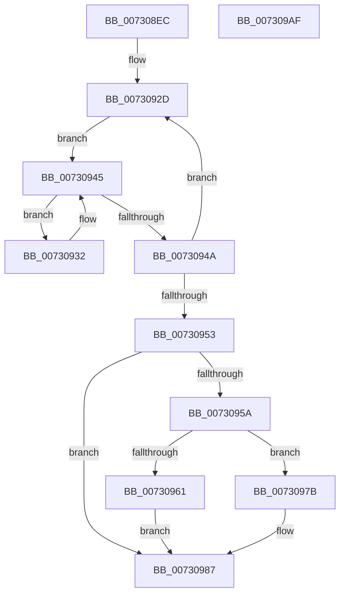

# PipDmgGetDriversDmarPolicy

- RVA: `0x007308EC`–`0x007309B0` (길이 `196` bytes)
- VA: `0x00000001407308EC`
- 실행 섹션: `PAGE`
- PDB 이름 있음: `예`; PDB Function 태그: `아니요`
- unwind 정보 RVA: `0x000C8974`
- 디코드: `59`개 명령, `196/196` bytes 표시
- 미해석 바이트: `0` (있으면 어셈블리에 `.byte`로 보존)

> 이 문서는 커널 이미지의 기계어와 PDB 기호를 분석해 생성했습니다. 4번과 5번은 함수 원형과 자료형을 바이너리 사용 방식에서 추정한 C 해석이며 원본 소스 복구 결과는 아닙니다.

## 1. Dependencies

- 직접 호출 지점: **2**; 고유 호출 대상: **2**
- 직접 호출자로 확인된 함수: **1**
- RIP 상대 이미지 참조: **1**

### Outgoing calls
- `0x00730935` → [PipDmgGetDriverDmarCompatLevel](../AA/PipDmgGetDriverDmarCompatLevel_function_00AA0A40.md) (function, `0x00AA0A40`)
- `0x00730991` → [_security_check_cookie](../../text/6A/_security_check_cookie_function_006AC640.md) (function, `0x006AC640`)

### Direct callers
- [PiDmaGuardProcessPreAddDevice](../A2/PiDmaGuardProcessPreAddDevice_function_00A27B50.md) at `0x00A27BC8`

### Static image references
- `0x00730904` → RVA `0x00E0A740` (`.data`; read)

## 2. Other-region calls and transfers

- 다른 실행 섹션으로 향하는 call: **1**
  - `0x00730991` → [_security_check_cookie](../../text/6A/_security_check_cookie_function_006AC640.md) (`PAGE` → `.text`)
- 별도 외부 분기/꼬리 이동을 확인하지 못했습니다.

## 3. Assembly (complete function range)

```asm
007308EC  48 89 5C 24 10                  mov qword ptr [rsp + 0x10], rbx
007308F1  48 89 6C 24 18                  mov qword ptr [rsp + 0x18], rbp
007308F6  48 89 74 24 20                  mov qword ptr [rsp + 0x20], rsi
007308FB  57                              push rdi
007308FC  41 56                           push r14
007308FE  41 57                           push r15
00730900  48 83 EC 40                     sub rsp, 0x40
00730904  48 8B 05 35 9E 6D 00            mov rax, qword ptr [rip + 0x6d9e35]
0073090B  48 33 C4                        xor rax, rsp
0073090E  48 89 44 24 30                  mov qword ptr [rsp + 0x30], rax
00730913  BD 06 00 00 00                  mov ebp, 6
00730918  48 8D 71 10                     lea rsi, [rcx + 0x10]
0073091C  0F 57 C0                        xorps xmm0, xmm0
0073091F  4C 8B F1                        mov r14, rcx
00730922  0F 11 44 24 20                  movups xmmword ptr [rsp + 0x20], xmm0
00730927  45 33 FF                        xor r15d, r15d
0073092A  8D 5D FB                        lea ebx, [rbp - 5]
0073092D  48 8B 3E                        mov rdi, qword ptr [rsi]
00730930  EB 13                           jmp 0x140730945
00730932  48 8B 0F                        mov rcx, qword ptr [rdi]
00730935  E8 06 01 37 00                  call 0x140aa0a40
0073093A  48 8B 7F 08                     mov rdi, qword ptr [rdi + 8]
0073093E  48 63 C8                        movsxd rcx, eax
00730941  01 5C 8C 20                     add dword ptr [rsp + rcx*4 + 0x20], ebx
00730945  48 85 FF                        test rdi, rdi
00730948  75 E8                           jne 0x140730932
0073094A  48 83 C6 08                     add rsi, 8
0073094E  48 2B EB                        sub rbp, rbx
00730951  75 DA                           jne 0x14073092d
00730953  44 39 7C 24 24                  cmp dword ptr [rsp + 0x24], r15d
00730958  77 2D                           ja 0x140730987
0073095A  44 39 7C 24 2C                  cmp dword ptr [rsp + 0x2c], r15d
0073095F  76 1A                           jbe 0x14073097b
00730961  49 8B 06                        mov rax, qword ptr [r14]
00730964  48 8B 88 D0 02 00 00            mov rcx, qword ptr [rax + 0x2d0]
0073096B  8A 41 10                        mov al, byte ptr [rcx + 0x10]
0073096E  24 24                           and al, 0x24
00730970  F6 D8                           neg al
00730972  1B C9                           sbb ecx, ecx
00730974  83 E1 02                        and ecx, 2
00730977  8B D9                           mov ebx, ecx
00730979  EB 0C                           jmp 0x140730987
0073097B  44 3B 7C 24 28                  cmp r15d, dword ptr [rsp + 0x28]
00730980  1B C0                           sbb eax, eax
00730982  83 E0 02                        and eax, 2
00730985  8B D8                           mov ebx, eax
00730987  8B C3                           mov eax, ebx
00730989  48 8B 4C 24 30                  mov rcx, qword ptr [rsp + 0x30]
0073098E  48 33 CC                        xor rcx, rsp
00730991  E8 AA BC F7 FF                  call 0x1406ac640
00730996  48 8B 5C 24 68                  mov rbx, qword ptr [rsp + 0x68]
0073099B  48 8B 6C 24 70                  mov rbp, qword ptr [rsp + 0x70]
007309A0  48 8B 74 24 78                  mov rsi, qword ptr [rsp + 0x78]
007309A5  48 83 C4 40                     add rsp, 0x40
007309A9  41 5F                           pop r15
007309AB  41 5E                           pop r14
007309AD  5F                              pop rdi
007309AE  C3                              ret
007309AF  CC                              int3
```

## 4. C-style interpretation (structured pseudocode)

```c
__int64 __fastcall PipDmgGetDriversDmarPolicy(__int64 a1)
{
    __int64 result;
    __int64 v_r15;
    __int64 v_rbp;
    __int64 v_rsi;
    __int64 v_rsp;
    unsigned __int64 v_stack_m28;
    unsigned int v_stack_m2C;
    unsigned int v_stack_m30;
    unsigned int v_stack_m34;
    unsigned __int64 v_stack_m38;
    unsigned __int64 v_stack_p10;
    unsigned __int64 v_stack_p18;
    unsigned __int64 v_stack_p20;

    v_stack_p10 = v_rbx;
    v_stack_p18 = v_rbp;
    v_stack_p20 = v_rsi;
    v_rsp = (v_rsp) - (64);
    result = (*(unsigned __int64 *)(v_rip + 7183925)) ^ (v_rsp);
    v_stack_m28 = result;
    v_stack_m38 = v_xmm0;
    v_r15 = 0;
loc_0073092D:
    goto loc_00730945;
loc_00730932:
    result = PipDmgGetDriverDmarCompatLevel(*(unsigned __int64 *)(*(unsigned __int64 *)(a1 + 16)), a2, a3, a4);
loc_00730945:
    if (*(unsigned __int64 *)(*(unsigned __int64 *)(a1 + 16) + 8) != 0) goto loc_00730932;
    v_rsi = (a1 + 16) + (8);
    v_rbp = (6) - (6 - 5);
    if (condition_is_not_equal) goto loc_0073092D;
    if (v_stack_m34 > 0) goto loc_00730987;
    if (v_stack_m2C <= 0) goto loc_0073097B;
    result = (unsigned __int8)((*(unsigned __int8 *)(*(unsigned __int64 *)(*(unsigned __int64 *)(a1) + 720) + 16)) & (36));
    result = (unsigned __int8)(-(result));
    a1 = (unsigned int)((*(unsigned __int64 *)(*(unsigned __int64 *)(a1) + 720)) & (2));
    goto loc_00730987;
loc_0073097B:
    result = (unsigned int)((result) & (2));
loc_00730987:
    a1 = (v_stack_m28) ^ (v_rsp);
    result = _security_check_cookie(a1, a2, a3, a4);
    v_rsp = (v_rsp) + (64);
    return result;
}
```

## 5. (Beta) C Style

```c
int64_t PipDmgGetDriversDmarPolicy(void *Arg1)
{
    uint8_t *arg1 = (uint8_t *)Arg1;

    int64_t result;
    int64_t local_r15;
    int64_t local_rbp;
    int64_t local_rsi;
    int64_t local_rsp;
    uint64_t v_stack_m28;
    uint32_t v_stack_m2C;
    uint32_t v_stack_m30;
    uint32_t v_stack_m34;
    uint64_t v_stack_m38;
    uint64_t v_stack_p10;
    uint64_t v_stack_p18;
    uint64_t v_stack_p20;

    v_stack_p10 = local_rbx;
    v_stack_p18 = local_rbp;
    v_stack_p20 = local_rsi;
    local_rsp = (local_rsp) - (64);
    result = (*(uint64_t *)(v_rip + 0x6D9E35)) ^ (local_rsp);
    v_stack_m28 = result;
    v_stack_m38 = v_xmm0;
    local_r15 = 0;
loc_0073092D:
    goto loc_00730945;
loc_00730932:
    result = PipDmgGetDriverDmarCompatLevel(*(uint64_t *)(*(uint64_t *)(arg1 + 0x10)), a2, a3, a4);
loc_00730945:
    if (*(uint64_t *)(*(uint64_t *)(arg1 + 0x10) + 0x8) != 0) goto loc_00730932;
    local_rsi = (Arg1 + 16) + (8);
    local_rbp = (6) - (6 - 5);
    if (condition_is_not_equal) goto loc_0073092D;
    if (v_stack_m34 > 0) goto loc_00730987;
    if (v_stack_m2C <= 0) goto loc_0073097B;
    result = (uint8_t)((*(uint8_t *)(*(uint64_t *)(*(uint64_t *)(arg1) + 0x2D0) + 0x10)) & (36));
    result = (uint8_t)(-(result));
    Arg1 = (uint32_t)((*(uint64_t *)(*(uint64_t *)(arg1) + 0x2D0)) & (2));
    goto loc_00730987;
loc_0073097B:
    result = (uint32_t)((result) & (2));
loc_00730987:
    Arg1 = (v_stack_m28) ^ (local_rsp);
    result = _security_check_cookie(Arg1, a2, a3, a4);
    local_rsp = (local_rsp) + (64);
    return result;
}
```

### 관측된 메모리 오프셋

구조체 형식이 확인되지 않은 접근은 인자 기준의 오프셋으로만 기록했습니다.

| 기준 인자 | 오프셋 표현 | 폭 (bit) | 접근 |
|---|---:|---:|---|
| `Arg1` | `+ 0x0` | `64` | `R` |
| `Arg1` | `+ 0x10` | `64` | `R` |

## 6. Execution-region graph

[열기: 2D/3D 그래프와 함수 탐색 컨트롤 패널](../../../control-panel.html?section=page&rva=0x007308EC&view=graph)

- 2D 그래프는 위에서 아래로 흐르고, 3D 그래프는 빈 공간을 드래그해 회전합니다. Shift+드래그는 이동, 휠은 확대·축소, 함수 노드 선택은 대상 보고서 이동입니다.

### Static fallback


