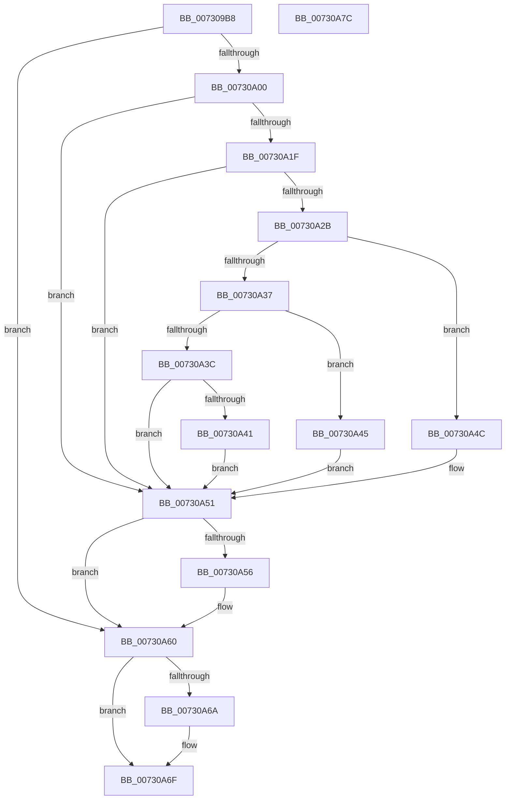

# PipDmgInitReadGroupPolicy

- RVA: `0x007309B8`–`0x00730A7D` (길이 `197` bytes)
- VA: `0x00000001407309B8`
- 실행 섹션: `PAGE`
- PDB 이름 있음: `예`; PDB Function 태그: `아니요`
- unwind 정보 RVA: `0x000C8998`
- 디코드: `58`개 명령, `197/197` bytes 표시
- 미해석 바이트: `0` (있으면 어셈블리에 `.byte`로 보존)

> 이 문서는 커널 이미지의 기계어와 PDB 기호를 분석해 생성했습니다. 4번과 5번은 함수 원형과 자료형을 바이너리 사용 방식에서 추정한 C 해석이며 원본 소스 복구 결과는 아닙니다.

## 1. Dependencies

- 직접 호출 지점: **5**; 고유 호출 대상: **5**
- 직접 호출자로 확인된 함수: **1**
- RIP 상대 이미지 참조: **2**

### Outgoing calls
- `0x007309F7` → [IopOpenRegistryKeyEx](../A5/IopOpenRegistryKeyEx_function_00A51B44.md) (function, `0x00A51B44`)
- `0x00730A12` → [IopGetRegistryValue](../99/IopGetRegistryValue_function_009990EC.md) (function, `0x009990EC`)
- `0x00730A22` → [PnpValidateRegistryDword](../../text/4D/PnpValidateRegistryDword_function_004D109C.md) (function, `0x004D109C`)
- `0x00730A5B` → [ExFreePoolWithTag](../../poolcode/B8/ExFreePoolWithTag_function_00B82870.md) (function, `0x00B82870`)
- `0x00730A6A` → [ZwClose](../../text/6A/ZwClose_function_006AD2B0.md) (function, `0x006AD2B0`)

### Direct callers
- [PipDmgInitPhaseTwo](PipDmgInitPhaseTwo_function_0073C07C.md) at `0x0073C089`

### Static image references
- `0x007309C9` → RVA `0x00AFE2C0` (` ?? ::NNGAKEGL::`string'`; read)
- `0x00730A0B` → RVA `0x00AFE360` (` ?? ::NNGAKEGL::`string'`; read)

## 2. Other-region calls and transfers

- 다른 실행 섹션으로 향하는 call: **3**
  - `0x00730A22` → [PnpValidateRegistryDword](../../text/4D/PnpValidateRegistryDword_function_004D109C.md) (`PAGE` → `.text`)
  - `0x00730A5B` → [ExFreePoolWithTag](../../poolcode/B8/ExFreePoolWithTag_function_00B82870.md) (`PAGE` → `POOLCODE`)
  - `0x00730A6A` → [ZwClose](../../text/6A/ZwClose_function_006AD2B0.md) (`PAGE` → `.text`)
- 별도 외부 분기/꼬리 이동을 확인하지 못했습니다.

## 3. Assembly (complete function range)

```asm
007309B8  48 89 5C 24 18                  mov qword ptr [rsp + 0x18], rbx
007309BD  55                              push rbp
007309BE  48 8B EC                        mov rbp, rsp
007309C1  48 83 EC 30                     sub rsp, 0x30
007309C5  83 65 F4 00                     and dword ptr [rbp - 0xc], 0
007309C9  48 8D 05 F0 D8 3C 00            lea rax, [rip + 0x3cd8f0]
007309D0  48 83 65 18 00                  and qword ptr [rbp + 0x18], 0
007309D5  4C 8D 45 F0                     lea r8, [rbp - 0x10]
007309D9  48 83 4D 10 FF                  or qword ptr [rbp + 0x10], 0xffffffffffffffff
007309DE  48 8D 4D 10                     lea rcx, [rbp + 0x10]
007309E2  41 B9 19 00 02 00               mov r9d, 0x20019
007309E8  48 89 45 F8                     mov qword ptr [rbp - 8], rax
007309EC  33 D2                           xor edx, edx
007309EE  C7 45 F0 96 00 98 00            mov dword ptr [rbp - 0x10], 0x980096
007309F5  33 DB                           xor ebx, ebx
007309F7  E8 48 11 32 00                  call 0x140a51b44
007309FC  85 C0                           test eax, eax
007309FE  78 60                           js 0x140730a60
00730A00  48 8B 4D 10                     mov rcx, qword ptr [rbp + 0x10]
00730A04  4C 8D 4D 18                     lea r9, [rbp + 0x18]
00730A08  45 33 C0                        xor r8d, r8d
00730A0B  48 8D 15 4E D9 3C 00            lea rdx, [rip + 0x3cd94e]
00730A12  E8 D5 86 26 00                  call 0x1409990ec
00730A17  4C 8B 45 18                     mov r8, qword ptr [rbp + 0x18]
00730A1B  85 C0                           test eax, eax
00730A1D  78 32                           js 0x140730a51
00730A1F  49 8B C8                        mov rcx, r8
00730A22  E8 75 06 DA FF                  call 0x1404d109c
00730A27  84 C0                           test al, al
00730A29  74 26                           je 0x140730a51
00730A2B  41 8B 48 08                     mov ecx, dword ptr [r8 + 8]
00730A2F  42 8B 14 01                     mov edx, dword ptr [rcx + r8]
00730A33  85 D2                           test edx, edx
00730A35  74 15                           je 0x140730a4c
00730A37  83 EA 01                        sub edx, 1
00730A3A  74 09                           je 0x140730a45
00730A3C  83 FA 01                        cmp edx, 1
00730A3F  75 10                           jne 0x140730a51
00730A41  8B DA                           mov ebx, edx
00730A43  EB 0C                           jmp 0x140730a51
00730A45  BB 02 00 00 00                  mov ebx, 2
00730A4A  EB 05                           jmp 0x140730a51
00730A4C  BB 03 00 00 00                  mov ebx, 3
00730A51  4D 85 C0                        test r8, r8
00730A54  74 0A                           je 0x140730a60
00730A56  33 D2                           xor edx, edx
00730A58  49 8B C8                        mov rcx, r8
00730A5B  E8 10 1E 45 00                  call 0x140b82870
00730A60  48 8B 4D 10                     mov rcx, qword ptr [rbp + 0x10]
00730A64  48 83 F9 FF                     cmp rcx, -1
00730A68  74 05                           je 0x140730a6f
00730A6A  E8 41 C8 F7 FF                  call 0x1406ad2b0
00730A6F  8B C3                           mov eax, ebx
00730A71  48 8B 5C 24 50                  mov rbx, qword ptr [rsp + 0x50]
00730A76  48 83 C4 30                     add rsp, 0x30
00730A7A  5D                              pop rbp
00730A7B  C3                              ret
00730A7C  CC                              int3
```

## 4. C-style interpretation (structured pseudocode)

```c
__int64 __fastcall PipDmgInitReadGroupPolicy(__int64 a1, int a2)
{
    __int64 result;
    __int64 v_rbx;
    __int64 v_rsp;
    unsigned __int64 v_stack_m10;
    unsigned int v_stack_m14;
    unsigned __int64 v_stack_m18;
    unsigned __int64 v_stack_p10;
    unsigned __int64 v_stack_p18;
    unsigned __int64 v_stack_p8;

    v_stack_p18 = v_rbx;
    v_rsp = (v_rsp) - (48);
    v_stack_m10 = v_rip + 3987696;
    a2 = 0;
    v_stack_m18 = 0x980096ULL;
    v_rbx = 0;
    result = IopOpenRegistryKeyEx(v_stack_p8, a2, v_stack_m18, (unsigned int)(0x20019ULL));
    if (sign_flag) goto loc_00730A60;
    a3 = 0;
    result = IopGetRegistryValue(v_stack_p8, v_rip + 3987790, a3, v_stack_p10);
    if (sign_flag) goto loc_00730A51;
    result = PnpValidateRegistryDword(v_stack_p10, v_rip + 3987790, v_stack_p10, v_stack_p10);
    if ((unsigned __int8)(result) == 0) goto loc_00730A51;
    if ((unsigned int)((unsigned int)(*(unsigned int *)((unsigned int)(*(unsigned int *)(v_stack_p10 + 8)) + v_stack_p10 * 1))) == 0) goto loc_00730A4C;
    a2 = (unsigned int)(((unsigned int)(*(unsigned int *)((unsigned int)(*(unsigned int *)(v_stack_p10 + 8)) + v_stack_p10 * 1))) - (1));
    if (condition_is_equal) goto loc_00730A45;
    if (a2 != 1) goto loc_00730A51;
    goto loc_00730A51;
loc_00730A45:
    goto loc_00730A51;
loc_00730A4C:
loc_00730A51:
    if (v_stack_p10 != 0) {
        a2 = 0;
        a1 = v_stack_p10;
        result = ExFreePoolWithTag(a1, a2, v_stack_p10, v_stack_p10);
    }
    if (v_stack_p8 != -1) {
        result = ZwClose(v_stack_p8, a2, v_stack_p10, v_stack_p10);
    }
    v_rsp = (v_rsp) + (48);
    return 3;
}
```

## 5. (Beta) C Style

```c
int64_t PipDmgInitReadGroupPolicy(int64_t Arg1, int32_t Arg2)
{
    int64_t result;
    int64_t local_rbx;
    int64_t local_rsp;
    uint64_t v_stack_m10;
    uint32_t v_stack_m14;
    uint64_t v_stack_m18;
    uint64_t v_stack_p10;
    uint64_t v_stack_p18;
    uint64_t v_stack_p8;

    v_stack_p18 = local_rbx;
    local_rsp = (local_rsp) - (48);
    v_stack_m10 = v_rip + 3987696;
    Arg2 = 0;
    v_stack_m18 = 0x980096ULL;
    local_rbx = 0;
    result = IopOpenRegistryKeyEx(v_stack_p8, Arg2, v_stack_m18, (uint32_t)(0x20019ULL));
    if (sign_flag) goto loc_00730A60;
    a3 = 0;
    result = IopGetRegistryValue(v_stack_p8, v_rip + 3987790, a3, v_stack_p10);
    if (sign_flag) goto loc_00730A51;
    result = PnpValidateRegistryDword(v_stack_p10, v_rip + 3987790, v_stack_p10, v_stack_p10);
    if ((uint8_t)(result) == 0) goto loc_00730A51;
    if ((uint32_t)((uint32_t)(*(uint32_t *)((uint32_t)(*(uint32_t *)(v_stack_p10 + 0x8)) + v_stack_p10 * 1))) == 0) goto loc_00730A4C;
    Arg2 = (uint32_t)(((uint32_t)(*(uint32_t *)((uint32_t)(*(uint32_t *)(v_stack_p10 + 0x8)) + v_stack_p10 * 1))) - (1));
    if (condition_is_equal) goto loc_00730A45;
    if (Arg2 != 1) goto loc_00730A51;
    goto loc_00730A51;
loc_00730A45:
    goto loc_00730A51;
loc_00730A4C:
loc_00730A51:
    if (v_stack_p10 != 0) {
        Arg2 = 0;
        Arg1 = v_stack_p10;
        result = ExFreePoolWithTag(Arg1, Arg2, v_stack_p10, v_stack_p10);
    }
    if (v_stack_p8 != -1) {
        result = ZwClose(v_stack_p8, Arg2, v_stack_p10, v_stack_p10);
    }
    local_rsp = (local_rsp) + (48);
    return 3;
}
```

## 6. Execution-region graph

[열기: 2D/3D 그래프와 함수 탐색 컨트롤 패널](../../../control-panel.html?section=page&rva=0x007309B8&view=graph)

- 2D 그래프는 위에서 아래로 흐르고, 3D 그래프는 빈 공간을 드래그해 회전합니다. Shift+드래그는 이동, 휠은 확대·축소, 함수 노드 선택은 대상 보고서 이동입니다.

### Static fallback


