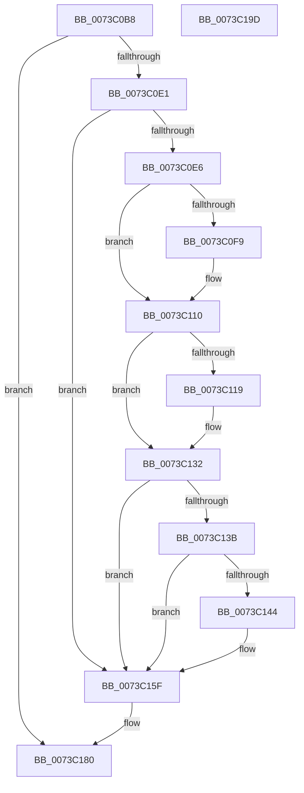

# PipDmgInitializeIommuExtension

- RVA: `0x0073C0B8`–`0x0073C19E` (길이 `230` bytes)
- VA: `0x000000014073C0B8`
- 실행 섹션: `PAGE`
- PDB 이름 있음: `예`; PDB Function 태그: `아니요`
- unwind 정보 RVA: `0x00066400`
- 디코드: `61`개 명령, `230/230` bytes 표시
- 미해석 바이트: `0` (있으면 어셈블리에 `.byte`로 보존)

> 이 문서는 커널 이미지의 기계어와 PDB 기호를 분석해 생성했습니다. 4번과 5번은 함수 원형과 자료형을 바이너리 사용 방식에서 추정한 C 해석이며 원본 소스 복구 결과는 아닙니다.

## 1. Dependencies

- 직접 호출 지점: **9**; 고유 호출 대상: **3**
- 직접 호출자로 확인된 함수: **1**
- RIP 상대 이미지 참조: **0**

### Outgoing calls
- `0x0073C0EF` → [IoAddTriageDumpDataBlock](../../text/42/IoAddTriageDumpDataBlock_function_00428374.md) (function, `0x00428374`)
- `0x0073C0FF` → [IoAddTriageDumpDataBlock](../../text/42/IoAddTriageDumpDataBlock_function_00428374.md) (function, `0x00428374`)
- `0x0073C10B` → [IoAddTriageDumpDataBlock](../../text/42/IoAddTriageDumpDataBlock_function_00428374.md) (function, `0x00428374`)
- `0x0073C121` → [IoAddTriageDumpDataBlock](../../text/42/IoAddTriageDumpDataBlock_function_00428374.md) (function, `0x00428374`)
- `0x0073C12D` → [IoAddTriageDumpDataBlock](../../text/42/IoAddTriageDumpDataBlock_function_00428374.md) (function, `0x00428374`)
- `0x0073C149` → [IoAddTriageDumpDataBlock](../../text/42/IoAddTriageDumpDataBlock_function_00428374.md) (function, `0x00428374`)
- `0x0073C15A` → [IoAddTriageDumpDataBlock](../../text/42/IoAddTriageDumpDataBlock_function_00428374.md) (function, `0x00428374`)
- `0x0073C17A` → [KeBugCheckEx](../../text/4F/KeBugCheckEx_function_004FD660.md) (function, `0x004FD660`)
- `0x0073C183` → [PiIommuAllocateExtension](../74/PiIommuAllocateExtension_function_00740004.md) (function, `0x00740004`)

### Direct callers
- [PiProcessNewDeviceNode](../A2/PiProcessNewDeviceNode_function_00A28F20.md) at `0x00A2A166`

### Static image references
- 디코드된 RIP-relative 메모리 참조가 없습니다.

## 2. Other-region calls and transfers

- 다른 실행 섹션으로 향하는 call: **8**
  - `0x0073C0EF` → [IoAddTriageDumpDataBlock](../../text/42/IoAddTriageDumpDataBlock_function_00428374.md) (`PAGE` → `.text`)
  - `0x0073C0FF` → [IoAddTriageDumpDataBlock](../../text/42/IoAddTriageDumpDataBlock_function_00428374.md) (`PAGE` → `.text`)
  - `0x0073C10B` → [IoAddTriageDumpDataBlock](../../text/42/IoAddTriageDumpDataBlock_function_00428374.md) (`PAGE` → `.text`)
  - `0x0073C121` → [IoAddTriageDumpDataBlock](../../text/42/IoAddTriageDumpDataBlock_function_00428374.md) (`PAGE` → `.text`)
  - `0x0073C12D` → [IoAddTriageDumpDataBlock](../../text/42/IoAddTriageDumpDataBlock_function_00428374.md) (`PAGE` → `.text`)
  - `0x0073C149` → [IoAddTriageDumpDataBlock](../../text/42/IoAddTriageDumpDataBlock_function_00428374.md) (`PAGE` → `.text`)
  - `0x0073C15A` → [IoAddTriageDumpDataBlock](../../text/42/IoAddTriageDumpDataBlock_function_00428374.md) (`PAGE` → `.text`)
  - `0x0073C17A` → [KeBugCheckEx](../../text/4F/KeBugCheckEx_function_004FD660.md) (`PAGE` → `.text`)
- 별도 외부 분기/꼬리 이동을 확인하지 못했습니다.

## 3. Assembly (complete function range)

```asm
0073C0B8  48 89 5C 24 08                  mov qword ptr [rsp + 8], rbx
0073C0BD  48 89 6C 24 10                  mov qword ptr [rsp + 0x10], rbp
0073C0C2  48 89 74 24 18                  mov qword ptr [rsp + 0x18], rsi
0073C0C7  57                              push rdi
0073C0C8  48 83 EC 30                     sub rsp, 0x30
0073C0CC  48 8D B1 D0 02 00 00            lea rsi, [rcx + 0x2d0]
0073C0D3  33 ED                           xor ebp, ebp
0073C0D5  48 8B D9                        mov rbx, rcx
0073C0D8  48 39 2E                        cmp qword ptr [rsi], rbp
0073C0DB  0F 84 9F 00 00 00               je 0x14073c180
0073C0E1  48 85 C9                        test rcx, rcx
0073C0E4  74 79                           je 0x14073c15f
0073C0E6  BA 88 03 00 00                  mov edx, 0x388
0073C0EB  48 8D 79 28                     lea rdi, [rcx + 0x28]
0073C0EF  E8 80 C2 CE FF                  call 0x140428374
0073C0F4  66 39 2F                        cmp word ptr [rdi], bp
0073C0F7  74 17                           je 0x14073c110
0073C0F9  8D 55 02                        lea edx, [rbp + 2]
0073C0FC  48 8B CF                        mov rcx, rdi
0073C0FF  E8 70 C2 CE FF                  call 0x140428374
0073C104  0F B7 17                        movzx edx, word ptr [rdi]
0073C107  48 8B 4F 08                     mov rcx, qword ptr [rdi + 8]
0073C10B  E8 64 C2 CE FF                  call 0x140428374
0073C110  48 8D 7B 38                     lea rdi, [rbx + 0x38]
0073C114  66 39 2F                        cmp word ptr [rdi], bp
0073C117  74 19                           je 0x14073c132
0073C119  BA 02 00 00 00                  mov edx, 2
0073C11E  48 8B CF                        mov rcx, rdi
0073C121  E8 4E C2 CE FF                  call 0x140428374
0073C126  0F B7 17                        movzx edx, word ptr [rdi]
0073C129  48 8B 4B 40                     mov rcx, qword ptr [rbx + 0x40]
0073C12D  E8 42 C2 CE FF                  call 0x140428374
0073C132  48 8B 43 10                     mov rax, qword ptr [rbx + 0x10]
0073C136  48 85 C0                        test rax, rax
0073C139  74 24                           je 0x14073c15f
0073C13B  48 8D 48 38                     lea rcx, [rax + 0x38]
0073C13F  66 39 29                        cmp word ptr [rcx], bp
0073C142  74 1B                           je 0x14073c15f
0073C144  BA 02 00 00 00                  mov edx, 2
0073C149  E8 26 C2 CE FF                  call 0x140428374
0073C14E  48 8B 4B 10                     mov rcx, qword ptr [rbx + 0x10]
0073C152  0F B7 51 38                     movzx edx, word ptr [rcx + 0x38]
0073C156  48 8B 49 40                     mov rcx, qword ptr [rcx + 0x40]
0073C15A  E8 15 C2 CE FF                  call 0x140428374
0073C15F  8B 83 C0 02 00 00               mov eax, dword ptr [rbx + 0x2c0]
0073C165  4C 8B C3                        mov r8, rbx
0073C168  4C 8B 0E                        mov r9, qword ptr [rsi]
0073C16B  BA 11 00 00 00                  mov edx, 0x11
0073C170  B9 CA 00 00 00                  mov ecx, 0xca
0073C175  48 89 44 24 20                  mov qword ptr [rsp + 0x20], rax
0073C17A  E8 E1 14 DC FF                  call 0x1404fd660
0073C17F  CC                              int3
0073C180  4C 8B C6                        mov r8, rsi
0073C183  E8 7C 3E 00 00                  call 0x140740004
0073C188  48 8B 5C 24 40                  mov rbx, qword ptr [rsp + 0x40]
0073C18D  48 8B 6C 24 48                  mov rbp, qword ptr [rsp + 0x48]
0073C192  48 8B 74 24 50                  mov rsi, qword ptr [rsp + 0x50]
0073C197  48 83 C4 30                     add rsp, 0x30
0073C19B  5F                              pop rdi
0073C19C  C3                              ret
0073C19D  CC                              int3
```

## 4. C-style interpretation (structured pseudocode)

```c
__int64 __fastcall PipDmgInitializeIommuExtension(__int64 a1)
{
    __int64 result;
    __int64 v_rbp;
    __int64 v_rsp;
    unsigned __int64 v_stack_m18;
    unsigned __int64 v_stack_p10;
    unsigned __int64 v_stack_p18;
    unsigned __int64 v_stack_p8;

    v_stack_p8 = v_rbx;
    v_stack_p10 = v_rbp;
    v_stack_p18 = v_rsi;
    v_rsp = (v_rsp) - (48);
    v_rbp = 0;
    if ((*(unsigned __int64 *)(a1 + 720)) == 0) goto loc_0073C180;
    if (a1 == 0) goto loc_0073C15F;
    result = IoAddTriageDumpDataBlock(a1, 904, a3, a4);
    if ((*(unsigned __int16 *)(a1 + 40)) != 0) {
        a2 = v_rbp + 2;
        a1 = a1 + 40;
        result = IoAddTriageDumpDataBlock(a1, a2, a3, a4);
        a2 = *(unsigned __int16 *)(a1 + 40);
        a1 = *(unsigned __int64 *)(a1 + 40 + 8);
        result = IoAddTriageDumpDataBlock(a1, a2, a3, a4);
    }
    if ((*(unsigned __int16 *)(a1 + 56)) != 0) {
        a2 = 2;
        a1 = a1 + 56;
        result = IoAddTriageDumpDataBlock(a1, a2, a3, a4);
        a2 = *(unsigned __int16 *)(a1 + 56);
        a1 = *(unsigned __int64 *)(a1 + 64);
        result = IoAddTriageDumpDataBlock(a1, a2, a3, a4);
    }
    if (*(unsigned __int64 *)(a1 + 16) == 0) goto loc_0073C15F;
    result = *(unsigned __int64 *)(a1 + 16);
    if ((*(unsigned __int16 *)(*(unsigned __int64 *)(a1 + 16) + 56)) != 0) {
        a2 = 2;
        result = IoAddTriageDumpDataBlock(*(unsigned __int64 *)(a1 + 16) + 56, a2, a3, a4);
        a1 = *(unsigned __int64 *)(a1 + 16);
        a2 = *(unsigned __int16 *)(a1 + 56);
        a1 = *(unsigned __int64 *)(a1 + 64);
        result = IoAddTriageDumpDataBlock(a1, a2, a3, a4);
    }
    v_stack_m18 = (unsigned int)(*(unsigned int *)(a1 + 704));
    result = KeBugCheckEx(202, 17, a1, *(unsigned __int64 *)(a1 + 720));
loc_0073C180:
    result = PiIommuAllocateExtension(202, 17, a1 + 720, *(unsigned __int64 *)(a1 + 720));
    v_rsp = (v_rsp) + (48);
    return result;
}
```

## 5. (Beta) C Style

```c
int64_t PipDmgInitializeIommuExtension(void *Arg1)
{
    uint8_t *arg1 = (uint8_t *)Arg1;

    int64_t result;
    int64_t local_rbp;
    int64_t local_rsp;
    uint64_t v_stack_m18;
    uint64_t v_stack_p10;
    uint64_t v_stack_p18;
    uint64_t v_stack_p8;

    v_stack_p8 = local_rbx;
    v_stack_p10 = local_rbp;
    v_stack_p18 = local_rsi;
    local_rsp = (local_rsp) - (48);
    local_rbp = 0;
    if ((*(uint64_t *)(arg1 + 0x2D0)) == 0) goto loc_0073C180;
    if (Arg1 == NULL) goto loc_0073C15F;
    result = IoAddTriageDumpDataBlock(Arg1, 904, a3, a4);
    if ((*(uint16_t *)(arg1 + 0x28)) != 0) {
        a2 = local_rbp + 2;
        Arg1 = Arg1 + 40;
        result = IoAddTriageDumpDataBlock(Arg1, a2, a3, a4);
        a2 = *(uint16_t *)(arg1 + 0x28);
        Arg1 = *(uint64_t *)(arg1 + 0x28 + 0x8);
        result = IoAddTriageDumpDataBlock(Arg1, a2, a3, a4);
    }
    if ((*(uint16_t *)(arg1 + 0x38)) != 0) {
        a2 = 2;
        Arg1 = Arg1 + 56;
        result = IoAddTriageDumpDataBlock(Arg1, a2, a3, a4);
        a2 = *(uint16_t *)(arg1 + 0x38);
        Arg1 = *(uint64_t *)(arg1 + 0x40);
        result = IoAddTriageDumpDataBlock(Arg1, a2, a3, a4);
    }
    if (*(uint64_t *)(arg1 + 0x10) == 0) goto loc_0073C15F;
    result = *(uint64_t *)(arg1 + 0x10);
    if ((*(uint16_t *)(*(uint64_t *)(arg1 + 0x10) + 0x38)) != 0) {
        a2 = 2;
        result = IoAddTriageDumpDataBlock(*(uint64_t *)(arg1 + 0x10) + 56, a2, a3, a4);
        Arg1 = *(uint64_t *)(arg1 + 0x10);
        a2 = *(uint16_t *)(arg1 + 0x38);
        Arg1 = *(uint64_t *)(arg1 + 0x40);
        result = IoAddTriageDumpDataBlock(Arg1, a2, a3, a4);
    }
    v_stack_m18 = (uint32_t)(*(uint32_t *)(arg1 + 0x2C0));
    result = KeBugCheckEx(202, 17, Arg1, *(uint64_t *)(arg1 + 0x2D0));
loc_0073C180:
    result = PiIommuAllocateExtension(202, 17, Arg1 + 720, *(uint64_t *)(arg1 + 0x2D0));
    local_rsp = (local_rsp) + (48);
    return result;
}
```

### 관측된 메모리 오프셋

구조체 형식이 확인되지 않은 접근은 인자 기준의 오프셋으로만 기록했습니다.

| 기준 인자 | 오프셋 표현 | 폭 (bit) | 접근 |
|---|---:|---:|---|
| `Arg1` | `+ 0x0` | `16` | `R` |
| `Arg1` | `+ 0x0` | `64` | `R` |
| `Arg1` | `+ 0x10` | `64` | `R` |
| `Arg1` | `+ 0x38` | `64` | `R` |
| `Arg1` | `+ 0x40` | `64` | `R` |
| `Arg1` | `+ 0x2C0` | `32` | `R` |
| `Arg1` | `+ 0x2D0` | `64` | `R` |

## 6. Execution-region graph

[열기: 2D/3D 그래프와 함수 탐색 컨트롤 패널](../../../control-panel.html?section=page&rva=0x0073C0B8&view=graph)

- 2D 그래프는 위에서 아래로 흐르고, 3D 그래프는 빈 공간을 드래그해 회전합니다. Shift+드래그는 이동, 휠은 확대·축소, 함수 노드 선택은 대상 보고서 이동입니다.

### Static fallback


