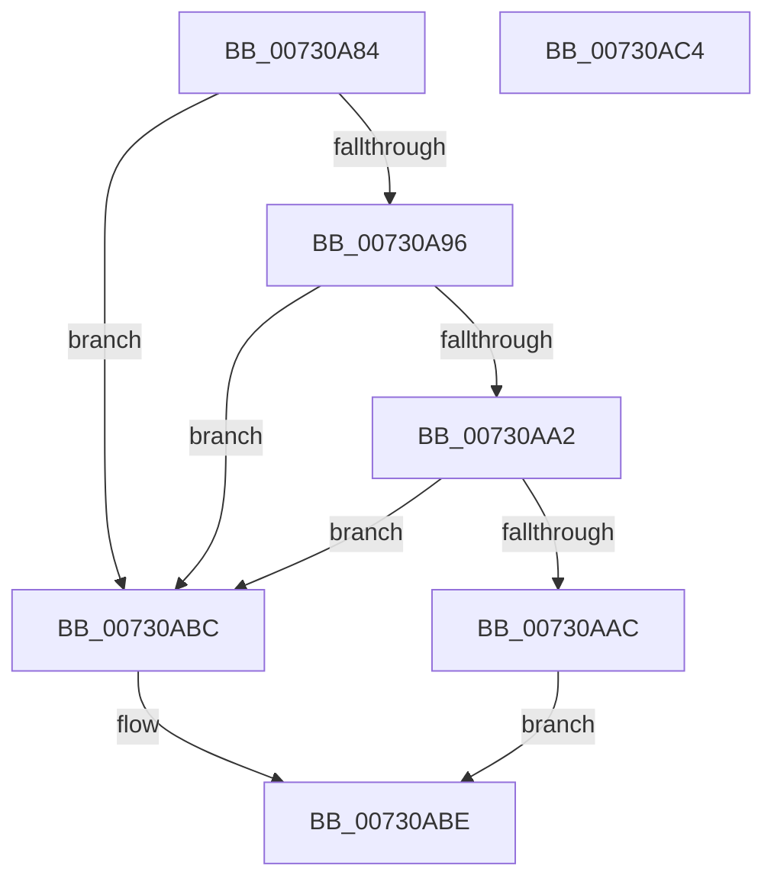

# PipDmgIsDmaVerifierEnabled

- RVA: `0x00730A84`–`0x00730AC5` (길이 `65` bytes)
- VA: `0x0000000140730A84`
- 실행 섹션: `PAGE`
- PDB 이름 있음: `예`; PDB Function 태그: `아니요`
- unwind 정보 RVA: `0x0005CF00`
- 디코드: `21`개 명령, `65/65` bytes 표시
- 미해석 바이트: `0` (있으면 어셈블리에 `.byte`로 보존)

> 이 문서는 커널 이미지의 기계어와 PDB 기호를 분석해 생성했습니다. 4번과 5번은 함수 원형과 자료형을 바이너리 사용 방식에서 추정한 C 해석이며 원본 소스 복구 결과는 아닙니다.

## 1. Dependencies

- 직접 호출 지점: **2**; 고유 호출 대상: **2**
- 직접 호출자로 확인된 함수: **2**
- RIP 상대 이미지 참조: **2**

### Outgoing calls
- `0x00730A8D` → [VfIsVerifierEnabled](../../text/4C/VfIsVerifierEnabled_function_004C72F0.md) (function, `0x004C72F0`)
- `0x00730AB0` → [VfTargetDriversIsEnabled](../../pagevrfy/BB/VfTargetDriversIsEnabled_function_00BB7F20.md) (function, `0x00BB7F20`)

### Direct callers
- [PipDmgGetDeviceDmarPolicy](PipDmgGetDeviceDmarPolicy_function_00730760.md) at `0x007307AF`
- [sub_00B492BC](../B4/Unknown_function_00B492BC.md) at `0x00B492C4`

### Static image references
- `0x00730A96` → RVA `0x00E681A0` (`.data`; read)
- `0x00730AA2` → RVA `0x00F04A20` (`.data`; read)

## 2. Other-region calls and transfers

- 다른 실행 섹션으로 향하는 call: **2**
  - `0x00730A8D` → [VfIsVerifierEnabled](../../text/4C/VfIsVerifierEnabled_function_004C72F0.md) (`PAGE` → `.text`)
  - `0x00730AB0` → [VfTargetDriversIsEnabled](../../pagevrfy/BB/VfTargetDriversIsEnabled_function_00BB7F20.md) (`PAGE` → `PAGEVRFY`)
- 별도 외부 분기/꼬리 이동을 확인하지 못했습니다.

## 3. Assembly (complete function range)

```asm
00730A84  40 53                           push rbx
00730A86  48 83 EC 20                     sub rsp, 0x20
00730A8A  48 8B D9                        mov rbx, rcx
00730A8D  E8 5E 68 D9 FF                  call 0x1404c72f0
00730A92  85 C0                           test eax, eax
00730A94  74 26                           je 0x140730abc
00730A96  F7 05 00 77 73 00 00 00 40 00   test dword ptr [rip + 0x737700], 0x400000
00730AA0  75 1A                           jne 0x140730abc
00730AA2  8B 05 78 3F 7D 00               mov eax, dword ptr [rip + 0x7d3f78]
00730AA8  84 C0                           test al, al
00730AAA  79 10                           jns 0x140730abc
00730AAC  48 8B 4B 18                     mov rcx, qword ptr [rbx + 0x18]
00730AB0  E8 6B 74 48 00                  call 0x140bb7f20
00730AB5  85 C0                           test eax, eax
00730AB7  0F 95 C0                        setne al
00730ABA  EB 02                           jmp 0x140730abe
00730ABC  32 C0                           xor al, al
00730ABE  48 83 C4 20                     add rsp, 0x20
00730AC2  5B                              pop rbx
00730AC3  C3                              ret
00730AC4  CC                              int3
```

## 4. C-style interpretation (structured pseudocode)

```c
__int64 __fastcall PipDmgIsDmaVerifierEnabled(__int64 a1)
{
    __int64 result;
    __int64 v_rsp;

    v_rsp = (v_rsp) - (32);
    result = VfIsVerifierEnabled(a1, a2, a3, a4);
    if ((unsigned int)(result) == 0) goto loc_00730ABC;
    if (((*(unsigned int *)(v_rip + 7567104)) & (0x400000ULL)) != 0) goto loc_00730ABC;
    if (!sign_flag) goto loc_00730ABC;
    result = VfTargetDriversIsEnabled(*(unsigned __int64 *)(a1 + 24), a2, a3, a4);
    result = ((unsigned int)(result) != 0) ? 1 : 0;
    goto loc_00730ABE;
loc_00730ABC:
    result = 0;
loc_00730ABE:
    v_rsp = (v_rsp) + (32);
    return result;
}
```

## 5. (Beta) C Style

```c
int64_t PipDmgIsDmaVerifierEnabled(void *Arg1)
{
    uint8_t *arg1 = (uint8_t *)Arg1;

    int64_t result;
    int64_t local_rsp;

    local_rsp = (local_rsp) - (32);
    result = VfIsVerifierEnabled(Arg1, a2, a3, a4);
    if ((uint32_t)(result) == 0) goto loc_00730ABC;
    if (((*(uint32_t *)(v_rip + 0x737700)) & (0x400000ULL)) != 0) goto loc_00730ABC;
    if (!sign_flag) goto loc_00730ABC;
    result = VfTargetDriversIsEnabled(*(uint64_t *)(arg1 + 0x18), a2, a3, a4);
    result = ((uint32_t)(result) != 0) ? 1 : 0;
    goto loc_00730ABE;
loc_00730ABC:
    result = 0;
loc_00730ABE:
    local_rsp = (local_rsp) + (32);
    return result;
}
```

### 관측된 메모리 오프셋

구조체 형식이 확인되지 않은 접근은 인자 기준의 오프셋으로만 기록했습니다.

| 기준 인자 | 오프셋 표현 | 폭 (bit) | 접근 |
|---|---:|---:|---|
| `Arg1` | `+ 0x18` | `64` | `R` |

## 6. Execution-region graph

[열기: 2D/3D 그래프와 함수 탐색 컨트롤 패널](../../../control-panel.html?section=page&rva=0x00730A84&view=graph)

- 2D 그래프는 위에서 아래로 흐르고, 3D 그래프는 빈 공간을 드래그해 회전합니다. Shift+드래그는 이동, 휠은 확대·축소, 함수 노드 선택은 대상 보고서 이동입니다.

### Static fallback


