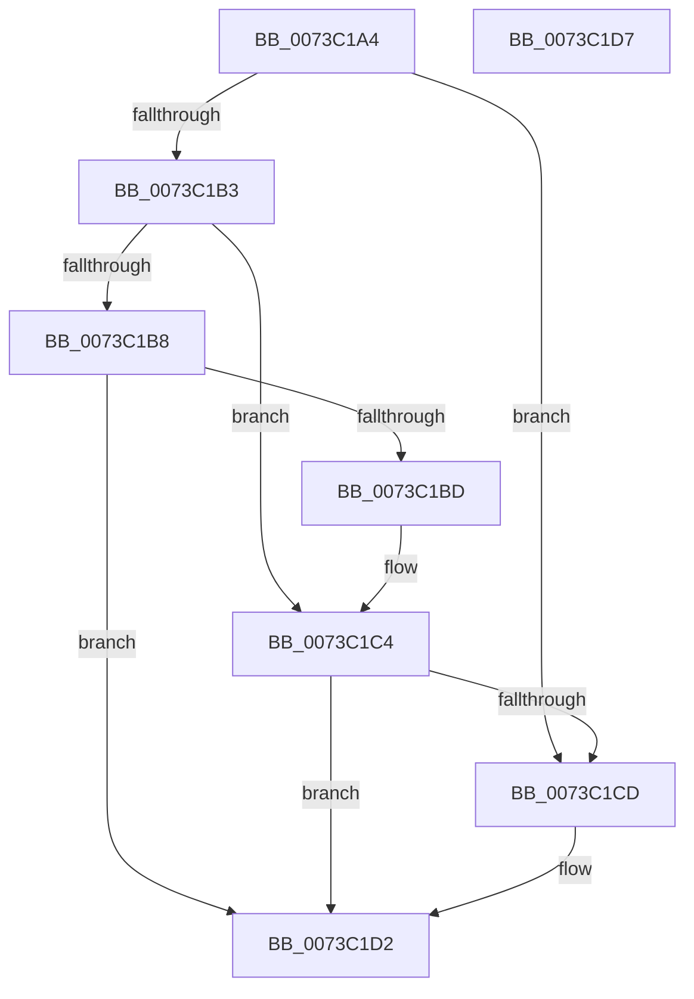

# PipDmgReevaluateQueue

- RVA: `0x0073C1A4`–`0x0073C1D8` (길이 `52` bytes)
- VA: `0x000000014073C1A4`
- 실행 섹션: `PAGE`
- PDB 이름 있음: `예`; PDB Function 태그: `아니요`
- unwind 정보 RVA: `0x0005C788`
- 디코드: `17`개 명령, `52/52` bytes 표시
- 미해석 바이트: `0` (있으면 어셈블리에 `.byte`로 보존)

> 이 문서는 커널 이미지의 기계어와 PDB 기호를 분석해 생성했습니다. 4번과 5번은 함수 원형과 자료형을 바이너리 사용 방식에서 추정한 C 해석이며 원본 소스 복구 결과는 아닙니다.

## 1. Dependencies

- 직접 호출 지점: **2**; 고유 호출 대상: **2**
- 직접 호출자로 확인된 함수: **3**
- RIP 상대 이미지 참조: **1**

### Outgoing calls
- `0x0073C1C4` → [PiCslIsConsoleLocked](../A9/PiCslIsConsoleLocked_function_00A95D38.md) (function, `0x00A95D38`)
- `0x0073C1CD` → [PipDmgFlushQueueAndRestartDevices](PipDmgFlushQueueAndRestartDevices_function_0073BF9C.md) (function, `0x0073BF9C`)

### Direct callers
- [PipDmgEnforceEnumerationPolicy](PipDmgEnforceEnumerationPolicy_function_0073BEB4.md) at `0x0073BF73`
- [PipDmgInitPhaseTwo](PipDmgInitPhaseTwo_function_0073C07C.md) at `0x0073C09E`
- [PiDmaGuardProcessPostRemove](../AA/PiDmaGuardProcessPostRemove_function_00AA3D40.md) at `0x00AA3DB0`

### Static image references
- `0x0073C1A8` → RVA `0x00F8A9AC` (`.data`; read)

## 2. Other-region calls and transfers

- 다른 실행 섹션으로 향하는 call: **0**
- 별도 외부 분기/꼬리 이동을 확인하지 못했습니다.

## 3. Assembly (complete function range)

```asm
0073C1A4  48 83 EC 28                     sub rsp, 0x28
0073C1A8  8B 0D FE E7 84 00               mov ecx, dword ptr [rip + 0x84e7fe]
0073C1AE  83 E9 01                        sub ecx, 1
0073C1B1  74 1A                           je 0x14073c1cd
0073C1B3  83 E9 01                        sub ecx, 1
0073C1B6  74 0C                           je 0x14073c1c4
0073C1B8  83 F9 01                        cmp ecx, 1
0073C1BB  74 15                           je 0x14073c1d2
0073C1BD  B9 05 00 00 00                  mov ecx, 5
0073C1C2  CD 29                           int 0x29
0073C1C4  E8 6F 9B 35 00                  call 0x140a95d38
0073C1C9  84 C0                           test al, al
0073C1CB  75 05                           jne 0x14073c1d2
0073C1CD  E8 CA FD FF FF                  call 0x14073bf9c
0073C1D2  48 83 C4 28                     add rsp, 0x28
0073C1D6  C3                              ret
0073C1D7  CC                              int3
```

## 4. C-style interpretation (structured pseudocode)

```c
__int64 __fastcall PipDmgReevaluateQueue(void)
{
    __int64 result;
    __int64 v_rsp;

    v_rsp = (v_rsp) - (40);
    a1 = (unsigned int)(((unsigned int)(*(unsigned int *)(v_rip + 8710142))) - (1));
    if (condition_is_equal) goto loc_0073C1CD;
    a1 = (unsigned int)((a1) - (1));
    if (condition_is_equal) goto loc_0073C1C4;
    if (((unsigned int)(a1)) == 1) goto loc_0073C1D2;
loc_0073C1C4:
    result = PiCslIsConsoleLocked(5, a2, a3, a4);
    if ((unsigned __int8)(result) == 0) {
        result = PipDmgFlushQueueAndRestartDevices(5, a2, a3, a4);
    }
    v_rsp = (v_rsp) + (40);
    return result;
}
```

## 5. (Beta) C Style

```c
void PipDmgReevaluateQueue(void)
{
    int64_t result;
    int64_t local_rsp;

    local_rsp = (local_rsp) - (40);
    a1 = (uint32_t)(((uint32_t)(*(uint32_t *)(v_rip + 0x84E7FE))) - (1));
    if (condition_is_equal) goto loc_0073C1CD;
    a1 = (uint32_t)((a1) - (1));
    if (condition_is_equal) goto loc_0073C1C4;
    if (((uint32_t)(a1)) == 1) goto loc_0073C1D2;
loc_0073C1C4:
    result = PiCslIsConsoleLocked(5, a2, a3, a4);
    if ((uint8_t)(result) == 0) {
        result = PipDmgFlushQueueAndRestartDevices(5, a2, a3, a4);
    }
    local_rsp = (local_rsp) + (40);
    return result;
}
```

## 6. Execution-region graph

[열기: 2D/3D 그래프와 함수 탐색 컨트롤 패널](../../../control-panel.html?section=page&rva=0x0073C1A4&view=graph)

- 2D 그래프는 위에서 아래로 흐르고, 3D 그래프는 빈 공간을 드래그해 회전합니다. Shift+드래그는 이동, 휠은 확대·축소, 함수 노드 선택은 대상 보고서 이동입니다.

### Static fallback


