# PipDmgRequestRestartOnBlockedDevice

- RVA: `0x0073C1E0`–`0x0073C4AA` (길이 `714` bytes)
- VA: `0x000000014073C1E0`
- 실행 섹션: `PAGE`
- PDB 이름 있음: `예`; PDB Function 태그: `아니요`
- unwind 정보 RVA: `0x000C8FF0`
- 디코드: `179`개 명령, `714/714` bytes 표시
- 미해석 바이트: `0` (있으면 어셈블리에 `.byte`로 보존)

> 이 문서는 커널 이미지의 기계어와 PDB 기호를 분석해 생성했습니다. 4번과 5번은 함수 원형과 자료형을 바이너리 사용 방식에서 추정한 C 해석이며 원본 소스 복구 결과는 아닙니다.

## 1. Dependencies

- 직접 호출 지점: **26**; 고유 호출 대상: **3**
- 직접 호출자로 확인된 함수: **1**
- RIP 상대 이미지 참조: **1**

### Outgoing calls
- `0x0073C213` → [IoAddTriageDumpDataBlock](../../text/42/IoAddTriageDumpDataBlock_function_00428374.md) (function, `0x00428374`)
- `0x0073C228` → [IoAddTriageDumpDataBlock](../../text/42/IoAddTriageDumpDataBlock_function_00428374.md) (function, `0x00428374`)
- `0x0073C23C` → [IoAddTriageDumpDataBlock](../../text/42/IoAddTriageDumpDataBlock_function_00428374.md) (function, `0x00428374`)
- `0x0073C24D` → [IoAddTriageDumpDataBlock](../../text/42/IoAddTriageDumpDataBlock_function_00428374.md) (function, `0x00428374`)
- `0x0073C26F` → [IoAddTriageDumpDataBlock](../../text/42/IoAddTriageDumpDataBlock_function_00428374.md) (function, `0x00428374`)
- `0x0073C27F` → [IoAddTriageDumpDataBlock](../../text/42/IoAddTriageDumpDataBlock_function_00428374.md) (function, `0x00428374`)
- `0x0073C28C` → [IoAddTriageDumpDataBlock](../../text/42/IoAddTriageDumpDataBlock_function_00428374.md) (function, `0x00428374`)
- `0x0073C2A7` → [IoAddTriageDumpDataBlock](../../text/42/IoAddTriageDumpDataBlock_function_00428374.md) (function, `0x00428374`)
- `0x0073C2BF` → [IoAddTriageDumpDataBlock](../../text/42/IoAddTriageDumpDataBlock_function_00428374.md) (function, `0x00428374`)
- `0x0073C2E3` → [IoAddTriageDumpDataBlock](../../text/42/IoAddTriageDumpDataBlock_function_00428374.md) (function, `0x00428374`)
- `0x0073C2FF` → [IoAddTriageDumpDataBlock](../../text/42/IoAddTriageDumpDataBlock_function_00428374.md) (function, `0x00428374`)
- `0x0073C318` → [KeBugCheckEx](../../text/4F/KeBugCheckEx_function_004FD660.md) (function, `0x004FD660`)
- `0x0073C360` → [PnpRequestDeviceAction](../../text/47/PnpRequestDeviceAction_function_00477FF8.md) (function, `0x00477FF8`)
- `0x0073C384` → [PnpRequestDeviceAction](../../text/47/PnpRequestDeviceAction_function_00477FF8.md) (function, `0x00477FF8`)
- `0x0073C3A3` → [IoAddTriageDumpDataBlock](../../text/42/IoAddTriageDumpDataBlock_function_00428374.md) (function, `0x00428374`)
- `0x0073C3B5` → [IoAddTriageDumpDataBlock](../../text/42/IoAddTriageDumpDataBlock_function_00428374.md) (function, `0x00428374`)
- `0x0073C3C9` → [IoAddTriageDumpDataBlock](../../text/42/IoAddTriageDumpDataBlock_function_00428374.md) (function, `0x00428374`)
- `0x0073C3DA` → [IoAddTriageDumpDataBlock](../../text/42/IoAddTriageDumpDataBlock_function_00428374.md) (function, `0x00428374`)
- `0x0073C3FC` → [IoAddTriageDumpDataBlock](../../text/42/IoAddTriageDumpDataBlock_function_00428374.md) (function, `0x00428374`)
- `0x0073C40C` → [IoAddTriageDumpDataBlock](../../text/42/IoAddTriageDumpDataBlock_function_00428374.md) (function, `0x00428374`)
- `0x0073C419` → [IoAddTriageDumpDataBlock](../../text/42/IoAddTriageDumpDataBlock_function_00428374.md) (function, `0x00428374`)
- `0x0073C434` → [IoAddTriageDumpDataBlock](../../text/42/IoAddTriageDumpDataBlock_function_00428374.md) (function, `0x00428374`)
- `0x0073C44C` → [IoAddTriageDumpDataBlock](../../text/42/IoAddTriageDumpDataBlock_function_00428374.md) (function, `0x00428374`)
- `0x0073C470` → [IoAddTriageDumpDataBlock](../../text/42/IoAddTriageDumpDataBlock_function_00428374.md) (function, `0x00428374`)
- `0x0073C48C` → [IoAddTriageDumpDataBlock](../../text/42/IoAddTriageDumpDataBlock_function_00428374.md) (function, `0x00428374`)
- `0x0073C4A4` → [KeBugCheckEx](../../text/4F/KeBugCheckEx_function_004FD660.md) (function, `0x004FD660`)

### Direct callers
- [PipDmgFlushQueueAndRestartDevices](PipDmgFlushQueueAndRestartDevices_function_0073BF9C.md) at `0x0073BFF1`

### Static image references
- `0x0073C1F9` → RVA `0x00F8A9AC` (`.data`; read)

## 2. Other-region calls and transfers

- 다른 실행 섹션으로 향하는 call: **26**
  - `0x0073C213` → [IoAddTriageDumpDataBlock](../../text/42/IoAddTriageDumpDataBlock_function_00428374.md) (`PAGE` → `.text`)
  - `0x0073C228` → [IoAddTriageDumpDataBlock](../../text/42/IoAddTriageDumpDataBlock_function_00428374.md) (`PAGE` → `.text`)
  - `0x0073C23C` → [IoAddTriageDumpDataBlock](../../text/42/IoAddTriageDumpDataBlock_function_00428374.md) (`PAGE` → `.text`)
  - `0x0073C24D` → [IoAddTriageDumpDataBlock](../../text/42/IoAddTriageDumpDataBlock_function_00428374.md) (`PAGE` → `.text`)
  - `0x0073C26F` → [IoAddTriageDumpDataBlock](../../text/42/IoAddTriageDumpDataBlock_function_00428374.md) (`PAGE` → `.text`)
  - `0x0073C27F` → [IoAddTriageDumpDataBlock](../../text/42/IoAddTriageDumpDataBlock_function_00428374.md) (`PAGE` → `.text`)
  - `0x0073C28C` → [IoAddTriageDumpDataBlock](../../text/42/IoAddTriageDumpDataBlock_function_00428374.md) (`PAGE` → `.text`)
  - `0x0073C2A7` → [IoAddTriageDumpDataBlock](../../text/42/IoAddTriageDumpDataBlock_function_00428374.md) (`PAGE` → `.text`)
  - `0x0073C2BF` → [IoAddTriageDumpDataBlock](../../text/42/IoAddTriageDumpDataBlock_function_00428374.md) (`PAGE` → `.text`)
  - `0x0073C2E3` → [IoAddTriageDumpDataBlock](../../text/42/IoAddTriageDumpDataBlock_function_00428374.md) (`PAGE` → `.text`)
  - `0x0073C2FF` → [IoAddTriageDumpDataBlock](../../text/42/IoAddTriageDumpDataBlock_function_00428374.md) (`PAGE` → `.text`)
  - `0x0073C318` → [KeBugCheckEx](../../text/4F/KeBugCheckEx_function_004FD660.md) (`PAGE` → `.text`)
  - `0x0073C360` → [PnpRequestDeviceAction](../../text/47/PnpRequestDeviceAction_function_00477FF8.md) (`PAGE` → `.text`)
  - `0x0073C384` → [PnpRequestDeviceAction](../../text/47/PnpRequestDeviceAction_function_00477FF8.md) (`PAGE` → `.text`)
  - `0x0073C3A3` → [IoAddTriageDumpDataBlock](../../text/42/IoAddTriageDumpDataBlock_function_00428374.md) (`PAGE` → `.text`)
  - `0x0073C3B5` → [IoAddTriageDumpDataBlock](../../text/42/IoAddTriageDumpDataBlock_function_00428374.md) (`PAGE` → `.text`)
  - `0x0073C3C9` → [IoAddTriageDumpDataBlock](../../text/42/IoAddTriageDumpDataBlock_function_00428374.md) (`PAGE` → `.text`)
  - `0x0073C3DA` → [IoAddTriageDumpDataBlock](../../text/42/IoAddTriageDumpDataBlock_function_00428374.md) (`PAGE` → `.text`)
  - `0x0073C3FC` → [IoAddTriageDumpDataBlock](../../text/42/IoAddTriageDumpDataBlock_function_00428374.md) (`PAGE` → `.text`)
  - `0x0073C40C` → [IoAddTriageDumpDataBlock](../../text/42/IoAddTriageDumpDataBlock_function_00428374.md) (`PAGE` → `.text`)
  - `0x0073C419` → [IoAddTriageDumpDataBlock](../../text/42/IoAddTriageDumpDataBlock_function_00428374.md) (`PAGE` → `.text`)
  - `0x0073C434` → [IoAddTriageDumpDataBlock](../../text/42/IoAddTriageDumpDataBlock_function_00428374.md) (`PAGE` → `.text`)
  - `0x0073C44C` → [IoAddTriageDumpDataBlock](../../text/42/IoAddTriageDumpDataBlock_function_00428374.md) (`PAGE` → `.text`)
  - `0x0073C470` → [IoAddTriageDumpDataBlock](../../text/42/IoAddTriageDumpDataBlock_function_00428374.md) (`PAGE` → `.text`)
  - `0x0073C48C` → [IoAddTriageDumpDataBlock](../../text/42/IoAddTriageDumpDataBlock_function_00428374.md) (`PAGE` → `.text`)
  - `0x0073C4A4` → [KeBugCheckEx](../../text/4F/KeBugCheckEx_function_004FD660.md) (`PAGE` → `.text`)
- 별도 외부 분기/꼬리 이동을 확인하지 못했습니다.

## 3. Assembly (complete function range)

```asm
0073C1E0  48 89 5C 24 08                  mov qword ptr [rsp + 8], rbx
0073C1E5  48 89 6C 24 18                  mov qword ptr [rsp + 0x18], rbp
0073C1EA  48 89 74 24 20                  mov qword ptr [rsp + 0x20], rsi
0073C1EF  57                              push rdi
0073C1F0  48 83 EC 40                     sub rsp, 0x40
0073C1F4  33 DB                           xor ebx, ebx
0073C1F6  48 8B F9                        mov rdi, rcx
0073C1F9  83 3D AC E7 84 00 03            cmp dword ptr [rip + 0x84e7ac], 3
0073C200  0F 85 18 01 00 00               jne 0x14073c31e
0073C206  48 85 C9                        test rcx, rcx
0073C209  0F 84 F5 00 00 00               je 0x14073c304
0073C20F  0F B7 51 02                     movzx edx, word ptr [rcx + 2]
0073C213  E8 5C C1 CE FF                  call 0x140428374
0073C218  48 8B 4F 08                     mov rcx, qword ptr [rdi + 8]
0073C21C  8D 73 02                        lea esi, [rbx + 2]
0073C21F  48 85 C9                        test rcx, rcx
0073C222  74 2E                           je 0x14073c252
0073C224  0F BF 51 02                     movsx edx, word ptr [rcx + 2]
0073C228  E8 47 C1 CE FF                  call 0x140428374
0073C22D  48 8B 4F 08                     mov rcx, qword ptr [rdi + 8]
0073C231  48 83 C1 38                     add rcx, 0x38
0073C235  66 39 19                        cmp word ptr [rcx], bx
0073C238  74 18                           je 0x14073c252
0073C23A  8B D6                           mov edx, esi
0073C23C  E8 33 C1 CE FF                  call 0x140428374
0073C241  48 8B 4F 08                     mov rcx, qword ptr [rdi + 8]
0073C245  0F B7 51 38                     movzx edx, word ptr [rcx + 0x38]
0073C249  48 8B 49 40                     mov rcx, qword ptr [rcx + 0x40]
0073C24D  E8 22 C1 CE FF                  call 0x140428374
0073C252  48 8B 87 38 01 00 00            mov rax, qword ptr [rdi + 0x138]
0073C259  48 8B 48 28                     mov rcx, qword ptr [rax + 0x28]
0073C25D  48 85 C9                        test rcx, rcx
0073C260  0F 84 9E 00 00 00               je 0x14073c304
0073C266  BA 88 03 00 00                  mov edx, 0x388
0073C26B  48 8D 69 28                     lea rbp, [rcx + 0x28]
0073C26F  E8 00 C1 CE FF                  call 0x140428374
0073C274  66 39 5D 00                     cmp word ptr [rbp], bx
0073C278  74 17                           je 0x14073c291
0073C27A  8B D6                           mov edx, esi
0073C27C  48 8B CD                        mov rcx, rbp
0073C27F  E8 F0 C0 CE FF                  call 0x140428374
0073C284  0F B7 55 00                     movzx edx, word ptr [rbp]
0073C288  48 8B 4D 08                     mov rcx, qword ptr [rbp + 8]
0073C28C  E8 E3 C0 CE FF                  call 0x140428374
0073C291  48 8B 87 38 01 00 00            mov rax, qword ptr [rdi + 0x138]
0073C298  48 8B 48 28                     mov rcx, qword ptr [rax + 0x28]
0073C29C  48 83 C1 38                     add rcx, 0x38
0073C2A0  66 39 19                        cmp word ptr [rcx], bx
0073C2A3  74 1F                           je 0x14073c2c4
0073C2A5  8B D6                           mov edx, esi
0073C2A7  E8 C8 C0 CE FF                  call 0x140428374
0073C2AC  48 8B 87 38 01 00 00            mov rax, qword ptr [rdi + 0x138]
0073C2B3  48 8B 48 28                     mov rcx, qword ptr [rax + 0x28]
0073C2B7  0F B7 51 38                     movzx edx, word ptr [rcx + 0x38]
0073C2BB  48 8B 49 40                     mov rcx, qword ptr [rcx + 0x40]
0073C2BF  E8 B0 C0 CE FF                  call 0x140428374
0073C2C4  48 8B 87 38 01 00 00            mov rax, qword ptr [rdi + 0x138]
0073C2CB  48 8B 48 28                     mov rcx, qword ptr [rax + 0x28]
0073C2CF  48 8B 41 10                     mov rax, qword ptr [rcx + 0x10]
0073C2D3  48 85 C0                        test rax, rax
0073C2D6  74 2C                           je 0x14073c304
0073C2D8  48 8D 48 38                     lea rcx, [rax + 0x38]
0073C2DC  66 39 19                        cmp word ptr [rcx], bx
0073C2DF  74 23                           je 0x14073c304
0073C2E1  8B D6                           mov edx, esi
0073C2E3  E8 8C C0 CE FF                  call 0x140428374
0073C2E8  48 8B 87 38 01 00 00            mov rax, qword ptr [rdi + 0x138]
0073C2EF  48 8B 48 28                     mov rcx, qword ptr [rax + 0x28]
0073C2F3  48 8B 49 10                     mov rcx, qword ptr [rcx + 0x10]
0073C2F7  0F B7 51 38                     movzx edx, word ptr [rcx + 0x38]
0073C2FB  48 8B 49 40                     mov rcx, qword ptr [rcx + 0x40]
0073C2FF  E8 70 C0 CE FF                  call 0x140428374
0073C304  45 33 C9                        xor r9d, r9d
0073C307  48 89 5C 24 20                  mov qword ptr [rsp + 0x20], rbx
0073C30C  4C 8B C7                        mov r8, rdi
0073C30F  B9 CA 00 00 00                  mov ecx, 0xca
0073C314  41 8D 51 11                     lea edx, [r9 + 0x11]
0073C318  E8 43 13 DC FF                  call 0x1404fd660
0073C31D  CC                              int3
0073C31E  BE 02 00 00 00                  mov esi, 2
0073C323  48 85 FF                        test rdi, rdi
0073C326  0F 84 65 01 00 00               je 0x14073c491
0073C32C  48 8B 81 38 01 00 00            mov rax, qword ptr [rcx + 0x138]
0073C333  48 8B 40 28                     mov rax, qword ptr [rax + 0x28]
0073C337  48 85 C0                        test rax, rax
0073C33A  74 63                           je 0x14073c39f
0073C33C  F7 80 8C 01 00 00 00 00 02 00   test dword ptr [rax + 0x18c], 0x20000
0073C346  75 57                           jne 0x14073c39f
0073C348  48 89 5C 24 30                  mov qword ptr [rsp + 0x30], rbx
0073C34D  8D 56 17                        lea edx, [rsi + 0x17]
0073C350  48 89 5C 24 28                  mov qword ptr [rsp + 0x28], rbx
0073C355  45 33 C9                        xor r9d, r9d
0073C358  41 B0 01                        mov r8b, 1
0073C35B  48 89 5C 24 20                  mov qword ptr [rsp + 0x20], rbx
0073C360  E8 93 BC D3 FF                  call 0x140477ff8
0073C365  85 C0                           test eax, eax
0073C367  78 20                           js 0x14073c389
0073C369  48 89 5C 24 30                  mov qword ptr [rsp + 0x30], rbx
0073C36E  8D 56 0E                        lea edx, [rsi + 0xe]
0073C371  48 89 5C 24 28                  mov qword ptr [rsp + 0x28], rbx
0073C376  45 33 C9                        xor r9d, r9d
0073C379  45 33 C0                        xor r8d, r8d
0073C37C  48 89 5C 24 20                  mov qword ptr [rsp + 0x20], rbx
0073C381  48 8B CF                        mov rcx, rdi
0073C384  E8 6F BC D3 FF                  call 0x140477ff8
0073C389  48 8B 5C 24 50                  mov rbx, qword ptr [rsp + 0x50]
0073C38E  48 8B 6C 24 60                  mov rbp, qword ptr [rsp + 0x60]
0073C393  48 8B 74 24 68                  mov rsi, qword ptr [rsp + 0x68]
0073C398  48 83 C4 40                     add rsp, 0x40
0073C39C  5F                              pop rdi
0073C39D  C3                              ret
0073C39E  CC                              int3
0073C39F  0F B7 51 02                     movzx edx, word ptr [rcx + 2]
0073C3A3  E8 CC BF CE FF                  call 0x140428374
0073C3A8  48 8B 4F 08                     mov rcx, qword ptr [rdi + 8]
0073C3AC  48 85 C9                        test rcx, rcx
0073C3AF  74 2E                           je 0x14073c3df
0073C3B1  0F BF 51 02                     movsx edx, word ptr [rcx + 2]
0073C3B5  E8 BA BF CE FF                  call 0x140428374
0073C3BA  48 8B 4F 08                     mov rcx, qword ptr [rdi + 8]
0073C3BE  48 83 C1 38                     add rcx, 0x38
0073C3C2  66 39 19                        cmp word ptr [rcx], bx
0073C3C5  74 18                           je 0x14073c3df
0073C3C7  8B D6                           mov edx, esi
0073C3C9  E8 A6 BF CE FF                  call 0x140428374
0073C3CE  48 8B 4F 08                     mov rcx, qword ptr [rdi + 8]
0073C3D2  0F B7 51 38                     movzx edx, word ptr [rcx + 0x38]
0073C3D6  48 8B 49 40                     mov rcx, qword ptr [rcx + 0x40]
0073C3DA  E8 95 BF CE FF                  call 0x140428374
0073C3DF  48 8B 87 38 01 00 00            mov rax, qword ptr [rdi + 0x138]
0073C3E6  48 8B 48 28                     mov rcx, qword ptr [rax + 0x28]
0073C3EA  48 85 C9                        test rcx, rcx
0073C3ED  0F 84 9E 00 00 00               je 0x14073c491
0073C3F3  BA 88 03 00 00                  mov edx, 0x388
0073C3F8  48 8D 69 28                     lea rbp, [rcx + 0x28]
0073C3FC  E8 73 BF CE FF                  call 0x140428374
0073C401  66 39 5D 00                     cmp word ptr [rbp], bx
0073C405  74 17                           je 0x14073c41e
0073C407  8B D6                           mov edx, esi
0073C409  48 8B CD                        mov rcx, rbp
0073C40C  E8 63 BF CE FF                  call 0x140428374
0073C411  0F B7 55 00                     movzx edx, word ptr [rbp]
0073C415  48 8B 4D 08                     mov rcx, qword ptr [rbp + 8]
0073C419  E8 56 BF CE FF                  call 0x140428374
0073C41E  48 8B 87 38 01 00 00            mov rax, qword ptr [rdi + 0x138]
0073C425  48 8B 48 28                     mov rcx, qword ptr [rax + 0x28]
0073C429  48 83 C1 38                     add rcx, 0x38
0073C42D  66 39 19                        cmp word ptr [rcx], bx
0073C430  74 1F                           je 0x14073c451
0073C432  8B D6                           mov edx, esi
0073C434  E8 3B BF CE FF                  call 0x140428374
0073C439  48 8B 87 38 01 00 00            mov rax, qword ptr [rdi + 0x138]
0073C440  48 8B 48 28                     mov rcx, qword ptr [rax + 0x28]
0073C444  0F B7 51 38                     movzx edx, word ptr [rcx + 0x38]
0073C448  48 8B 49 40                     mov rcx, qword ptr [rcx + 0x40]
0073C44C  E8 23 BF CE FF                  call 0x140428374
0073C451  48 8B 87 38 01 00 00            mov rax, qword ptr [rdi + 0x138]
0073C458  48 8B 48 28                     mov rcx, qword ptr [rax + 0x28]
0073C45C  48 8B 41 10                     mov rax, qword ptr [rcx + 0x10]
0073C460  48 85 C0                        test rax, rax
0073C463  74 2C                           je 0x14073c491
0073C465  48 8D 48 38                     lea rcx, [rax + 0x38]
0073C469  66 39 19                        cmp word ptr [rcx], bx
0073C46C  74 23                           je 0x14073c491
0073C46E  8B D6                           mov edx, esi
0073C470  E8 FF BE CE FF                  call 0x140428374
0073C475  48 8B 87 38 01 00 00            mov rax, qword ptr [rdi + 0x138]
0073C47C  48 8B 48 28                     mov rcx, qword ptr [rax + 0x28]
0073C480  48 8B 49 10                     mov rcx, qword ptr [rcx + 0x10]
0073C484  0F B7 51 38                     movzx edx, word ptr [rcx + 0x38]
0073C488  48 8B 49 40                     mov rcx, qword ptr [rcx + 0x40]
0073C48C  E8 E3 BE CE FF                  call 0x140428374
0073C491  45 33 C9                        xor r9d, r9d
0073C494  48 89 5C 24 20                  mov qword ptr [rsp + 0x20], rbx
0073C499  4C 8B C7                        mov r8, rdi
0073C49C  48 8B D6                        mov rdx, rsi
0073C49F  B9 CA 00 00 00                  mov ecx, 0xca
0073C4A4  E8 B7 11 DC FF                  call 0x1404fd660
0073C4A9  CC                              int3
```

## 4. C-style interpretation (structured pseudocode)

```c
__int64 __fastcall PipDmgRequestRestartOnBlockedDevice(__int64 a1, __int64 a2, __int64 a3, int a4)
{
    __int64 result;
    __int64 v_rbx;
    __int64 v_rsp;
    unsigned __int64 v_stack_m18;
    unsigned __int64 v_stack_m20;
    unsigned __int64 v_stack_m28;
    unsigned __int64 v_stack_p18;
    unsigned __int64 v_stack_p20;
    unsigned __int64 v_stack_p8;

    v_stack_p8 = v_rbx;
    v_stack_p18 = v_rbp;
    v_stack_p20 = v_rsi;
    v_rsp = (v_rsp) - (64);
    v_rbx = 0;
    if ((*(unsigned int *)(v_rip + 8710060)) != 3) goto loc_0073C31E;
    if (a1 == 0) goto loc_0073C304;
    result = IoAddTriageDumpDataBlock(a1, *(unsigned __int16 *)(a1 + 2), a3, a4);
    if (*(unsigned __int64 *)(a1 + 8) == 0) goto loc_0073C252;
    result = IoAddTriageDumpDataBlock(*(unsigned __int64 *)(a1 + 8), (__int16)(*(unsigned __int16 *)(*(unsigned __int64 *)(a1 + 8) + 2)), a3, a4);
    a1 = (*(unsigned __int64 *)(a1 + 8)) + (56);
    if ((*(unsigned __int16 *)(a1)) != 0) {
        a2 = (unsigned int)(v_rbx + 2);
        result = IoAddTriageDumpDataBlock(a1, a2, a3, a4);
        a1 = *(unsigned __int64 *)(a1 + 8);
        a2 = *(unsigned __int16 *)(a1 + 56);
        a1 = *(unsigned __int64 *)(a1 + 64);
        result = IoAddTriageDumpDataBlock(a1, a2, a3, a4);
    }
    if (*(unsigned __int64 *)(*(unsigned __int64 *)(a1 + 312) + 40) == 0) goto loc_0073C304;
    result = IoAddTriageDumpDataBlock(*(unsigned __int64 *)(*(unsigned __int64 *)(a1 + 312) + 40), 904, a3, a4);
    if ((*(unsigned __int16 *)(*(unsigned __int64 *)(*(unsigned __int64 *)(a1 + 312) + 40) + 40)) != 0) {
        a2 = (unsigned int)(v_rbx + 2);
        a1 = *(unsigned __int64 *)(*(unsigned __int64 *)(a1 + 312) + 40) + 40;
        result = IoAddTriageDumpDataBlock(a1, a2, a3, a4);
        a2 = *(unsigned __int16 *)(*(unsigned __int64 *)(*(unsigned __int64 *)(a1 + 312) + 40) + 40);
        a1 = *(unsigned __int64 *)(*(unsigned __int64 *)(*(unsigned __int64 *)(a1 + 312) + 40) + 40 + 8);
        result = IoAddTriageDumpDataBlock(a1, a2, a3, a4);
    }
    a1 = (*(unsigned __int64 *)(*(unsigned __int64 *)(a1 + 312) + 40)) + (56);
    result = *(unsigned __int64 *)(a1 + 312);
    if ((*(unsigned __int16 *)(a1)) != 0) {
        a2 = (unsigned int)(v_rbx + 2);
        result = IoAddTriageDumpDataBlock(a1, a2, a3, a4);
        result = *(unsigned __int64 *)(a1 + 312);
        a1 = *(unsigned __int64 *)(result + 40);
        a2 = *(unsigned __int16 *)(a1 + 56);
        a1 = *(unsigned __int64 *)(a1 + 64);
        result = IoAddTriageDumpDataBlock(a1, a2, a3, a4);
    }
    if (*(unsigned __int64 *)(*(unsigned __int64 *)(*(unsigned __int64 *)(a1 + 312) + 40) + 16) == 0) goto loc_0073C304;
    result = *(unsigned __int64 *)(*(unsigned __int64 *)(*(unsigned __int64 *)(a1 + 312) + 40) + 16);
    if ((*(unsigned __int16 *)(*(unsigned __int64 *)(*(unsigned __int64 *)(*(unsigned __int64 *)(a1 + 312) + 40) + 16) + 56)) != 0) {
        a2 = (unsigned int)(v_rbx + 2);
        result = IoAddTriageDumpDataBlock(*(unsigned __int64 *)(*(unsigned __int64 *)(*(unsigned __int64 *)(a1 + 312) + 40) + 16) + 56, a2, a3, a4);
        result = *(unsigned __int64 *)(a1 + 312);
        a1 = *(unsigned __int64 *)(result + 40);
        a1 = *(unsigned __int64 *)(a1 + 16);
        a2 = *(unsigned __int16 *)(a1 + 56);
        a1 = *(unsigned __int64 *)(a1 + 64);
        result = IoAddTriageDumpDataBlock(a1, a2, a3, a4);
    }
    a4 = 0;
    v_stack_m28 = 0;
    result = KeBugCheckEx(202, a4 + 17, a1, a4);
loc_0073C31E:
    if (a1 == 0) goto loc_0073C491;
    if (*(unsigned __int64 *)(*(unsigned __int64 *)(202 + 312) + 40) == 0) goto loc_0073C39F;
    if (((*(unsigned int *)(*(unsigned __int64 *)(*(unsigned __int64 *)(202 + 312) + 40) + 396)) & (0x20000ULL)) != 0) goto loc_0073C39F;
    v_stack_m18 = 0;
    v_stack_m20 = 0;
    a4 = 0;
    v_stack_m28 = 0;
    result = PnpRequestDeviceAction(202, 2 + 23, 1, a4);
    if (!(sign_flag)) {
        v_stack_m18 = 0;
        a2 = 2 + 14;
        v_stack_m20 = 0;
        a4 = 0;
        a3 = 0;
        v_stack_m28 = 0;
        a1 = a1;
        result = PnpRequestDeviceAction(a1, a2, a3, a4);
    }
    v_rsp = (v_rsp) + (64);
    return result;
loc_0073C39F:
    result = IoAddTriageDumpDataBlock(a1, *(unsigned __int16 *)(a1 + 2), a3, a4);
    if (*(unsigned __int64 *)(a1 + 8) == 0) goto loc_0073C3DF;
    result = IoAddTriageDumpDataBlock(*(unsigned __int64 *)(a1 + 8), (__int16)(*(unsigned __int16 *)(*(unsigned __int64 *)(a1 + 8) + 2)), a3, a4);
    a1 = (*(unsigned __int64 *)(a1 + 8)) + (56);
    if ((*(unsigned __int16 *)(a1)) != ((unsigned __int16)(v_stack_p8))) {
        a2 = (unsigned int)(v_stack_p20);
        result = IoAddTriageDumpDataBlock(a1, a2, a3, a4);
        a1 = *(unsigned __int64 *)(a1 + 8);
        a2 = *(unsigned __int16 *)(a1 + 56);
        a1 = *(unsigned __int64 *)(a1 + 64);
        result = IoAddTriageDumpDataBlock(a1, a2, a3, a4);
    }
    if (*(unsigned __int64 *)(*(unsigned __int64 *)(a1 + 312) + 40) == 0) goto loc_0073C491;
    result = IoAddTriageDumpDataBlock(*(unsigned __int64 *)(*(unsigned __int64 *)(a1 + 312) + 40), 904, a3, a4);
    if ((*(unsigned __int16 *)(*(unsigned __int64 *)(*(unsigned __int64 *)(a1 + 312) + 40) + 40)) != ((unsigned __int16)(v_stack_p8))) {
        a2 = (unsigned int)(v_stack_p20);
        a1 = *(unsigned __int64 *)(*(unsigned __int64 *)(a1 + 312) + 40) + 40;
        result = IoAddTriageDumpDataBlock(a1, a2, a3, a4);
        a2 = *(unsigned __int16 *)(*(unsigned __int64 *)(*(unsigned __int64 *)(a1 + 312) + 40) + 40);
        a1 = *(unsigned __int64 *)(*(unsigned __int64 *)(*(unsigned __int64 *)(a1 + 312) + 40) + 40 + 8);
        result = IoAddTriageDumpDataBlock(a1, a2, a3, a4);
    }
    a1 = (*(unsigned __int64 *)(*(unsigned __int64 *)(a1 + 312) + 40)) + (56);
    result = *(unsigned __int64 *)(a1 + 312);
    if ((*(unsigned __int16 *)(a1)) != ((unsigned __int16)(v_stack_p8))) {
        a2 = (unsigned int)(v_stack_p20);
        result = IoAddTriageDumpDataBlock(a1, a2, a3, a4);
        result = *(unsigned __int64 *)(a1 + 312);
        a1 = *(unsigned __int64 *)(result + 40);
        a2 = *(unsigned __int16 *)(a1 + 56);
        a1 = *(unsigned __int64 *)(a1 + 64);
        result = IoAddTriageDumpDataBlock(a1, a2, a3, a4);
    }
    if (*(unsigned __int64 *)(*(unsigned __int64 *)(*(unsigned __int64 *)(a1 + 312) + 40) + 16) == 0) goto loc_0073C491;
    result = *(unsigned __int64 *)(*(unsigned __int64 *)(*(unsigned __int64 *)(a1 + 312) + 40) + 16);
    if ((*(unsigned __int16 *)(*(unsigned __int64 *)(*(unsigned __int64 *)(*(unsigned __int64 *)(a1 + 312) + 40) + 16) + 56)) != ((unsigned __int16)(v_stack_p8))) {
        a2 = (unsigned int)(v_stack_p20);
        result = IoAddTriageDumpDataBlock(*(unsigned __int64 *)(*(unsigned __int64 *)(*(unsigned __int64 *)(a1 + 312) + 40) + 16) + 56, a2, a3, a4);
        result = *(unsigned __int64 *)(a1 + 312);
        a1 = *(unsigned __int64 *)(result + 40);
        a1 = *(unsigned __int64 *)(a1 + 16);
        a2 = *(unsigned __int16 *)(a1 + 56);
        a1 = *(unsigned __int64 *)(a1 + 64);
        result = IoAddTriageDumpDataBlock(a1, a2, a3, a4);
    }
    a4 = 0;
    v_stack_p20 = v_stack_p8;
    result = KeBugCheckEx(202, v_stack_p20, a1, a4);
    return result;
}
```

## 5. (Beta) C Style

```c
int64_t PipDmgRequestRestartOnBlockedDevice(void *Arg1, int64_t Arg2, int64_t Arg3, int32_t Arg4)
{
    uint8_t *arg1 = (uint8_t *)Arg1;

    int64_t result;
    int64_t local_rbx;
    int64_t local_rsp;
    uint64_t v_stack_m18;
    uint64_t v_stack_m20;
    uint64_t v_stack_m28;
    uint64_t v_stack_p18;
    uint64_t v_stack_p20;
    uint64_t v_stack_p8;

    v_stack_p8 = local_rbx;
    v_stack_p18 = local_rbp;
    v_stack_p20 = local_rsi;
    local_rsp = (local_rsp) - (64);
    local_rbx = 0;
    if ((*(uint32_t *)(v_rip + 0x84E7AC)) != 3) goto loc_0073C31E;
    if (Arg1 == NULL) goto loc_0073C304;
    result = IoAddTriageDumpDataBlock(Arg1, *(uint16_t *)(arg1 + 0x2), Arg3, Arg4);
    if (*(uint64_t *)(arg1 + 0x8) == 0) goto loc_0073C252;
    result = IoAddTriageDumpDataBlock(*(uint64_t *)(arg1 + 0x8), (int16_t)(*(uint16_t *)(*(uint64_t *)(arg1 + 0x8) + 0x2)), Arg3, Arg4);
    Arg1 = (*(uint64_t *)(arg1 + 0x8)) + (56);
    if ((*(uint16_t *)(arg1)) != 0) {
        Arg2 = (uint32_t)(local_rbx + 2);
        result = IoAddTriageDumpDataBlock(Arg1, Arg2, Arg3, Arg4);
        Arg1 = *(uint64_t *)(arg1 + 0x8);
        Arg2 = *(uint16_t *)(arg1 + 0x38);
        Arg1 = *(uint64_t *)(arg1 + 0x40);
        result = IoAddTriageDumpDataBlock(Arg1, Arg2, Arg3, Arg4);
    }
    if (*(uint64_t *)(*(uint64_t *)(arg1 + 0x138) + 0x28) == 0) goto loc_0073C304;
    result = IoAddTriageDumpDataBlock(*(uint64_t *)(*(uint64_t *)(arg1 + 0x138) + 0x28), 904, Arg3, Arg4);
    if ((*(uint16_t *)(*(uint64_t *)(*(uint64_t *)(arg1 + 0x138) + 0x28) + 0x28)) != 0) {
        Arg2 = (uint32_t)(local_rbx + 2);
        Arg1 = *(uint64_t *)(*(uint64_t *)(arg1 + 0x138) + 0x28) + 40;
        result = IoAddTriageDumpDataBlock(Arg1, Arg2, Arg3, Arg4);
        Arg2 = *(uint16_t *)(*(uint64_t *)(*(uint64_t *)(arg1 + 0x138) + 0x28) + 0x28);
        Arg1 = *(uint64_t *)(*(uint64_t *)(*(uint64_t *)(arg1 + 0x138) + 0x28) + 0x28 + 0x8);
        result = IoAddTriageDumpDataBlock(Arg1, Arg2, Arg3, Arg4);
    }
    Arg1 = (*(uint64_t *)(*(uint64_t *)(arg1 + 0x138) + 0x28)) + (56);
    result = *(uint64_t *)(arg1 + 0x138);
    if ((*(uint16_t *)(arg1)) != 0) {
        Arg2 = (uint32_t)(local_rbx + 2);
        result = IoAddTriageDumpDataBlock(Arg1, Arg2, Arg3, Arg4);
        result = *(uint64_t *)(arg1 + 0x138);
        Arg1 = *(uint64_t *)(result + 0x28);
        Arg2 = *(uint16_t *)(arg1 + 0x38);
        Arg1 = *(uint64_t *)(arg1 + 0x40);
        result = IoAddTriageDumpDataBlock(Arg1, Arg2, Arg3, Arg4);
    }
    if (*(uint64_t *)(*(uint64_t *)(*(uint64_t *)(arg1 + 0x138) + 0x28) + 0x10) == 0) goto loc_0073C304;
    result = *(uint64_t *)(*(uint64_t *)(*(uint64_t *)(arg1 + 0x138) + 0x28) + 0x10);
    if ((*(uint16_t *)(*(uint64_t *)(*(uint64_t *)(*(uint64_t *)(arg1 + 0x138) + 0x28) + 0x10) + 0x38)) != 0) {
        Arg2 = (uint32_t)(local_rbx + 2);
        result = IoAddTriageDumpDataBlock(*(uint64_t *)(*(uint64_t *)(*(uint64_t *)(arg1 + 0x138) + 0x28) + 0x10) + 56, Arg2, Arg3, Arg4);
        result = *(uint64_t *)(arg1 + 0x138);
        Arg1 = *(uint64_t *)(result + 0x28);
        Arg1 = *(uint64_t *)(arg1 + 0x10);
        Arg2 = *(uint16_t *)(arg1 + 0x38);
        Arg1 = *(uint64_t *)(arg1 + 0x40);
        result = IoAddTriageDumpDataBlock(Arg1, Arg2, Arg3, Arg4);
    }
    Arg4 = 0;
    v_stack_m28 = 0;
    result = KeBugCheckEx(202, Arg4 + 17, Arg1, Arg4);
loc_0073C31E:
    if (Arg1 == NULL) goto loc_0073C491;
    if (*(uint64_t *)(*(uint64_t *)(202 + 0x138) + 0x28) == 0) goto loc_0073C39F;
    if (((*(uint32_t *)(*(uint64_t *)(*(uint64_t *)(202 + 0x138) + 0x28) + 0x18C)) & (0x20000ULL)) != 0) goto loc_0073C39F;
    v_stack_m18 = 0;
    v_stack_m20 = 0;
    Arg4 = 0;
    v_stack_m28 = 0;
    result = PnpRequestDeviceAction(202, 2 + 23, 1, Arg4);
    if (!(sign_flag)) {
        v_stack_m18 = 0;
        Arg2 = 2 + 14;
        v_stack_m20 = 0;
        Arg4 = 0;
        Arg3 = 0;
        v_stack_m28 = 0;
        Arg1 = Arg1;
        result = PnpRequestDeviceAction(Arg1, Arg2, Arg3, Arg4);
    }
    local_rsp = (local_rsp) + (64);
    return result;
loc_0073C39F:
    result = IoAddTriageDumpDataBlock(Arg1, *(uint16_t *)(arg1 + 0x2), Arg3, Arg4);
    if (*(uint64_t *)(arg1 + 0x8) == 0) goto loc_0073C3DF;
    result = IoAddTriageDumpDataBlock(*(uint64_t *)(arg1 + 0x8), (int16_t)(*(uint16_t *)(*(uint64_t *)(arg1 + 0x8) + 0x2)), Arg3, Arg4);
    Arg1 = (*(uint64_t *)(arg1 + 0x8)) + (56);
    if ((*(uint16_t *)(arg1)) != ((uint16_t)(v_stack_p8))) {
        Arg2 = (uint32_t)(v_stack_p20);
        result = IoAddTriageDumpDataBlock(Arg1, Arg2, Arg3, Arg4);
        Arg1 = *(uint64_t *)(arg1 + 0x8);
        Arg2 = *(uint16_t *)(arg1 + 0x38);
        Arg1 = *(uint64_t *)(arg1 + 0x40);
        result = IoAddTriageDumpDataBlock(Arg1, Arg2, Arg3, Arg4);
    }
    if (*(uint64_t *)(*(uint64_t *)(arg1 + 0x138) + 0x28) == 0) goto loc_0073C491;
    result = IoAddTriageDumpDataBlock(*(uint64_t *)(*(uint64_t *)(arg1 + 0x138) + 0x28), 904, Arg3, Arg4);
    if ((*(uint16_t *)(*(uint64_t *)(*(uint64_t *)(arg1 + 0x138) + 0x28) + 0x28)) != ((uint16_t)(v_stack_p8))) {
        Arg2 = (uint32_t)(v_stack_p20);
        Arg1 = *(uint64_t *)(*(uint64_t *)(arg1 + 0x138) + 0x28) + 40;
        result = IoAddTriageDumpDataBlock(Arg1, Arg2, Arg3, Arg4);
        Arg2 = *(uint16_t *)(*(uint64_t *)(*(uint64_t *)(arg1 + 0x138) + 0x28) + 0x28);
        Arg1 = *(uint64_t *)(*(uint64_t *)(*(uint64_t *)(arg1 + 0x138) + 0x28) + 0x28 + 0x8);
        result = IoAddTriageDumpDataBlock(Arg1, Arg2, Arg3, Arg4);
    }
    Arg1 = (*(uint64_t *)(*(uint64_t *)(arg1 + 0x138) + 0x28)) + (56);
    result = *(uint64_t *)(arg1 + 0x138);
    if ((*(uint16_t *)(arg1)) != ((uint16_t)(v_stack_p8))) {
        Arg2 = (uint32_t)(v_stack_p20);
        result = IoAddTriageDumpDataBlock(Arg1, Arg2, Arg3, Arg4);
        result = *(uint64_t *)(arg1 + 0x138);
        Arg1 = *(uint64_t *)(result + 0x28);
        Arg2 = *(uint16_t *)(arg1 + 0x38);
        Arg1 = *(uint64_t *)(arg1 + 0x40);
        result = IoAddTriageDumpDataBlock(Arg1, Arg2, Arg3, Arg4);
    }
    if (*(uint64_t *)(*(uint64_t *)(*(uint64_t *)(arg1 + 0x138) + 0x28) + 0x10) == 0) goto loc_0073C491;
    result = *(uint64_t *)(*(uint64_t *)(*(uint64_t *)(arg1 + 0x138) + 0x28) + 0x10);
    if ((*(uint16_t *)(*(uint64_t *)(*(uint64_t *)(*(uint64_t *)(arg1 + 0x138) + 0x28) + 0x10) + 0x38)) != ((uint16_t)(v_stack_p8))) {
        Arg2 = (uint32_t)(v_stack_p20);
        result = IoAddTriageDumpDataBlock(*(uint64_t *)(*(uint64_t *)(*(uint64_t *)(arg1 + 0x138) + 0x28) + 0x10) + 56, Arg2, Arg3, Arg4);
        result = *(uint64_t *)(arg1 + 0x138);
        Arg1 = *(uint64_t *)(result + 0x28);
        Arg1 = *(uint64_t *)(arg1 + 0x10);
        Arg2 = *(uint16_t *)(arg1 + 0x38);
        Arg1 = *(uint64_t *)(arg1 + 0x40);
        result = IoAddTriageDumpDataBlock(Arg1, Arg2, Arg3, Arg4);
    }
    Arg4 = 0;
    v_stack_p20 = v_stack_p8;
    result = KeBugCheckEx(202, v_stack_p20, Arg1, Arg4);
    return result;
}
```

### 관측된 메모리 오프셋

구조체 형식이 확인되지 않은 접근은 인자 기준의 오프셋으로만 기록했습니다.

| 기준 인자 | 오프셋 표현 | 폭 (bit) | 접근 |
|---|---:|---:|---|
| `Arg1` | `+ 0x8` | `64` | `R` |
| `Arg1` | `+ 0x138` | `64` | `R` |

## 6. Execution-region graph

[열기: 2D/3D 그래프와 함수 탐색 컨트롤 패널](../../../control-panel.html?section=page&rva=0x0073C1E0&view=graph)

- 2D 그래프는 위에서 아래로 흐르고, 3D 그래프는 빈 공간을 드래그해 회전합니다. Shift+드래그는 이동, 휠은 확대·축소, 함수 노드 선택은 대상 보고서 이동입니다.

### Static fallback

```mermaid
flowchart TD
  bb_0073C1E0[BB_0073C1E0]
  bb_0073C206[BB_0073C206]
  bb_0073C20F[BB_0073C20F]
  bb_0073C224[BB_0073C224]
  bb_0073C23A[BB_0073C23A]
  bb_0073C252[BB_0073C252]
  bb_0073C266[BB_0073C266]
  bb_0073C27A[BB_0073C27A]
  bb_0073C291[BB_0073C291]
  bb_0073C2A5[BB_0073C2A5]
  bb_0073C2C4[BB_0073C2C4]
  bb_0073C2D8[BB_0073C2D8]
  bb_0073C2E1[BB_0073C2E1]
  bb_0073C304[BB_0073C304]
  bb_0073C31E[BB_0073C31E]
  bb_0073C32C[BB_0073C32C]
  bb_0073C33C[BB_0073C33C]
  bb_0073C348[BB_0073C348]
  bb_0073C369[BB_0073C369]
  bb_0073C389[BB_0073C389]
  bb_0073C39E[BB_0073C39E]
  bb_0073C39F[BB_0073C39F]
  bb_0073C3B1[BB_0073C3B1]
  bb_0073C3C7[BB_0073C3C7]
  bb_0073C3DF[BB_0073C3DF]
  bb_0073C3F3[BB_0073C3F3]
  bb_0073C407[BB_0073C407]
  bb_0073C41E[BB_0073C41E]
  bb_0073C432[BB_0073C432]
  bb_0073C451[BB_0073C451]
  bb_0073C465[BB_0073C465]
  bb_0073C46E[BB_0073C46E]
  bb_0073C491[BB_0073C491]
  bb_0073C1E0 -->|branch| bb_0073C31E
  bb_0073C1E0 -->|fallthrough| bb_0073C206
  bb_0073C206 -->|branch| bb_0073C304
  bb_0073C206 -->|fallthrough| bb_0073C20F
  bb_0073C20F -->|branch| bb_0073C252
  bb_0073C20F -->|fallthrough| bb_0073C224
  bb_0073C224 -->|branch| bb_0073C252
  bb_0073C224 -->|fallthrough| bb_0073C23A
  bb_0073C23A -->|flow| bb_0073C252
  bb_0073C252 -->|branch| bb_0073C304
  bb_0073C252 -->|fallthrough| bb_0073C266
  bb_0073C266 -->|branch| bb_0073C291
  bb_0073C266 -->|fallthrough| bb_0073C27A
  bb_0073C27A -->|flow| bb_0073C291
  bb_0073C291 -->|branch| bb_0073C2C4
  bb_0073C291 -->|fallthrough| bb_0073C2A5
  bb_0073C2A5 -->|flow| bb_0073C2C4
  bb_0073C2C4 -->|branch| bb_0073C304
  bb_0073C2C4 -->|fallthrough| bb_0073C2D8
  bb_0073C2D8 -->|branch| bb_0073C304
  bb_0073C2D8 -->|fallthrough| bb_0073C2E1
  bb_0073C2E1 -->|flow| bb_0073C304
  bb_0073C304 -->|flow| bb_0073C31E
  bb_0073C31E -->|branch| bb_0073C491
  bb_0073C31E -->|fallthrough| bb_0073C32C
  bb_0073C32C -->|branch| bb_0073C39F
  bb_0073C32C -->|fallthrough| bb_0073C33C
  bb_0073C33C -->|branch| bb_0073C39F
  bb_0073C33C -->|fallthrough| bb_0073C348
  bb_0073C348 -->|branch| bb_0073C389
  bb_0073C348 -->|fallthrough| bb_0073C369
  bb_0073C369 -->|flow| bb_0073C389
  bb_0073C39E -->|flow| bb_0073C39F
  bb_0073C39F -->|branch| bb_0073C3DF
  bb_0073C39F -->|fallthrough| bb_0073C3B1
  bb_0073C3B1 -->|branch| bb_0073C3DF
  bb_0073C3B1 -->|fallthrough| bb_0073C3C7
  bb_0073C3C7 -->|flow| bb_0073C3DF
  bb_0073C3DF -->|branch| bb_0073C491
  bb_0073C3DF -->|fallthrough| bb_0073C3F3
  bb_0073C3F3 -->|branch| bb_0073C41E
  bb_0073C3F3 -->|fallthrough| bb_0073C407
  bb_0073C407 -->|flow| bb_0073C41E
  bb_0073C41E -->|branch| bb_0073C451
  bb_0073C41E -->|fallthrough| bb_0073C432
  bb_0073C432 -->|flow| bb_0073C451
  bb_0073C451 -->|branch| bb_0073C491
  bb_0073C451 -->|fallthrough| bb_0073C465
  bb_0073C465 -->|branch| bb_0073C491
  bb_0073C465 -->|fallthrough| bb_0073C46E
  bb_0073C46E -->|flow| bb_0073C491
```


