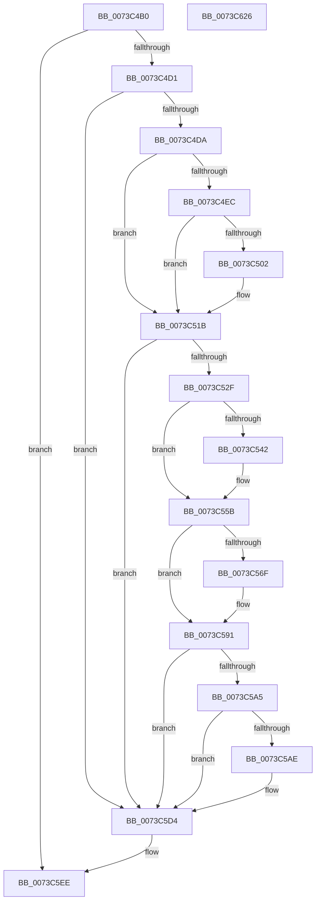

# PipDmgRequestUpdateConsoleLockState

- RVA: `0x0073C4B0`–`0x0073C627` (길이 `375` bytes)
- VA: `0x000000014073C4B0`
- 실행 섹션: `PAGE`
- PDB 이름 있음: `예`; PDB Function 태그: `아니요`
- unwind 정보 RVA: `0x0008A4C8`
- 디코드: `92`개 명령, `375/375` bytes 표시
- 미해석 바이트: `0` (있으면 어셈블리에 `.byte`로 보존)

> 이 문서는 커널 이미지의 기계어와 PDB 기호를 분석해 생성했습니다. 4번과 5번은 함수 원형과 자료형을 바이너리 사용 방식에서 추정한 C 해석이며 원본 소스 복구 결과는 아닙니다.

## 1. Dependencies

- 직접 호출 지점: **13**; 고유 호출 대상: **3**
- 직접 호출자로 확인된 함수: **1**
- RIP 상대 이미지 참조: **1**

### Outgoing calls
- `0x0073C4DE` → [IoAddTriageDumpDataBlock](../../text/42/IoAddTriageDumpDataBlock_function_00428374.md) (function, `0x00428374`)
- `0x0073C4F0` → [IoAddTriageDumpDataBlock](../../text/42/IoAddTriageDumpDataBlock_function_00428374.md) (function, `0x00428374`)
- `0x0073C505` → [IoAddTriageDumpDataBlock](../../text/42/IoAddTriageDumpDataBlock_function_00428374.md) (function, `0x00428374`)
- `0x0073C516` → [IoAddTriageDumpDataBlock](../../text/42/IoAddTriageDumpDataBlock_function_00428374.md) (function, `0x00428374`)
- `0x0073C538` → [IoAddTriageDumpDataBlock](../../text/42/IoAddTriageDumpDataBlock_function_00428374.md) (function, `0x00428374`)
- `0x0073C54A` → [IoAddTriageDumpDataBlock](../../text/42/IoAddTriageDumpDataBlock_function_00428374.md) (function, `0x00428374`)
- `0x0073C556` → [IoAddTriageDumpDataBlock](../../text/42/IoAddTriageDumpDataBlock_function_00428374.md) (function, `0x00428374`)
- `0x0073C574` → [IoAddTriageDumpDataBlock](../../text/42/IoAddTriageDumpDataBlock_function_00428374.md) (function, `0x00428374`)
- `0x0073C58C` → [IoAddTriageDumpDataBlock](../../text/42/IoAddTriageDumpDataBlock_function_00428374.md) (function, `0x00428374`)
- `0x0073C5B3` → [IoAddTriageDumpDataBlock](../../text/42/IoAddTriageDumpDataBlock_function_00428374.md) (function, `0x00428374`)
- `0x0073C5CF` → [IoAddTriageDumpDataBlock](../../text/42/IoAddTriageDumpDataBlock_function_00428374.md) (function, `0x00428374`)
- `0x0073C5E8` → [KeBugCheckEx](../../text/4F/KeBugCheckEx_function_004FD660.md) (function, `0x004FD660`)
- `0x0073C611` → [PnpRequestDeviceAction](../../text/47/PnpRequestDeviceAction_function_00477FF8.md) (function, `0x00477FF8`)

### Direct callers
- [PipDmgFlushQueueAndRestartDevices](PipDmgFlushQueueAndRestartDevices_function_0073BF9C.md) at `0x0073C000`

### Static image references
- `0x0073C4C4` → RVA `0x00F8A9AC` (`.data`; read)

## 2. Other-region calls and transfers

- 다른 실행 섹션으로 향하는 call: **13**
  - `0x0073C4DE` → [IoAddTriageDumpDataBlock](../../text/42/IoAddTriageDumpDataBlock_function_00428374.md) (`PAGE` → `.text`)
  - `0x0073C4F0` → [IoAddTriageDumpDataBlock](../../text/42/IoAddTriageDumpDataBlock_function_00428374.md) (`PAGE` → `.text`)
  - `0x0073C505` → [IoAddTriageDumpDataBlock](../../text/42/IoAddTriageDumpDataBlock_function_00428374.md) (`PAGE` → `.text`)
  - `0x0073C516` → [IoAddTriageDumpDataBlock](../../text/42/IoAddTriageDumpDataBlock_function_00428374.md) (`PAGE` → `.text`)
  - `0x0073C538` → [IoAddTriageDumpDataBlock](../../text/42/IoAddTriageDumpDataBlock_function_00428374.md) (`PAGE` → `.text`)
  - `0x0073C54A` → [IoAddTriageDumpDataBlock](../../text/42/IoAddTriageDumpDataBlock_function_00428374.md) (`PAGE` → `.text`)
  - `0x0073C556` → [IoAddTriageDumpDataBlock](../../text/42/IoAddTriageDumpDataBlock_function_00428374.md) (`PAGE` → `.text`)
  - `0x0073C574` → [IoAddTriageDumpDataBlock](../../text/42/IoAddTriageDumpDataBlock_function_00428374.md) (`PAGE` → `.text`)
  - `0x0073C58C` → [IoAddTriageDumpDataBlock](../../text/42/IoAddTriageDumpDataBlock_function_00428374.md) (`PAGE` → `.text`)
  - `0x0073C5B3` → [IoAddTriageDumpDataBlock](../../text/42/IoAddTriageDumpDataBlock_function_00428374.md) (`PAGE` → `.text`)
  - `0x0073C5CF` → [IoAddTriageDumpDataBlock](../../text/42/IoAddTriageDumpDataBlock_function_00428374.md) (`PAGE` → `.text`)
  - `0x0073C5E8` → [KeBugCheckEx](../../text/4F/KeBugCheckEx_function_004FD660.md) (`PAGE` → `.text`)
  - `0x0073C611` → [PnpRequestDeviceAction](../../text/47/PnpRequestDeviceAction_function_00477FF8.md) (`PAGE` → `.text`)
- 별도 외부 분기/꼬리 이동을 확인하지 못했습니다.

## 3. Assembly (complete function range)

```asm
0073C4B0  48 89 5C 24 08                  mov qword ptr [rsp + 8], rbx
0073C4B5  48 89 74 24 10                  mov qword ptr [rsp + 0x10], rsi
0073C4BA  57                              push rdi
0073C4BB  48 83 EC 50                     sub rsp, 0x50
0073C4BF  33 DB                           xor ebx, ebx
0073C4C1  48 8B F9                        mov rdi, rcx
0073C4C4  83 3D E1 E4 84 00 03            cmp dword ptr [rip + 0x84e4e1], 3
0073C4CB  0F 85 1D 01 00 00               jne 0x14073c5ee
0073C4D1  48 85 C9                        test rcx, rcx
0073C4D4  0F 84 FA 00 00 00               je 0x14073c5d4
0073C4DA  0F B7 51 02                     movzx edx, word ptr [rcx + 2]
0073C4DE  E8 91 BE CE FF                  call 0x140428374
0073C4E3  48 8B 4F 08                     mov rcx, qword ptr [rdi + 8]
0073C4E7  48 85 C9                        test rcx, rcx
0073C4EA  74 2F                           je 0x14073c51b
0073C4EC  0F BF 51 02                     movsx edx, word ptr [rcx + 2]
0073C4F0  E8 7F BE CE FF                  call 0x140428374
0073C4F5  48 8B 4F 08                     mov rcx, qword ptr [rdi + 8]
0073C4F9  48 83 C1 38                     add rcx, 0x38
0073C4FD  66 39 19                        cmp word ptr [rcx], bx
0073C500  74 19                           je 0x14073c51b
0073C502  8D 53 02                        lea edx, [rbx + 2]
0073C505  E8 6A BE CE FF                  call 0x140428374
0073C50A  48 8B 4F 08                     mov rcx, qword ptr [rdi + 8]
0073C50E  0F B7 51 38                     movzx edx, word ptr [rcx + 0x38]
0073C512  48 8B 49 40                     mov rcx, qword ptr [rcx + 0x40]
0073C516  E8 59 BE CE FF                  call 0x140428374
0073C51B  48 8B 87 38 01 00 00            mov rax, qword ptr [rdi + 0x138]
0073C522  48 8B 48 28                     mov rcx, qword ptr [rax + 0x28]
0073C526  48 85 C9                        test rcx, rcx
0073C529  0F 84 A5 00 00 00               je 0x14073c5d4
0073C52F  BA 88 03 00 00                  mov edx, 0x388
0073C534  48 8D 71 28                     lea rsi, [rcx + 0x28]
0073C538  E8 37 BE CE FF                  call 0x140428374
0073C53D  66 39 1E                        cmp word ptr [rsi], bx
0073C540  74 19                           je 0x14073c55b
0073C542  BA 02 00 00 00                  mov edx, 2
0073C547  48 8B CE                        mov rcx, rsi
0073C54A  E8 25 BE CE FF                  call 0x140428374
0073C54F  0F B7 16                        movzx edx, word ptr [rsi]
0073C552  48 8B 4E 08                     mov rcx, qword ptr [rsi + 8]
0073C556  E8 19 BE CE FF                  call 0x140428374
0073C55B  48 8B 87 38 01 00 00            mov rax, qword ptr [rdi + 0x138]
0073C562  48 8B 48 28                     mov rcx, qword ptr [rax + 0x28]
0073C566  48 83 C1 38                     add rcx, 0x38
0073C56A  66 39 19                        cmp word ptr [rcx], bx
0073C56D  74 22                           je 0x14073c591
0073C56F  BA 02 00 00 00                  mov edx, 2
0073C574  E8 FB BD CE FF                  call 0x140428374
0073C579  48 8B 87 38 01 00 00            mov rax, qword ptr [rdi + 0x138]
0073C580  48 8B 48 28                     mov rcx, qword ptr [rax + 0x28]
0073C584  0F B7 51 38                     movzx edx, word ptr [rcx + 0x38]
0073C588  48 8B 49 40                     mov rcx, qword ptr [rcx + 0x40]
0073C58C  E8 E3 BD CE FF                  call 0x140428374
0073C591  48 8B 87 38 01 00 00            mov rax, qword ptr [rdi + 0x138]
0073C598  48 8B 48 28                     mov rcx, qword ptr [rax + 0x28]
0073C59C  48 8B 41 10                     mov rax, qword ptr [rcx + 0x10]
0073C5A0  48 85 C0                        test rax, rax
0073C5A3  74 2F                           je 0x14073c5d4
0073C5A5  48 8D 48 38                     lea rcx, [rax + 0x38]
0073C5A9  66 39 19                        cmp word ptr [rcx], bx
0073C5AC  74 26                           je 0x14073c5d4
0073C5AE  BA 02 00 00 00                  mov edx, 2
0073C5B3  E8 BC BD CE FF                  call 0x140428374
0073C5B8  48 8B 87 38 01 00 00            mov rax, qword ptr [rdi + 0x138]
0073C5BF  48 8B 48 28                     mov rcx, qword ptr [rax + 0x28]
0073C5C3  48 8B 49 10                     mov rcx, qword ptr [rcx + 0x10]
0073C5C7  0F B7 51 38                     movzx edx, word ptr [rcx + 0x38]
0073C5CB  48 8B 49 40                     mov rcx, qword ptr [rcx + 0x40]
0073C5CF  E8 A0 BD CE FF                  call 0x140428374
0073C5D4  45 33 C9                        xor r9d, r9d
0073C5D7  48 89 5C 24 20                  mov qword ptr [rsp + 0x20], rbx
0073C5DC  4C 8B C7                        mov r8, rdi
0073C5DF  B9 CA 00 00 00                  mov ecx, 0xca
0073C5E4  41 8D 51 11                     lea edx, [r9 + 0x11]
0073C5E8  E8 73 10 DC FF                  call 0x1404fd660
0073C5ED  CC                              int3
0073C5EE  45 33 C0                        xor r8d, r8d
0073C5F1  48 89 5C 24 30                  mov qword ptr [rsp + 0x30], rbx
0073C5F6  0F 57 C0                        xorps xmm0, xmm0
0073C5F9  48 89 5C 24 28                  mov qword ptr [rsp + 0x28], rbx
0073C5FE  4C 8D 4C 24 40                  lea r9, [rsp + 0x40]
0073C603  48 89 5C 24 20                  mov qword ptr [rsp + 0x20], rbx
0073C608  0F 11 44 24 40                  movups xmmword ptr [rsp + 0x40], xmm0
0073C60D  41 8D 50 1B                     lea edx, [r8 + 0x1b]
0073C611  E8 E2 B9 D3 FF                  call 0x140477ff8
0073C616  48 8B 5C 24 60                  mov rbx, qword ptr [rsp + 0x60]
0073C61B  48 8B 74 24 68                  mov rsi, qword ptr [rsp + 0x68]
0073C620  48 83 C4 50                     add rsp, 0x50
0073C624  5F                              pop rdi
0073C625  C3                              ret
0073C626  CC                              int3
```

## 4. C-style interpretation (structured pseudocode)

```c
__int64 __fastcall PipDmgRequestUpdateConsoleLockState(__int64 a1, __int64 a2, __int64 a3, int a4)
{
    __int64 result;
    __int64 v_rbx;
    __int64 v_rsp;
    unsigned __int64 v_stack_m18;
    unsigned __int64 v_stack_m28;
    unsigned __int64 v_stack_m30;
    unsigned __int64 v_stack_m38;
    unsigned __int64 v_stack_p10;
    unsigned __int64 v_stack_p8;

    v_stack_p8 = v_rbx;
    v_stack_p10 = v_rsi;
    v_rsp = (v_rsp) - (80);
    v_rbx = 0;
    if ((*(unsigned int *)(v_rip + 8709345)) != 3) goto loc_0073C5EE;
    if (a1 == 0) goto loc_0073C5D4;
    result = IoAddTriageDumpDataBlock(a1, *(unsigned __int16 *)(a1 + 2), a3, a4);
    if (*(unsigned __int64 *)(a1 + 8) == 0) goto loc_0073C51B;
    result = IoAddTriageDumpDataBlock(*(unsigned __int64 *)(a1 + 8), (__int16)(*(unsigned __int16 *)(*(unsigned __int64 *)(a1 + 8) + 2)), a3, a4);
    a1 = (*(unsigned __int64 *)(a1 + 8)) + (56);
    if ((*(unsigned __int16 *)(a1)) != 0) {
        a2 = v_rbx + 2;
        result = IoAddTriageDumpDataBlock(a1, a2, a3, a4);
        a1 = *(unsigned __int64 *)(a1 + 8);
        a2 = *(unsigned __int16 *)(a1 + 56);
        a1 = *(unsigned __int64 *)(a1 + 64);
        result = IoAddTriageDumpDataBlock(a1, a2, a3, a4);
    }
    if (*(unsigned __int64 *)(*(unsigned __int64 *)(a1 + 312) + 40) == 0) goto loc_0073C5D4;
    result = IoAddTriageDumpDataBlock(*(unsigned __int64 *)(*(unsigned __int64 *)(a1 + 312) + 40), 904, a3, a4);
    if ((*(unsigned __int16 *)(*(unsigned __int64 *)(*(unsigned __int64 *)(a1 + 312) + 40) + 40)) != 0) {
        a2 = 2;
        a1 = *(unsigned __int64 *)(*(unsigned __int64 *)(a1 + 312) + 40) + 40;
        result = IoAddTriageDumpDataBlock(a1, a2, a3, a4);
        a2 = *(unsigned __int16 *)(*(unsigned __int64 *)(*(unsigned __int64 *)(a1 + 312) + 40) + 40);
        a1 = *(unsigned __int64 *)(*(unsigned __int64 *)(*(unsigned __int64 *)(a1 + 312) + 40) + 40 + 8);
        result = IoAddTriageDumpDataBlock(a1, a2, a3, a4);
    }
    a1 = (*(unsigned __int64 *)(*(unsigned __int64 *)(a1 + 312) + 40)) + (56);
    result = *(unsigned __int64 *)(a1 + 312);
    if ((*(unsigned __int16 *)(a1)) != 0) {
        a2 = 2;
        result = IoAddTriageDumpDataBlock(a1, a2, a3, a4);
        result = *(unsigned __int64 *)(a1 + 312);
        a1 = *(unsigned __int64 *)(result + 40);
        a2 = *(unsigned __int16 *)(a1 + 56);
        a1 = *(unsigned __int64 *)(a1 + 64);
        result = IoAddTriageDumpDataBlock(a1, a2, a3, a4);
    }
    if (*(unsigned __int64 *)(*(unsigned __int64 *)(*(unsigned __int64 *)(a1 + 312) + 40) + 16) == 0) goto loc_0073C5D4;
    result = *(unsigned __int64 *)(*(unsigned __int64 *)(*(unsigned __int64 *)(a1 + 312) + 40) + 16);
    if ((*(unsigned __int16 *)(*(unsigned __int64 *)(*(unsigned __int64 *)(*(unsigned __int64 *)(a1 + 312) + 40) + 16) + 56)) != 0) {
        a2 = 2;
        result = IoAddTriageDumpDataBlock(*(unsigned __int64 *)(*(unsigned __int64 *)(*(unsigned __int64 *)(a1 + 312) + 40) + 16) + 56, a2, a3, a4);
        result = *(unsigned __int64 *)(a1 + 312);
        a1 = *(unsigned __int64 *)(result + 40);
        a1 = *(unsigned __int64 *)(a1 + 16);
        a2 = *(unsigned __int16 *)(a1 + 56);
        a1 = *(unsigned __int64 *)(a1 + 64);
        result = IoAddTriageDumpDataBlock(a1, a2, a3, a4);
    }
    a4 = 0;
    v_stack_m38 = 0;
    result = KeBugCheckEx(202, a4 + 17, a1, a4);
loc_0073C5EE:
    a3 = 0;
    v_stack_m28 = 0;
    v_stack_m30 = 0;
    v_stack_m38 = 0;
    v_stack_m18 = v_xmm0;
    result = PnpRequestDeviceAction(202, a3 + 27, a3, v_stack_m18);
    v_rsp = (v_rsp) + (80);
    return result;
}
```

## 5. (Beta) C Style

```c
int64_t PipDmgRequestUpdateConsoleLockState(void *Arg1, int64_t Arg2, int64_t Arg3, int32_t Arg4)
{
    uint8_t *arg1 = (uint8_t *)Arg1;

    int64_t result;
    int64_t local_rbx;
    int64_t local_rsp;
    uint64_t v_stack_m18;
    uint64_t v_stack_m28;
    uint64_t v_stack_m30;
    uint64_t v_stack_m38;
    uint64_t v_stack_p10;
    uint64_t v_stack_p8;

    v_stack_p8 = local_rbx;
    v_stack_p10 = local_rsi;
    local_rsp = (local_rsp) - (80);
    local_rbx = 0;
    if ((*(uint32_t *)(v_rip + 0x84E4E1)) != 3) goto loc_0073C5EE;
    if (Arg1 == NULL) goto loc_0073C5D4;
    result = IoAddTriageDumpDataBlock(Arg1, *(uint16_t *)(arg1 + 0x2), Arg3, Arg4);
    if (*(uint64_t *)(arg1 + 0x8) == 0) goto loc_0073C51B;
    result = IoAddTriageDumpDataBlock(*(uint64_t *)(arg1 + 0x8), (int16_t)(*(uint16_t *)(*(uint64_t *)(arg1 + 0x8) + 0x2)), Arg3, Arg4);
    Arg1 = (*(uint64_t *)(arg1 + 0x8)) + (56);
    if ((*(uint16_t *)(arg1)) != 0) {
        Arg2 = local_rbx + 2;
        result = IoAddTriageDumpDataBlock(Arg1, Arg2, Arg3, Arg4);
        Arg1 = *(uint64_t *)(arg1 + 0x8);
        Arg2 = *(uint16_t *)(arg1 + 0x38);
        Arg1 = *(uint64_t *)(arg1 + 0x40);
        result = IoAddTriageDumpDataBlock(Arg1, Arg2, Arg3, Arg4);
    }
    if (*(uint64_t *)(*(uint64_t *)(arg1 + 0x138) + 0x28) == 0) goto loc_0073C5D4;
    result = IoAddTriageDumpDataBlock(*(uint64_t *)(*(uint64_t *)(arg1 + 0x138) + 0x28), 904, Arg3, Arg4);
    if ((*(uint16_t *)(*(uint64_t *)(*(uint64_t *)(arg1 + 0x138) + 0x28) + 0x28)) != 0) {
        Arg2 = 2;
        Arg1 = *(uint64_t *)(*(uint64_t *)(arg1 + 0x138) + 0x28) + 40;
        result = IoAddTriageDumpDataBlock(Arg1, Arg2, Arg3, Arg4);
        Arg2 = *(uint16_t *)(*(uint64_t *)(*(uint64_t *)(arg1 + 0x138) + 0x28) + 0x28);
        Arg1 = *(uint64_t *)(*(uint64_t *)(*(uint64_t *)(arg1 + 0x138) + 0x28) + 0x28 + 0x8);
        result = IoAddTriageDumpDataBlock(Arg1, Arg2, Arg3, Arg4);
    }
    Arg1 = (*(uint64_t *)(*(uint64_t *)(arg1 + 0x138) + 0x28)) + (56);
    result = *(uint64_t *)(arg1 + 0x138);
    if ((*(uint16_t *)(arg1)) != 0) {
        Arg2 = 2;
        result = IoAddTriageDumpDataBlock(Arg1, Arg2, Arg3, Arg4);
        result = *(uint64_t *)(arg1 + 0x138);
        Arg1 = *(uint64_t *)(result + 0x28);
        Arg2 = *(uint16_t *)(arg1 + 0x38);
        Arg1 = *(uint64_t *)(arg1 + 0x40);
        result = IoAddTriageDumpDataBlock(Arg1, Arg2, Arg3, Arg4);
    }
    if (*(uint64_t *)(*(uint64_t *)(*(uint64_t *)(arg1 + 0x138) + 0x28) + 0x10) == 0) goto loc_0073C5D4;
    result = *(uint64_t *)(*(uint64_t *)(*(uint64_t *)(arg1 + 0x138) + 0x28) + 0x10);
    if ((*(uint16_t *)(*(uint64_t *)(*(uint64_t *)(*(uint64_t *)(arg1 + 0x138) + 0x28) + 0x10) + 0x38)) != 0) {
        Arg2 = 2;
        result = IoAddTriageDumpDataBlock(*(uint64_t *)(*(uint64_t *)(*(uint64_t *)(arg1 + 0x138) + 0x28) + 0x10) + 56, Arg2, Arg3, Arg4);
        result = *(uint64_t *)(arg1 + 0x138);
        Arg1 = *(uint64_t *)(result + 0x28);
        Arg1 = *(uint64_t *)(arg1 + 0x10);
        Arg2 = *(uint16_t *)(arg1 + 0x38);
        Arg1 = *(uint64_t *)(arg1 + 0x40);
        result = IoAddTriageDumpDataBlock(Arg1, Arg2, Arg3, Arg4);
    }
    Arg4 = 0;
    v_stack_m38 = 0;
    result = KeBugCheckEx(202, Arg4 + 17, Arg1, Arg4);
loc_0073C5EE:
    Arg3 = 0;
    v_stack_m28 = 0;
    v_stack_m30 = 0;
    v_stack_m38 = 0;
    v_stack_m18 = v_xmm0;
    result = PnpRequestDeviceAction(202, Arg3 + 27, Arg3, v_stack_m18);
    local_rsp = (local_rsp) + (80);
    return result;
}
```

### 관측된 메모리 오프셋

구조체 형식이 확인되지 않은 접근은 인자 기준의 오프셋으로만 기록했습니다.

| 기준 인자 | 오프셋 표현 | 폭 (bit) | 접근 |
|---|---:|---:|---|
| `Arg1` | `+ 0x8` | `64` | `R` |
| `Arg1` | `+ 0x138` | `64` | `R` |

## 6. Execution-region graph

[열기: 2D/3D 그래프와 함수 탐색 컨트롤 패널](../../../control-panel.html?section=page&rva=0x0073C4B0&view=graph)

- 2D 그래프는 위에서 아래로 흐르고, 3D 그래프는 빈 공간을 드래그해 회전합니다. Shift+드래그는 이동, 휠은 확대·축소, 함수 노드 선택은 대상 보고서 이동입니다.

### Static fallback


