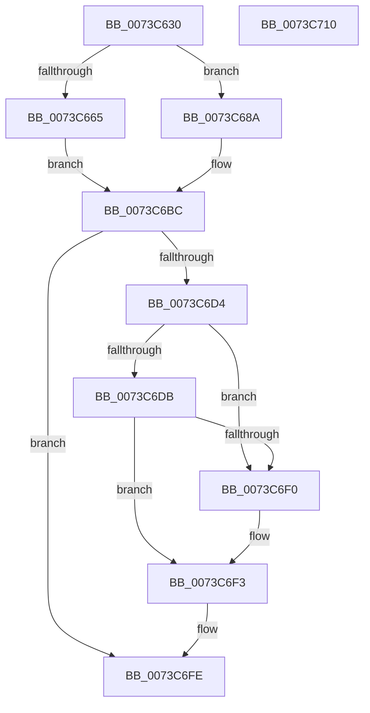

# PipDmgSaveDeviceDmarPolicy

- RVA: `0x0073C630`–`0x0073C711` (길이 `225` bytes)
- VA: `0x000000014073C630`
- 실행 섹션: `PAGE`
- PDB 이름 있음: `예`; PDB Function 태그: `아니요`
- unwind 정보 RVA: `0x000C3968`
- 디코드: `60`개 명령, `225/225` bytes 표시
- 미해석 바이트: `0` (있으면 어셈블리에 `.byte`로 보존)

> 이 문서는 커널 이미지의 기계어와 PDB 기호를 분석해 생성했습니다. 4번과 5번은 함수 원형과 자료형을 바이너리 사용 방식에서 추정한 C 해석이며 원본 소스 복구 결과는 아닙니다.

## 1. Dependencies

- 직접 호출 지점: **4**; 고유 호출 대상: **3**
- 직접 호출자로 확인된 함수: **1**
- RIP 상대 이미지 참조: **3**

### Outgoing calls
- `0x0073C683` → [PnpSetObjectProperty](../8F/PnpSetObjectProperty_function_008F66E8.md) (function, `0x008F66E8`)
- `0x0073C6B5` → [PnpSetObjectProperty](../8F/PnpSetObjectProperty_function_008F66E8.md) (function, `0x008F66E8`)
- `0x0073C6C3` → [PnpTraceDmaGuardDevicePolicy](../AD/PnpTraceDmaGuardDevicePolicy_function_00AD1A38.md) (function, `0x00AD1A38`)
- `0x0073C6E7` → [guard_dispatch_icall](../../text/6B/guard_dispatch_icall_function_006BAAD0.md) (function, `0x006BAAD0`)

### Direct callers
- [PiDmaGuardProcessPreAddDevice](../A2/PiDmaGuardProcessPreAddDevice_function_00A27B50.md) at `0x00A27BED`

### Static image references
- `0x0073C656` → RVA `0x00E66398` (`.data`; read)
- `0x0073C672` → RVA `0x00022A50` (`.rdata`; read)
- `0x0073C6DB` → RVA `0x00E00C98` (`.data`; read)

## 2. Other-region calls and transfers

- 다른 실행 섹션으로 향하는 call: **1**
  - `0x0073C6E7` → [guard_dispatch_icall](../../text/6B/guard_dispatch_icall_function_006BAAD0.md) (`PAGE` → `.text`)
- 별도 외부 분기/꼬리 이동을 확인하지 못했습니다.

## 3. Assembly (complete function range)

```asm
0073C630  48 8B C4                        mov rax, rsp
0073C633  48 89 58 08                     mov qword ptr [rax + 8], rbx
0073C637  48 89 70 10                     mov qword ptr [rax + 0x10], rsi
0073C63B  44 89 40 18                     mov dword ptr [rax + 0x18], r8d
0073C63F  57                              push rdi
0073C640  48 83 EC 50                     sub rsp, 0x50
0073C644  33 F6                           xor esi, esi
0073C646  4C 8B CA                        mov r9, rdx
0073C649  21 70 F0                        and dword ptr [rax - 0x10], esi
0073C64C  48 8B D9                        mov rbx, rcx
0073C64F  48 8B 51 30                     mov rdx, qword ptr [rcx + 0x30]
0073C653  45 85 C0                        test r8d, r8d
0073C656  48 8B 0D 3B 9D 72 00            mov rcx, qword ptr [rip + 0x729d3b]
0073C65D  8D 7E 01                        lea edi, [rsi + 1]
0073C660  44 8B C7                        mov r8d, edi
0073C663  75 25                           jne 0x14073c68a
0073C665  21 70 E8                        and dword ptr [rax - 0x18], esi
0073C668  45 33 C9                        xor r9d, r9d
0073C66B  48 21 70 E0                     and qword ptr [rax - 0x20], rsi
0073C66F  21 70 D8                        and dword ptr [rax - 0x28], esi
0073C672  48 8D 05 D7 63 8E FF            lea rax, [rip - 0x719c29]
0073C679  48 89 44 24 28                  mov qword ptr [rsp + 0x28], rax
0073C67E  48 21 74 24 20                  and qword ptr [rsp + 0x20], rsi
0073C683  E8 60 A0 1B 00                  call 0x1408f66e8
0073C688  EB 32                           jmp 0x14073c6bc
0073C68A  C7 44 24 40 04 00 00 00         mov dword ptr [rsp + 0x40], 4
0073C692  48 8D 44 24 70                  lea rax, [rsp + 0x70]
0073C697  48 89 44 24 38                  mov qword ptr [rsp + 0x38], rax
0073C69C  48 8D 05 AD 63 8E FF            lea rax, [rip - 0x719c53]
0073C6A3  C7 44 24 30 07 00 00 00         mov dword ptr [rsp + 0x30], 7
0073C6AB  48 89 44 24 28                  mov qword ptr [rsp + 0x28], rax
0073C6B0  48 21 74 24 20                  and qword ptr [rsp + 0x20], rsi
0073C6B5  E8 2E A0 1B 00                  call 0x1408f66e8
0073C6BA  8B F0                           mov esi, eax
0073C6BC  8B 54 24 70                     mov edx, dword ptr [rsp + 0x70]
0073C6C0  48 8B CB                        mov rcx, rbx
0073C6C3  E8 70 53 39 00                  call 0x140ad1a38
0073C6C8  48 8B 9B D0 02 00 00            mov rbx, qword ptr [rbx + 0x2d0]
0073C6CF  48 85 DB                        test rbx, rbx
0073C6D2  74 2A                           je 0x14073c6fe
0073C6D4  83 7C 24 70 02                  cmp dword ptr [rsp + 0x70], 2
0073C6D9  75 15                           jne 0x14073c6f0
0073C6DB  48 8B 05 B6 45 6C 00            mov rax, qword ptr [rip + 0x6c45b6]
0073C6E2  33 D2                           xor edx, edx
0073C6E4  48 8B 0B                        mov rcx, qword ptr [rbx]
0073C6E7  E8 E4 E3 F7 FF                  call 0x1406baad0
0073C6EC  84 C0                           test al, al
0073C6EE  75 03                           jne 0x14073c6f3
0073C6F0  40 32 FF                        xor dil, dil
0073C6F3  8A 43 10                        mov al, byte ptr [rbx + 0x10]
0073C6F6  24 FE                           and al, 0xfe
0073C6F8  40 0A C7                        or al, dil
0073C6FB  88 43 10                        mov byte ptr [rbx + 0x10], al
0073C6FE  48 8B 5C 24 60                  mov rbx, qword ptr [rsp + 0x60]
0073C703  8B C6                           mov eax, esi
0073C705  48 8B 74 24 68                  mov rsi, qword ptr [rsp + 0x68]
0073C70A  48 83 C4 50                     add rsp, 0x50
0073C70E  5F                              pop rdi
0073C70F  C3                              ret
0073C710  CC                              int3
```

## 4. C-style interpretation (structured pseudocode)

```c
__int64 __fastcall PipDmgSaveDeviceDmarPolicy(__int64 a1, __int64 a2, int a3)
{
    __int64 result;
    __int64 v_rdi;
    __int64 v_rsi;
    __int64 v_rsp;
    unsigned int v_stack_m18;
    unsigned __int64 v_stack_m20;
    unsigned int v_stack_m28;
    unsigned __int64 v_stack_m30;
    unsigned __int64 v_stack_m38;
    unsigned __int64 v_stack_p10;
    unsigned __int64 v_stack_p18;
    unsigned __int64 v_stack_p8;

    *(unsigned __int64 *)(v_rsp + 8) = v_rbx;
    *(unsigned __int64 *)(v_rsp + 16) = v_rsi;
    *(unsigned int *)(v_rsp + 24) = a3;
    v_rsp = (v_rsp) - (80);
    v_rsi = 0;
    if (a3 != 0) goto loc_0073C68A;
    a4 = 0;
    v_stack_m30 = v_rip - 7445545;
    result = PnpSetObjectProperty(*(unsigned __int64 *)(v_rip + 7511355), *(unsigned __int64 *)(a1 + 48), (unsigned int)((unsigned int)(v_rsi + 1)), a4);
    goto loc_0073C6BC;
loc_0073C68A:
    v_stack_m18 = 4;
    v_stack_m20 = v_stack_p18;
    v_stack_m28 = 7;
    v_stack_m30 = v_rip - 7445587;
    result = PnpSetObjectProperty(*(unsigned __int64 *)(v_rip + 7511355), *(unsigned __int64 *)(a1 + 48), (unsigned int)((unsigned int)(v_rsi + 1)), a4);
loc_0073C6BC:
    result = PnpTraceDmaGuardDevicePolicy(a1, (unsigned int)(v_stack_p18), (unsigned int)((unsigned int)(v_rsi + 1)), a4);
    if (*(unsigned __int64 *)(a1 + 720) == 0) goto loc_0073C6FE;
    if (v_stack_p18 != 2) goto loc_0073C6F0;
    a2 = 0;
    result = guard_dispatch_icall(*(unsigned __int64 *)(*(unsigned __int64 *)(a1 + 720)), a2, (unsigned int)((unsigned int)(v_rsi + 1)), a4);
    v_rdi = v_rsi + 1;
    if ((unsigned __int8)(result) == 0) {
        v_rdi = 0;
    }
    result = (unsigned __int8)((*(unsigned __int8 *)(*(unsigned __int64 *)(a1 + 720) + 16)) & (254));
    result = (unsigned __int8)((result) | (0));
    *(unsigned __int8 *)(*(unsigned __int64 *)(a1 + 720) + 16) = (unsigned __int8)(result);
loc_0073C6FE:
    v_rsp = (v_rsp) + (80);
    return (unsigned int)((unsigned int)((unsigned int)((unsigned int)(result))));
}
```

## 5. (Beta) C Style

```c
int64_t PipDmgSaveDeviceDmarPolicy(void *Arg1, int64_t Arg2, int32_t Arg3)
{
    uint8_t *arg1 = (uint8_t *)Arg1;

    int64_t result;
    int64_t local_rdi;
    int64_t local_rsi;
    int64_t local_rsp;
    uint32_t v_stack_m18;
    uint64_t v_stack_m20;
    uint32_t v_stack_m28;
    uint64_t v_stack_m30;
    uint64_t v_stack_m38;
    uint64_t v_stack_p10;
    uint64_t v_stack_p18;
    uint64_t v_stack_p8;

    *(uint64_t *)(local_rsp + 0x8) = local_rbx;
    *(uint64_t *)(local_rsp + 0x10) = local_rsi;
    *(uint32_t *)(local_rsp + 0x18) = Arg3;
    local_rsp = (local_rsp) - (80);
    local_rsi = 0;
    if (Arg3 != 0) goto loc_0073C68A;
    a4 = 0;
    v_stack_m30 = v_rip - 7445545;
    result = PnpSetObjectProperty(*(uint64_t *)(v_rip + 0x729D3B), *(uint64_t *)(arg1 + 0x30), (uint32_t)((uint32_t)(local_rsi + 1)), a4);
    goto loc_0073C6BC;
loc_0073C68A:
    v_stack_m18 = 4;
    v_stack_m20 = v_stack_p18;
    v_stack_m28 = 7;
    v_stack_m30 = v_rip - 7445587;
    result = PnpSetObjectProperty(*(uint64_t *)(v_rip + 0x729D3B), *(uint64_t *)(arg1 + 0x30), (uint32_t)((uint32_t)(local_rsi + 1)), a4);
loc_0073C6BC:
    result = PnpTraceDmaGuardDevicePolicy(Arg1, (uint32_t)(v_stack_p18), (uint32_t)((uint32_t)(local_rsi + 1)), a4);
    if (*(uint64_t *)(arg1 + 0x2D0) == 0) goto loc_0073C6FE;
    if (v_stack_p18 != 2) goto loc_0073C6F0;
    Arg2 = 0;
    result = guard_dispatch_icall(*(uint64_t *)(*(uint64_t *)(arg1 + 0x2D0)), Arg2, (uint32_t)((uint32_t)(local_rsi + 1)), a4);
    local_rdi = local_rsi + 1;
    if ((uint8_t)(result) == 0) {
        local_rdi = 0;
    }
    result = (uint8_t)((*(uint8_t *)(*(uint64_t *)(arg1 + 0x2D0) + 0x10)) & (254));
    result = (uint8_t)((result) | (0));
    *(uint8_t *)(*(uint64_t *)(arg1 + 0x2D0) + 0x10) = (uint8_t)(result);
loc_0073C6FE:
    local_rsp = (local_rsp) + (80);
    return (uint32_t)((uint32_t)((uint32_t)((uint32_t)(result))));
}
```

### 관측된 메모리 오프셋

구조체 형식이 확인되지 않은 접근은 인자 기준의 오프셋으로만 기록했습니다.

| 기준 인자 | 오프셋 표현 | 폭 (bit) | 접근 |
|---|---:|---:|---|
| `Arg1` | `+ 0x30` | `64` | `R` |
| `Arg1` | `+ 0x2D0` | `64` | `R` |

## 6. Execution-region graph

[열기: 2D/3D 그래프와 함수 탐색 컨트롤 패널](../../../control-panel.html?section=page&rva=0x0073C630&view=graph)

- 2D 그래프는 위에서 아래로 흐르고, 3D 그래프는 빈 공간을 드래그해 회전합니다. Shift+드래그는 이동, 휠은 확대·축소, 함수 노드 선택은 대상 보고서 이동입니다.

### Static fallback


