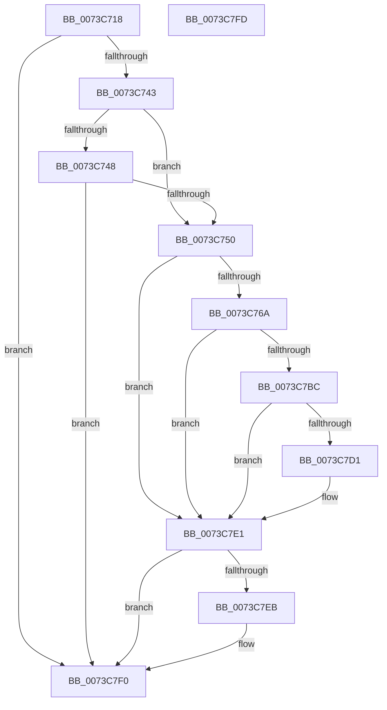

# PipDmgSetIommuDomainPolicyAndNotifyHal

- RVA: `0x0073C718`–`0x0073C7FE` (길이 `230` bytes)
- VA: `0x000000014073C718`
- 실행 섹션: `PAGE`
- PDB 이름 있음: `예`; PDB Function 태그: `아니요`
- unwind 정보 RVA: `0x000C8FE0`
- 디코드: `56`개 명령, `230/230` bytes 표시
- 미해석 바이트: `0` (있으면 어셈블리에 `.byte`로 보존)

> 이 문서는 커널 이미지의 기계어와 PDB 기호를 분석해 생성했습니다. 4번과 5번은 함수 원형과 자료형을 바이너리 사용 방식에서 추정한 C 해석이며 원본 소스 복구 결과는 아닙니다.

## 1. Dependencies

- 직접 호출 지점: **4**; 고유 호출 대상: **4**
- 직접 호출자로 확인된 함수: **2**
- RIP 상대 이미지 참조: **3**

### Outgoing calls
- `0x0073C75F` → [PnpDeviceObjectToDeviceInstance](../8F/PnpDeviceObjectToDeviceInstance_function_008FD630.md) (function, `0x008FD630`)
- `0x0073C7B1` → [PnpSetObjectProperty](../8F/PnpSetObjectProperty_function_008F66E8.md) (function, `0x008F66E8`)
- `0x0073C7DC` → [guard_dispatch_icall](../../text/6B/guard_dispatch_icall_function_006BAAD0.md) (function, `0x006BAAD0`)
- `0x0073C7EB` → [ZwClose](../../text/6A/ZwClose_function_006AD2B0.md) (function, `0x006AD2B0`)

### Direct callers
- [PiDmaGuardProcessUpdateConsoleLockStateAction](PiDmaGuardProcessUpdateConsoleLockStateAction_function_0073BACC.md) at `0x0073BC59`
- [PipDmgEnforceEnumerationPolicy](PipDmgEnforceEnumerationPolicy_function_0073BEB4.md) at `0x0073BF43`

### Static image references
- `0x0073C783` → RVA `0x00E66398` (`.data`; read)
- `0x0073C797` → RVA `0x000212F8` (`.rdata`; read)
- `0x0073C7D1` → RVA `0x00E00CB8` (`.data`; read)

## 2. Other-region calls and transfers

- 다른 실행 섹션으로 향하는 call: **2**
  - `0x0073C7DC` → [guard_dispatch_icall](../../text/6B/guard_dispatch_icall_function_006BAAD0.md) (`PAGE` → `.text`)
  - `0x0073C7EB` → [ZwClose](../../text/6A/ZwClose_function_006AD2B0.md) (`PAGE` → `.text`)
- 별도 외부 분기/꼬리 이동을 확인하지 못했습니다.

## 3. Assembly (complete function range)

```asm
0073C718  48 89 5C 24 18                  mov qword ptr [rsp + 0x18], rbx
0073C71D  89 54 24 10                     mov dword ptr [rsp + 0x10], edx
0073C721  57                              push rdi
0073C722  48 83 EC 50                     sub rsp, 0x50
0073C726  48 83 64 24 60 00               and qword ptr [rsp + 0x60], 0
0073C72C  48 8B D9                        mov rbx, rcx
0073C72F  48 8B 81 D0 02 00 00            mov rax, qword ptr [rcx + 0x2d0]
0073C736  33 FF                           xor edi, edi
0073C738  8B 48 14                        mov ecx, dword ptr [rax + 0x14]
0073C73B  3B D1                           cmp edx, ecx
0073C73D  0F 84 AD 00 00 00               je 0x14073c7f0
0073C743  45 84 C0                        test r8b, r8b
0073C746  75 08                           jne 0x14073c750
0073C748  85 C9                           test ecx, ecx
0073C74A  0F 84 A0 00 00 00               je 0x14073c7f0
0073C750  48 8B 4B 20                     mov rcx, qword ptr [rbx + 0x20]
0073C754  48 8D 54 24 60                  lea rdx, [rsp + 0x60]
0073C759  41 B8 3F 00 0F 00               mov r8d, 0xf003f
0073C75F  E8 CC 0E 1C 00                  call 0x1408fd630
0073C764  8B F8                           mov edi, eax
0073C766  85 C0                           test eax, eax
0073C768  78 77                           js 0x14073c7e1
0073C76A  83 64 24 48 00                  and dword ptr [rsp + 0x48], 0
0073C76F  48 8D 44 24 68                  lea rax, [rsp + 0x68]
0073C774  4C 8B 4C 24 60                  mov r9, qword ptr [rsp + 0x60]
0073C779  41 B8 01 00 00 00               mov r8d, 1
0073C77F  48 8B 53 30                     mov rdx, qword ptr [rbx + 0x30]
0073C783  48 8B 0D 0E 9C 72 00            mov rcx, qword ptr [rip + 0x729c0e]
0073C78A  C7 44 24 40 04 00 00 00         mov dword ptr [rsp + 0x40], 4
0073C792  48 89 44 24 38                  mov qword ptr [rsp + 0x38], rax
0073C797  48 8D 05 5A 4B 8E FF            lea rax, [rip - 0x71b4a6]
0073C79E  C7 44 24 30 07 00 00 00         mov dword ptr [rsp + 0x30], 7
0073C7A6  48 89 44 24 28                  mov qword ptr [rsp + 0x28], rax
0073C7AB  48 83 64 24 20 00               and qword ptr [rsp + 0x20], 0
0073C7B1  E8 32 9F 1B 00                  call 0x1408f66e8
0073C7B6  8B F8                           mov edi, eax
0073C7B8  85 C0                           test eax, eax
0073C7BA  78 25                           js 0x14073c7e1
0073C7BC  48 8B 8B D0 02 00 00            mov rcx, qword ptr [rbx + 0x2d0]
0073C7C3  8B 44 24 68                     mov eax, dword ptr [rsp + 0x68]
0073C7C7  89 41 14                        mov dword ptr [rcx + 0x14], eax
0073C7CA  83 7C 24 68 00                  cmp dword ptr [rsp + 0x68], 0
0073C7CF  75 10                           jne 0x14073c7e1
0073C7D1  48 8B 05 E0 44 6C 00            mov rax, qword ptr [rip + 0x6c44e0]
0073C7D8  48 8B 4B 20                     mov rcx, qword ptr [rbx + 0x20]
0073C7DC  E8 EF E2 F7 FF                  call 0x1406baad0
0073C7E1  48 8B 4C 24 60                  mov rcx, qword ptr [rsp + 0x60]
0073C7E6  48 85 C9                        test rcx, rcx
0073C7E9  74 05                           je 0x14073c7f0
0073C7EB  E8 C0 0A F7 FF                  call 0x1406ad2b0
0073C7F0  48 8B 5C 24 70                  mov rbx, qword ptr [rsp + 0x70]
0073C7F5  8B C7                           mov eax, edi
0073C7F7  48 83 C4 50                     add rsp, 0x50
0073C7FB  5F                              pop rdi
0073C7FC  C3                              ret
0073C7FD  CC                              int3
```

## 4. C-style interpretation (structured pseudocode)

```c
__int64 __fastcall PipDmgSetIommuDomainPolicyAndNotifyHal(__int64 a1, int a2, unsigned __int8 a3)
{
    __int64 result;
    __int64 v_rdi;
    __int64 v_rsp;
    unsigned int v_stack_m10;
    unsigned int v_stack_m18;
    unsigned __int64 v_stack_m20;
    unsigned int v_stack_m28;
    unsigned __int64 v_stack_m30;
    unsigned __int64 v_stack_m38;
    unsigned int v_stack_p10;
    unsigned __int64 v_stack_p18;
    unsigned __int64 v_stack_p8;

    v_stack_p18 = v_rbx;
    v_stack_p10 = a2;
    v_rsp = (v_rsp) - (80);
    v_rdi = 0;
    if (a2 == ((unsigned int)((unsigned int)(*(unsigned int *)(*(unsigned __int64 *)(a1 + 720) + 20))))) goto loc_0073C7F0;
    if (a3 != 0) goto loc_0073C750;
    if ((unsigned int)((unsigned int)(*(unsigned int *)(*(unsigned __int64 *)(a1 + 720) + 20))) == 0) goto loc_0073C7F0;
loc_0073C750:
    result = PnpDeviceObjectToDeviceInstance(*(unsigned __int64 *)(a1 + 32), v_stack_p8, (unsigned int)(0xF003FULL), a4);
    if (sign_flag) goto loc_0073C7E1;
    v_stack_m18 = 4;
    v_stack_m20 = v_stack_p10;
    v_stack_m28 = 7;
    v_stack_m30 = v_rip - 7451814;
    result = PnpSetObjectProperty(*(unsigned __int64 *)(v_rip + 7511054), *(unsigned __int64 *)(a1 + 48), 1, v_stack_p8);
    if (sign_flag) goto loc_0073C7E1;
    *(unsigned int *)(*(unsigned __int64 *)(a1 + 720) + 20) = (unsigned int)((unsigned int)(v_stack_p10));
    result = (unsigned int)(v_stack_p10);
    if (v_stack_p10 == 0) {
        result = *(unsigned __int64 *)(v_rip + 7095520);
        a1 = *(unsigned __int64 *)(a1 + 32);
        result = guard_dispatch_icall(a1, *(unsigned __int64 *)(a1 + 48), 1, v_stack_p8);
    }
    if (v_stack_p8 != 0) {
        result = ZwClose(v_stack_p8, *(unsigned __int64 *)(a1 + 48), 1, v_stack_p8);
    }
    v_rsp = (v_rsp) + (80);
    return (unsigned int)((unsigned int)((unsigned int)((unsigned int)(result))));
}
```

## 5. (Beta) C Style

```c
int64_t PipDmgSetIommuDomainPolicyAndNotifyHal(void *Arg1, int32_t Arg2, uint8_t Arg3)
{
    uint8_t *arg1 = (uint8_t *)Arg1;

    int64_t result;
    int64_t local_rdi;
    int64_t local_rsp;
    uint32_t v_stack_m10;
    uint32_t v_stack_m18;
    uint64_t v_stack_m20;
    uint32_t v_stack_m28;
    uint64_t v_stack_m30;
    uint64_t v_stack_m38;
    uint32_t v_stack_p10;
    uint64_t v_stack_p18;
    uint64_t v_stack_p8;

    v_stack_p18 = local_rbx;
    v_stack_p10 = Arg2;
    local_rsp = (local_rsp) - (80);
    local_rdi = 0;
    if (Arg2 == ((uint32_t)((uint32_t)(*(uint32_t *)(*(uint64_t *)(arg1 + 0x2D0) + 0x14))))) goto loc_0073C7F0;
    if (Arg3 != 0) goto loc_0073C750;
    if ((uint32_t)((uint32_t)(*(uint32_t *)(*(uint64_t *)(arg1 + 0x2D0) + 0x14))) == 0) goto loc_0073C7F0;
loc_0073C750:
    result = PnpDeviceObjectToDeviceInstance(*(uint64_t *)(arg1 + 0x20), v_stack_p8, (uint32_t)(0xF003FULL), a4);
    if (sign_flag) goto loc_0073C7E1;
    v_stack_m18 = 4;
    v_stack_m20 = v_stack_p10;
    v_stack_m28 = 7;
    v_stack_m30 = v_rip - 7451814;
    result = PnpSetObjectProperty(*(uint64_t *)(v_rip + 0x729C0E), *(uint64_t *)(arg1 + 0x30), 1, v_stack_p8);
    if (sign_flag) goto loc_0073C7E1;
    *(uint32_t *)(*(uint64_t *)(arg1 + 0x2D0) + 0x14) = (uint32_t)((uint32_t)(v_stack_p10));
    result = (uint32_t)(v_stack_p10);
    if (v_stack_p10 == 0) {
        result = *(uint64_t *)(v_rip + 0x6C44E0);
        Arg1 = *(uint64_t *)(arg1 + 0x20);
        result = guard_dispatch_icall(Arg1, *(uint64_t *)(arg1 + 0x30), 1, v_stack_p8);
    }
    if (v_stack_p8 != 0) {
        result = ZwClose(v_stack_p8, *(uint64_t *)(arg1 + 0x30), 1, v_stack_p8);
    }
    local_rsp = (local_rsp) + (80);
    return (uint32_t)((uint32_t)((uint32_t)((uint32_t)(result))));
}
```

### 관측된 메모리 오프셋

구조체 형식이 확인되지 않은 접근은 인자 기준의 오프셋으로만 기록했습니다.

| 기준 인자 | 오프셋 표현 | 폭 (bit) | 접근 |
|---|---:|---:|---|
| `Arg1` | `+ 0x20` | `64` | `R` |
| `Arg1` | `+ 0x30` | `64` | `R` |
| `Arg1` | `+ 0x2D0` | `64` | `R` |

## 6. Execution-region graph

[열기: 2D/3D 그래프와 함수 탐색 컨트롤 패널](../../../control-panel.html?section=page&rva=0x0073C718&view=graph)

- 2D 그래프는 위에서 아래로 흐르고, 3D 그래프는 빈 공간을 드래그해 회전합니다. Shift+드래그는 이동, 휠은 확대·축소, 함수 노드 선택은 대상 보고서 이동입니다.

### Static fallback


