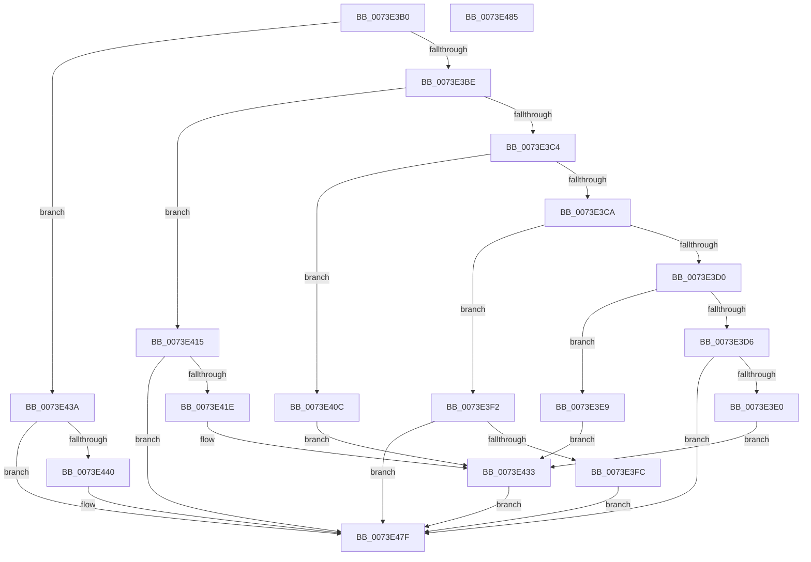

# PipKsrCallback

- RVA: `0x0073E3B0`–`0x0073E486` (길이 `214` bytes)
- VA: `0x000000014073E3B0`
- 실행 섹션: `PAGE`
- PDB 이름 있음: `예`; PDB Function 태그: `아니요`
- unwind 정보 RVA: `0x0005CF00`
- 디코드: `54`개 명령, `214/214` bytes 표시
- 미해석 바이트: `0` (있으면 어셈블리에 `.byte`로 보존)

> 이 문서는 커널 이미지의 기계어와 PDB 기호를 분석해 생성했습니다. 4번과 5번은 함수 원형과 자료형을 바이너리 사용 방식에서 추정한 C 해석이며 원본 소스 복구 결과는 아닙니다.

## 1. Dependencies

- 직접 호출 지점: **4**; 고유 호출 대상: **2**
- 직접 호출자로 확인된 함수: **0**
- RIP 상대 이미지 참조: **9**

### Outgoing calls
- `0x0073E403` → [PipKsrNotifyDrivers](PipKsrNotifyDrivers_function_0073E48C.md) (function, `0x0073E48C`)
- `0x0073E433` → [PipKsrNotifyDrivers](PipKsrNotifyDrivers_function_0073E48C.md) (function, `0x0073E48C`)
- `0x0073E447` → [PipKsrNotifyDrivers](PipKsrNotifyDrivers_function_0073E48C.md) (function, `0x0073E48C`)
- `0x0073E46B` → [ZwQuerySystemInformation](../../text/6A/ZwQuerySystemInformation_function_006AD790.md) (function, `0x006AD790`)

### Direct callers
- 이 함수 시작 RVA로 연결되는 직접 call은 확인되지 않았습니다. 간접 호출은 완전히 역산할 수 없습니다.

### Static image references
- `0x0073E3E0` → RVA `0x00023FC0` (`.rdata`; read)
- `0x0073E3E9` → RVA `0x00024018` (`.rdata`; read)
- `0x0073E3FC` → RVA `0x00024158` (`.rdata`; read)
- `0x0073E40C` → RVA `0x00024138` (`.rdata`; read)
- `0x0073E415` → RVA `0x00F8A880` (`.data`; read)
- `0x0073E41E` → RVA `0x00F8A880` (`.data`; write)
- `0x0073E425` → RVA `0x00023FB0` (`.rdata`; read)
- `0x0073E42C` → RVA `0x00F8A8F0` (`.data`; write)
- `0x0073E440` → RVA `0x00024148` (`.rdata`; read)

## 2. Other-region calls and transfers

- 다른 실행 섹션으로 향하는 call: **1**
  - `0x0073E46B` → [ZwQuerySystemInformation](../../text/6A/ZwQuerySystemInformation_function_006AD790.md) (`PAGE` → `.text`)
- 별도 외부 분기/꼬리 이동을 확인하지 못했습니다.

## 3. Assembly (complete function range)

```asm
0073E3B0  40 53                           push rbx
0073E3B2  48 83 EC 20                     sub rsp, 0x20
0073E3B6  49 8B D8                        mov rbx, r8
0073E3B9  48 85 D2                        test rdx, rdx
0073E3BC  74 7C                           je 0x14073e43a
0073E3BE  48 83 EA 01                     sub rdx, 1
0073E3C2  74 51                           je 0x14073e415
0073E3C4  48 83 EA 01                     sub rdx, 1
0073E3C8  74 42                           je 0x14073e40c
0073E3CA  48 83 EA 03                     sub rdx, 3
0073E3CE  74 22                           je 0x14073e3f2
0073E3D0  48 83 EA 0F                     sub rdx, 0xf
0073E3D4  74 13                           je 0x14073e3e9
0073E3D6  48 83 FA 05                     cmp rdx, 5
0073E3DA  0F 85 9F 00 00 00               jne 0x14073e47f
0073E3E0  48 8D 0D D9 5B 8E FF            lea rcx, [rip - 0x71a427]
0073E3E7  EB 4A                           jmp 0x14073e433
0073E3E9  48 8D 0D 28 5C 8E FF            lea rcx, [rip - 0x71a3d8]
0073E3F0  EB 41                           jmp 0x14073e433
0073E3F2  41 83 38 00                     cmp dword ptr [r8], 0
0073E3F6  0F 8C 83 00 00 00               jl 0x14073e47f
0073E3FC  48 8D 0D 55 5D 8E FF            lea rcx, [rip - 0x71a2ab]
0073E403  E8 84 00 00 00                  call 0x14073e48c
0073E408  89 03                           mov dword ptr [rbx], eax
0073E40A  EB 73                           jmp 0x14073e47f
0073E40C  48 8D 0D 25 5D 8E FF            lea rcx, [rip - 0x71a2db]
0073E413  EB 1E                           jmp 0x14073e433
0073E415  80 3D 64 C4 84 00 00            cmp byte ptr [rip + 0x84c464], 0
0073E41C  74 61                           je 0x14073e47f
0073E41E  C6 05 5B C4 84 00 00            mov byte ptr [rip + 0x84c45b], 0
0073E425  48 8D 0D 84 5B 8E FF            lea rcx, [rip - 0x71a47c]
0073E42C  C6 05 BD C4 84 00 00            mov byte ptr [rip + 0x84c4bd], 0
0073E433  E8 54 00 00 00                  call 0x14073e48c
0073E438  EB 45                           jmp 0x14073e47f
0073E43A  41 83 38 00                     cmp dword ptr [r8], 0
0073E43E  7C 3F                           jl 0x14073e47f
0073E440  48 8D 0D 01 5D 8E FF            lea rcx, [rip - 0x71a2ff]
0073E447  E8 40 00 00 00                  call 0x14073e48c
0073E44C  83 64 24 38 00                  and dword ptr [rsp + 0x38], 0
0073E451  48 8D 54 24 38                  lea rdx, [rsp + 0x38]
0073E456  45 33 C9                        xor r9d, r9d
0073E459  89 03                           mov dword ptr [rbx], eax
0073E45B  B9 97 00 00 00                  mov ecx, 0x97
0073E460  C6 05 19 C4 84 00 01            mov byte ptr [rip + 0x84c419], 1
0073E467  45 8D 41 04                     lea r8d, [r9 + 4]
0073E46B  E8 20 F3 F6 FF                  call 0x1406ad790
0073E470  8A 44 24 38                     mov al, byte ptr [rsp + 0x38]
0073E474  C0 E8 06                        shr al, 6
0073E477  24 01                           and al, 1
0073E479  88 05 71 C4 84 00               mov byte ptr [rip + 0x84c471], al
0073E47F  48 83 C4 20                     add rsp, 0x20
0073E483  5B                              pop rbx
0073E484  C3                              ret
0073E485  CC                              int3
```

## 4. C-style interpretation (structured pseudocode)

```c
__int64 __fastcall PipKsrCallback(__int64 a1, __int64 a2, __int64 a3, int a4)
{
    __int64 result;
    __int64 v_rsp;
    unsigned int v_stack_p10;

    v_rsp = (v_rsp) - (32);
    if (a2 == 0) goto loc_0073E43A;
    a2 = (a2) - (1);
    if (condition_is_equal) goto loc_0073E415;
    a2 = (a2) - (1);
    if (condition_is_equal) goto loc_0073E40C;
    a2 = (a2) - (3);
    if (condition_is_equal) goto loc_0073E3F2;
    a2 = (a2) - (15);
    if (condition_is_equal) goto loc_0073E3E9;
    if (a2 != 5) goto loc_0073E47F;
    goto loc_0073E433;
loc_0073E3E9:
    goto loc_0073E433;
loc_0073E3F2:
    if ((*(unsigned int *)(a3)) < 0) goto loc_0073E47F;
    result = PipKsrNotifyDrivers(v_rip - 7447211, a2, a3, a4);
    *(unsigned int *)(a3) = (unsigned int)(result);
    goto loc_0073E47F;
loc_0073E40C:
    goto loc_0073E433;
loc_0073E415:
    if ((*(unsigned __int8 *)(v_rip + 8701028)) == 0) goto loc_0073E47F;
    *(unsigned __int8 *)(v_rip + 8701019) = 0;
    *(unsigned __int8 *)(v_rip + 8701117) = 0;
loc_0073E433:
    result = PipKsrNotifyDrivers(v_rip - 7447676, a2, a3, a4);
    goto loc_0073E47F;
loc_0073E43A:
    if ((*(unsigned int *)(a3)) >= 0) {
        a1 = v_rip - 7447295;
        result = PipKsrNotifyDrivers(a1, a2, a3, a4);
        a2 = v_stack_p10;
        a4 = 0;
        *(unsigned int *)(a3) = (unsigned int)(result);
        a1 = 151;
        *(unsigned __int8 *)(v_rip + 8700953) = 1;
        a3 = a4 + 4;
        result = ZwQuerySystemInformation(a1, a2, a3, a4);
        result = v_stack_p10;
        result = (unsigned __int8)((result) >> (6));
        result = (unsigned __int8)((result) & (1));
        *(unsigned __int8 *)(v_rip + 8701041) = (unsigned __int8)(result);
    }
    v_rsp = (v_rsp) + (32);
    return result;
}
```

## 5. (Beta) C Style

```c
int64_t PipKsrCallback(int64_t Arg1, int64_t Arg2, void *Arg3, int32_t Arg4)
{
    uint8_t *arg3 = (uint8_t *)Arg3;

    int64_t result;
    int64_t local_rsp;
    uint32_t v_stack_p10;

    local_rsp = (local_rsp) - (32);
    if (Arg2 == 0) goto loc_0073E43A;
    Arg2 = (Arg2) - (1);
    if (condition_is_equal) goto loc_0073E415;
    Arg2 = (Arg2) - (1);
    if (condition_is_equal) goto loc_0073E40C;
    Arg2 = (Arg2) - (3);
    if (condition_is_equal) goto loc_0073E3F2;
    Arg2 = (Arg2) - (15);
    if (condition_is_equal) goto loc_0073E3E9;
    if (Arg2 != 5) goto loc_0073E47F;
    goto loc_0073E433;
loc_0073E3E9:
    goto loc_0073E433;
loc_0073E3F2:
    if ((*(uint32_t *)(arg3)) < 0) goto loc_0073E47F;
    result = PipKsrNotifyDrivers(v_rip - 7447211, Arg2, Arg3, Arg4);
    *(uint32_t *)(arg3) = (uint32_t)(result);
    goto loc_0073E47F;
loc_0073E40C:
    goto loc_0073E433;
loc_0073E415:
    if ((*(uint8_t *)(v_rip + 0x84C464)) == 0) goto loc_0073E47F;
    *(uint8_t *)(v_rip + 0x84C45B) = 0;
    *(uint8_t *)(v_rip + 0x84C4BD) = 0;
loc_0073E433:
    result = PipKsrNotifyDrivers(v_rip - 7447676, Arg2, Arg3, Arg4);
    goto loc_0073E47F;
loc_0073E43A:
    if ((*(uint32_t *)(arg3)) >= 0) {
        Arg1 = v_rip - 7447295;
        result = PipKsrNotifyDrivers(Arg1, Arg2, Arg3, Arg4);
        Arg2 = v_stack_p10;
        Arg4 = 0;
        *(uint32_t *)(arg3) = (uint32_t)(result);
        Arg1 = 151;
        *(uint8_t *)(v_rip + 0x84C419) = 1;
        Arg3 = Arg4 + 4;
        result = ZwQuerySystemInformation(Arg1, Arg2, Arg3, Arg4);
        result = v_stack_p10;
        result = (uint8_t)((result) >> (6));
        result = (uint8_t)((result) & (1));
        *(uint8_t *)(v_rip + 0x84C471) = (uint8_t)(result);
    }
    local_rsp = (local_rsp) + (32);
    return result;
}
```

### 관측된 메모리 오프셋

구조체 형식이 확인되지 않은 접근은 인자 기준의 오프셋으로만 기록했습니다.

| 기준 인자 | 오프셋 표현 | 폭 (bit) | 접근 |
|---|---:|---:|---|
| `Arg3` | `+ 0x0` | `32` | `R` |
| `Arg3` | `+ 0x0` | `32` | `W` |

## 6. Execution-region graph

[열기: 2D/3D 그래프와 함수 탐색 컨트롤 패널](../../../control-panel.html?section=page&rva=0x0073E3B0&view=graph)

- 2D 그래프는 위에서 아래로 흐르고, 3D 그래프는 빈 공간을 드래그해 회전합니다. Shift+드래그는 이동, 휠은 확대·축소, 함수 노드 선택은 대상 보고서 이동입니다.

### Static fallback


