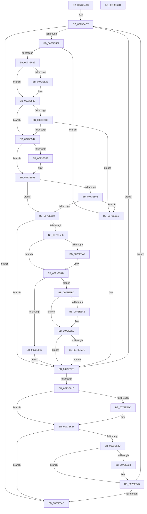

# PipKsrNotifyDrivers

- RVA: `0x0073E48C`–`0x0073E67D` (길이 `497` bytes)
- VA: `0x000000014073E48C`
- 실행 섹션: `PAGE`
- PDB 이름 있음: `예`; PDB Function 태그: `아니요`
- unwind 정보 RVA: `0x000C9134`
- 디코드: `123`개 명령, `497/497` bytes 표시
- 미해석 바이트: `0` (있으면 어셈블리에 `.byte`로 보존)

> 이 문서는 커널 이미지의 기계어와 PDB 기호를 분석해 생성했습니다. 4번과 5번은 함수 원형과 자료형을 바이너리 사용 방식에서 추정한 C 해석이며 원본 소스 복구 결과는 아닙니다.

## 1. Dependencies

- 직접 호출 지점: **10**; 고유 호출 대상: **8**
- 직접 호출자로 확인된 함수: **1**
- RIP 상대 이미지 참조: **9**

### Outgoing calls
- `0x0073E4C7` → [ExAcquireFastMutex](../../text/20/ExAcquireFastMutex_function_0020E5A0.md) (function, `0x0020E5A0`)
- `0x0073E4F6` → [ExReleaseFastMutex](../../text/25/ExReleaseFastMutex_function_002519C0.md) (function, `0x002519C0`)
- `0x0073E513` → [ExAcquireResourceExclusiveLite](../../text/21/ExAcquireResourceExclusiveLite_function_00214E20.md) (function, `0x00214E20`)
- `0x0073E58B` → [PnpNotifyDriverCallback](../95/PnpNotifyDriverCallback_function_00954AA0.md) (function, `0x00954AA0`)
- `0x0073E5E7` → [ExReleaseResourceLite](../../text/25/ExReleaseResourceLite_function_0025FA10.md) (function, `0x0025FA10`)
- `0x0073E5EC` → [KeLeaveCriticalRegion](../../text/25/KeLeaveCriticalRegion_function_0025D8B0.md) (function, `0x0025D8B0`)
- `0x0073E5F8` → [ExAcquireFastMutex](../../text/20/ExAcquireFastMutex_function_0020E5A0.md) (function, `0x0020E5A0`)
- `0x0073E603` → [PnpDereferenceNotify](../95/PnpDereferenceNotify_function_00954A04.md) (function, `0x00954A04`)
- `0x0073E653` → [ExReleaseFastMutex](../../text/25/ExReleaseFastMutex_function_002519C0.md) (function, `0x002519C0`)
- `0x0073E662` → [_security_check_cookie](../../text/6A/_security_check_cookie_function_006AC640.md) (function, `0x006AC640`)

### Direct callers
- [PipKsrCallback](PipKsrCallback_function_0073E3B0.md) at `0x0073E403`
- [PipKsrCallback](PipKsrCallback_function_0073E3B0.md) at `0x0073E433`
- [PipKsrCallback](PipKsrCallback_function_0073E3B0.md) at `0x0073E447`

### Static image references
- `0x0073E49E` → RVA `0x00E0A740` (`.data`; read)
- `0x0073E4B5` → RVA `0x00F8A8A0` (`.data`; read)
- `0x0073E4CC` → RVA `0x00F8A8E0` (`.data`; read)
- `0x0073E525` → RVA `0x00023FB0` (`.rdata`; read)
- `0x0073E532` → RVA `0x00023FB8` (`.rdata`; read)
- `0x0073E54A` → RVA `0x00024148` (`.rdata`; read)
- `0x0073E557` → RVA `0x00024150` (`.rdata`; read)
- `0x0073E62F` → RVA `0x00024158` (`.rdata`; read)
- `0x0073E63C` → RVA `0x00024160` (`.rdata`; read)

## 2. Other-region calls and transfers

- 다른 실행 섹션으로 향하는 call: **8**
  - `0x0073E4C7` → [ExAcquireFastMutex](../../text/20/ExAcquireFastMutex_function_0020E5A0.md) (`PAGE` → `.text`)
  - `0x0073E4F6` → [ExReleaseFastMutex](../../text/25/ExReleaseFastMutex_function_002519C0.md) (`PAGE` → `.text`)
  - `0x0073E513` → [ExAcquireResourceExclusiveLite](../../text/21/ExAcquireResourceExclusiveLite_function_00214E20.md) (`PAGE` → `.text`)
  - `0x0073E5E7` → [ExReleaseResourceLite](../../text/25/ExReleaseResourceLite_function_0025FA10.md) (`PAGE` → `.text`)
  - `0x0073E5EC` → [KeLeaveCriticalRegion](../../text/25/KeLeaveCriticalRegion_function_0025D8B0.md) (`PAGE` → `.text`)
  - `0x0073E5F8` → [ExAcquireFastMutex](../../text/20/ExAcquireFastMutex_function_0020E5A0.md) (`PAGE` → `.text`)
  - `0x0073E653` → [ExReleaseFastMutex](../../text/25/ExReleaseFastMutex_function_002519C0.md) (`PAGE` → `.text`)
  - `0x0073E662` → [_security_check_cookie](../../text/6A/_security_check_cookie_function_006AC640.md) (`PAGE` → `.text`)
- 별도 외부 분기/꼬리 이동을 확인하지 못했습니다.

## 3. Assembly (complete function range)

```asm
0073E48C  48 89 5C 24 10                  mov qword ptr [rsp + 0x10], rbx
0073E491  48 89 6C 24 18                  mov qword ptr [rsp + 0x18], rbp
0073E496  56                              push rsi
0073E497  57                              push rdi
0073E498  41 54                           push r12
0073E49A  48 83 EC 50                     sub rsp, 0x50
0073E49E  48 8B 05 9B C2 6C 00            mov rax, qword ptr [rip + 0x6cc29b]
0073E4A5  48 33 C4                        xor rax, rsp
0073E4A8  48 89 44 24 40                  mov qword ptr [rsp + 0x40], rax
0073E4AD  48 8B F9                        mov rdi, rcx
0073E4B0  0F 57 C0                        xorps xmm0, xmm0
0073E4B3  33 C0                           xor eax, eax
0073E4B5  48 8D 0D E4 C3 84 00            lea rcx, [rip + 0x84c3e4]
0073E4BC  33 F6                           xor esi, esi
0073E4BE  89 44 24 38                     mov dword ptr [rsp + 0x38], eax
0073E4C2  0F 11 44 24 28                  movups xmmword ptr [rsp + 0x28], xmm0
0073E4C7  E8 D4 00 AD FF                  call 0x14020e5a0
0073E4CC  48 8B 1D 0D C4 84 00            mov rbx, qword ptr [rip + 0x84c40d]
0073E4D3  44 8D 66 01                     lea r12d, [rsi + 1]
0073E4D7  48 8D 05 02 C4 84 00            lea rax, [rip + 0x84c402]
0073E4DE  48 3B D8                        cmp rbx, rax
0073E4E1  0F 84 65 01 00 00               je 0x14073e64c
0073E4E7  66 44 01 63 38                  add word ptr [rbx + 0x38], r12w
0073E4EC  48 8D 0D AD C3 84 00            lea rcx, [rip + 0x84c3ad]
0073E4F3  48 8B EB                        mov rbp, rbx
0073E4F6  E8 C5 34 B1 FF                  call 0x1402519c0
0073E4FB  65 48 8B 04 25 88 01 00 00      mov rax, qword ptr gs:[0x188]
0073E504  41 8A D4                        mov dl, r12b
0073E507  66 FF 88 E4 01 00 00            dec word ptr [rax + 0x1e4]
0073E50E  90                              nop
0073E50F  48 8B 4B 48                     mov rcx, qword ptr [rbx + 0x48]
0073E513  E8 08 69 AD FF                  call 0x140214e20
0073E518  80 7B 3A 00                     cmp byte ptr [rbx + 0x3a], 0
0073E51C  0F 85 BF 00 00 00               jne 0x14073e5e1
0073E522  48 8B 07                        mov rax, qword ptr [rdi]
0073E525  48 2B 05 84 5A 8E FF            sub rax, qword ptr [rip - 0x71a57c]
0073E52C  75 0B                           jne 0x14073e539
0073E52E  48 8B 47 08                     mov rax, qword ptr [rdi + 8]
0073E532  48 2B 05 7F 5A 8E FF            sub rax, qword ptr [rip - 0x71a581]
0073E539  48 85 C0                        test rax, rax
0073E53C  75 09                           jne 0x14073e547
0073E53E  38 43 50                        cmp byte ptr [rbx + 0x50], al
0073E541  0F 84 9A 00 00 00               je 0x14073e5e1
0073E547  48 8B 07                        mov rax, qword ptr [rdi]
0073E54A  48 2B 05 F7 5B 8E FF            sub rax, qword ptr [rip - 0x71a409]
0073E551  75 0B                           jne 0x14073e55e
0073E553  48 8B 47 08                     mov rax, qword ptr [rdi + 8]
0073E557  48 2B 05 F2 5B 8E FF            sub rax, qword ptr [rip - 0x71a40e]
0073E55E  48 85 C0                        test rax, rax
0073E561  75 05                           jne 0x14073e568
0073E563  38 43 50                        cmp byte ptr [rbx + 0x50], al
0073E566  75 79                           jne 0x14073e5e1
0073E568  0F 10 07                        movups xmm0, xmmword ptr [rdi]
0073E56B  83 64 24 20 00                  and dword ptr [rsp + 0x20], 0
0073E570  4C 8D 44 24 20                  lea r8, [rsp + 0x20]
0073E575  48 8D 54 24 28                  lea rdx, [rsp + 0x28]
0073E57A  C7 44 24 28 01 00 14 00         mov dword ptr [rsp + 0x28], 0x140001
0073E582  48 8B CB                        mov rcx, rbx
0073E585  F3 0F 7F 44 24 2C               movdqu xmmword ptr [rsp + 0x2c], xmm0
0073E58B  E8 10 65 21 00                  call 0x140954aa0
0073E590  8B F0                           mov esi, eax
0073E592  85 C0                           test eax, eax
0073E594  78 4D                           js 0x14073e5e3
0073E596  48 8B 07                        mov rax, qword ptr [rdi]
0073E599  48 2B 05 A8 5B 8E FF            sub rax, qword ptr [rip - 0x71a458]
0073E5A0  75 0B                           jne 0x14073e5ad
0073E5A2  48 8B 47 08                     mov rax, qword ptr [rdi + 8]
0073E5A6  48 2B 05 A3 5B 8E FF            sub rax, qword ptr [rip - 0x71a45d]
0073E5AD  48 85 C0                        test rax, rax
0073E5B0  75 0A                           jne 0x14073e5bc
0073E5B2  8B 74 24 20                     mov esi, dword ptr [rsp + 0x20]
0073E5B6  44 88 63 50                     mov byte ptr [rbx + 0x50], r12b
0073E5BA  EB 27                           jmp 0x14073e5e3
0073E5BC  48 8B 07                        mov rax, qword ptr [rdi]
0073E5BF  48 2B 05 EA 59 8E FF            sub rax, qword ptr [rip - 0x71a616]
0073E5C6  75 0B                           jne 0x14073e5d3
0073E5C8  48 8B 47 08                     mov rax, qword ptr [rdi + 8]
0073E5CC  48 2B 05 E5 59 8E FF            sub rax, qword ptr [rip - 0x71a61b]
0073E5D3  8B 74 24 20                     mov esi, dword ptr [rsp + 0x20]
0073E5D7  48 85 C0                        test rax, rax
0073E5DA  75 07                           jne 0x14073e5e3
0073E5DC  88 43 50                        mov byte ptr [rbx + 0x50], al
0073E5DF  EB 02                           jmp 0x14073e5e3
0073E5E1  33 F6                           xor esi, esi
0073E5E3  48 8B 4B 48                     mov rcx, qword ptr [rbx + 0x48]
0073E5E7  E8 24 14 B2 FF                  call 0x14025fa10
0073E5EC  E8 BF F2 B1 FF                  call 0x14025d8b0
0073E5F1  48 8D 0D A8 C2 84 00            lea rcx, [rip + 0x84c2a8]
0073E5F8  E8 A3 FF AC FF                  call 0x14020e5a0
0073E5FD  48 8B 1B                        mov rbx, qword ptr [rbx]
0073E600  48 8B CD                        mov rcx, rbp
0073E603  E8 FC 63 21 00                  call 0x140954a04
0073E608  85 F6                           test esi, esi
0073E60A  0F 89 C7 FE FF FF               jns 0x14073e4d7
0073E610  48 8B 07                        mov rax, qword ptr [rdi]
0073E613  48 2B 05 2E 5B 8E FF            sub rax, qword ptr [rip - 0x71a4d2]
0073E61A  75 0B                           jne 0x14073e627
0073E61C  48 8B 47 08                     mov rax, qword ptr [rdi + 8]
0073E620  48 2B 05 29 5B 8E FF            sub rax, qword ptr [rip - 0x71a4d7]
0073E627  48 85 C0                        test rax, rax
0073E62A  74 20                           je 0x14073e64c
0073E62C  48 8B 07                        mov rax, qword ptr [rdi]
0073E62F  48 2B 05 22 5B 8E FF            sub rax, qword ptr [rip - 0x71a4de]
0073E636  75 0B                           jne 0x14073e643
0073E638  48 8B 47 08                     mov rax, qword ptr [rdi + 8]
0073E63C  48 2B 05 1D 5B 8E FF            sub rax, qword ptr [rip - 0x71a4e3]
0073E643  48 85 C0                        test rax, rax
0073E646  0F 85 8B FE FF FF               jne 0x14073e4d7
0073E64C  48 8D 0D 4D C2 84 00            lea rcx, [rip + 0x84c24d]
0073E653  E8 68 33 B1 FF                  call 0x1402519c0
0073E658  8B C6                           mov eax, esi
0073E65A  48 8B 4C 24 40                  mov rcx, qword ptr [rsp + 0x40]
0073E65F  48 33 CC                        xor rcx, rsp
0073E662  E8 D9 DF F6 FF                  call 0x1406ac640
0073E667  4C 8D 5C 24 50                  lea r11, [rsp + 0x50]
0073E66C  49 8B 5B 28                     mov rbx, qword ptr [r11 + 0x28]
0073E670  49 8B 6B 30                     mov rbp, qword ptr [r11 + 0x30]
0073E674  49 8B E3                        mov rsp, r11
0073E677  41 5C                           pop r12
0073E679  5F                              pop rdi
0073E67A  5E                              pop rsi
0073E67B  C3                              ret
0073E67C  CC                              int3
```

## 4. C-style interpretation (structured pseudocode)

```c
__int64 __fastcall PipKsrNotifyDrivers(__int64 a1)
{
    __int64 result;
    __int64 v_rsi;
    __int64 v_rsp;
    unsigned __int64 v_stack_m18;
    unsigned __int64 v_stack_m28;
    unsigned int v_stack_m30;
    unsigned __int64 v_stack_m3C;
    unsigned __int64 v_stack_m40;
    unsigned int v_stack_m48;
    unsigned __int64 v_stack_p10;
    unsigned __int64 v_stack_p18;

    v_stack_p10 = v_rbx;
    v_stack_p18 = v_rbp;
    v_rsp = (v_rsp) - (80);
    result = (*(unsigned __int64 *)(v_rip + 7127707)) ^ (v_rsp);
    v_stack_m28 = result;
    result = 0;
    v_rsi = 0;
    v_stack_m30 = 0;
    v_stack_m40 = v_xmm0;
    result = ExAcquireFastMutex(v_rip + 8700900, a2, a3, a4);
loc_0073E4D7:
    if ((*(unsigned __int64 *)(v_rip + 8700941)) == (v_rip + 8700930)) goto loc_0073E64C;
    result = ExReleaseFastMutex(v_rip + 8700845, a2, a3, a4);
    result = ExAcquireResourceExclusiveLite(*(unsigned __int64 *)(*(unsigned __int64 *)(v_rip + 8700941) + 72), (unsigned __int8)(v_rsi + 1), a3, a4);
    if ((*(unsigned __int8 *)(*(unsigned __int64 *)(v_rip + 8700941) + 58)) != 0) goto loc_0073E5E1;
    result = (*(unsigned __int64 *)(a1)) - (*(unsigned __int64 *)(v_rip - 7447932));
    if (!(condition_is_not_equal)) {
        result = *(unsigned __int64 *)(a1 + 8);
        result = (result) - (*(unsigned __int64 *)(v_rip - 7447937));
    }
    if (result != 0) goto loc_0073E547;
    if ((*(unsigned __int8 *)(*(unsigned __int64 *)(v_rip + 8700941) + 80)) == ((unsigned __int8)(result))) goto loc_0073E5E1;
loc_0073E547:
    result = (*(unsigned __int64 *)(a1)) - (*(unsigned __int64 *)(v_rip - 7447561));
    if (!(condition_is_not_equal)) {
        result = *(unsigned __int64 *)(a1 + 8);
        result = (result) - (*(unsigned __int64 *)(v_rip - 7447566));
    }
    if (result != 0) goto loc_0073E568;
    if ((*(unsigned __int8 *)(*(unsigned __int64 *)(v_rip + 8700941) + 80)) != ((unsigned __int8)(result))) goto loc_0073E5E1;
loc_0073E568:
    v_stack_m40 = 0x140001ULL;
    v_stack_m3C = v_xmm0;
    result = PnpNotifyDriverCallback(*(unsigned __int64 *)(v_rip + 8700941), v_stack_m40, v_stack_m48, a4);
    if (sign_flag) goto loc_0073E5E3;
    result = (*(unsigned __int64 *)(a1)) - (*(unsigned __int64 *)(v_rip - 7447640));
    if (!(condition_is_not_equal)) {
        result = *(unsigned __int64 *)(a1 + 8);
        result = (result) - (*(unsigned __int64 *)(v_rip - 7447645));
    }
    if (result != 0) goto loc_0073E5BC;
    *(unsigned __int8 *)(*(unsigned __int64 *)(v_rip + 8700941) + 80) = (unsigned __int8)(v_rsi + 1);
    goto loc_0073E5E3;
loc_0073E5BC:
    result = (*(unsigned __int64 *)(a1)) - (*(unsigned __int64 *)(v_rip - 7448086));
    if (!(condition_is_not_equal)) {
        result = *(unsigned __int64 *)(a1 + 8);
        result = (result) - (*(unsigned __int64 *)(v_rip - 7448091));
    }
    if (result != 0) goto loc_0073E5E3;
    *(unsigned __int8 *)(*(unsigned __int64 *)(v_rip + 8700941) + 80) = (unsigned __int8)(result);
    goto loc_0073E5E3;
loc_0073E5E1:
    v_rsi = 0;
loc_0073E5E3:
    result = ExReleaseResourceLite(*(unsigned __int64 *)(*(unsigned __int64 *)(v_rip + 8700941) + 72), v_stack_m40, v_stack_m48, a4);
    result = KeLeaveCriticalRegion(*(unsigned __int64 *)(*(unsigned __int64 *)(v_rip + 8700941) + 72), v_stack_m40, v_stack_m48, a4);
    result = ExAcquireFastMutex(v_rip + 8700584, v_stack_m40, v_stack_m48, a4);
    result = PnpDereferenceNotify(*(unsigned __int64 *)(v_rip + 8700941), v_stack_m40, v_stack_m48, a4);
    if (!sign_flag) goto loc_0073E4D7;
    result = (*(unsigned __int64 *)(a1)) - (*(unsigned __int64 *)(v_rip - 7447762));
    if (!(condition_is_not_equal)) {
        result = *(unsigned __int64 *)(a1 + 8);
        result = (result) - (*(unsigned __int64 *)(v_rip - 7447767));
    }
    if (result == 0) goto loc_0073E64C;
    result = (*(unsigned __int64 *)(a1)) - (*(unsigned __int64 *)(v_rip - 7447774));
    if (!(condition_is_not_equal)) {
        result = *(unsigned __int64 *)(a1 + 8);
        result = (result) - (*(unsigned __int64 *)(v_rip - 7447779));
    }
    if (result != 0) goto loc_0073E4D7;
loc_0073E64C:
    result = ExReleaseFastMutex(v_rip + 8700493, v_stack_m40, v_stack_m48, a4);
    a1 = (v_stack_m28) ^ (v_rsp);
    result = _security_check_cookie(a1, v_stack_m40, v_stack_m48, a4);
    return result;
}
```

## 5. (Beta) C Style

```c
int64_t PipKsrNotifyDrivers(void *Arg1)
{
    uint8_t *arg1 = (uint8_t *)Arg1;

    int64_t result;
    int64_t local_rsi;
    int64_t local_rsp;
    uint64_t v_stack_m18;
    uint64_t v_stack_m28;
    uint32_t v_stack_m30;
    uint64_t v_stack_m3C;
    uint64_t v_stack_m40;
    uint32_t v_stack_m48;
    uint64_t v_stack_p10;
    uint64_t v_stack_p18;

    v_stack_p10 = local_rbx;
    v_stack_p18 = local_rbp;
    local_rsp = (local_rsp) - (80);
    result = (*(uint64_t *)(v_rip + 0x6CC29B)) ^ (local_rsp);
    v_stack_m28 = result;
    result = 0;
    local_rsi = 0;
    v_stack_m30 = 0;
    v_stack_m40 = v_xmm0;
    result = ExAcquireFastMutex(v_rip + 8700900, a2, a3, a4);
loc_0073E4D7:
    if ((*(uint64_t *)(v_rip + 0x84C40D)) == (v_rip + 8700930)) goto loc_0073E64C;
    result = ExReleaseFastMutex(v_rip + 8700845, a2, a3, a4);
    result = ExAcquireResourceExclusiveLite(*(uint64_t *)(*(uint64_t *)(v_rip + 0x84C40D) + 0x48), (uint8_t)(local_rsi + 1), a3, a4);
    if ((*(uint8_t *)(*(uint64_t *)(v_rip + 0x84C40D) + 0x3A)) != 0) goto loc_0073E5E1;
    result = (*(uint64_t *)(arg1)) - (*(uint64_t *)(v_rip - 0x71A57C));
    if (!(condition_is_not_equal)) {
        result = *(uint64_t *)(arg1 + 0x8);
        result = (result) - (*(uint64_t *)(v_rip - 0x71A581));
    }
    if (result != 0) goto loc_0073E547;
    if ((*(uint8_t *)(*(uint64_t *)(v_rip + 0x84C40D) + 0x50)) == ((uint8_t)(result))) goto loc_0073E5E1;
loc_0073E547:
    result = (*(uint64_t *)(arg1)) - (*(uint64_t *)(v_rip - 0x71A409));
    if (!(condition_is_not_equal)) {
        result = *(uint64_t *)(arg1 + 0x8);
        result = (result) - (*(uint64_t *)(v_rip - 0x71A40E));
    }
    if (result != 0) goto loc_0073E568;
    if ((*(uint8_t *)(*(uint64_t *)(v_rip + 0x84C40D) + 0x50)) != ((uint8_t)(result))) goto loc_0073E5E1;
loc_0073E568:
    v_stack_m40 = 0x140001ULL;
    v_stack_m3C = v_xmm0;
    result = PnpNotifyDriverCallback(*(uint64_t *)(v_rip + 0x84C40D), v_stack_m40, v_stack_m48, a4);
    if (sign_flag) goto loc_0073E5E3;
    result = (*(uint64_t *)(arg1)) - (*(uint64_t *)(v_rip - 0x71A458));
    if (!(condition_is_not_equal)) {
        result = *(uint64_t *)(arg1 + 0x8);
        result = (result) - (*(uint64_t *)(v_rip - 0x71A45D));
    }
    if (result != 0) goto loc_0073E5BC;
    *(uint8_t *)(*(uint64_t *)(v_rip + 0x84C40D) + 0x50) = (uint8_t)(local_rsi + 1);
    goto loc_0073E5E3;
loc_0073E5BC:
    result = (*(uint64_t *)(arg1)) - (*(uint64_t *)(v_rip - 0x71A616));
    if (!(condition_is_not_equal)) {
        result = *(uint64_t *)(arg1 + 0x8);
        result = (result) - (*(uint64_t *)(v_rip - 0x71A61B));
    }
    if (result != 0) goto loc_0073E5E3;
    *(uint8_t *)(*(uint64_t *)(v_rip + 0x84C40D) + 0x50) = (uint8_t)(result);
    goto loc_0073E5E3;
loc_0073E5E1:
    local_rsi = 0;
loc_0073E5E3:
    result = ExReleaseResourceLite(*(uint64_t *)(*(uint64_t *)(v_rip + 0x84C40D) + 0x48), v_stack_m40, v_stack_m48, a4);
    result = KeLeaveCriticalRegion(*(uint64_t *)(*(uint64_t *)(v_rip + 0x84C40D) + 0x48), v_stack_m40, v_stack_m48, a4);
    result = ExAcquireFastMutex(v_rip + 8700584, v_stack_m40, v_stack_m48, a4);
    result = PnpDereferenceNotify(*(uint64_t *)(v_rip + 0x84C40D), v_stack_m40, v_stack_m48, a4);
    if (!sign_flag) goto loc_0073E4D7;
    result = (*(uint64_t *)(arg1)) - (*(uint64_t *)(v_rip - 0x71A4D2));
    if (!(condition_is_not_equal)) {
        result = *(uint64_t *)(arg1 + 0x8);
        result = (result) - (*(uint64_t *)(v_rip - 0x71A4D7));
    }
    if (result == 0) goto loc_0073E64C;
    result = (*(uint64_t *)(arg1)) - (*(uint64_t *)(v_rip - 0x71A4DE));
    if (!(condition_is_not_equal)) {
        result = *(uint64_t *)(arg1 + 0x8);
        result = (result) - (*(uint64_t *)(v_rip - 0x71A4E3));
    }
    if (result != 0) goto loc_0073E4D7;
loc_0073E64C:
    result = ExReleaseFastMutex(v_rip + 8700493, v_stack_m40, v_stack_m48, a4);
    Arg1 = (v_stack_m28) ^ (local_rsp);
    result = _security_check_cookie(Arg1, v_stack_m40, v_stack_m48, a4);
    return result;
}
```

### 관측된 메모리 오프셋

구조체 형식이 확인되지 않은 접근은 인자 기준의 오프셋으로만 기록했습니다.

| 기준 인자 | 오프셋 표현 | 폭 (bit) | 접근 |
|---|---:|---:|---|
| `Arg1` | `+ 0x0` | `64` | `R` |
| `Arg1` | `+ 0x0` | `128` | `R` |
| `Arg1` | `+ 0x8` | `64` | `R` |

## 6. Execution-region graph

[열기: 2D/3D 그래프와 함수 탐색 컨트롤 패널](../../../control-panel.html?section=page&rva=0x0073E48C&view=graph)

- 2D 그래프는 위에서 아래로 흐르고, 3D 그래프는 빈 공간을 드래그해 회전합니다. Shift+드래그는 이동, 휠은 확대·축소, 함수 노드 선택은 대상 보고서 이동입니다.

### Static fallback


