# PnpBuildCmResourceLists

- RVA: `0x0073E684`–`0x0073E870` (길이 `492` bytes)
- VA: `0x000000014073E684`
- 실행 섹션: `PAGE`
- PDB 이름 있음: `예`; PDB Function 태그: `아니요`
- unwind 정보 RVA: `0x00075C18`
- 디코드: `131`개 명령, `492/492` bytes 표시
- 미해석 바이트: `0` (있으면 어셈블리에 `.byte`로 보존)

> 이 문서는 커널 이미지의 기계어와 PDB 기호를 분석해 생성했습니다. 4번과 5번은 함수 원형과 자료형을 바이너리 사용 방식에서 추정한 C 해석이며 원본 소스 복구 결과는 아닙니다.

## 1. Dependencies

- 직접 호출 지점: **11**; 고유 호출 대상: **8**
- 직접 호출자로 확인된 함수: **3**
- RIP 상대 이미지 참조: **1**

### Outgoing calls
- `0x0073E6D4` → [ExAcquireFastMutex](../../text/20/ExAcquireFastMutex_function_0020E5A0.md) (function, `0x0020E5A0`)
- `0x0073E6E7` → [ExFreePoolWithTag](../../poolcode/B8/ExFreePoolWithTag_function_00B82870.md) (function, `0x00B82870`)
- `0x0073E702` → [ExFreePoolWithTag](../../poolcode/B8/ExFreePoolWithTag_function_00B82870.md) (function, `0x00B82870`)
- `0x0073E716` → [ExReleaseFastMutex](../../text/25/ExReleaseFastMutex_function_002519C0.md) (function, `0x002519C0`)
- `0x0073E776` → [PnpBuildCmResourceList](../AA/PnpBuildCmResourceList_function_00AAB034.md) (function, `0x00AAB034`)
- `0x0073E7B8` → [PipClearDevNodeFlags](../8F/PipClearDevNodeFlags_function_008F9F54.md) (function, `0x008F9F54`)
- `0x0073E7C4` → [ExAcquireFastMutex](../../text/20/ExAcquireFastMutex_function_0020E5A0.md) (function, `0x0020E5A0`)
- `0x0073E7E1` → [PipSetDevNodeFlags](../8F/PipSetDevNodeFlags_function_008FC048.md) (function, `0x008FC048`)
- `0x0073E7F8` → [ExReleaseFastMutex](../../text/25/ExReleaseFastMutex_function_002519C0.md) (function, `0x002519C0`)
- `0x0073E821` → [PnpDetermineResourceListSize](../8F/PnpDetermineResourceListSize_function_008FC6F8.md) (function, `0x008FC6F8`)
- `0x0073E82F` → [IopWriteAllocatedResourcesToRegistry](../AA/IopWriteAllocatedResourcesToRegistry_function_00AA54E4.md) (function, `0x00AA54E4`)

### Direct callers
- [PnpReallocateResources](PnpReallocateResources_function_0073E924.md) at `0x0073EA41`
- [PnpRebalance](PnpRebalance_function_0073F508.md) at `0x0073F815`
- [PnpRebalance](PnpRebalance_function_0073F508.md) at `0x0073F833`
- [sub_00B38CDE](../B3/Unknown_function_00B38CDE.md) at `0x00B38EB7`
- [sub_00B38CDE](../B3/Unknown_function_00B38CDE.md) at `0x00B38F3A`

### Static image references
- `0x0073E6CD` → RVA `0x00F8C3E0` (`.data`; read)

## 2. Other-region calls and transfers

- 다른 실행 섹션으로 향하는 call: **6**
  - `0x0073E6D4` → [ExAcquireFastMutex](../../text/20/ExAcquireFastMutex_function_0020E5A0.md) (`PAGE` → `.text`)
  - `0x0073E6E7` → [ExFreePoolWithTag](../../poolcode/B8/ExFreePoolWithTag_function_00B82870.md) (`PAGE` → `POOLCODE`)
  - `0x0073E702` → [ExFreePoolWithTag](../../poolcode/B8/ExFreePoolWithTag_function_00B82870.md) (`PAGE` → `POOLCODE`)
  - `0x0073E716` → [ExReleaseFastMutex](../../text/25/ExReleaseFastMutex_function_002519C0.md) (`PAGE` → `.text`)
  - `0x0073E7C4` → [ExAcquireFastMutex](../../text/20/ExAcquireFastMutex_function_0020E5A0.md) (`PAGE` → `.text`)
  - `0x0073E7F8` → [ExReleaseFastMutex](../../text/25/ExReleaseFastMutex_function_002519C0.md) (`PAGE` → `.text`)
- 별도 외부 분기/꼬리 이동을 확인하지 못했습니다.

## 3. Assembly (complete function range)

```asm
0073E684  48 89 5C 24 08                  mov qword ptr [rsp + 8], rbx
0073E689  48 89 6C 24 10                  mov qword ptr [rsp + 0x10], rbp
0073E68E  48 89 74 24 18                  mov qword ptr [rsp + 0x18], rsi
0073E693  57                              push rdi
0073E694  41 54                           push r12
0073E696  41 55                           push r13
0073E698  41 56                           push r14
0073E69A  41 57                           push r15
0073E69C  48 83 EC 20                     sub rsp, 0x20
0073E6A0  45 8A E8                        mov r13b, r8b
0073E6A3  4C 8B FA                        mov r15, rdx
0073E6A6  4C 8B F1                        mov r14, rcx
0073E6A9  45 84 C0                        test r8b, r8b
0073E6AC  74 76                           je 0x14073e724
0073E6AE  48 8B F9                        mov rdi, rcx
0073E6B1  48 3B CA                        cmp rcx, rdx
0073E6B4  73 6E                           jae 0x14073e724
0073E6B6  48 8B 07                        mov rax, qword ptr [rdi]
0073E6B9  48 85 C0                        test rax, rax
0073E6BC  74 0D                           je 0x14073e6cb
0073E6BE  48 8B 80 38 01 00 00            mov rax, qword ptr [rax + 0x138]
0073E6C5  48 8B 58 28                     mov rbx, qword ptr [rax + 0x28]
0073E6C9  EB 02                           jmp 0x14073e6cd
0073E6CB  33 DB                           xor ebx, ebx
0073E6CD  48 8D 0D 0C DD 84 00            lea rcx, [rip + 0x84dd0c]
0073E6D4  E8 C7 FE AC FF                  call 0x14020e5a0
0073E6D9  48 8B 8B A0 01 00 00            mov rcx, qword ptr [rbx + 0x1a0]
0073E6E0  48 85 C9                        test rcx, rcx
0073E6E3  74 0F                           je 0x14073e6f4
0073E6E5  33 D2                           xor edx, edx
0073E6E7  E8 84 41 44 00                  call 0x140b82870
0073E6EC  48 83 A3 A0 01 00 00 00         and qword ptr [rbx + 0x1a0], 0
0073E6F4  48 8B 8B A8 01 00 00            mov rcx, qword ptr [rbx + 0x1a8]
0073E6FB  48 85 C9                        test rcx, rcx
0073E6FE  74 0F                           je 0x14073e70f
0073E700  33 D2                           xor edx, edx
0073E702  E8 69 41 44 00                  call 0x140b82870
0073E707  48 83 A3 A8 01 00 00 00         and qword ptr [rbx + 0x1a8], 0
0073E70F  48 8D 0D CA DC 84 00            lea rcx, [rip + 0x84dcca]
0073E716  E8 A5 32 B1 FF                  call 0x1402519c0
0073E71B  48 83 C7 40                     add rdi, 0x40
0073E71F  49 3B FF                        cmp rdi, r15
0073E722  72 92                           jb 0x14073e6b6
0073E724  83 CE FF                        or esi, 0xffffffff
0073E727  44 8B E6                        mov r12d, esi
0073E72A  33 F6                           xor esi, esi
0073E72C  4D 3B F7                        cmp r14, r15
0073E72F  0F 83 1D 01 00 00               jae 0x14073e852
0073E735  49 8D 5E 38                     lea rbx, [r14 + 0x38]
0073E739  48 83 63 F0 00                  and qword ptr [rbx - 0x10], 0
0073E73E  8B 43 D0                        mov eax, dword ptr [rbx - 0x30]
0073E741  A8 28                           test al, 0x28
0073E743  0F 85 EB 00 00 00               jne 0x14073e834
0073E749  A8 10                           test al, 0x10
0073E74B  74 0B                           je 0x14073e758
0073E74D  C7 03 01 00 00 C0               mov dword ptr [rbx], 0xc0000001
0073E753  E9 DC 00 00 00                  jmp 0x14073e834
0073E758  41 83 FC FF                     cmp r12d, -1
0073E75C  74 0C                           je 0x14073e76a
0073E75E  81 3B 2D 02 00 C0               cmp dword ptr [rbx], 0xc000022d
0073E764  0F 85 CA 00 00 00               jne 0x14073e834
0073E76A  83 23 00                        and dword ptr [rbx], 0
0073E76D  48 8D 4B C8                     lea rcx, [rbx - 0x38]
0073E771  BA 01 00 00 00                  mov edx, 1
0073E776  E8 B9 C8 36 00                  call 0x140aab034
0073E77B  81 3B 2D 02 00 C0               cmp dword ptr [rbx], 0xc000022d
0073E781  75 07                           jne 0x14073e78a
0073E783  FF C6                           inc esi
0073E785  E9 AA 00 00 00                  jmp 0x14073e834
0073E78A  45 84 ED                        test r13b, r13b
0073E78D  74 6E                           je 0x14073e7fd
0073E78F  48 8B 43 C8                     mov rax, qword ptr [rbx - 0x38]
0073E793  48 85 C0                        test rax, rax
0073E796  74 0D                           je 0x14073e7a5
0073E798  48 8B 80 38 01 00 00            mov rax, qword ptr [rax + 0x138]
0073E79F  48 8B 78 28                     mov rdi, qword ptr [rax + 0x28]
0073E7A3  EB 02                           jmp 0x14073e7a7
0073E7A5  33 FF                           xor edi, edi
0073E7A7  F7 43 D0 00 04 00 00            test dword ptr [rbx - 0x30], 0x400
0073E7AE  74 0D                           je 0x14073e7bd
0073E7B0  BA 00 0C 00 00                  mov edx, 0xc00
0073E7B5  48 8B CF                        mov rcx, rdi
0073E7B8  E8 97 B7 1B 00                  call 0x1408f9f54
0073E7BD  48 8D 0D 1C DC 84 00            lea rcx, [rip + 0x84dc1c]
0073E7C4  E8 D7 FD AC FF                  call 0x14020e5a0
0073E7C9  48 8B 43 F0                     mov rax, qword ptr [rbx - 0x10]
0073E7CD  48 89 87 A0 01 00 00            mov qword ptr [rdi + 0x1a0], rax
0073E7D4  48 85 C0                        test rax, rax
0073E7D7  75 0D                           jne 0x14073e7e6
0073E7D9  BA 00 01 00 00                  mov edx, 0x100
0073E7DE  48 8B CF                        mov rcx, rdi
0073E7E1  E8 62 D8 1B 00                  call 0x1408fc048
0073E7E6  48 8B 43 F8                     mov rax, qword ptr [rbx - 8]
0073E7EA  48 8D 0D EF DB 84 00            lea rcx, [rip + 0x84dbef]
0073E7F1  48 89 87 A8 01 00 00            mov qword ptr [rdi + 0x1a8], rax
0073E7F8  E8 C3 31 B1 FF                  call 0x1402519c0
0073E7FD  48 8B 7B F0                     mov rdi, qword ptr [rbx - 0x10]
0073E801  48 85 FF                        test rdi, rdi
0073E804  74 2E                           je 0x14073e834
0073E806  48 8B 43 C8                     mov rax, qword ptr [rbx - 0x38]
0073E80A  48 85 C0                        test rax, rax
0073E80D  74 0D                           je 0x14073e81c
0073E80F  48 8B 80 38 01 00 00            mov rax, qword ptr [rax + 0x138]
0073E816  48 8B 68 28                     mov rbp, qword ptr [rax + 0x28]
0073E81A  EB 02                           jmp 0x14073e81e
0073E81C  33 ED                           xor ebp, ebp
0073E81E  48 8B CF                        mov rcx, rdi
0073E821  E8 D2 DE 1B 00                  call 0x1408fc6f8
0073E826  44 8B C0                        mov r8d, eax
0073E829  48 8B D7                        mov rdx, rdi
0073E82C  48 8B CD                        mov rcx, rbp
0073E82F  E8 B0 6C 36 00                  call 0x140aa54e4
0073E834  48 83 C3 40                     add rbx, 0x40
0073E838  48 8D 43 C8                     lea rax, [rbx - 0x38]
0073E83C  49 3B C7                        cmp rax, r15
0073E83F  0F 82 F4 FE FF FF               jb 0x14073e739
0073E845  85 F6                           test esi, esi
0073E847  74 09                           je 0x14073e852
0073E849  41 3B F4                        cmp esi, r12d
0073E84C  0F 82 D5 FE FF FF               jb 0x14073e727
0073E852  48 8B 5C 24 50                  mov rbx, qword ptr [rsp + 0x50]
0073E857  48 8B 6C 24 58                  mov rbp, qword ptr [rsp + 0x58]
0073E85C  48 8B 74 24 60                  mov rsi, qword ptr [rsp + 0x60]
0073E861  48 83 C4 20                     add rsp, 0x20
0073E865  41 5F                           pop r15
0073E867  41 5E                           pop r14
0073E869  41 5D                           pop r13
0073E86B  41 5C                           pop r12
0073E86D  5F                              pop rdi
0073E86E  C3                              ret
0073E86F  CC                              int3
```

## 4. C-style interpretation (structured pseudocode)

```c
__int64 __fastcall PnpBuildCmResourceLists(__int64 a1, __int64 a2, unsigned __int8 a3)
{
    __int64 result;
    __int64 v_rbp;
    __int64 v_rbx;
    __int64 v_rdi;
    __int64 v_rsi;
    __int64 v_rsp;
    unsigned __int64 v_stack_p10;
    unsigned __int64 v_stack_p18;
    unsigned __int64 v_stack_p8;

    v_stack_p8 = v_rbx;
    v_stack_p10 = v_rbp;
    v_stack_p18 = v_rsi;
    v_rsp = (v_rsp) - (32);
    if (a3 == 0) goto loc_0073E724;
    if (a1 >= a2) goto loc_0073E724;
loc_0073E6B6:
    if (*(unsigned __int64 *)(a1) == 0) goto loc_0073E6CB;
    goto loc_0073E6CD;
loc_0073E6CB:
    v_rbx = 0;
loc_0073E6CD:
    result = ExAcquireFastMutex(v_rip + 8707340, a2, a3, a4);
    if (*(unsigned __int64 *)(v_rbx + 416) != 0) {
        a2 = 0;
        result = ExFreePoolWithTag(*(unsigned __int64 *)(v_rbx + 416), a2, a3, a4);
    }
    if (*(unsigned __int64 *)(v_rbx + 424) != 0) {
        a2 = 0;
        result = ExFreePoolWithTag(*(unsigned __int64 *)(v_rbx + 424), a2, a3, a4);
    }
    result = ExReleaseFastMutex(v_rip + 8707274, a2, a3, a4);
    v_rdi = (a1) + (64);
    if (v_rdi < 0) goto loc_0073E6B6;
loc_0073E724:
    v_rsi = (unsigned int)((v_rsi) | (0xFFFFFFFFULL));
loc_0073E727:
    v_rsi = 0;
    if (a1 >= 0) goto loc_0073E852;
loc_0073E739:
    if ((((unsigned __int8)((unsigned int)(*(unsigned int *)(a1 + 56 - 48)))) & (40)) != 0) goto loc_0073E834;
    if ((((unsigned __int8)((unsigned int)(*(unsigned int *)(a1 + 56 - 48)))) & (16)) == 0) goto loc_0073E758;
    *(unsigned int *)(a1 + 56) = 0xC0000001ULL;
    goto loc_0073E834;
loc_0073E758:
    if (((unsigned int)((unsigned int)((unsigned int)(v_rsi)))) == -1) goto loc_0073E76A;
    if ((*(unsigned int *)(a1 + 56)) != 0xC000022DULL) goto loc_0073E834;
loc_0073E76A:
    result = PnpBuildCmResourceList(a1 + 56 - 56, 1, a3, a4);
    if ((*(unsigned int *)(a1 + 56)) != 0xC000022DULL) goto loc_0073E78A;
    v_rsi = (unsigned int)((v_rsi) + 1);
    goto loc_0073E834;
loc_0073E78A:
    if (a3 == 0) goto loc_0073E7FD;
    if (*(unsigned __int64 *)(a1 + 56 - 56) == 0) goto loc_0073E7A5;
    goto loc_0073E7A7;
loc_0073E7A5:
    v_rdi = 0;
loc_0073E7A7:
    result = *(unsigned __int64 *)(*(unsigned __int64 *)(a1 + 56 - 56) + 312);
    if (((*(unsigned int *)(a1 + 56 - 48)) & (0x400ULL)) != 0) {
        a2 = 0xC00ULL;
        a1 = 0;
        result = PipClearDevNodeFlags(a1, a2, a3, a4);
    }
    result = ExAcquireFastMutex(v_rip + 8707100, a2, a3, a4);
    *(unsigned __int64 *)(v_rdi + 416) = *(unsigned __int64 *)(a1 + 56 - 16);
    result = *(unsigned __int64 *)(a1 + 56 - 16);
    if (*(unsigned __int64 *)(a1 + 56 - 16) == 0) {
        a2 = 256;
        a1 = 0;
        result = PipSetDevNodeFlags(a1, a2, a3, a4);
    }
    *(unsigned __int64 *)(v_rdi + 424) = *(unsigned __int64 *)(a1 + 56 - 8);
    result = ExReleaseFastMutex(v_rip + 8707055, a2, a3, a4);
loc_0073E7FD:
    if (*(unsigned __int64 *)(a1 + 56 - 16) == 0) goto loc_0073E834;
    if (*(unsigned __int64 *)(a1 + 56 - 56) == 0) goto loc_0073E81C;
    goto loc_0073E81E;
loc_0073E81C:
    v_rbp = 0;
loc_0073E81E:
    result = PnpDetermineResourceListSize(*(unsigned __int64 *)(a1 + 56 - 16), a2, a3, a4);
    result = IopWriteAllocatedResourcesToRegistry(0, *(unsigned __int64 *)(a1 + 56 - 16), (unsigned int)((unsigned int)(result)), a4);
loc_0073E834:
    v_rbx = (a1 + 56) + (64);
    if ((v_rbx - 56) < a2) goto loc_0073E739;
    if ((unsigned int)(v_rsi) == 0) goto loc_0073E852;
    if (((unsigned int)(v_rsi)) < ((unsigned int)((unsigned int)((unsigned int)(v_rsi))))) goto loc_0073E727;
loc_0073E852:
    v_rsp = (v_rsp) + (32);
    return v_rbx - 56;
}
```

## 5. (Beta) C Style

```c
int64_t PnpBuildCmResourceLists(int64_t Arg1, int64_t Arg2, uint8_t Arg3)
{
    int64_t result;
    int64_t local_rbp;
    int64_t local_rbx;
    int64_t local_rdi;
    int64_t local_rsi;
    int64_t local_rsp;
    uint64_t v_stack_p10;
    uint64_t v_stack_p18;
    uint64_t v_stack_p8;

    v_stack_p8 = local_rbx;
    v_stack_p10 = local_rbp;
    v_stack_p18 = local_rsi;
    local_rsp = (local_rsp) - (32);
    if (Arg3 == 0) goto loc_0073E724;
    if (Arg1 >= Arg2) goto loc_0073E724;
loc_0073E6B6:
    if (*(uint64_t *)(Arg1) == 0) goto loc_0073E6CB;
    goto loc_0073E6CD;
loc_0073E6CB:
    local_rbx = 0;
loc_0073E6CD:
    result = ExAcquireFastMutex(v_rip + 8707340, Arg2, Arg3, a4);
    if (*(uint64_t *)(local_rbx + 0x1A0) != 0) {
        Arg2 = 0;
        result = ExFreePoolWithTag(*(uint64_t *)(local_rbx + 0x1A0), Arg2, Arg3, a4);
    }
    if (*(uint64_t *)(local_rbx + 0x1A8) != 0) {
        Arg2 = 0;
        result = ExFreePoolWithTag(*(uint64_t *)(local_rbx + 0x1A8), Arg2, Arg3, a4);
    }
    result = ExReleaseFastMutex(v_rip + 8707274, Arg2, Arg3, a4);
    local_rdi = (Arg1) + (64);
    if (local_rdi < 0) goto loc_0073E6B6;
loc_0073E724:
    local_rsi = (uint32_t)((local_rsi) | (0xFFFFFFFFULL));
loc_0073E727:
    local_rsi = 0;
    if (Arg1 >= 0) goto loc_0073E852;
loc_0073E739:
    if ((((uint8_t)((uint32_t)(*(uint32_t *)(Arg1 + 0x38 - 0x30)))) & (40)) != 0) goto loc_0073E834;
    if ((((uint8_t)((uint32_t)(*(uint32_t *)(Arg1 + 0x38 - 0x30)))) & (16)) == 0) goto loc_0073E758;
    *(uint32_t *)(Arg1 + 0x38) = 0xC0000001ULL;
    goto loc_0073E834;
loc_0073E758:
    if (((uint32_t)((uint32_t)((uint32_t)(local_rsi)))) == -1) goto loc_0073E76A;
    if ((*(uint32_t *)(Arg1 + 0x38)) != 0xC000022DULL) goto loc_0073E834;
loc_0073E76A:
    result = PnpBuildCmResourceList(Arg1 + 56 - 56, 1, Arg3, a4);
    if ((*(uint32_t *)(Arg1 + 0x38)) != 0xC000022DULL) goto loc_0073E78A;
    local_rsi = (uint32_t)((local_rsi) + 1);
    goto loc_0073E834;
loc_0073E78A:
    if (Arg3 == 0) goto loc_0073E7FD;
    if (*(uint64_t *)(Arg1 + 0x38 - 0x38) == 0) goto loc_0073E7A5;
    goto loc_0073E7A7;
loc_0073E7A5:
    local_rdi = 0;
loc_0073E7A7:
    result = *(uint64_t *)(*(uint64_t *)(Arg1 + 0x38 - 0x38) + 0x138);
    if (((*(uint32_t *)(Arg1 + 0x38 - 0x30)) & (0x400ULL)) != 0) {
        Arg2 = 0xC00ULL;
        Arg1 = 0;
        result = PipClearDevNodeFlags(Arg1, Arg2, Arg3, a4);
    }
    result = ExAcquireFastMutex(v_rip + 8707100, Arg2, Arg3, a4);
    *(uint64_t *)(local_rdi + 0x1A0) = *(uint64_t *)(Arg1 + 0x38 - 0x10);
    result = *(uint64_t *)(Arg1 + 0x38 - 0x10);
    if (*(uint64_t *)(Arg1 + 0x38 - 0x10) == 0) {
        Arg2 = 256;
        Arg1 = 0;
        result = PipSetDevNodeFlags(Arg1, Arg2, Arg3, a4);
    }
    *(uint64_t *)(local_rdi + 0x1A8) = *(uint64_t *)(Arg1 + 0x38 - 0x8);
    result = ExReleaseFastMutex(v_rip + 8707055, Arg2, Arg3, a4);
loc_0073E7FD:
    if (*(uint64_t *)(Arg1 + 0x38 - 0x10) == 0) goto loc_0073E834;
    if (*(uint64_t *)(Arg1 + 0x38 - 0x38) == 0) goto loc_0073E81C;
    goto loc_0073E81E;
loc_0073E81C:
    local_rbp = 0;
loc_0073E81E:
    result = PnpDetermineResourceListSize(*(uint64_t *)(Arg1 + 0x38 - 0x10), Arg2, Arg3, a4);
    result = IopWriteAllocatedResourcesToRegistry(0, *(uint64_t *)(Arg1 + 0x38 - 0x10), (uint32_t)((uint32_t)(result)), a4);
loc_0073E834:
    local_rbx = (Arg1 + 56) + (64);
    if ((local_rbx - 56) < Arg2) goto loc_0073E739;
    if ((uint32_t)(local_rsi) == 0) goto loc_0073E852;
    if (((uint32_t)(local_rsi)) < ((uint32_t)((uint32_t)((uint32_t)(local_rsi))))) goto loc_0073E727;
loc_0073E852:
    local_rsp = (local_rsp) + (32);
    return local_rbx - 56;
}
```

## 6. Execution-region graph

[열기: 2D/3D 그래프와 함수 탐색 컨트롤 패널](../../../control-panel.html?section=page&rva=0x0073E684&view=graph)

- 2D 그래프는 위에서 아래로 흐르고, 3D 그래프는 빈 공간을 드래그해 회전합니다. Shift+드래그는 이동, 휠은 확대·축소, 함수 노드 선택은 대상 보고서 이동입니다.

### Static fallback

```mermaid
flowchart TD
  bb_0073E684[BB_0073E684]
  bb_0073E6AE[BB_0073E6AE]
  bb_0073E6B6[BB_0073E6B6]
  bb_0073E6BE[BB_0073E6BE]
  bb_0073E6CB[BB_0073E6CB]
  bb_0073E6CD[BB_0073E6CD]
  bb_0073E6E5[BB_0073E6E5]
  bb_0073E6F4[BB_0073E6F4]
  bb_0073E700[BB_0073E700]
  bb_0073E70F[BB_0073E70F]
  bb_0073E724[BB_0073E724]
  bb_0073E727[BB_0073E727]
  bb_0073E735[BB_0073E735]
  bb_0073E739[BB_0073E739]
  bb_0073E749[BB_0073E749]
  bb_0073E74D[BB_0073E74D]
  bb_0073E758[BB_0073E758]
  bb_0073E75E[BB_0073E75E]
  bb_0073E76A[BB_0073E76A]
  bb_0073E783[BB_0073E783]
  bb_0073E78A[BB_0073E78A]
  bb_0073E78F[BB_0073E78F]
  bb_0073E798[BB_0073E798]
  bb_0073E7A5[BB_0073E7A5]
  bb_0073E7A7[BB_0073E7A7]
  bb_0073E7B0[BB_0073E7B0]
  bb_0073E7BD[BB_0073E7BD]
  bb_0073E7D9[BB_0073E7D9]
  bb_0073E7E6[BB_0073E7E6]
  bb_0073E7FD[BB_0073E7FD]
  bb_0073E806[BB_0073E806]
  bb_0073E80F[BB_0073E80F]
  bb_0073E81C[BB_0073E81C]
  bb_0073E81E[BB_0073E81E]
  bb_0073E834[BB_0073E834]
  bb_0073E845[BB_0073E845]
  bb_0073E849[BB_0073E849]
  bb_0073E852[BB_0073E852]
  bb_0073E86F[BB_0073E86F]
  bb_0073E684 -->|branch| bb_0073E724
  bb_0073E684 -->|fallthrough| bb_0073E6AE
  bb_0073E6AE -->|branch| bb_0073E724
  bb_0073E6AE -->|fallthrough| bb_0073E6B6
  bb_0073E6B6 -->|branch| bb_0073E6CB
  bb_0073E6B6 -->|fallthrough| bb_0073E6BE
  bb_0073E6BE -->|branch| bb_0073E6CD
  bb_0073E6CB -->|flow| bb_0073E6CD
  bb_0073E6CD -->|branch| bb_0073E6F4
  bb_0073E6CD -->|fallthrough| bb_0073E6E5
  bb_0073E6E5 -->|flow| bb_0073E6F4
  bb_0073E6F4 -->|branch| bb_0073E70F
  bb_0073E6F4 -->|fallthrough| bb_0073E700
  bb_0073E700 -->|flow| bb_0073E70F
  bb_0073E70F -->|branch| bb_0073E6B6
  bb_0073E70F -->|fallthrough| bb_0073E724
  bb_0073E724 -->|flow| bb_0073E727
  bb_0073E727 -->|branch| bb_0073E852
  bb_0073E727 -->|fallthrough| bb_0073E735
  bb_0073E735 -->|flow| bb_0073E739
  bb_0073E739 -->|branch| bb_0073E834
  bb_0073E739 -->|fallthrough| bb_0073E749
  bb_0073E749 -->|branch| bb_0073E758
  bb_0073E749 -->|fallthrough| bb_0073E74D
  bb_0073E74D -->|branch| bb_0073E834
  bb_0073E758 -->|branch| bb_0073E76A
  bb_0073E758 -->|fallthrough| bb_0073E75E
  bb_0073E75E -->|branch| bb_0073E834
  bb_0073E75E -->|fallthrough| bb_0073E76A
  bb_0073E76A -->|branch| bb_0073E78A
  bb_0073E76A -->|fallthrough| bb_0073E783
  bb_0073E783 -->|branch| bb_0073E834
  bb_0073E78A -->|branch| bb_0073E7FD
  bb_0073E78A -->|fallthrough| bb_0073E78F
  bb_0073E78F -->|branch| bb_0073E7A5
  bb_0073E78F -->|fallthrough| bb_0073E798
  bb_0073E798 -->|branch| bb_0073E7A7
  bb_0073E7A5 -->|flow| bb_0073E7A7
  bb_0073E7A7 -->|branch| bb_0073E7BD
  bb_0073E7A7 -->|fallthrough| bb_0073E7B0
  bb_0073E7B0 -->|flow| bb_0073E7BD
  bb_0073E7BD -->|branch| bb_0073E7E6
  bb_0073E7BD -->|fallthrough| bb_0073E7D9
  bb_0073E7D9 -->|flow| bb_0073E7E6
  bb_0073E7E6 -->|flow| bb_0073E7FD
  bb_0073E7FD -->|branch| bb_0073E834
  bb_0073E7FD -->|fallthrough| bb_0073E806
  bb_0073E806 -->|branch| bb_0073E81C
  bb_0073E806 -->|fallthrough| bb_0073E80F
  bb_0073E80F -->|branch| bb_0073E81E
  bb_0073E81C -->|flow| bb_0073E81E
  bb_0073E81E -->|flow| bb_0073E834
  bb_0073E834 -->|branch| bb_0073E739
  bb_0073E834 -->|fallthrough| bb_0073E845
  bb_0073E845 -->|branch| bb_0073E852
  bb_0073E845 -->|fallthrough| bb_0073E849
  bb_0073E849 -->|branch| bb_0073E727
  bb_0073E849 -->|fallthrough| bb_0073E852
```


