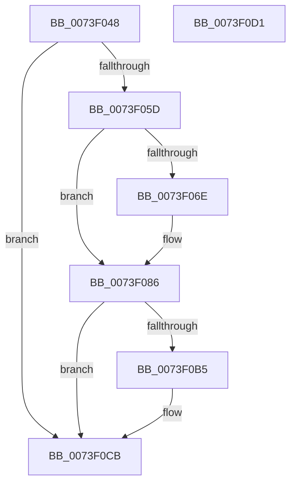

# PnpCancelStopDeviceNode

- RVA: `0x0073F048`–`0x0073F0D2` (길이 `138` bytes)
- VA: `0x000000014073F048`
- 실행 섹션: `PAGE`
- PDB 이름 있음: `예`; PDB Function 태그: `아니요`
- unwind 정보 RVA: `0x00064C80`
- 디코드: `34`개 명령, `138/138` bytes 표시
- 미해석 바이트: `0` (있으면 어셈블리에 `.byte`로 보존)

> 이 문서는 커널 이미지의 기계어와 PDB 기호를 분석해 생성했습니다. 4번과 5번은 함수 원형과 자료형을 바이너리 사용 방식에서 추정한 C 해석이며 원본 소스 복구 결과는 아닙니다.

## 1. Dependencies

- 직접 호출 지점: **6**; 고유 호출 대상: **6**
- 직접 호출자로 확인된 함수: **2**
- RIP 상대 이미지 참조: **0**

### Outgoing calls
- `0x0073F080` → [KeBugCheckEx](../../text/4F/KeBugCheckEx_function_004FD660.md) (function, `0x004FD660`)
- `0x0073F08A` → [PoFxIdleDevice](../../text/48/PoFxIdleDevice_function_00483EE8.md) (function, `0x00483EE8`)
- `0x0073F09C` → [IopQueryReconfiguration](IopQueryReconfiguration_function_0073DFD0.md) (function, `0x0073DFD0`)
- `0x0073F0A4` → [PipRestoreDevNodeState](../../text/5A/PipRestoreDevNodeState_function_005A7100.md) (function, `0x005A7100`)
- `0x0073F0B9` → [PnpUnlockMountableDevice](../../text/4C/PnpUnlockMountableDevice_function_004CDD2C.md) (function, `0x004CDD2C`)
- `0x0073F0C6` → [PipClearDevNodeFlags](../8F/PipClearDevNodeFlags_function_008F9F54.md) (function, `0x008F9F54`)

### Direct callers
- [PnpCancelStopDeviceSubtree](PnpCancelStopDeviceSubtree_function_0073F0D8.md) at `0x0073F0E1`
- [PnpQueryRebalanceWorker](PnpQueryRebalanceWorker_function_0073F2EC.md) at `0x0073F3CF`
- [PnpQueryRebalanceWorker](PnpQueryRebalanceWorker_function_0073F2EC.md) at `0x0073F3E9`

### Static image references
- 디코드된 RIP-relative 메모리 참조가 없습니다.

## 2. Other-region calls and transfers

- 다른 실행 섹션으로 향하는 call: **4**
  - `0x0073F080` → [KeBugCheckEx](../../text/4F/KeBugCheckEx_function_004FD660.md) (`PAGE` → `.text`)
  - `0x0073F08A` → [PoFxIdleDevice](../../text/48/PoFxIdleDevice_function_00483EE8.md) (`PAGE` → `.text`)
  - `0x0073F0A4` → [PipRestoreDevNodeState](../../text/5A/PipRestoreDevNodeState_function_005A7100.md) (`PAGE` → `.text`)
  - `0x0073F0B9` → [PnpUnlockMountableDevice](../../text/4C/PnpUnlockMountableDevice_function_004CDD2C.md) (`PAGE` → `.text`)
- 별도 외부 분기/꼬리 이동을 확인하지 못했습니다.

## 3. Assembly (complete function range)

```asm
0073F048  40 53                           push rbx
0073F04A  48 83 EC 30                     sub rsp, 0x30
0073F04E  81 B9 2C 01 00 00 0B 03 00 00   cmp dword ptr [rcx + 0x12c], 0x30b
0073F058  48 8B D9                        mov rbx, rcx
0073F05B  75 6E                           jne 0x14073f0cb
0073F05D  8B 81 C0 02 00 00               mov eax, dword ptr [rcx + 0x2c0]
0073F063  41 B9 20 00 00 00               mov r9d, 0x20
0073F069  41 84 C1                        test r9b, al
0073F06C  75 18                           jne 0x14073f086
0073F06E  48 83 64 24 20 00               and qword ptr [rsp + 0x20], 0
0073F074  41 8D 51 ED                     lea edx, [r9 - 0x13]
0073F078  4C 8B C1                        mov r8, rcx
0073F07B  B9 CA 00 00 00                  mov ecx, 0xca
0073F080  E8 DB E5 DB FF                  call 0x1404fd660
0073F085  CC                              int3
0073F086  48 8B 49 20                     mov rcx, qword ptr [rcx + 0x20]
0073F08A  E8 59 4E D4 FF                  call 0x140483ee8
0073F08F  48 8B 53 20                     mov rdx, qword ptr [rbx + 0x20]
0073F093  B1 06                           mov cl, 6
0073F095  83 A3 C0 02 00 00 DF            and dword ptr [rbx + 0x2c0], 0xffffffdf
0073F09C  E8 2F EF FF FF                  call 0x14073dfd0
0073F0A1  48 8B CB                        mov rcx, rbx
0073F0A4  E8 57 80 E6 FF                  call 0x1405a7100
0073F0A9  F7 83 8C 01 00 00 00 00 00 01   test dword ptr [rbx + 0x18c], 0x1000000
0073F0B3  74 16                           je 0x14073f0cb
0073F0B5  48 8B 4B 20                     mov rcx, qword ptr [rbx + 0x20]
0073F0B9  E8 6E EC D8 FF                  call 0x1404cdd2c
0073F0BE  BA 00 00 00 01                  mov edx, 0x1000000
0073F0C3  48 8B CB                        mov rcx, rbx
0073F0C6  E8 89 AE 1B 00                  call 0x1408f9f54
0073F0CB  48 83 C4 30                     add rsp, 0x30
0073F0CF  5B                              pop rbx
0073F0D0  C3                              ret
0073F0D1  CC                              int3
```

## 4. C-style interpretation (structured pseudocode)

```c
__int64 __fastcall PnpCancelStopDeviceNode(__int64 a1)
{
    __int64 result;
    __int64 v_rsp;
    unsigned __int64 v_stack_m18;

    v_rsp = (v_rsp) - (48);
    if ((*(unsigned int *)(a1 + 300)) != 779) goto loc_0073F0CB;
    result = (unsigned int)(*(unsigned int *)(a1 + 704));
    if (((32) & ((unsigned __int8)((unsigned int)(*(unsigned int *)(a1 + 704))))) == 0) {
        a2 = 32 - 19;
        a3 = a1;
        a1 = 202;
        result = KeBugCheckEx(a1, a2, a3, 32);
    }
    result = PoFxIdleDevice(*(unsigned __int64 *)(a1 + 32), a2, a3, 32);
    result = IopQueryReconfiguration(6, *(unsigned __int64 *)(a1 + 32), a3, 32);
    result = PipRestoreDevNodeState(a1, *(unsigned __int64 *)(a1 + 32), a3, 32);
    if (((*(unsigned int *)(a1 + 396)) & (0x1000000ULL)) != 0) {
        a1 = *(unsigned __int64 *)(a1 + 32);
        result = PnpUnlockMountableDevice(a1, *(unsigned __int64 *)(a1 + 32), a3, 32);
        a2 = 0x1000000ULL;
        a1 = a1;
        result = PipClearDevNodeFlags(a1, a2, a3, 32);
    }
    v_rsp = (v_rsp) + (48);
    return result;
}
```

## 5. (Beta) C Style

```c
int64_t PnpCancelStopDeviceNode(void *Arg1)
{
    uint8_t *arg1 = (uint8_t *)Arg1;

    int64_t result;
    int64_t local_rsp;
    uint64_t v_stack_m18;

    local_rsp = (local_rsp) - (48);
    if ((*(uint32_t *)(arg1 + 0x12C)) != 779) goto loc_0073F0CB;
    result = (uint32_t)(*(uint32_t *)(arg1 + 0x2C0));
    if (((32) & ((uint8_t)((uint32_t)(*(uint32_t *)(arg1 + 0x2C0))))) == 0) {
        a2 = 32 - 19;
        a3 = Arg1;
        Arg1 = 202;
        result = KeBugCheckEx(Arg1, a2, a3, 32);
    }
    result = PoFxIdleDevice(*(uint64_t *)(arg1 + 0x20), a2, a3, 32);
    result = IopQueryReconfiguration(6, *(uint64_t *)(arg1 + 0x20), a3, 32);
    result = PipRestoreDevNodeState(Arg1, *(uint64_t *)(arg1 + 0x20), a3, 32);
    if (((*(uint32_t *)(arg1 + 0x18C)) & (0x1000000ULL)) != 0) {
        Arg1 = *(uint64_t *)(arg1 + 0x20);
        result = PnpUnlockMountableDevice(Arg1, *(uint64_t *)(arg1 + 0x20), a3, 32);
        a2 = 0x1000000ULL;
        Arg1 = Arg1;
        result = PipClearDevNodeFlags(Arg1, a2, a3, 32);
    }
    local_rsp = (local_rsp) + (48);
    return result;
}
```

### 관측된 메모리 오프셋

구조체 형식이 확인되지 않은 접근은 인자 기준의 오프셋으로만 기록했습니다.

| 기준 인자 | 오프셋 표현 | 폭 (bit) | 접근 |
|---|---:|---:|---|
| `Arg1` | `+ 0x20` | `64` | `R` |
| `Arg1` | `+ 0x12C` | `32` | `R` |
| `Arg1` | `+ 0x18C` | `32` | `R` |
| `Arg1` | `+ 0x2C0` | `32` | `R` |
| `Arg1` | `+ 0x2C0` | `32` | `R/W` |

## 6. Execution-region graph

[열기: 2D/3D 그래프와 함수 탐색 컨트롤 패널](../../../control-panel.html?section=page&rva=0x0073F048&view=graph)

- 2D 그래프는 위에서 아래로 흐르고, 3D 그래프는 빈 공간을 드래그해 회전합니다. Shift+드래그는 이동, 휠은 확대·축소, 함수 노드 선택은 대상 보고서 이동입니다.

### Static fallback


