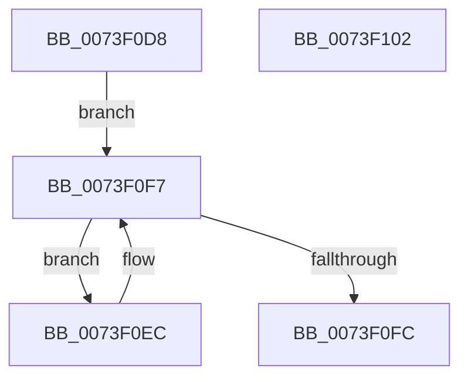

# PnpCancelStopDeviceSubtree

- RVA: `0x0073F0D8`–`0x0073F103` (길이 `43` bytes)
- VA: `0x000000014073F0D8`
- 실행 섹션: `PAGE`
- PDB 이름 있음: `예`; PDB Function 태그: `아니요`
- unwind 정보 RVA: `0x0005CF00`
- 디코드: `15`개 명령, `43/43` bytes 표시
- 미해석 바이트: `0` (있으면 어셈블리에 `.byte`로 보존)

> 이 문서는 커널 이미지의 기계어와 PDB 기호를 분석해 생성했습니다. 4번과 5번은 함수 원형과 자료형을 바이너리 사용 방식에서 추정한 C 해석이며 원본 소스 복구 결과는 아닙니다.

## 1. Dependencies

- 직접 호출 지점: **2**; 고유 호출 대상: **2**
- 직접 호출자로 확인된 함수: **2**
- RIP 상대 이미지 참조: **0**

### Outgoing calls
- `0x0073F0E1` → [PnpCancelStopDeviceNode](PnpCancelStopDeviceNode_function_0073F048.md) (function, `0x0073F048`)
- `0x0073F0EF` → [PnpCancelStopDeviceSubtree](PnpCancelStopDeviceSubtree_function_0073F0D8.md) (function, `0x0073F0D8`)

### Direct callers
- [PnpCancelStopDeviceSubtree](PnpCancelStopDeviceSubtree_function_0073F0D8.md) at `0x0073F0EF`
- [PnpRebalance](PnpRebalance_function_0073F508.md) at `0x0073F6F7`

### Static image references
- 디코드된 RIP-relative 메모리 참조가 없습니다.

## 2. Other-region calls and transfers

- 다른 실행 섹션으로 향하는 call: **0**
- 별도 외부 분기/꼬리 이동을 확인하지 못했습니다.

## 3. Assembly (complete function range)

```asm
0073F0D8  40 53                           push rbx
0073F0DA  48 83 EC 20                     sub rsp, 0x20
0073F0DE  48 8B D9                        mov rbx, rcx
0073F0E1  E8 62 FF FF FF                  call 0x14073f048
0073F0E6  48 8B 5B 08                     mov rbx, qword ptr [rbx + 8]
0073F0EA  EB 0B                           jmp 0x14073f0f7
0073F0EC  48 8B CB                        mov rcx, rbx
0073F0EF  E8 E4 FF FF FF                  call 0x14073f0d8
0073F0F4  48 8B 1B                        mov rbx, qword ptr [rbx]
0073F0F7  48 85 DB                        test rbx, rbx
0073F0FA  75 F0                           jne 0x14073f0ec
0073F0FC  48 83 C4 20                     add rsp, 0x20
0073F100  5B                              pop rbx
0073F101  C3                              ret
0073F102  CC                              int3
```

## 4. C-style interpretation (structured pseudocode)

```c
__int64 __fastcall PnpCancelStopDeviceSubtree(__int64 a1)
{
    __int64 result;
    __int64 v_rsp;

    v_rsp = (v_rsp) - (32);
    result = PnpCancelStopDeviceNode(a1, a2, a3, a4);
    goto loc_0073F0F7;
loc_0073F0EC:
    result = PnpCancelStopDeviceSubtree(*(unsigned __int64 *)(a1 + 8), a2, a3, a4);
loc_0073F0F7:
    if (*(unsigned __int64 *)(*(unsigned __int64 *)(a1 + 8)) != 0) goto loc_0073F0EC;
    v_rsp = (v_rsp) + (32);
    return result;
}
```

## 5. (Beta) C Style

```c
int64_t PnpCancelStopDeviceSubtree(void *Arg1)
{
    uint8_t *arg1 = (uint8_t *)Arg1;

    int64_t result;
    int64_t local_rsp;

    local_rsp = (local_rsp) - (32);
    result = PnpCancelStopDeviceNode(Arg1, a2, a3, a4);
    goto loc_0073F0F7;
loc_0073F0EC:
    result = PnpCancelStopDeviceSubtree(*(uint64_t *)(arg1 + 0x8), a2, a3, a4);
loc_0073F0F7:
    if (*(uint64_t *)(*(uint64_t *)(arg1 + 0x8)) != 0) goto loc_0073F0EC;
    local_rsp = (local_rsp) + (32);
    return result;
}
```

### 관측된 메모리 오프셋

구조체 형식이 확인되지 않은 접근은 인자 기준의 오프셋으로만 기록했습니다.

| 기준 인자 | 오프셋 표현 | 폭 (bit) | 접근 |
|---|---:|---:|---|
| `Arg1` | `+ 0x8` | `64` | `R` |

## 6. Execution-region graph

[열기: 2D/3D 그래프와 함수 탐색 컨트롤 패널](../../../control-panel.html?section=page&rva=0x0073F0D8&view=graph)

- 2D 그래프는 위에서 아래로 흐르고, 3D 그래프는 빈 공간을 드래그해 회전합니다. Shift+드래그는 이동, 휠은 확대·축소, 함수 노드 선택은 대상 보고서 이동입니다.

### Static fallback


