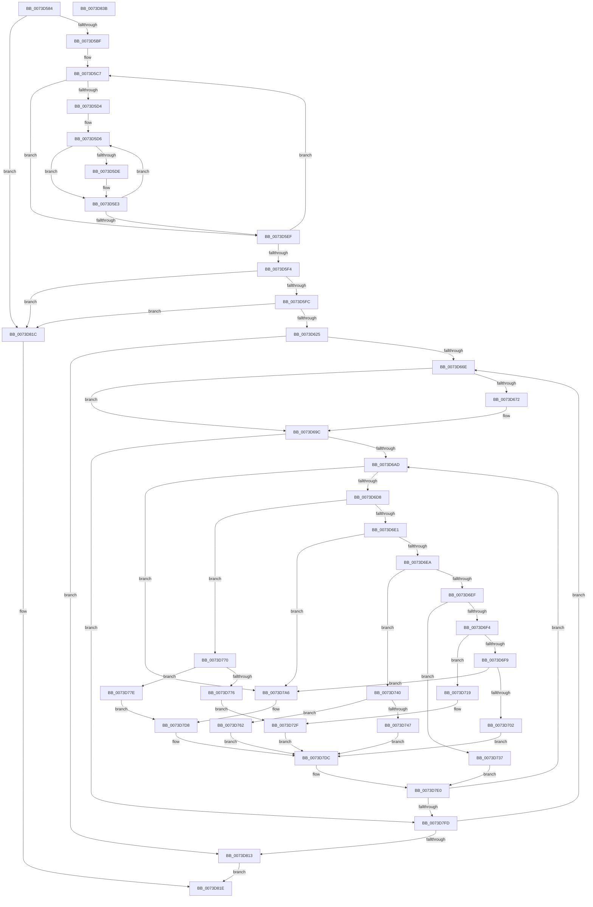

# PnpCmResourcesToIoResources

- RVA: `0x0073D584`–`0x0073D83C` (길이 `696` bytes)
- VA: `0x000000014073D584`
- 실행 섹션: `PAGE`
- PDB 이름 있음: `예`; PDB Function 태그: `아니요`
- unwind 정보 RVA: `0x000B0E24`
- 디코드: `200`개 명령, `696/696` bytes 표시
- 미해석 바이트: `0` (있으면 어셈블리에 `.byte`로 보존)

> 이 문서는 커널 이미지의 기계어와 PDB 기호를 분석해 생성했습니다. 4번과 5번은 함수 원형과 자료형을 바이너리 사용 방식에서 추정한 C 해석이며 원본 소스 복구 결과는 아닙니다.

## 1. Dependencies

- 직접 호출 지점: **2**; 고유 호출 대상: **2**
- 직접 호출자로 확인된 함수: **6**
- RIP 상대 이미지 참조: **0**

### Outgoing calls
- `0x0073D614` → [ExAllocatePool2](../../poolcode/B8/ExAllocatePool2_function_00B820F0.md) (function, `0x00B820F0`)
- `0x0073D7B4` → [RtlCmDecodeMemIoResource](../../text/4A/RtlCmDecodeMemIoResource_function_004A0120.md) (function, `0x004A0120`)

### Direct callers
- [PnpReleaseBootResourcesForFilteredRequirements](../../text/5A/PnpReleaseBootResourcesForFilteredRequirements_function_005A79D4.md) at `0x005A7A89`
- [IoReportResourceUsageInternal](../72/IoReportResourceUsageInternal_function_0072A398.md) at `0x0072A3EA`
- [IopAllocateBootResourcesInternal](../72/IopAllocateBootResourcesInternal_function_0072E708.md) at `0x0072E758`
- [PnpRestoreResourcesInternal](PnpRestoreResourcesInternal_function_0073EB10.md) at `0x0073EB47`
- [IopQueryDeviceResources](../8F/IopQueryDeviceResources_function_008FC344.md) at `0x008FC6A0`
- [PnpFilterResourceRequirementsList](../AD/PnpFilterResourceRequirementsList_function_00AD0D7C.md) at `0x00AD135E`
- [PnpFilterResourceRequirementsList](../AD/PnpFilterResourceRequirementsList_function_00AD0D7C.md) at `0x00AD14B7`

### Static image references
- 디코드된 RIP-relative 메모리 참조가 없습니다.

## 2. Other-region calls and transfers

- 다른 실행 섹션으로 향하는 call: **2**
  - `0x0073D614` → [ExAllocatePool2](../../poolcode/B8/ExAllocatePool2_function_00B820F0.md) (`PAGE` → `POOLCODE`)
  - `0x0073D7B4` → [RtlCmDecodeMemIoResource](../../text/4A/RtlCmDecodeMemIoResource_function_004A0120.md) (`PAGE` → `.text`)
- 별도 외부 분기/꼬리 이동을 확인하지 못했습니다.

## 3. Assembly (complete function range)

```asm
0073D584  48 89 5C 24 08                  mov qword ptr [rsp + 8], rbx
0073D589  48 89 6C 24 18                  mov qword ptr [rsp + 0x18], rbp
0073D58E  48 89 74 24 20                  mov qword ptr [rsp + 0x20], rsi
0073D593  57                              push rdi
0073D594  41 54                           push r12
0073D596  41 55                           push r13
0073D598  41 56                           push r14
0073D59A  41 57                           push r15
0073D59C  48 83 EC 20                     sub rsp, 0x20
0073D5A0  44 8B 0A                        mov r9d, dword ptr [rdx]
0073D5A3  4C 8D 72 04                     lea r14, [rdx + 4]
0073D5A7  45 33 E4                        xor r12d, r12d
0073D5AA  41 8B F8                        mov edi, r8d
0073D5AD  4C 8B EA                        mov r13, rdx
0073D5B0  41 8B DC                        mov ebx, r12d
0073D5B3  49 8B CE                        mov rcx, r14
0073D5B6  45 85 C9                        test r9d, r9d
0073D5B9  0F 84 5D 02 00 00               je 0x14073d81c
0073D5BF  45 8B C1                        mov r8d, r9d
0073D5C2  45 8D 7C 24 01                  lea r15d, [r12 + 1]
0073D5C7  8B 41 0C                        mov eax, dword ptr [rcx + 0xc]
0073D5CA  48 83 C1 10                     add rcx, 0x10
0073D5CE  03 D8                           add ebx, eax
0073D5D0  85 C0                           test eax, eax
0073D5D2  74 1B                           je 0x14073d5ef
0073D5D4  8B D0                           mov edx, eax
0073D5D6  80 39 05                        cmp byte ptr [rcx], 5
0073D5D9  41 8B C4                        mov eax, r12d
0073D5DC  75 05                           jne 0x14073d5e3
0073D5DE  8B 41 04                        mov eax, dword ptr [rcx + 4]
0073D5E1  FF CB                           dec ebx
0073D5E3  48 83 C1 14                     add rcx, 0x14
0073D5E7  48 03 C8                        add rcx, rax
0073D5EA  49 2B D7                        sub rdx, r15
0073D5ED  75 E7                           jne 0x14073d5d6
0073D5EF  4D 2B C7                        sub r8, r15
0073D5F2  75 D3                           jne 0x14073d5c7
0073D5F4  85 DB                           test ebx, ebx
0073D5F6  0F 84 20 02 00 00               je 0x14073d81c
0073D5FC  41 03 D9                        add ebx, r9d
0073D5FF  B9 00 01 00 00                  mov ecx, 0x100
0073D604  8B D3                           mov edx, ebx
0073D606  41 B8 50 6E 70 36               mov r8d, 0x36706e50
0073D60C  48 C1 E2 05                     shl rdx, 5
0073D610  48 83 C2 48                     add rdx, 0x48
0073D614  E8 D7 4A 44 00                  call 0x140b820f0
0073D619  48 8B F0                        mov rsi, rax
0073D61C  48 85 C0                        test rax, rax
0073D61F  0F 84 F7 01 00 00               je 0x14073d81c
0073D625  41 8B 06                        mov eax, dword ptr [r14]
0073D628  41 8B EC                        mov ebp, r12d
0073D62B  89 46 04                        mov dword ptr [rsi + 4], eax
0073D62E  41 8B 45 08                     mov eax, dword ptr [r13 + 8]
0073D632  89 5E 24                        mov dword ptr [rsi + 0x24], ebx
0073D635  48 8D 5E 48                     lea rbx, [rsi + 0x48]
0073D639  89 46 08                        mov dword ptr [rsi + 8], eax
0073D63C  4C 89 66 0C                     mov qword ptr [rsi + 0xc], r12
0073D640  4C 89 66 14                     mov qword ptr [rsi + 0x14], r12
0073D644  44 89 7E 1C                     mov dword ptr [rsi + 0x1c], r15d
0073D648  C7 46 20 01 00 01 00            mov dword ptr [rsi + 0x20], 0x10001
0073D64F  66 C7 46 28 01 80               mov word ptr [rsi + 0x28], 0x8001
0073D655  C7 46 2A 03 00 00 00            mov dword ptr [rsi + 0x2a], 3
0073D65C  66 44 89 66 2E                  mov word ptr [rsi + 0x2e], r12w
0073D661  89 7E 30                        mov dword ptr [rsi + 0x30], edi
0073D664  45 39 65 00                     cmp dword ptr [r13], r12d
0073D668  0F 86 A5 01 00 00               jbe 0x14073d813
0073D66E  85 ED                           test ebp, ebp
0073D670  74 2A                           je 0x14073d69c
0073D672  83 63 02 00                     and dword ptr [rbx + 2], 0
0073D676  66 C7 03 01 F0                  mov word ptr [rbx], 0xf001
0073D67B  66 44 89 63 06                  mov word ptr [rbx + 6], r12w
0073D680  41 8B 06                        mov eax, dword ptr [r14]
0073D683  83 F8 FF                        cmp eax, -1
0073D686  41 0F 44 C7                     cmove eax, r15d
0073D68A  89 43 08                        mov dword ptr [rbx + 8], eax
0073D68D  41 8B 46 04                     mov eax, dword ptr [r14 + 4]
0073D691  89 43 0C                        mov dword ptr [rbx + 0xc], eax
0073D694  44 89 63 10                     mov dword ptr [rbx + 0x10], r12d
0073D698  48 83 C3 20                     add rbx, 0x20
0073D69C  49 8D 7E 10                     lea rdi, [r14 + 0x10]
0073D6A0  45 8B FC                        mov r15d, r12d
0073D6A3  45 39 66 0C                     cmp dword ptr [r14 + 0xc], r12d
0073D6A7  0F 86 50 01 00 00               jbe 0x14073d7fd
0073D6AD  C6 03 01                        mov byte ptr [rbx], 1
0073D6B0  8A 07                           mov al, byte ptr [rdi]
0073D6B2  88 43 01                        mov byte ptr [rbx + 1], al
0073D6B5  8A 47 01                        mov al, byte ptr [rdi + 1]
0073D6B8  88 43 02                        mov byte ptr [rbx + 2], al
0073D6BB  0F B7 47 02                     movzx eax, word ptr [rdi + 2]
0073D6BF  66 89 43 04                     mov word ptr [rbx + 4], ax
0073D6C3  44 88 63 03                     mov byte ptr [rbx + 3], r12b
0073D6C7  66 44 89 63 06                  mov word ptr [rbx + 6], r12w
0073D6CC  0F B6 0F                        movzx ecx, byte ptr [rdi]
0073D6CF  83 E9 01                        sub ecx, 1
0073D6D2  0F 84 CE 00 00 00               je 0x14073d7a6
0073D6D8  83 E9 01                        sub ecx, 1
0073D6DB  0F 84 8F 00 00 00               je 0x14073d770
0073D6E1  83 E9 01                        sub ecx, 1
0073D6E4  0F 84 BC 00 00 00               je 0x14073d7a6
0073D6EA  83 E9 01                        sub ecx, 1
0073D6ED  74 51                           je 0x14073d740
0073D6EF  83 E9 01                        sub ecx, 1
0073D6F2  74 43                           je 0x14073d737
0073D6F4  83 E9 01                        sub ecx, 1
0073D6F7  74 20                           je 0x14073d719
0073D6F9  83 F9 01                        cmp ecx, 1
0073D6FC  0F 84 A4 00 00 00               je 0x14073d7a6
0073D702  8B 47 04                        mov eax, dword ptr [rdi + 4]
0073D705  89 43 08                        mov dword ptr [rbx + 8], eax
0073D708  8B 47 08                        mov eax, dword ptr [rdi + 8]
0073D70B  89 43 0C                        mov dword ptr [rbx + 0xc], eax
0073D70E  8B 47 0C                        mov eax, dword ptr [rdi + 0xc]
0073D711  89 43 10                        mov dword ptr [rbx + 0x10], eax
0073D714  E9 C3 00 00 00                  jmp 0x14073d7dc
0073D719  8B 47 04                        mov eax, dword ptr [rdi + 4]
0073D71C  89 43 0C                        mov dword ptr [rbx + 0xc], eax
0073D71F  8B 47 04                        mov eax, dword ptr [rdi + 4]
0073D722  8B 4F 08                        mov ecx, dword ptr [rdi + 8]
0073D725  FF C8                           dec eax
0073D727  03 C8                           add ecx, eax
0073D729  89 4B 10                        mov dword ptr [rbx + 0x10], ecx
0073D72C  8B 47 08                        mov eax, dword ptr [rdi + 8]
0073D72F  89 43 08                        mov dword ptr [rbx + 8], eax
0073D732  E9 A5 00 00 00                  jmp 0x14073d7dc
0073D737  44 8B 67 04                     mov r12d, dword ptr [rdi + 4]
0073D73B  E9 A0 00 00 00                  jmp 0x14073d7e0
0073D740  8A 47 02                        mov al, byte ptr [rdi + 2]
0073D743  84 C0                           test al, al
0073D745  79 1B                           jns 0x14073d762
0073D747  8B 47 08                        mov eax, dword ptr [rdi + 8]
0073D74A  89 43 08                        mov dword ptr [rbx + 8], eax
0073D74D  8B 47 08                        mov eax, dword ptr [rdi + 8]
0073D750  89 43 0C                        mov dword ptr [rbx + 0xc], eax
0073D753  8B 47 04                        mov eax, dword ptr [rdi + 4]
0073D756  89 43 10                        mov dword ptr [rbx + 0x10], eax
0073D759  0F B6 47 0C                     movzx eax, byte ptr [rdi + 0xc]
0073D75D  89 43 14                        mov dword ptr [rbx + 0x14], eax
0073D760  EB 7A                           jmp 0x14073d7dc
0073D762  8B 47 04                        mov eax, dword ptr [rdi + 4]
0073D765  89 43 08                        mov dword ptr [rbx + 8], eax
0073D768  8B 47 04                        mov eax, dword ptr [rdi + 4]
0073D76B  89 43 0C                        mov dword ptr [rbx + 0xc], eax
0073D76E  EB 6C                           jmp 0x14073d7dc
0073D770  F6 47 02 02                     test byte ptr [rdi + 2], 2
0073D774  75 08                           jne 0x14073d77e
0073D776  8B 47 08                        mov eax, dword ptr [rdi + 8]
0073D779  89 43 0C                        mov dword ptr [rbx + 0xc], eax
0073D77C  EB B1                           jmp 0x14073d72f
0073D77E  C7 43 0C FE FF FF FF            mov dword ptr [rbx + 0xc], 0xfffffffe
0073D785  0F B7 47 06                     movzx eax, word ptr [rdi + 6]
0073D789  83 63 14 00                     and dword ptr [rbx + 0x14], 0
0073D78D  F7 D0                           not eax
0073D78F  89 43 08                        mov dword ptr [rbx + 8], eax
0073D792  66 C7 43 10 04 00               mov word ptr [rbx + 0x10], 4
0073D798  0F B7 47 04                     movzx eax, word ptr [rdi + 4]
0073D79C  66 89 43 12                     mov word ptr [rbx + 0x12], ax
0073D7A0  48 8B 47 0C                     mov rax, qword ptr [rdi + 0xc]
0073D7A4  EB 32                           jmp 0x14073d7d8
0073D7A6  48 83 64 24 58 00               and qword ptr [rsp + 0x58], 0
0073D7AC  48 8D 54 24 58                  lea rdx, [rsp + 0x58]
0073D7B1  48 8B CF                        mov rcx, rdi
0073D7B4  E8 67 29 D6 FF                  call 0x1404a0120
0073D7B9  48 8B C8                        mov rcx, rax
0073D7BC  8B 47 0C                        mov eax, dword ptr [rdi + 0xc]
0073D7BF  89 43 08                        mov dword ptr [rbx + 8], eax
0073D7C2  48 8B 44 24 58                  mov rax, qword ptr [rsp + 0x58]
0073D7C7  48 89 43 10                     mov qword ptr [rbx + 0x10], rax
0073D7CB  48 FF C8                        dec rax
0073D7CE  48 03 C1                        add rax, rcx
0073D7D1  C7 43 0C 01 00 00 00            mov dword ptr [rbx + 0xc], 1
0073D7D8  48 89 43 18                     mov qword ptr [rbx + 0x18], rax
0073D7DC  48 83 C3 20                     add rbx, 0x20
0073D7E0  41 8B C4                        mov eax, r12d
0073D7E3  48 83 C7 14                     add rdi, 0x14
0073D7E7  48 03 F8                        add rdi, rax
0073D7EA  41 FF C7                        inc r15d
0073D7ED  41 BC 00 00 00 00               mov r12d, 0
0073D7F3  45 3B 7E 0C                     cmp r15d, dword ptr [r14 + 0xc]
0073D7F7  0F 82 B0 FE FF FF               jb 0x14073d6ad
0073D7FD  41 BF 01 00 00 00               mov r15d, 1
0073D803  4C 8B F7                        mov r14, rdi
0073D806  41 03 EF                        add ebp, r15d
0073D809  41 3B 6D 00                     cmp ebp, dword ptr [r13]
0073D80D  0F 82 5B FE FF FF               jb 0x14073d66e
0073D813  2B DE                           sub ebx, esi
0073D815  48 8B C6                        mov rax, rsi
0073D818  89 1E                           mov dword ptr [rsi], ebx
0073D81A  EB 02                           jmp 0x14073d81e
0073D81C  33 C0                           xor eax, eax
0073D81E  48 8B 5C 24 50                  mov rbx, qword ptr [rsp + 0x50]
0073D823  48 8B 6C 24 60                  mov rbp, qword ptr [rsp + 0x60]
0073D828  48 8B 74 24 68                  mov rsi, qword ptr [rsp + 0x68]
0073D82D  48 83 C4 20                     add rsp, 0x20
0073D831  41 5F                           pop r15
0073D833  41 5E                           pop r14
0073D835  41 5D                           pop r13
0073D837  41 5C                           pop r12
0073D839  5F                              pop rdi
0073D83A  C3                              ret
0073D83B  CC                              int3
```

## 4. C-style interpretation (structured pseudocode)

```c
__int64 __fastcall PnpCmResourcesToIoResources(__int64 a1, __int64 a2, int a3)
{
    __int64 result;
    __int64 v_r12;
    __int64 v_r15;
    __int64 v_rbp;
    __int64 v_rbx;
    __int64 v_rdi;
    __int64 v_rsp;
    unsigned __int64 v_stack_p10;
    unsigned __int64 v_stack_p18;
    unsigned __int64 v_stack_p20;
    unsigned __int64 v_stack_p8;

    v_stack_p8 = v_rbx;
    v_stack_p18 = v_rbp;
    v_stack_p20 = v_rsi;
    v_rsp = (v_rsp) - (32);
    v_r12 = 0;
    if ((unsigned int)((unsigned int)(*(unsigned int *)(a2))) == 0) goto loc_0073D81C;
loc_0073D5C7:
    a1 = (a2 + 4) + (16);
    v_rbx = (unsigned int)((0) + ((unsigned int)((unsigned int)(*(unsigned int *)(a2 + 4 + 12)))));
    if ((unsigned int)((unsigned int)(*(unsigned int *)(a2 + 4 + 12))) == 0) goto loc_0073D5EF;
loc_0073D5D6:
    result = 0;
    if ((*(unsigned __int8 *)(a1)) == 5) {
        result = *(unsigned int *)(a1 + 4);
        v_rbx = (unsigned int)((v_rbx) - 1);
    }
    a1 = (a1) + (20);
    a1 = (a1) + (result);
    a2 = ((unsigned int)((unsigned int)((unsigned int)(*(unsigned int *)(a2 + 4 + 12))))) - (v_r12 + 1);
    if (condition_is_not_equal) goto loc_0073D5D6;
loc_0073D5EF:
    a3 = ((unsigned int)((unsigned int)((unsigned int)(*(unsigned int *)(a2))))) - (v_r12 + 1);
    if (condition_is_not_equal) goto loc_0073D5C7;
    if ((unsigned int)(v_rbx) == 0) goto loc_0073D81C;
    v_rbx = (unsigned int)((v_rbx) + ((unsigned int)((unsigned int)(*(unsigned int *)(a2)))));
    a2 = ((unsigned int)((unsigned int)(v_rbx))) << (5);
    a2 = (a2) + (72);
    result = ExAllocatePool2(256, a2, (unsigned int)(0x36706E50ULL), (unsigned int)(*(unsigned int *)(a2)));
    if (result == 0) goto loc_0073D81C;
    *(unsigned int *)(result + 4) = (unsigned int)((unsigned int)(*(unsigned int *)(a2 + 4)));
    *(unsigned int *)(result + 36) = (unsigned int)(v_rbx);
    *(unsigned int *)(result + 8) = (unsigned int)((unsigned int)(*(unsigned int *)(a2 + 8)));
    *(unsigned __int64 *)(result + 12) = 0;
    *(unsigned __int64 *)(result + 20) = 0;
    *(unsigned int *)(result + 28) = (unsigned int)(v_r12 + 1);
    *(unsigned int *)(result + 32) = 0x10001ULL;
    *(unsigned __int16 *)(result + 40) = 0x8001ULL;
    *(unsigned int *)(result + 42) = 3;
    *(unsigned __int16 *)(result + 46) = 0;
    *(unsigned int *)(result + 48) = (unsigned int)((unsigned int)(a3));
    if ((*(unsigned int *)(a2)) <= 0) goto loc_0073D813;
loc_0073D66E:
    result = (unsigned int)(*(unsigned int *)(a2 + 8));
    v_rbx = result + 72;
    if (0 != 0) {
        *(unsigned __int16 *)(result + 72) = 0xF001ULL;
        *(unsigned __int16 *)(result + 72 + 6) = 0;
        result = *(unsigned int *)(a2 + 4);
        if (((unsigned int)(result)) == -1) { result = (unsigned int)(v_r12 + 1); }
        *(unsigned int *)(result + 72 + 8) = (unsigned int)(result);
        result = *(unsigned int *)(a2 + 4 + 4);
        *(unsigned int *)(result + 72 + 12) = (unsigned int)(result);
        *(unsigned int *)(result + 72 + 16) = 0;
        v_rbx = (result + 72) + (32);
    }
    if ((*(unsigned int *)(a2 + 4 + 12)) <= 0) goto loc_0073D7FD;
loc_0073D6AD:
    *(unsigned __int8 *)(v_rbx) = 1;
    *(unsigned __int8 *)(v_rbx + 1) = (unsigned __int8)(*(unsigned __int8 *)(a2 + 4 + 16));
    *(unsigned __int8 *)(v_rbx + 2) = (unsigned __int8)(*(unsigned __int8 *)(a2 + 4 + 16 + 1));
    *(unsigned __int16 *)(v_rbx + 4) = (unsigned __int16)(*(unsigned __int16 *)(a2 + 4 + 16 + 2));
    *(unsigned __int8 *)(v_rbx + 3) = 0;
    *(unsigned __int16 *)(v_rbx + 6) = 0;
    a1 = (unsigned int)((*(unsigned __int8 *)(a2 + 4 + 16)) - (1));
    if (condition_is_equal) goto loc_0073D7A6;
    a1 = (unsigned int)((a1) - (1));
    if (condition_is_equal) goto loc_0073D770;
    a1 = (unsigned int)((a1) - (1));
    if (condition_is_equal) goto loc_0073D7A6;
    a1 = (unsigned int)((a1) - (1));
    if (condition_is_equal) goto loc_0073D740;
    a1 = (unsigned int)((a1) - (1));
    if (condition_is_equal) goto loc_0073D737;
    a1 = (unsigned int)((a1) - (1));
    if (condition_is_equal) goto loc_0073D719;
    if (((unsigned int)(a1)) == 1) goto loc_0073D7A6;
    *(unsigned int *)(v_rbx + 8) = (unsigned int)((unsigned int)(*(unsigned int *)(a2 + 4 + 16 + 4)));
    *(unsigned int *)(v_rbx + 12) = (unsigned int)((unsigned int)(*(unsigned int *)(a2 + 4 + 16 + 8)));
    *(unsigned int *)(v_rbx + 16) = (unsigned int)((unsigned int)(*(unsigned int *)(a2 + 4 + 16 + 12)));
    goto loc_0073D7DC;
loc_0073D719:
    *(unsigned int *)(v_rbx + 12) = (unsigned int)((unsigned int)(*(unsigned int *)(a2 + 4 + 16 + 4)));
    result = (unsigned int)(((unsigned int)(*(unsigned int *)(a2 + 4 + 16 + 4))) - 1);
    a1 = (unsigned int)(((unsigned int)(*(unsigned int *)(a2 + 4 + 16 + 8))) + ((unsigned int)(result)));
    *(unsigned int *)(v_rbx + 16) = (unsigned int)(a1);
loc_0073D72F:
    *(unsigned int *)(v_rbx + 8) = (unsigned int)((unsigned int)(*(unsigned int *)(a2 + 4 + 16 + 8)));
    goto loc_0073D7DC;
loc_0073D737:
    goto loc_0073D7E0;
loc_0073D740:
    if (!sign_flag) goto loc_0073D762;
    *(unsigned int *)(v_rbx + 8) = (unsigned int)((unsigned int)(*(unsigned int *)(a2 + 4 + 16 + 8)));
    *(unsigned int *)(v_rbx + 12) = (unsigned int)((unsigned int)(*(unsigned int *)(a2 + 4 + 16 + 8)));
    *(unsigned int *)(v_rbx + 16) = (unsigned int)((unsigned int)(*(unsigned int *)(a2 + 4 + 16 + 4)));
    *(unsigned int *)(v_rbx + 20) = (unsigned int)(*(unsigned __int8 *)(a2 + 4 + 16 + 12));
    goto loc_0073D7DC;
loc_0073D762:
    *(unsigned int *)(v_rbx + 8) = (unsigned int)((unsigned int)(*(unsigned int *)(a2 + 4 + 16 + 4)));
    *(unsigned int *)(v_rbx + 12) = (unsigned int)((unsigned int)(*(unsigned int *)(a2 + 4 + 16 + 4)));
    goto loc_0073D7DC;
loc_0073D770:
    if (((*(unsigned __int8 *)(a2 + 4 + 16 + 2)) & (2)) != 0) goto loc_0073D77E;
    *(unsigned int *)(v_rbx + 12) = (unsigned int)((unsigned int)(*(unsigned int *)(a2 + 4 + 16 + 8)));
    goto loc_0073D72F;
loc_0073D77E:
    *(unsigned int *)(v_rbx + 12) = 0xFFFFFFFEULL;
    result = (unsigned int)(~(*(unsigned __int16 *)(a2 + 4 + 16 + 6)));
    *(unsigned int *)(v_rbx + 8) = (unsigned int)(result);
    *(unsigned __int16 *)(v_rbx + 16) = 4;
    *(unsigned __int16 *)(v_rbx + 18) = (unsigned __int16)(*(unsigned __int16 *)(a2 + 4 + 16 + 4));
    goto loc_0073D7D8;
loc_0073D7A6:
    result = RtlCmDecodeMemIoResource(a2 + 4 + 16, v_stack_p10, (unsigned int)(0x36706E50ULL), (unsigned int)(*(unsigned int *)(a2)));
    *(unsigned int *)(v_rbx + 8) = (unsigned int)((unsigned int)(*(unsigned int *)(a2 + 4 + 16 + 12)));
    *(unsigned __int64 *)(v_rbx + 16) = v_stack_p10;
    result = (v_stack_p10) - 1;
    result = (result) + (result);
    *(unsigned int *)(v_rbx + 12) = 1;
loc_0073D7D8:
    *(unsigned __int64 *)(v_rbx + 24) = result;
loc_0073D7DC:
    v_rbx = (v_rbx) + (32);
loc_0073D7E0:
    v_rdi = (a2 + 4 + 16) + (20);
    v_rdi = (v_rdi) + ((unsigned int)((unsigned int)((unsigned int)(*(unsigned int *)(a2 + 4 + 16 + 4)))));
    v_r15 = (unsigned int)((0) + 1);
    if (((unsigned int)(v_r15)) < (*(unsigned int *)(a2 + 4 + 12))) goto loc_0073D6AD;
loc_0073D7FD:
    v_rbp = (unsigned int)((0) + (1));
    if (((unsigned int)(v_rbp)) < (*(unsigned int *)(a2))) goto loc_0073D66E;
loc_0073D813:
    v_rbx = (unsigned int)((v_rbx) - ((unsigned int)(result)));
    *(unsigned int *)(result) = (unsigned int)(v_rbx);
    goto loc_0073D81E;
loc_0073D81C:
    result = 0;
loc_0073D81E:
    v_rsp = (v_rsp) + (32);
    return result;
}
```

## 5. (Beta) C Style

```c
int64_t PnpCmResourcesToIoResources(int64_t Arg1, void *Arg2, int32_t Arg3)
{
    uint8_t *arg2 = (uint8_t *)Arg2;

    int64_t result;
    int64_t local_r12;
    int64_t local_r15;
    int64_t local_rbp;
    int64_t local_rbx;
    int64_t local_rdi;
    int64_t local_rsp;
    uint64_t v_stack_p10;
    uint64_t v_stack_p18;
    uint64_t v_stack_p20;
    uint64_t v_stack_p8;

    v_stack_p8 = local_rbx;
    v_stack_p18 = local_rbp;
    v_stack_p20 = local_rsi;
    local_rsp = (local_rsp) - (32);
    local_r12 = 0;
    if ((uint32_t)((uint32_t)(*(uint32_t *)(arg2))) == 0) goto loc_0073D81C;
loc_0073D5C7:
    Arg1 = (Arg2 + 4) + (16);
    local_rbx = (uint32_t)((0) + ((uint32_t)((uint32_t)(*(uint32_t *)(arg2 + 0x4 + 0xC)))));
    if ((uint32_t)((uint32_t)(*(uint32_t *)(arg2 + 0x4 + 0xC))) == 0) goto loc_0073D5EF;
loc_0073D5D6:
    result = 0;
    if ((*(uint8_t *)(Arg1)) == 5) {
        result = *(uint32_t *)(Arg1 + 0x4);
        local_rbx = (uint32_t)((local_rbx) - 1);
    }
    Arg1 = (Arg1) + (20);
    Arg1 = (Arg1) + (result);
    Arg2 = ((uint32_t)((uint32_t)((uint32_t)(*(uint32_t *)(arg2 + 0x4 + 0xC))))) - (local_r12 + 1);
    if (condition_is_not_equal) goto loc_0073D5D6;
loc_0073D5EF:
    Arg3 = ((uint32_t)((uint32_t)((uint32_t)(*(uint32_t *)(arg2))))) - (local_r12 + 1);
    if (condition_is_not_equal) goto loc_0073D5C7;
    if ((uint32_t)(local_rbx) == 0) goto loc_0073D81C;
    local_rbx = (uint32_t)((local_rbx) + ((uint32_t)((uint32_t)(*(uint32_t *)(arg2)))));
    Arg2 = ((uint32_t)((uint32_t)(local_rbx))) << (5);
    Arg2 = (Arg2) + (72);
    result = ExAllocatePool2(256, Arg2, (uint32_t)(0x36706E50ULL), (uint32_t)(*(uint32_t *)(arg2)));
    if (result == 0) goto loc_0073D81C;
    *(uint32_t *)(result + 0x4) = (uint32_t)((uint32_t)(*(uint32_t *)(arg2 + 0x4)));
    *(uint32_t *)(result + 0x24) = (uint32_t)(local_rbx);
    *(uint32_t *)(result + 0x8) = (uint32_t)((uint32_t)(*(uint32_t *)(arg2 + 0x8)));
    *(uint64_t *)(result + 0xC) = 0;
    *(uint64_t *)(result + 0x14) = 0;
    *(uint32_t *)(result + 0x1C) = (uint32_t)(local_r12 + 1);
    *(uint32_t *)(result + 0x20) = 0x10001ULL;
    *(uint16_t *)(result + 0x28) = 0x8001ULL;
    *(uint32_t *)(result + 0x2A) = 3;
    *(uint16_t *)(result + 0x2E) = 0;
    *(uint32_t *)(result + 0x30) = (uint32_t)((uint32_t)(Arg3));
    if ((*(uint32_t *)(arg2)) <= 0) goto loc_0073D813;
loc_0073D66E:
    result = (uint32_t)(*(uint32_t *)(arg2 + 0x8));
    local_rbx = result + 72;
    if (0 != 0) {
        *(uint16_t *)(result + 0x48) = 0xF001ULL;
        *(uint16_t *)(result + 0x48 + 0x6) = 0;
        result = *(uint32_t *)(arg2 + 0x4);
        if (((uint32_t)(result)) == -1) { result = (uint32_t)(local_r12 + 1); }
        *(uint32_t *)(result + 0x48 + 0x8) = (uint32_t)(result);
        result = *(uint32_t *)(arg2 + 0x4 + 0x4);
        *(uint32_t *)(result + 0x48 + 0xC) = (uint32_t)(result);
        *(uint32_t *)(result + 0x48 + 0x10) = 0;
        local_rbx = (result + 72) + (32);
    }
    if ((*(uint32_t *)(arg2 + 0x4 + 0xC)) <= 0) goto loc_0073D7FD;
loc_0073D6AD:
    *(uint8_t *)(local_rbx) = 1;
    *(uint8_t *)(local_rbx + 0x1) = (uint8_t)(*(uint8_t *)(arg2 + 0x4 + 0x10));
    *(uint8_t *)(local_rbx + 0x2) = (uint8_t)(*(uint8_t *)(arg2 + 0x4 + 0x10 + 0x1));
    *(uint16_t *)(local_rbx + 0x4) = (uint16_t)(*(uint16_t *)(arg2 + 0x4 + 0x10 + 0x2));
    *(uint8_t *)(local_rbx + 0x3) = 0;
    *(uint16_t *)(local_rbx + 0x6) = 0;
    Arg1 = (uint32_t)((*(uint8_t *)(arg2 + 0x4 + 0x10)) - (1));
    if (condition_is_equal) goto loc_0073D7A6;
    Arg1 = (uint32_t)((Arg1) - (1));
    if (condition_is_equal) goto loc_0073D770;
    Arg1 = (uint32_t)((Arg1) - (1));
    if (condition_is_equal) goto loc_0073D7A6;
    Arg1 = (uint32_t)((Arg1) - (1));
    if (condition_is_equal) goto loc_0073D740;
    Arg1 = (uint32_t)((Arg1) - (1));
    if (condition_is_equal) goto loc_0073D737;
    Arg1 = (uint32_t)((Arg1) - (1));
    if (condition_is_equal) goto loc_0073D719;
    if (((uint32_t)(Arg1)) == 1) goto loc_0073D7A6;
    *(uint32_t *)(local_rbx + 0x8) = (uint32_t)((uint32_t)(*(uint32_t *)(arg2 + 0x4 + 0x10 + 0x4)));
    *(uint32_t *)(local_rbx + 0xC) = (uint32_t)((uint32_t)(*(uint32_t *)(arg2 + 0x4 + 0x10 + 0x8)));
    *(uint32_t *)(local_rbx + 0x10) = (uint32_t)((uint32_t)(*(uint32_t *)(arg2 + 0x4 + 0x10 + 0xC)));
    goto loc_0073D7DC;
loc_0073D719:
    *(uint32_t *)(local_rbx + 0xC) = (uint32_t)((uint32_t)(*(uint32_t *)(arg2 + 0x4 + 0x10 + 0x4)));
    result = (uint32_t)(((uint32_t)(*(uint32_t *)(arg2 + 0x4 + 0x10 + 0x4))) - 1);
    Arg1 = (uint32_t)(((uint32_t)(*(uint32_t *)(arg2 + 0x4 + 0x10 + 0x8))) + ((uint32_t)(result)));
    *(uint32_t *)(local_rbx + 0x10) = (uint32_t)(Arg1);
loc_0073D72F:
    *(uint32_t *)(local_rbx + 0x8) = (uint32_t)((uint32_t)(*(uint32_t *)(arg2 + 0x4 + 0x10 + 0x8)));
    goto loc_0073D7DC;
loc_0073D737:
    goto loc_0073D7E0;
loc_0073D740:
    if (!sign_flag) goto loc_0073D762;
    *(uint32_t *)(local_rbx + 0x8) = (uint32_t)((uint32_t)(*(uint32_t *)(arg2 + 0x4 + 0x10 + 0x8)));
    *(uint32_t *)(local_rbx + 0xC) = (uint32_t)((uint32_t)(*(uint32_t *)(arg2 + 0x4 + 0x10 + 0x8)));
    *(uint32_t *)(local_rbx + 0x10) = (uint32_t)((uint32_t)(*(uint32_t *)(arg2 + 0x4 + 0x10 + 0x4)));
    *(uint32_t *)(local_rbx + 0x14) = (uint32_t)(*(uint8_t *)(arg2 + 0x4 + 0x10 + 0xC));
    goto loc_0073D7DC;
loc_0073D762:
    *(uint32_t *)(local_rbx + 0x8) = (uint32_t)((uint32_t)(*(uint32_t *)(arg2 + 0x4 + 0x10 + 0x4)));
    *(uint32_t *)(local_rbx + 0xC) = (uint32_t)((uint32_t)(*(uint32_t *)(arg2 + 0x4 + 0x10 + 0x4)));
    goto loc_0073D7DC;
loc_0073D770:
    if (((*(uint8_t *)(arg2 + 0x4 + 0x10 + 0x2)) & (2)) != 0) goto loc_0073D77E;
    *(uint32_t *)(local_rbx + 0xC) = (uint32_t)((uint32_t)(*(uint32_t *)(arg2 + 0x4 + 0x10 + 0x8)));
    goto loc_0073D72F;
loc_0073D77E:
    *(uint32_t *)(local_rbx + 0xC) = 0xFFFFFFFEULL;
    result = (uint32_t)(~(*(uint16_t *)(arg2 + 0x4 + 0x10 + 0x6)));
    *(uint32_t *)(local_rbx + 0x8) = (uint32_t)(result);
    *(uint16_t *)(local_rbx + 0x10) = 4;
    *(uint16_t *)(local_rbx + 0x12) = (uint16_t)(*(uint16_t *)(arg2 + 0x4 + 0x10 + 0x4));
    goto loc_0073D7D8;
loc_0073D7A6:
    result = RtlCmDecodeMemIoResource(Arg2 + 4 + 16, v_stack_p10, (uint32_t)(0x36706E50ULL), (uint32_t)(*(uint32_t *)(arg2)));
    *(uint32_t *)(local_rbx + 0x8) = (uint32_t)((uint32_t)(*(uint32_t *)(arg2 + 0x4 + 0x10 + 0xC)));
    *(uint64_t *)(local_rbx + 0x10) = v_stack_p10;
    result = (v_stack_p10) - 1;
    result = (result) + (result);
    *(uint32_t *)(local_rbx + 0xC) = 1;
loc_0073D7D8:
    *(uint64_t *)(local_rbx + 0x18) = result;
loc_0073D7DC:
    local_rbx = (local_rbx) + (32);
loc_0073D7E0:
    local_rdi = (Arg2 + 4 + 16) + (20);
    local_rdi = (local_rdi) + ((uint32_t)((uint32_t)((uint32_t)(*(uint32_t *)(arg2 + 0x4 + 0x10 + 0x4)))));
    local_r15 = (uint32_t)((0) + 1);
    if (((uint32_t)(local_r15)) < (*(uint32_t *)(arg2 + 0x4 + 0xC))) goto loc_0073D6AD;
loc_0073D7FD:
    local_rbp = (uint32_t)((0) + (1));
    if (((uint32_t)(local_rbp)) < (*(uint32_t *)(arg2))) goto loc_0073D66E;
loc_0073D813:
    local_rbx = (uint32_t)((local_rbx) - ((uint32_t)(result)));
    *(uint32_t *)(result) = (uint32_t)(local_rbx);
    goto loc_0073D81E;
loc_0073D81C:
    result = 0;
loc_0073D81E:
    local_rsp = (local_rsp) + (32);
    return result;
}
```

### 관측된 메모리 오프셋

구조체 형식이 확인되지 않은 접근은 인자 기준의 오프셋으로만 기록했습니다.

| 기준 인자 | 오프셋 표현 | 폭 (bit) | 접근 |
|---|---:|---:|---|
| `Arg2` | `+ 0x0` | `8` | `R` |
| `Arg2` | `+ 0x0` | `32` | `R` |
| `Arg2` | `+ 0x1` | `8` | `R` |
| `Arg2` | `+ 0x2` | `8` | `R` |
| `Arg2` | `+ 0x2` | `16` | `R` |
| `Arg2` | `+ 0x4` | `16` | `R` |
| `Arg2` | `+ 0x4` | `32` | `R` |
| `Arg2` | `+ 0x4` | `64` | `R` |
| `Arg2` | `+ 0x6` | `16` | `R` |
| `Arg2` | `+ 0x8` | `32` | `R` |
| `Arg2` | `+ 0xC` | `8` | `R` |
| `Arg2` | `+ 0xC` | `32` | `R` |
| `Arg2` | `+ 0xC` | `64` | `R` |
| `Arg2` | `+ 0x10` | `64` | `R` |

## 6. Execution-region graph

[열기: 2D/3D 그래프와 함수 탐색 컨트롤 패널](../../../control-panel.html?section=page&rva=0x0073D584&view=graph)

- 2D 그래프는 위에서 아래로 흐르고, 3D 그래프는 빈 공간을 드래그해 회전합니다. Shift+드래그는 이동, 휠은 확대·축소, 함수 노드 선택은 대상 보고서 이동입니다.

### Static fallback


