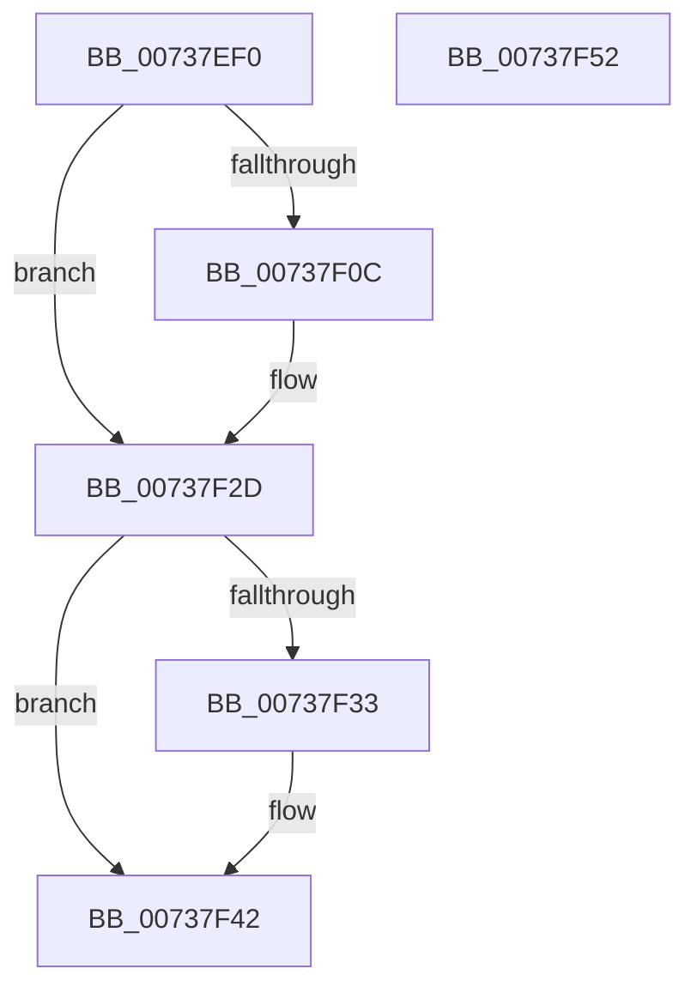

# PnpCollectOpenHandlesCallBack

- RVA: `0x00737EF0`–`0x00737F53` (길이 `99` bytes)
- VA: `0x0000000140737EF0`
- 실행 섹션: `PAGE`
- PDB 이름 있음: `예`; PDB Function 태그: `아니요`
- unwind 정보 RVA: `0x0006E5F8`
- 디코드: `27`개 명령, `99/99` bytes 표시
- 미해석 바이트: `0` (있으면 어셈블리에 `.byte`로 보존)

> 이 문서는 커널 이미지의 기계어와 PDB 기호를 분석해 생성했습니다. 4번과 5번은 함수 원형과 자료형을 바이너리 사용 방식에서 추정한 C 해석이며 원본 소스 복구 결과는 아닙니다.

## 1. Dependencies

- 직접 호출 지점: **2**; 고유 호출 대상: **2**
- 직접 호출자로 확인된 함수: **0**
- RIP 상대 이미지 참조: **1**

### Outgoing calls
- `0x00737F28` → [IopDebugPrint](../../text/5A/IopDebugPrint_function_005A68F8.md) (function, `0x005A68F8`)
- `0x00737F3D` → [PnpAddVetoInformation](../AA/PnpAddVetoInformation_function_00AA8250.md) (function, `0x00AA8250`)

### Direct callers
- 이 함수 시작 RVA로 연결되는 직접 call은 확인되지 않았습니다. 간접 호출은 완전히 역산할 수 없습니다.

### Static image references
- `0x00737F11` → RVA `0x00AFF740` (` ?? ::NNGAKEGL::`string'`; read)

## 2. Other-region calls and transfers

- 다른 실행 섹션으로 향하는 call: **1**
  - `0x00737F28` → [IopDebugPrint](../../text/5A/IopDebugPrint_function_005A68F8.md) (`PAGE` → `.text`)
- 별도 외부 분기/꼬리 이동을 확인하지 못했습니다.

## 3. Assembly (complete function range)

```asm
00737EF0  48 89 5C 24 08                  mov qword ptr [rsp + 8], rbx
00737EF5  57                              push rdi
00737EF6  48 83 EC 30                     sub rsp, 0x30
00737EFA  48 8B 5C 24 60                  mov rbx, qword ptr [rsp + 0x60]
00737EFF  48 8D BA D0 01 00 00            lea rdi, [rdx + 0x1d0]
00737F06  80 7B 24 00                     cmp byte ptr [rbx + 0x24], 0
00737F0A  74 21                           je 0x140737f2d
00737F0C  4C 89 4C 24 28                  mov qword ptr [rsp + 0x28], r9
00737F11  48 8D 15 28 78 3C 00            lea rdx, [rip + 0x3c7828]
00737F18  4C 8B 0F                        mov r9, qword ptr [rdi]
00737F1B  4C 89 44 24 20                  mov qword ptr [rsp + 0x20], r8
00737F20  4C 8B C1                        mov r8, rcx
00737F23  B9 14 00 00 00                  mov ecx, 0x14
00737F28  E8 CB E9 E6 FF                  call 0x1405a68f8
00737F2D  80 7B 25 00                     cmp byte ptr [rbx + 0x25], 0
00737F31  74 0F                           je 0x140737f42
00737F33  44 8B 07                        mov r8d, dword ptr [rdi]
00737F36  48 8D 53 10                     lea rdx, [rbx + 0x10]
00737F3A  48 8B 0B                        mov rcx, qword ptr [rbx]
00737F3D  E8 0E 03 37 00                  call 0x140aa8250
00737F42  FF 43 20                        inc dword ptr [rbx + 0x20]
00737F45  48 8B 5C 24 40                  mov rbx, qword ptr [rsp + 0x40]
00737F4A  33 C0                           xor eax, eax
00737F4C  48 83 C4 30                     add rsp, 0x30
00737F50  5F                              pop rdi
00737F51  C3                              ret
00737F52  CC                              int3
```

## 4. C-style interpretation (structured pseudocode)

```c
__int64 __fastcall PnpCollectOpenHandlesCallBack(__int64 a1, __int64 a2, __int64 a3, __int64 a4, __int64 a5)
{
    __int64 result;
    __int64 v_rsp;
    unsigned __int64 v_stack_m10;
    unsigned __int64 v_stack_m18;
    unsigned __int64 v_stack_p8;

    v_stack_p8 = v_rbx;
    v_rsp = (v_rsp) - (48);
    if ((*(unsigned __int8 *)(a5 + 36)) != 0) {
        v_stack_m10 = a4;
        a2 = v_rip + 3962920;
        a4 = *(unsigned __int64 *)(a2 + 464);
        v_stack_m18 = a3;
        a3 = a1;
        a1 = 20;
        result = IopDebugPrint(a1, a2, a3, a4);
    }
    if ((*(unsigned __int8 *)(a5 + 37)) != 0) {
        a3 = *(unsigned int *)(a2 + 464);
        a2 = a5 + 16;
        a1 = *(unsigned __int64 *)(a5);
        result = PnpAddVetoInformation(a1, a2, a3, a4);
    }
    result = 0;
    v_rsp = (v_rsp) + (48);
    return result;
}
```

## 5. (Beta) C Style

```c
int64_t PnpCollectOpenHandlesCallBack(int64_t Arg1, void *Arg2, int64_t Arg3, int64_t Arg4, void *Arg5)
{
    uint8_t *arg2 = (uint8_t *)Arg2;
    uint8_t *arg5 = (uint8_t *)Arg5;

    int64_t result;
    int64_t local_rsp;
    uint64_t v_stack_m10;
    uint64_t v_stack_m18;
    uint64_t v_stack_p8;

    v_stack_p8 = local_rbx;
    local_rsp = (local_rsp) - (48);
    if ((*(uint8_t *)(arg5 + 0x24)) != 0) {
        v_stack_m10 = Arg4;
        Arg2 = v_rip + 3962920;
        Arg4 = *(uint64_t *)(arg2 + 0x1D0);
        v_stack_m18 = Arg3;
        Arg3 = Arg1;
        Arg1 = 20;
        result = IopDebugPrint(Arg1, Arg2, Arg3, Arg4);
    }
    if ((*(uint8_t *)(arg5 + 0x25)) != 0) {
        Arg3 = *(uint32_t *)(arg2 + 0x1D0);
        Arg2 = Arg5 + 16;
        Arg1 = *(uint64_t *)(arg5);
        result = PnpAddVetoInformation(Arg1, Arg2, Arg3, Arg4);
    }
    result = 0;
    local_rsp = (local_rsp) + (48);
    return result;
}
```

### 관측된 메모리 오프셋

구조체 형식이 확인되지 않은 접근은 인자 기준의 오프셋으로만 기록했습니다.

| 기준 인자 | 오프셋 표현 | 폭 (bit) | 접근 |
|---|---:|---:|---|
| `Arg2` | `+ 0x0` | `32` | `R` |
| `Arg2` | `+ 0x0` | `64` | `R` |
| `Arg2` | `+ 0x1D0` | `64` | `R` |
| `Arg5` | `+ 0x0` | `64` | `R` |
| `Arg5` | `+ 0x10` | `64` | `R` |
| `Arg5` | `+ 0x20` | `32` | `R/W` |
| `Arg5` | `+ 0x24` | `8` | `R` |
| `Arg5` | `+ 0x25` | `8` | `R` |

## 6. Execution-region graph

[열기: 2D/3D 그래프와 함수 탐색 컨트롤 패널](../../../control-panel.html?section=page&rva=0x00737EF0&view=graph)

- 2D 그래프는 위에서 아래로 흐르고, 3D 그래프는 빈 공간을 드래그해 회전합니다. Shift+드래그는 이동, 휠은 확대·축소, 함수 노드 선택은 대상 보고서 이동입니다.

### Static fallback


