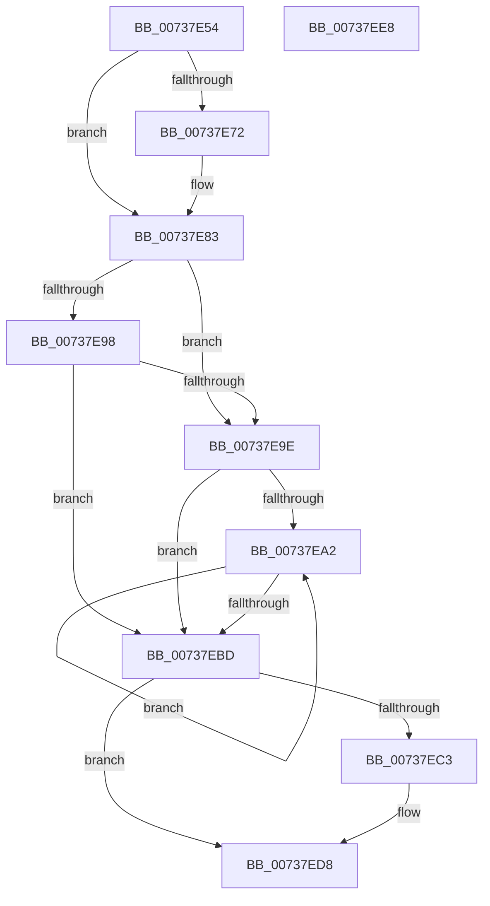

# PnpCollectOpenHandles

- RVA: `0x00737E54`–`0x00737EE9` (길이 `149` bytes)
- VA: `0x0000000140737E54`
- 실행 섹션: `PAGE`
- PDB 이름 있음: `예`; PDB Function 태그: `아니요`
- unwind 정보 RVA: `0x00060BC4`
- 디코드: `42`개 명령, `149/149` bytes 표시
- 미해석 바이트: `0` (있으면 어셈블리에 `.byte`로 보존)

> 이 문서는 커널 이미지의 기계어와 PDB 기호를 분석해 생성했습니다. 4번과 5번은 함수 원형과 자료형을 바이너리 사용 방식에서 추정한 C 해석이며 원본 소스 복구 결과는 아닙니다.

## 1. Dependencies

- 직접 호출 지점: **3**; 고유 호출 대상: **2**
- 직접 호출자로 확인된 함수: **1**
- RIP 상대 이미지 참조: **2**

### Outgoing calls
- `0x00737E7E` → [IopDebugPrint](../../text/5A/IopDebugPrint_function_005A68F8.md) (function, `0x005A68F8`)
- `0x00737EAE` → [PnpHandleEnumerateHandlesAgainstPdoStack](../../text/4C/PnpHandleEnumerateHandlesAgainstPdoStack_function_004C8F94.md) (function, `0x004C8F94`)
- `0x00737ED3` → [IopDebugPrint](../../text/5A/IopDebugPrint_function_005A68F8.md) (function, `0x005A68F8`)

### Direct callers
- [PipSendQueryRemoveIrpAndCheckOpenHandles](../74/PipSendQueryRemoveIrpAndCheckOpenHandles_function_007443E8.md) at `0x0074451D`
- [PipSendQueryRemoveIrpAndCheckOpenHandles](../74/PipSendQueryRemoveIrpAndCheckOpenHandles_function_007443E8.md) at `0x007445A7`

### Static image references
- `0x00737E72` → RVA `0x00AFF850` (` ?? ::NNGAKEGL::`string'`; read)
- `0x00737EC7` → RVA `0x00AFF710` (` ?? ::NNGAKEGL::`string'`; read)

## 2. Other-region calls and transfers

- 다른 실행 섹션으로 향하는 call: **3**
  - `0x00737E7E` → [IopDebugPrint](../../text/5A/IopDebugPrint_function_005A68F8.md) (`PAGE` → `.text`)
  - `0x00737EAE` → [PnpHandleEnumerateHandlesAgainstPdoStack](../../text/4C/PnpHandleEnumerateHandlesAgainstPdoStack_function_004C8F94.md) (`PAGE` → `.text`)
  - `0x00737ED3` → [IopDebugPrint](../../text/5A/IopDebugPrint_function_005A68F8.md) (`PAGE` → `.text`)
- 별도 외부 분기/꼬리 이동을 확인하지 못했습니다.

## 3. Assembly (complete function range)

```asm
00737E54  48 89 5C 24 08                  mov qword ptr [rsp + 8], rbx
00737E59  48 89 74 24 10                  mov qword ptr [rsp + 0x10], rsi
00737E5E  57                              push rdi
00737E5F  48 83 EC 20                     sub rsp, 0x20
00737E63  41 80 78 24 00                  cmp byte ptr [r8 + 0x24], 0
00737E68  49 8B D8                        mov rbx, r8
00737E6B  8B F2                           mov esi, edx
00737E6D  48 8B F9                        mov rdi, rcx
00737E70  74 11                           je 0x140737e83
00737E72  48 8D 15 D7 79 3C 00            lea rdx, [rip + 0x3c79d7]
00737E79  B9 14 00 00 00                  mov ecx, 0x14
00737E7E  E8 75 EA E6 FF                  call 0x1405a68f8
00737E83  83 63 20 00                     and dword ptr [rbx + 0x20], 0
00737E87  48 8D 43 10                     lea rax, [rbx + 0x10]
00737E8B  48 89 40 08                     mov qword ptr [rax + 8], rax
00737E8F  48 89 00                        mov qword ptr [rax], rax
00737E92  80 7B 24 00                     cmp byte ptr [rbx + 0x24], 0
00737E96  75 06                           jne 0x140737e9e
00737E98  80 7B 25 00                     cmp byte ptr [rbx + 0x25], 0
00737E9C  74 1F                           je 0x140737ebd
00737E9E  85 F6                           test esi, esi
00737EA0  74 1B                           je 0x140737ebd
00737EA2  48 8B 07                        mov rax, qword ptr [rdi]
00737EA5  4C 8B C3                        mov r8, rbx
00737EA8  48 89 03                        mov qword ptr [rbx], rax
00737EAB  48 8B 0F                        mov rcx, qword ptr [rdi]
00737EAE  E8 E1 10 D9 FF                  call 0x1404c8f94
00737EB3  48 8D 7F 08                     lea rdi, [rdi + 8]
00737EB7  48 83 EE 01                     sub rsi, 1
00737EBB  75 E5                           jne 0x140737ea2
00737EBD  80 7B 24 00                     cmp byte ptr [rbx + 0x24], 0
00737EC1  74 15                           je 0x140737ed8
00737EC3  44 8B 43 20                     mov r8d, dword ptr [rbx + 0x20]
00737EC7  48 8D 15 42 78 3C 00            lea rdx, [rip + 0x3c7842]
00737ECE  B9 14 00 00 00                  mov ecx, 0x14
00737ED3  E8 20 EA E6 FF                  call 0x1405a68f8
00737ED8  48 8B 5C 24 30                  mov rbx, qword ptr [rsp + 0x30]
00737EDD  48 8B 74 24 38                  mov rsi, qword ptr [rsp + 0x38]
00737EE2  48 83 C4 20                     add rsp, 0x20
00737EE6  5F                              pop rdi
00737EE7  C3                              ret
00737EE8  CC                              int3
```

## 4. C-style interpretation (structured pseudocode)

```c
__int64 __fastcall PnpCollectOpenHandles(__int64 a1, int a2, __int64 a3)
{
    __int64 result;
    __int64 v_rsi;
    __int64 v_rsp;
    unsigned __int64 v_stack_p10;
    unsigned __int64 v_stack_p8;

    v_stack_p8 = v_rbx;
    v_stack_p10 = v_rsi;
    v_rsp = (v_rsp) - (32);
    if ((*(unsigned __int8 *)(a3 + 36)) != 0) {
        a2 = v_rip + 3963351;
        a1 = 20;
        result = IopDebugPrint(a1, a2, a3, a4);
    }
    *(unsigned __int64 *)(a3 + 16 + 8) = a3 + 16;
    *(unsigned __int64 *)(a3 + 16) = a3 + 16;
    if ((*(unsigned __int8 *)(a3 + 36)) != 0) goto loc_00737E9E;
    if ((*(unsigned __int8 *)(a3 + 37)) == 0) goto loc_00737EBD;
loc_00737E9E:
    if ((unsigned int)((unsigned int)(a2)) == 0) goto loc_00737EBD;
loc_00737EA2:
    *(unsigned __int64 *)(a3) = *(unsigned __int64 *)(a1);
    result = PnpHandleEnumerateHandlesAgainstPdoStack(*(unsigned __int64 *)(a1), a2, a3, a4);
    v_rsi = ((unsigned int)(a2)) - (1);
    if (condition_is_not_equal) goto loc_00737EA2;
loc_00737EBD:
    if ((*(unsigned __int8 *)(a3 + 36)) != 0) {
        a3 = *(unsigned int *)(a3 + 32);
        a2 = v_rip + 3962946;
        a1 = 20;
        result = IopDebugPrint(a1, a2, a3, a4);
    }
    v_rsp = (v_rsp) + (32);
    return result;
}
```

## 5. (Beta) C Style

```c
int64_t PnpCollectOpenHandles(void *Arg1, int32_t Arg2, void *Arg3)
{
    uint8_t *arg1 = (uint8_t *)Arg1;
    uint8_t *arg3 = (uint8_t *)Arg3;

    int64_t result;
    int64_t local_rsi;
    int64_t local_rsp;
    uint64_t v_stack_p10;
    uint64_t v_stack_p8;

    v_stack_p8 = local_rbx;
    v_stack_p10 = local_rsi;
    local_rsp = (local_rsp) - (32);
    if ((*(uint8_t *)(arg3 + 0x24)) != 0) {
        Arg2 = v_rip + 3963351;
        Arg1 = 20;
        result = IopDebugPrint(Arg1, Arg2, Arg3, a4);
    }
    *(void **)(arg3 + 0x10 + 0x8) = Arg3 + 16;
    *(void **)(arg3 + 0x10) = Arg3 + 16;
    if ((*(uint8_t *)(arg3 + 0x24)) != 0) goto loc_00737E9E;
    if ((*(uint8_t *)(arg3 + 0x25)) == 0) goto loc_00737EBD;
loc_00737E9E:
    if ((uint32_t)((uint32_t)(Arg2)) == 0) goto loc_00737EBD;
loc_00737EA2:
    *(uint64_t *)(arg3) = *(uint64_t *)(arg1);
    result = PnpHandleEnumerateHandlesAgainstPdoStack(*(uint64_t *)(arg1), Arg2, Arg3, a4);
    local_rsi = ((uint32_t)(Arg2)) - (1);
    if (condition_is_not_equal) goto loc_00737EA2;
loc_00737EBD:
    if ((*(uint8_t *)(arg3 + 0x24)) != 0) {
        Arg3 = *(uint32_t *)(arg3 + 0x20);
        Arg2 = v_rip + 3962946;
        Arg1 = 20;
        result = IopDebugPrint(Arg1, Arg2, Arg3, a4);
    }
    local_rsp = (local_rsp) + (32);
    return result;
}
```

### 관측된 메모리 오프셋

구조체 형식이 확인되지 않은 접근은 인자 기준의 오프셋으로만 기록했습니다.

| 기준 인자 | 오프셋 표현 | 폭 (bit) | 접근 |
|---|---:|---:|---|
| `Arg1` | `+ 0x0` | `64` | `R` |
| `Arg1` | `+ 0x8` | `64` | `R` |
| `Arg3` | `+ 0x0` | `64` | `W` |
| `Arg3` | `+ 0x8` | `64` | `W` |
| `Arg3` | `+ 0x10` | `64` | `R` |
| `Arg3` | `+ 0x20` | `32` | `R` |
| `Arg3` | `+ 0x20` | `32` | `R/W` |
| `Arg3` | `+ 0x24` | `8` | `R` |
| `Arg3` | `+ 0x25` | `8` | `R` |

## 6. Execution-region graph

[열기: 2D/3D 그래프와 함수 탐색 컨트롤 패널](../../../control-panel.html?section=page&rva=0x00737E54&view=graph)

- 2D 그래프는 위에서 아래로 흐르고, 3D 그래프는 빈 공간을 드래그해 회전합니다. Shift+드래그는 이동, 휠은 확대·축소, 함수 노드 선택은 대상 보고서 이동입니다.

### Static fallback


