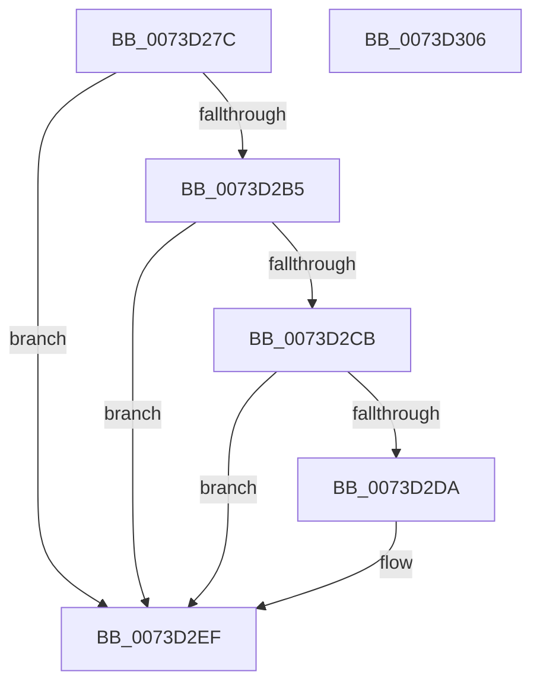

# PnpCompareMultiSz

- RVA: `0x0073D27C`–`0x0073D307` (길이 `139` bytes)
- VA: `0x000000014073D27C`
- 실행 섹션: `PAGE`
- PDB 이름 있음: `예`; PDB Function 태그: `아니요`
- unwind 정보 RVA: `0x0007D3C0`
- 디코드: `41`개 명령, `139/139` bytes 표시
- 미해석 바이트: `0` (있으면 어셈블리에 `.byte`로 보존)

> 이 문서는 커널 이미지의 기계어와 PDB 기호를 분석해 생성했습니다. 4번과 5번은 함수 원형과 자료형을 바이너리 사용 방식에서 추정한 C 해석이며 원본 소스 복구 결과는 아닙니다.

## 1. Dependencies

- 직접 호출 지점: **3**; 고유 호출 대상: **2**
- 직접 호출자로 확인된 함수: **4**
- RIP 상대 이미지 참조: **0**

### Outgoing calls
- `0x0073D2AC` → [PnpGetMultiSzLength](../94/PnpGetMultiSzLength_function_0094E690.md) (function, `0x0094E690`)
- `0x0073D2C2` → [PnpGetMultiSzLength](../94/PnpGetMultiSzLength_function_0094E690.md) (function, `0x0094E690`)
- `0x0073D2E5` → [RtlCompareUnicodeStrings](../97/RtlCompareUnicodeStrings_function_009727E0.md) (function, `0x009727E0`)

### Direct callers
- [PipMatchPersistentMemory](../72/PipMatchPersistentMemory_function_0072594C.md) at `0x007259F0`
- [PipMatchPersistentMemoryV1](../72/PipMatchPersistentMemoryV1_function_00725A30.md) at `0x00725A8C`
- [PiSwDoesCreateChangesRequireReEnum](../AA/PiSwDoesCreateChangesRequireReEnum_function_00AAE658.md) at `0x00AAE758`
- [PiSwDoesCreateChangesRequireReEnum](../AA/PiSwDoesCreateChangesRequireReEnum_function_00AAE658.md) at `0x00AAE77B`
- [PiCreateDriverSwDeviceCallback](../AB/PiCreateDriverSwDeviceCallback_function_00ABB420.md) at `0x00ABB97C`

### Static image references
- 디코드된 RIP-relative 메모리 참조가 없습니다.

## 2. Other-region calls and transfers

- 다른 실행 섹션으로 향하는 call: **0**
- 별도 외부 분기/꼬리 이동을 확인하지 못했습니다.

## 3. Assembly (complete function range)

```asm
0073D27C  48 8B C4                        mov rax, rsp
0073D27F  48 89 58 08                     mov qword ptr [rax + 8], rbx
0073D283  48 89 68 10                     mov qword ptr [rax + 0x10], rbp
0073D287  48 89 70 18                     mov qword ptr [rax + 0x18], rsi
0073D28B  57                              push rdi
0073D28C  48 83 EC 40                     sub rsp, 0x40
0073D290  48 8B FA                        mov rdi, rdx
0073D293  33 DB                           xor ebx, ebx
0073D295  41 8A E8                        mov bpl, r8b
0073D298  48 89 58 20                     mov qword ptr [rax + 0x20], rbx
0073D29C  4C 8D 40 20                     lea r8, [rax + 0x20]
0073D2A0  48 89 58 E8                     mov qword ptr [rax - 0x18], rbx
0073D2A4  BA FF FF FF 7F                  mov edx, 0x7fffffff
0073D2A9  48 8B F1                        mov rsi, rcx
0073D2AC  E8 DF 13 21 00                  call 0x14094e690
0073D2B1  85 C0                           test eax, eax
0073D2B3  78 3A                           js 0x14073d2ef
0073D2B5  4C 8D 44 24 30                  lea r8, [rsp + 0x30]
0073D2BA  BA FF FF FF 7F                  mov edx, 0x7fffffff
0073D2BF  48 8B CF                        mov rcx, rdi
0073D2C2  E8 C9 13 21 00                  call 0x14094e690
0073D2C7  85 C0                           test eax, eax
0073D2C9  78 24                           js 0x14073d2ef
0073D2CB  48 8B 54 24 68                  mov rdx, qword ptr [rsp + 0x68]
0073D2D0  4C 8B 4C 24 30                  mov r9, qword ptr [rsp + 0x30]
0073D2D5  49 3B D1                        cmp rdx, r9
0073D2D8  75 15                           jne 0x14073d2ef
0073D2DA  4C 8B C7                        mov r8, rdi
0073D2DD  40 88 6C 24 20                  mov byte ptr [rsp + 0x20], bpl
0073D2E2  48 8B CE                        mov rcx, rsi
0073D2E5  E8 F6 54 23 00                  call 0x1409727e0
0073D2EA  85 C0                           test eax, eax
0073D2EC  0F 94 C3                        sete bl
0073D2EF  48 8B 6C 24 58                  mov rbp, qword ptr [rsp + 0x58]
0073D2F4  8A C3                           mov al, bl
0073D2F6  48 8B 5C 24 50                  mov rbx, qword ptr [rsp + 0x50]
0073D2FB  48 8B 74 24 60                  mov rsi, qword ptr [rsp + 0x60]
0073D300  48 83 C4 40                     add rsp, 0x40
0073D304  5F                              pop rdi
0073D305  C3                              ret
0073D306  CC                              int3
```

## 4. C-style interpretation (structured pseudocode)

```c
__int64 __fastcall PnpCompareMultiSz(__int64 a1, __int64 a2, unsigned __int8 a3)
{
    __int64 result;
    __int64 v_rbx;
    __int64 v_rsp;
    unsigned __int64 v_stack_m18;
    unsigned __int8 v_stack_m28;
    unsigned __int64 v_stack_p10;
    unsigned __int64 v_stack_p18;
    unsigned __int64 v_stack_p20;
    unsigned __int64 v_stack_p8;

    *(unsigned __int64 *)(v_rsp + 8) = v_rbx;
    *(unsigned __int64 *)(v_rsp + 16) = v_rbp;
    *(unsigned __int64 *)(v_rsp + 24) = v_rsi;
    v_rsp = (v_rsp) - (64);
    v_rbx = 0;
    *(unsigned __int64 *)(v_rsp + 32) = 0;
    *(unsigned __int64 *)(v_rsp - 24) = 0;
    result = PnpGetMultiSzLength(a1, (unsigned int)(0x7FFFFFFFULL), v_rsp + 32, a4);
    if (sign_flag) goto loc_0073D2EF;
    result = PnpGetMultiSzLength(a2, (unsigned int)(0x7FFFFFFFULL), v_stack_m18, a4);
    if (sign_flag) goto loc_0073D2EF;
    if (v_stack_p20 == v_stack_m18) {
        a3 = a2;
        v_stack_m28 = a3;
        a1 = a1;
        result = RtlCompareUnicodeStrings(a1, v_stack_p20, a3, v_stack_m18);
        v_rbx = ((unsigned int)(result) == 0) ? 1 : 0;
    }
    v_rsp = (v_rsp) + (64);
    return (unsigned __int8)(v_rbx);
}
```

## 5. (Beta) C Style

```c
int64_t PnpCompareMultiSz(int64_t Arg1, int64_t Arg2, uint8_t Arg3)
{
    int64_t result;
    int64_t local_rbx;
    int64_t local_rsp;
    uint64_t v_stack_m18;
    uint8_t v_stack_m28;
    uint64_t v_stack_p10;
    uint64_t v_stack_p18;
    uint64_t v_stack_p20;
    uint64_t v_stack_p8;

    *(uint64_t *)(local_rsp + 0x8) = local_rbx;
    *(uint64_t *)(local_rsp + 0x10) = local_rbp;
    *(uint64_t *)(local_rsp + 0x18) = local_rsi;
    local_rsp = (local_rsp) - (64);
    local_rbx = 0;
    *(uint64_t *)(local_rsp + 0x20) = 0;
    *(uint64_t *)(local_rsp - 0x18) = 0;
    result = PnpGetMultiSzLength(Arg1, (uint32_t)(0x7FFFFFFFULL), local_rsp + 32, a4);
    if (sign_flag) goto loc_0073D2EF;
    result = PnpGetMultiSzLength(Arg2, (uint32_t)(0x7FFFFFFFULL), v_stack_m18, a4);
    if (sign_flag) goto loc_0073D2EF;
    if (v_stack_p20 == v_stack_m18) {
        Arg3 = Arg2;
        v_stack_m28 = Arg3;
        Arg1 = Arg1;
        result = RtlCompareUnicodeStrings(Arg1, v_stack_p20, Arg3, v_stack_m18);
        local_rbx = ((uint32_t)(result) == 0) ? 1 : 0;
    }
    local_rsp = (local_rsp) + (64);
    return (uint8_t)(local_rbx);
}
```

## 6. Execution-region graph

[열기: 2D/3D 그래프와 함수 탐색 컨트롤 패널](../../../control-panel.html?section=page&rva=0x0073D27C&view=graph)

- 2D 그래프는 위에서 아래로 흐르고, 3D 그래프는 빈 공간을 드래그해 회전합니다. Shift+드래그는 이동, 휠은 확대·축소, 함수 노드 선택은 대상 보고서 이동입니다.

### Static fallback


