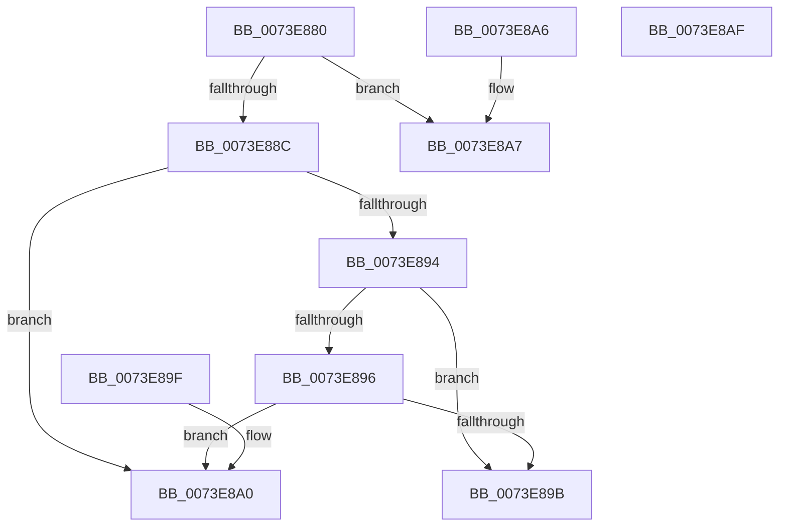

# PnpCompareResourceRequestPriority

- RVA: `0x0073E880`–`0x0073E8B0` (길이 `48` bytes)
- VA: `0x000000014073E880`
- 실행 섹션: `PAGE`
- PDB 이름 있음: `예`; PDB Function 태그: `아니요`
- unwind 정보 RVA: `0x000DB714`
- 디코드: `21`개 명령, `48/48` bytes 표시
- 미해석 바이트: `0` (있으면 어셈블리에 `.byte`로 보존)

> 이 문서는 커널 이미지의 기계어와 PDB 기호를 분석해 생성했습니다. 4번과 5번은 함수 원형과 자료형을 바이너리 사용 방식에서 추정한 C 해석이며 원본 소스 복구 결과는 아닙니다.

## 1. Dependencies

- 직접 호출 지점: **0**; 고유 호출 대상: **0**
- 직접 호출자로 확인된 함수: **0**
- RIP 상대 이미지 참조: **0**

### Outgoing calls
- 직접 디코드된 call 명령이 없습니다.

### Direct callers
- 이 함수 시작 RVA로 연결되는 직접 call은 확인되지 않았습니다. 간접 호출은 완전히 역산할 수 없습니다.

### Static image references
- 디코드된 RIP-relative 메모리 참조가 없습니다.

## 2. Other-region calls and transfers

- 다른 실행 섹션으로 향하는 call: **0**
- 별도 외부 분기/꼬리 이동을 확인하지 못했습니다.

## 3. Assembly (complete function range)

```asm
0073E880  8B 41 10                        mov eax, dword ptr [rcx + 0x10]
0073E883  44 8B 42 10                     mov r8d, dword ptr [rdx + 0x10]
0073E887  44 3B C0                        cmp r8d, eax
0073E88A  75 1B                           jne 0x14073e8a7
0073E88C  8B 41 14                        mov eax, dword ptr [rcx + 0x14]
0073E88F  3B 42 14                        cmp eax, dword ptr [rdx + 0x14]
0073E892  77 0C                           ja 0x14073e8a0
0073E894  72 05                           jb 0x14073e89b
0073E896  48 3B CA                        cmp rcx, rdx
0073E899  73 05                           jae 0x14073e8a0
0073E89B  83 C8 FF                        or eax, 0xffffffff
0073E89E  C3                              ret
0073E89F  CC                              int3
0073E8A0  B8 01 00 00 00                  mov eax, 1
0073E8A5  C3                              ret
0073E8A6  CC                              int3
0073E8A7  1B C0                           sbb eax, eax
0073E8A9  83 E0 02                        and eax, 2
0073E8AC  FF C8                           dec eax
0073E8AE  C3                              ret
0073E8AF  CC                              int3
```

## 4. C-style interpretation (structured pseudocode)

```c
__int64 __fastcall PnpCompareResourceRequestPriority(__int64 a1, __int64 a2)
{
    __int64 result;

    if (((unsigned int)((unsigned int)(*(unsigned int *)(a2 + 16)))) != ((unsigned int)((unsigned int)(*(unsigned int *)(a1 + 16))))) goto loc_0073E8A7;
    if (((unsigned int)((unsigned int)(*(unsigned int *)(a1 + 20)))) > (*(unsigned int *)(a2 + 20))) goto loc_0073E8A0;
    if (((unsigned int)((unsigned int)(*(unsigned int *)(a1 + 20)))) < (*(unsigned int *)(a2 + 20))) goto loc_0073E89B;
    if (a1 >= a2) goto loc_0073E8A0;
loc_0073E89B:
    result = (unsigned int)(((unsigned int)(*(unsigned int *)(a1 + 20))) | (0xFFFFFFFFULL));
    return result;
loc_0073E8A0:
    return 1;
loc_0073E8A7:
    result = (unsigned int)((1) & (2));
    result = (unsigned int)((result) - 1);
    return result;
}
```

## 5. (Beta) C Style

```c
int64_t PnpCompareResourceRequestPriority(void *Arg1, void *Arg2)
{
    uint8_t *arg1 = (uint8_t *)Arg1;
    uint8_t *arg2 = (uint8_t *)Arg2;

    int64_t result;

    if (((uint32_t)((uint32_t)(*(uint32_t *)(arg2 + 0x10)))) != ((uint32_t)((uint32_t)(*(uint32_t *)(arg1 + 0x10))))) goto loc_0073E8A7;
    if (((uint32_t)((uint32_t)(*(uint32_t *)(arg1 + 0x14)))) > (*(uint32_t *)(arg2 + 0x14))) goto loc_0073E8A0;
    if (((uint32_t)((uint32_t)(*(uint32_t *)(arg1 + 0x14)))) < (*(uint32_t *)(arg2 + 0x14))) goto loc_0073E89B;
    if (Arg1 >= Arg2) goto loc_0073E8A0;
loc_0073E89B:
    result = (uint32_t)(((uint32_t)(*(uint32_t *)(arg1 + 0x14))) | (0xFFFFFFFFULL));
    return result;
loc_0073E8A0:
    return 1;
loc_0073E8A7:
    result = (uint32_t)((1) & (2));
    result = (uint32_t)((result) - 1);
    return result;
}
```

### 관측된 메모리 오프셋

구조체 형식이 확인되지 않은 접근은 인자 기준의 오프셋으로만 기록했습니다.

| 기준 인자 | 오프셋 표현 | 폭 (bit) | 접근 |
|---|---:|---:|---|
| `Arg1` | `+ 0x10` | `32` | `R` |
| `Arg1` | `+ 0x14` | `32` | `R` |
| `Arg2` | `+ 0x10` | `32` | `R` |
| `Arg2` | `+ 0x14` | `32` | `R` |

## 6. Execution-region graph

[열기: 2D/3D 그래프와 함수 탐색 컨트롤 패널](../../../control-panel.html?section=page&rva=0x0073E880&view=graph)

- 2D 그래프는 위에서 아래로 흐르고, 3D 그래프는 빈 공간을 드래그해 회전합니다. Shift+드래그는 이동, 휠은 확대·축소, 함수 노드 선택은 대상 보고서 이동입니다.

### Static fallback


