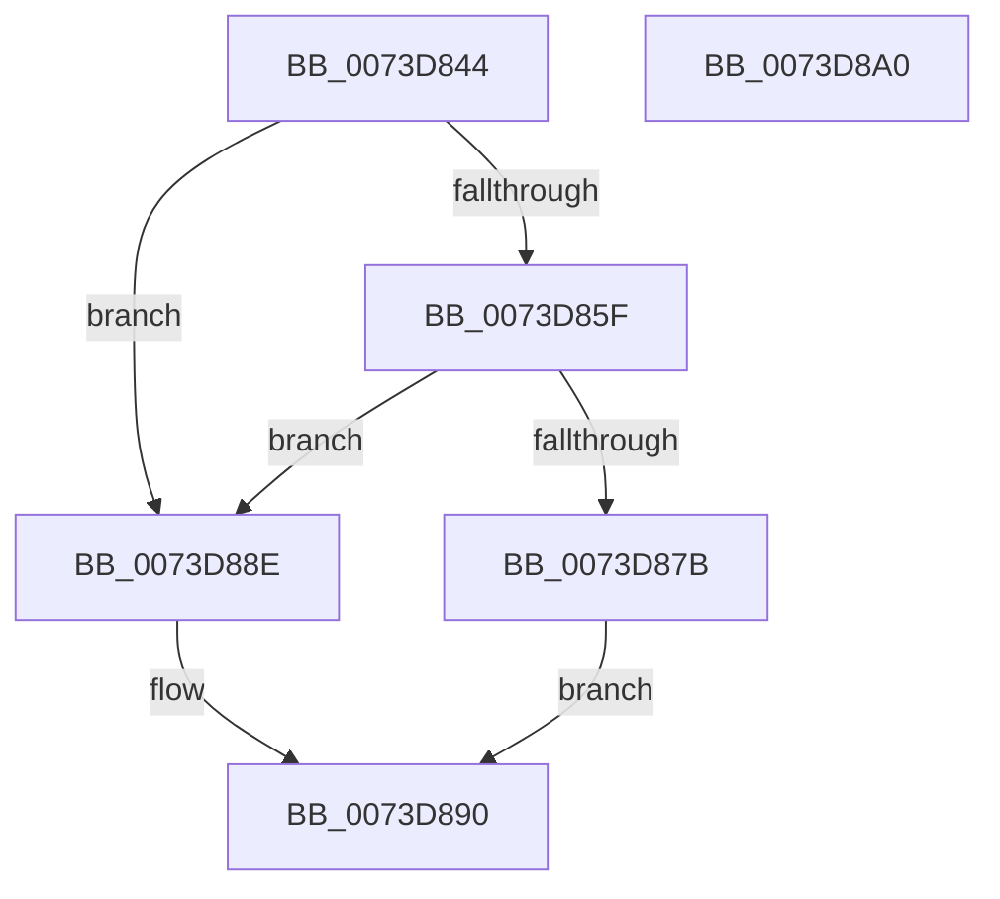

# PnpCopyResourceList

- RVA: `0x0073D844`–`0x0073D8A1` (길이 `93` bytes)
- VA: `0x000000014073D844`
- 실행 섹션: `PAGE`
- PDB 이름 있음: `예`; PDB Function 태그: `아니요`
- unwind 정보 RVA: `0x00060BC4`
- 디코드: `29`개 명령, `93/93` bytes 표시
- 미해석 바이트: `0` (있으면 어셈블리에 `.byte`로 보존)

> 이 문서는 커널 이미지의 기계어와 PDB 기호를 분석해 생성했습니다. 4번과 5번은 함수 원형과 자료형을 바이너리 사용 방식에서 추정한 C 해석이며 원본 소스 복구 결과는 아닙니다.

## 1. Dependencies

- 직접 호출 지점: **3**; 고유 호출 대상: **3**
- 직접 호출자로 확인된 함수: **1**
- RIP 상대 이미지 참조: **0**

### Outgoing calls
- `0x0073D856` → [PnpDetermineResourceListSize](../8F/PnpDetermineResourceListSize_function_008FC6F8.md) (function, `0x008FC6F8`)
- `0x0073D86E` → [ExAllocatePool2](../../poolcode/B8/ExAllocatePool2_function_00B820F0.md) (function, `0x00B820F0`)
- `0x0073D884` → [memcpy](../../text/6C/memcpy_function_006C6840.md) (function, `0x006C6840`)

### Direct callers
- [PiUpdateDeviceResourceLists](../74/PiUpdateDeviceResourceLists_function_007406BC.md) at `0x0074072B`
- [PiUpdateDeviceResourceLists](../74/PiUpdateDeviceResourceLists_function_007406BC.md) at `0x00740744`

### Static image references
- 디코드된 RIP-relative 메모리 참조가 없습니다.

## 2. Other-region calls and transfers

- 다른 실행 섹션으로 향하는 call: **2**
  - `0x0073D86E` → [ExAllocatePool2](../../poolcode/B8/ExAllocatePool2_function_00B820F0.md) (`PAGE` → `POOLCODE`)
  - `0x0073D884` → [memcpy](../../text/6C/memcpy_function_006C6840.md) (`PAGE` → `.text`)
- 별도 외부 분기/꼬리 이동을 확인하지 못했습니다.

## 3. Assembly (complete function range)

```asm
0073D844  48 89 5C 24 08                  mov qword ptr [rsp + 8], rbx
0073D849  48 89 74 24 10                  mov qword ptr [rsp + 0x10], rsi
0073D84E  57                              push rdi
0073D84F  48 83 EC 20                     sub rsp, 0x20
0073D853  48 8B F9                        mov rdi, rcx
0073D856  E8 9D EE 1B 00                  call 0x1408fc6f8
0073D85B  85 C0                           test eax, eax
0073D85D  74 2F                           je 0x14073d88e
0073D85F  41 B8 50 6E 70 36               mov r8d, 0x36706e50
0073D865  8B D0                           mov edx, eax
0073D867  B9 00 01 00 00                  mov ecx, 0x100
0073D86C  8B F0                           mov esi, eax
0073D86E  E8 7D 48 44 00                  call 0x140b820f0
0073D873  48 8B D8                        mov rbx, rax
0073D876  48 85 C0                        test rax, rax
0073D879  74 13                           je 0x14073d88e
0073D87B  44 8B C6                        mov r8d, esi
0073D87E  48 8B D7                        mov rdx, rdi
0073D881  48 8B C8                        mov rcx, rax
0073D884  E8 B7 8F F8 FF                  call 0x1406c6840
0073D889  48 8B C3                        mov rax, rbx
0073D88C  EB 02                           jmp 0x14073d890
0073D88E  33 C0                           xor eax, eax
0073D890  48 8B 5C 24 30                  mov rbx, qword ptr [rsp + 0x30]
0073D895  48 8B 74 24 38                  mov rsi, qword ptr [rsp + 0x38]
0073D89A  48 83 C4 20                     add rsp, 0x20
0073D89E  5F                              pop rdi
0073D89F  C3                              ret
0073D8A0  CC                              int3
```

## 4. C-style interpretation (structured pseudocode)

```c
__int64 __fastcall PnpCopyResourceList(__int64 a1)
{
    __int64 result;
    __int64 v_rsp;
    unsigned __int64 v_stack_p10;
    unsigned __int64 v_stack_p8;

    v_stack_p8 = v_rbx;
    v_stack_p10 = v_rsi;
    v_rsp = (v_rsp) - (32);
    result = PnpDetermineResourceListSize(a1, a2, a3, a4);
    if ((unsigned int)(result) == 0) goto loc_0073D88E;
    result = ExAllocatePool2(256, (unsigned int)((unsigned int)(result)), (unsigned int)(0x36706E50ULL), a4);
    if (result == 0) goto loc_0073D88E;
    result = memcpy(result, a1, (unsigned int)((unsigned int)((unsigned int)((unsigned int)(result)))), a4);
    goto loc_0073D890;
loc_0073D88E:
    result = 0;
loc_0073D890:
    v_rsp = (v_rsp) + (32);
    return result;
}
```

## 5. (Beta) C Style

```c
int64_t PnpCopyResourceList(int64_t Arg1)
{
    int64_t result;
    int64_t local_rsp;
    uint64_t v_stack_p10;
    uint64_t v_stack_p8;

    v_stack_p8 = local_rbx;
    v_stack_p10 = local_rsi;
    local_rsp = (local_rsp) - (32);
    result = PnpDetermineResourceListSize(Arg1, a2, a3, a4);
    if ((uint32_t)(result) == 0) goto loc_0073D88E;
    result = ExAllocatePool2(256, (uint32_t)((uint32_t)(result)), (uint32_t)(0x36706E50ULL), a4);
    if (result == 0) goto loc_0073D88E;
    result = memcpy(result, Arg1, (uint32_t)((uint32_t)((uint32_t)((uint32_t)(result)))), a4);
    goto loc_0073D890;
loc_0073D88E:
    result = 0;
loc_0073D890:
    local_rsp = (local_rsp) + (32);
    return result;
}
```

## 6. Execution-region graph

[열기: 2D/3D 그래프와 함수 탐색 컨트롤 패널](../../../control-panel.html?section=page&rva=0x0073D844&view=graph)

- 2D 그래프는 위에서 아래로 흐르고, 3D 그래프는 빈 공간을 드래그해 회전합니다. Shift+드래그는 이동, 휠은 확대·축소, 함수 노드 선택은 대상 보고서 이동입니다.

### Static fallback


