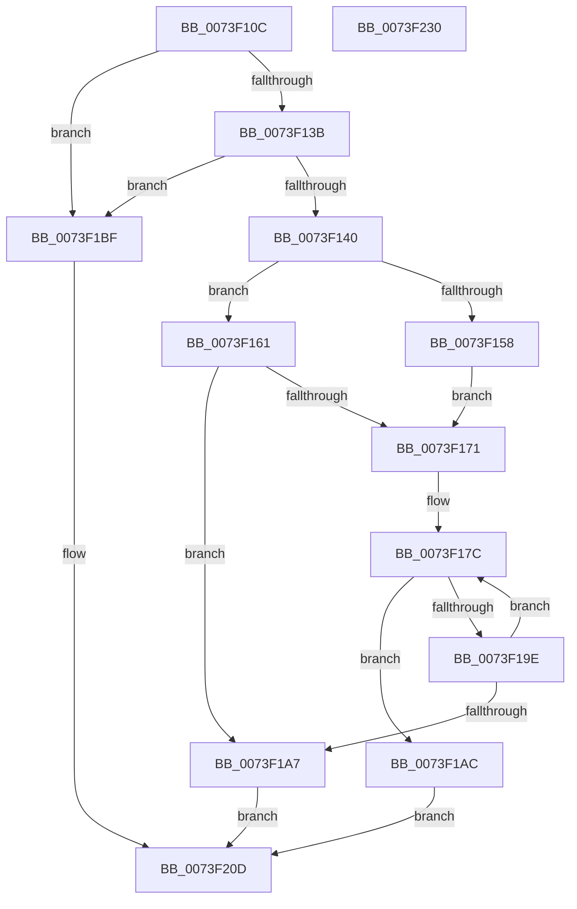

# PnpFindRebalanceCandidates

- RVA: `0x0073F10C`–`0x0073F231` (길이 `293` bytes)
- VA: `0x000000014073F10C`
- 실행 섹션: `PAGE`
- PDB 이름 있음: `예`; PDB Function 태그: `아니요`
- unwind 정보 RVA: `0x0008C20C`
- 디코드: `78`개 명령, `293/293` bytes 표시
- 미해석 바이트: `0` (있으면 어셈블리에 `.byte`로 보존)

> 이 문서는 커널 이미지의 기계어와 PDB 기호를 분석해 생성했습니다. 4번과 5번은 함수 원형과 자료형을 바이너리 사용 방식에서 추정한 C 해석이며 원본 소스 복구 결과는 아닙니다.

## 1. Dependencies

- 직접 호출 지점: **2**; 고유 호출 대상: **1**
- 직접 호출자로 확인된 함수: **1**
- RIP 상대 이미지 참조: **1**

### Outgoing calls
- `0x0073F192` → [PnpQueryRebalance](PnpQueryRebalance_function_0073F238.md) (function, `0x0073F238`)
- `0x0073F1F7` → [PnpQueryRebalance](PnpQueryRebalance_function_0073F238.md) (function, `0x0073F238`)

### Direct callers
- [PnpRebalance](PnpRebalance_function_0073F508.md) at `0x0073F640`

### Static image references
- `0x0073F1EC` → RVA `0x00F8C438` (`.data`; read)

## 2. Other-region calls and transfers

- 다른 실행 섹션으로 향하는 call: **0**
- 별도 외부 분기/꼬리 이동을 확인하지 못했습니다.

## 3. Assembly (complete function range)

```asm
0073F10C  48 89 5C 24 08                  mov qword ptr [rsp + 8], rbx
0073F111  48 89 6C 24 10                  mov qword ptr [rsp + 0x10], rbp
0073F116  48 89 74 24 18                  mov qword ptr [rsp + 0x18], rsi
0073F11B  57                              push rdi
0073F11C  41 54                           push r12
0073F11E  41 55                           push r13
0073F120  41 56                           push r14
0073F122  41 57                           push r15
0073F124  48 83 EC 30                     sub rsp, 0x30
0073F128  8B E9                           mov ebp, ecx
0073F12A  4D 8B F1                        mov r14, r9
0073F12D  4D 8B F8                        mov r15, r8
0073F130  48 8B F2                        mov rsi, rdx
0073F133  85 C9                           test ecx, ecx
0073F135  0F 85 84 00 00 00               jne 0x14073f1bf
0073F13B  48 85 D2                        test rdx, rdx
0073F13E  74 7F                           je 0x14073f1bf
0073F140  48 8B BC 24 88 00 00 00         mov rdi, qword ptr [rsp + 0x88]
0073F148  48 89 57 30                     mov qword ptr [rdi + 0x30], rdx
0073F14C  81 BA 2C 01 00 00 0A 03 00 00   cmp dword ptr [rdx + 0x12c], 0x30a
0073F156  75 09                           jne 0x14073f161
0073F158  C7 47 0C 01 00 00 00            mov dword ptr [rdi + 0xc], 1
0073F15F  EB 10                           jmp 0x14073f171
0073F161  48 8B 72 10                     mov rsi, qword ptr [rdx + 0x10]
0073F165  C7 47 0C 02 00 00 00            mov dword ptr [rdi + 0xc], 2
0073F16C  48 85 F6                        test rsi, rsi
0073F16F  74 36                           je 0x14073f1a7
0073F171  8B 9C 24 80 00 00 00            mov ebx, dword ptr [rsp + 0x80]
0073F178  4C 8D 67 60                     lea r12, [rdi + 0x60]
0073F17C  89 5C 24 28                     mov dword ptr [rsp + 0x28], ebx
0073F180  4C 8D 4F 50                     lea r9, [rdi + 0x50]
0073F184  4D 8B C6                        mov r8, r14
0073F187  4C 89 64 24 20                  mov qword ptr [rsp + 0x20], r12
0073F18C  49 8B D7                        mov rdx, r15
0073F18F  48 8B CE                        mov rcx, rsi
0073F192  E8 A1 00 00 00                  call 0x14073f238
0073F197  3D 19 01 00 00                  cmp eax, 0x119
0073F19C  75 0E                           jne 0x14073f1ac
0073F19E  48 8B 76 10                     mov rsi, qword ptr [rsi + 0x10]
0073F1A2  48 85 F6                        test rsi, rsi
0073F1A5  75 D5                           jne 0x14073f17c
0073F1A7  48 8B DD                        mov rbx, rbp
0073F1AA  EB 61                           jmp 0x14073f20d
0073F1AC  C1 E8 1F                        shr eax, 0x1f
0073F1AF  48 8B DD                        mov rbx, rbp
0073F1B2  34 01                           xor al, 1
0073F1B4  88 44 3D 28                     mov byte ptr [rbp + rdi + 0x28], al
0073F1B8  48 89 74 EF 18                  mov qword ptr [rdi + rbp*8 + 0x18], rsi
0073F1BD  EB 4E                           jmp 0x14073f20d
0073F1BF  48 8B BC 24 88 00 00 00         mov rdi, qword ptr [rsp + 0x88]
0073F1C7  4D 8B C6                        mov r8, r14
0073F1CA  8B 84 24 80 00 00 00            mov eax, dword ptr [rsp + 0x80]
0073F1D1  49 8B D7                        mov rdx, r15
0073F1D4  89 44 24 28                     mov dword ptr [rsp + 0x28], eax
0073F1D8  48 8B DD                        mov rbx, rbp
0073F1DB  48 8D 4F 60                     lea rcx, [rdi + 0x60]
0073F1DF  48 8D 0C A9                     lea rcx, [rcx + rbp*4]
0073F1E3  48 89 4C 24 20                  mov qword ptr [rsp + 0x20], rcx
0073F1E8  4C 8D 4F 50                     lea r9, [rdi + 0x50]
0073F1EC  48 8B 0D 45 D2 84 00            mov rcx, qword ptr [rip + 0x84d245]
0073F1F3  4D 8D 0C E9                     lea r9, [r9 + rbp*8]
0073F1F7  E8 3C 00 00 00                  call 0x14073f238
0073F1FC  48 8B 05 35 D2 84 00            mov rax, qword ptr [rip + 0x84d235]
0073F203  48 89 44 EF 18                  mov qword ptr [rdi + rbp*8 + 0x18], rax
0073F208  C6 44 3D 28 01                  mov byte ptr [rbp + rdi + 0x28], 1
0073F20D  41 8B 06                        mov eax, dword ptr [r14]
0073F210  48 8B 6C 24 68                  mov rbp, qword ptr [rsp + 0x68]
0073F215  48 8B 74 24 70                  mov rsi, qword ptr [rsp + 0x70]
0073F21A  89 04 9F                        mov dword ptr [rdi + rbx*4], eax
0073F21D  48 8B 5C 24 60                  mov rbx, qword ptr [rsp + 0x60]
0073F222  48 83 C4 30                     add rsp, 0x30
0073F226  41 5F                           pop r15
0073F228  41 5E                           pop r14
0073F22A  41 5D                           pop r13
0073F22C  41 5C                           pop r12
0073F22E  5F                              pop rdi
0073F22F  C3                              ret
0073F230  CC                              int3
```

## 4. C-style interpretation (structured pseudocode)

```c
__int64 __fastcall PnpFindRebalanceCandidates(int a1, __int64 a2, __int64 a3, __int64 a4, unsigned int a5, __int64 a6)
{
    __int64 result;
    __int64 v_rsp;
    unsigned int v_stack_m30;
    unsigned __int64 v_stack_m38;
    unsigned __int64 v_stack_p10;
    unsigned __int64 v_stack_p18;
    unsigned __int64 v_stack_p8;

    v_stack_p8 = v_rbx;
    v_stack_p10 = v_rbp;
    v_stack_p18 = v_rsi;
    v_rsp = (v_rsp) - (48);
    if (a1 != 0) goto loc_0073F1BF;
    if (a2 == 0) goto loc_0073F1BF;
    *(unsigned __int64 *)(a6 + 48) = a2;
    if ((*(unsigned int *)(a2 + 300)) != 778) goto loc_0073F161;
    *(unsigned int *)(a6 + 12) = 1;
    goto loc_0073F171;
loc_0073F161:
    *(unsigned int *)(a6 + 12) = 2;
    if (*(unsigned __int64 *)(a2 + 16) == 0) goto loc_0073F1A7;
loc_0073F171:
loc_0073F17C:
    v_stack_m30 = (unsigned int)((unsigned int)(a5));
    v_stack_m38 = a6 + 96;
    result = PnpQueryRebalance(*(unsigned __int64 *)(a2 + 16), a3, a4, a6 + 80);
    if (((unsigned int)(result)) != 281) goto loc_0073F1AC;
    if (*(unsigned __int64 *)(*(unsigned __int64 *)(a2 + 16) + 16) != 0) goto loc_0073F17C;
loc_0073F1A7:
    goto loc_0073F20D;
loc_0073F1AC:
    result = (unsigned int)((result) >> (31));
    result = (unsigned __int8)((result) ^ (1));
    *(unsigned __int8 *)((unsigned int)(a1) + a6 * 1 + 40) = (unsigned __int8)(result);
    *(unsigned __int64 *)(a6 + (unsigned int)(a1) * 8 + 24) = *(unsigned __int64 *)(*(unsigned __int64 *)(a2 + 16) + 16);
    goto loc_0073F20D;
loc_0073F1BF:
    v_stack_m30 = (unsigned int)((unsigned int)(a5));
    v_stack_m38 = a6 + 96 + (unsigned int)(a1) * 4;
    result = PnpQueryRebalance(*(unsigned __int64 *)(v_rip + 8704581), a3, a4, a6 + 80 + (unsigned int)(a1) * 8);
    *(unsigned __int64 *)(a6 + (unsigned int)(a1) * 8 + 24) = *(unsigned __int64 *)(v_rip + 8704565);
    *(unsigned __int8 *)((unsigned int)(a1) + a6 * 1 + 40) = 1;
loc_0073F20D:
    *(unsigned int *)(a6 + (unsigned int)(a1) * 4) = (unsigned int)((unsigned int)(*(unsigned int *)(a4)));
    v_rsp = (v_rsp) + (48);
    return (unsigned int)(*(unsigned int *)(a4));
}
```

## 5. (Beta) C Style

```c
int64_t PnpFindRebalanceCandidates(void *Arg1, int64_t Arg2, int64_t Arg3, void *Arg4, uint32_t Arg5, void *Arg6)
{
    uint8_t *arg1 = (uint8_t *)Arg1;
    uint8_t *arg4 = (uint8_t *)Arg4;
    uint8_t *arg6 = (uint8_t *)Arg6;

    int64_t result;
    int64_t local_rsp;
    uint32_t v_stack_m30;
    uint64_t v_stack_m38;
    uint64_t v_stack_p10;
    uint64_t v_stack_p18;
    uint64_t v_stack_p8;

    v_stack_p8 = local_rbx;
    v_stack_p10 = local_rbp;
    v_stack_p18 = local_rsi;
    local_rsp = (local_rsp) - (48);
    if (Arg1 != NULL) goto loc_0073F1BF;
    if (Arg2 == 0) goto loc_0073F1BF;
    *(uint64_t *)(arg6 + 0x30) = Arg2;
    if ((*(uint32_t *)(Arg2 + 0x12C)) != 778) goto loc_0073F161;
    *(uint32_t *)(arg6 + 0xC) = 1;
    goto loc_0073F171;
loc_0073F161:
    *(uint32_t *)(arg6 + 0xC) = 2;
    if (*(uint64_t *)(Arg2 + 0x10) == 0) goto loc_0073F1A7;
loc_0073F171:
loc_0073F17C:
    v_stack_m30 = (uint32_t)((uint32_t)(Arg5));
    v_stack_m38 = Arg6 + 96;
    result = PnpQueryRebalance(*(uint64_t *)(Arg2 + 0x10), Arg3, Arg4, Arg6 + 80);
    if (((uint32_t)(result)) != 281) goto loc_0073F1AC;
    if (*(uint64_t *)(*(uint64_t *)(Arg2 + 0x10) + 0x10) != 0) goto loc_0073F17C;
loc_0073F1A7:
    goto loc_0073F20D;
loc_0073F1AC:
    result = (uint32_t)((result) >> (31));
    result = (uint8_t)((result) ^ (1));
    *(uint8_t *)((uint32_t)(arg1) + arg6 * 1 + 0x28) = (uint8_t)(result);
    *(uint64_t *)(arg6 + (uint32_t)(arg1) * 8 + 0x18) = *(uint64_t *)(*(uint64_t *)(Arg2 + 0x10) + 0x10);
    goto loc_0073F20D;
loc_0073F1BF:
    v_stack_m30 = (uint32_t)((uint32_t)(Arg5));
    v_stack_m38 = Arg6 + 96 + (uint32_t)(Arg1) * 4;
    result = PnpQueryRebalance(*(uint64_t *)(v_rip + 0x84D245), Arg3, Arg4, Arg6 + 80 + (uint32_t)(Arg1) * 8);
    *(uint64_t *)(arg6 + (uint32_t)(arg1) * 8 + 0x18) = *(uint64_t *)(v_rip + 0x84D235);
    *(uint8_t *)((uint32_t)(arg1) + arg6 * 1 + 0x28) = 1;
loc_0073F20D:
    *(uint32_t *)(arg6 + (uint32_t)(arg1) * 4) = (uint32_t)((uint32_t)(*(uint32_t *)(arg4)));
    local_rsp = (local_rsp) + (48);
    return (uint32_t)(*(uint32_t *)(arg4));
}
```

### 관측된 메모리 오프셋

구조체 형식이 확인되지 않은 접근은 인자 기준의 오프셋으로만 기록했습니다.

| 기준 인자 | 오프셋 표현 | 폭 (bit) | 접근 |
|---|---:|---:|---|
| `Arg1` | `+ 0x28 + rdi*1` | `8` | `W` |
| `Arg4` | `+ 0x0` | `32` | `R` |
| `Arg6` | `+ 0x0 + rbp*4` | `64` | `R` |
| `Arg6` | `+ 0x0 + rbp*8` | `64` | `R` |
| `Arg6` | `+ 0x0 + rbx*4` | `32` | `W` |
| `Arg6` | `+ 0xC` | `32` | `W` |
| `Arg6` | `+ 0x18 + rbp*8` | `64` | `W` |
| `Arg6` | `+ 0x30` | `64` | `W` |
| `Arg6` | `+ 0x50` | `64` | `R` |
| `Arg6` | `+ 0x60` | `64` | `R` |

## 6. Execution-region graph

[열기: 2D/3D 그래프와 함수 탐색 컨트롤 패널](../../../control-panel.html?section=page&rva=0x0073F10C&view=graph)

- 2D 그래프는 위에서 아래로 흐르고, 3D 그래프는 빈 공간을 드래그해 회전합니다. Shift+드래그는 이동, 휠은 확대·축소, 함수 노드 선택은 대상 보고서 이동입니다.

### Static fallback


